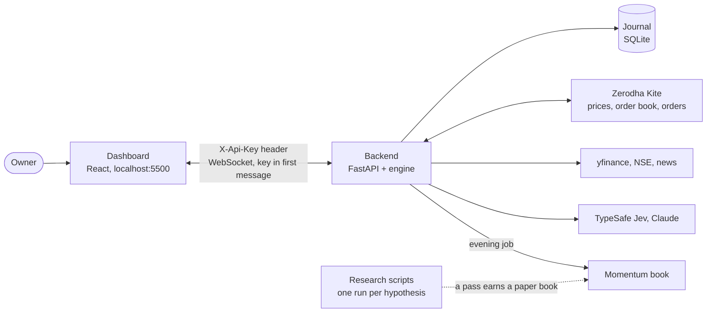

# Trader Sahab: a research-driven trading agent for NSE (Zerodha)

Trader Sahab is a paper-mode trading system for Indian equities, built around
one rule: **nothing trades until it passes a test that was written down before
its data was read.** It began as an intraday agent that scans the NIFTY 100
and follows Zerodha Varsity's Grand Checklist. That approach was measured,
and it does not work. After 202 recorded strategy trials and many research
looks, the one strategy that has passed is slow: a **monthly momentum book
held in delivery**. Since 2026-09-30 it is the core of Trader Sahab and the
dashboard's front page ([§116](#116-the-momentum-book-is-the-strategy-the-intraday-engine-is-a-paper-record)). It runs in paper; real money needs months
of paper results and the owner's decision.

The intraday engine still runs, in paper, as a record: no intraday edge was
found. Since 2026-10-01 it takes its paper trades automatically; the
confidence gate applies in Live only ([§118](#118-the-paper-engine-takes-automatic-trades-the-confidence-gate-applies-in-live-only)). It keeps its live scans of the NIFTY 100,
the checklist's labels, a review queue where you decide, risk-based sizing,
and a plain-language explanation of every decision with a link to its
source. Everything runs in **paper mode** by default. The code can route real
orders through **Zerodha Kite Connect**, for cash equity and, opt-in, for
buying calls and puts. **No real-money order has ever been placed**, and
going live is the owner's decision alone.

**Design documents:** [High-level design](docs/architecture/HLD.md) ·
[Low-level design](docs/architecture/LLD.md) ·
[Rules checklist](docs/architecture/RULES.md) ·
[Knowledge graph](docs/architecture/KNOWLEDGE_GRAPH.md) ·
[Interactive rulebook](https://claude.ai/artifact/5VxZ5bHM8b79u2sSUUtWrK)

## What it runs today (2026-10-01)

| Book | What it does | Evidence | Status |
| --- | --- | --- | --- |
| **Momentum book** ([§83](#83-the-paper-momentum-book), [§116](#116-the-momentum-book-is-the-strategy-the-intraday-engine-is-a-paper-record)): **the strategy**, and the dashboard's front page, with a monthly report against its benchmark and an alert at each rebalance | Holds the 15 of NSE's 200 most-traded stocks with the strongest volatility-adjusted 6- and 12-month returns, in delivery, with ₹10 lakh of paper capital. It rebalances at the close of each month's first session, lets an order wait when a stock is locked at its price band, and switches itself off if it falls below a band fixed in advance | Passed its pre-registered test over 2010–2025: +0.82% a month over its own universe after every delivery charge (t 2.91). Re-run on repaired prices with orders that wait, which is what the book now runs: **+0.71% a month** (t 2.51; 20.6% a year against 11.9%), a narrow pass ([§96](#96-should-the-first-pick-come-from-more-stocks-tested-the-running-book-holds-up-a-wider-one-is-not-shown-to-be-better), [§99](#99-the-paper-momentum-book-runs-what-was-tested-orders-wait-and-the-band-expects-071-a-month)). Confirmed on 200 stocks never read before and on the unseen first eight months of 2026 (+1.28% a month, t 1.08); see [§82](#82-the-first-strategy-to-pass-slow-momentum-in-delivery-on-corrected-data-confirmed-on-unseen-stocks-and-on-2026) | Paper. First trades at the **1 October 2026** close |
| **Jev book** ([§86](#86-the-jev-book-an-llm-judge-on-the-daily-shortlist-tested-in-paper)), on the *Jev Book* page | Each trading day after 09:45, TypeSafe Jev (an LLM judgment service, called through its official API) says buy, short or skip for each stock on the scanner's shortlist, up to 15. Paper positions close at 15:08 and are compared with the scanner's own side | None yet. It is a pre-registered forward test (trial 123), judged after 300 trades or 60 sessions. The research found no LLM trader with an edge after costs | Paper. Running since **28 September 2026** |
| **Intraday scanner and review queue** ([§64](#64-the-review-queue-near-misses-come-to-you-and-nothing-is-placed-unless-you-approve), [§75](#75-the-varsity-checklist-is-retired-as-the-decision-maker-the-order-book-is-the-one-open-line)) | Scans the NIFTY 100 and shortlists setups. The Varsity checklist labels them, and you decide | Every intraday price rule tested came out at zero before costs ([§51](#51-the-strategy-was-measured-over-495-sessions-and-it-does-not-work), [§69](#69-a-76-configuration-strategy-search-the-varsity-checklist-included-nothing-passes-and-the-entries-are-zero-before-costs)) | **Automatic entries in paper only** ([§118](#118-the-paper-engine-takes-automatic-trades-the-confidence-gate-applies-in-live-only)): the confidence gate's bar is 0 in Paper and 60 in Live, where it blocks every entry ([§70](#70-the-confidence-gate-now-knows-what-the-backtests-measured-and-it-stops-automatic-entries)). Each paper entry journals its score and whether 60 would have blocked it. A paper record, not the strategy, since 2026-09-30 ([§116](#116-the-momentum-book-is-the-strategy-the-intraday-engine-is-a-paper-record)) |
| **Order-book test** ([§71](#71-recording-the-order-book-every-tick--the-data-for-the-next-brain), [§75](#75-the-varsity-checklist-is-retired-as-the-decision-maker-the-order-book-is-the-one-open-line)) | Records Kite's five-level order book for the watchlist on every tick | Pre-registered; it runs once 15 full sessions are recorded, about **19 October 2026** | Collecting. Needs Kite connected every trading day |

## ⚠️ Read this first

- **Nothing here guarantees profit.** The one strategy that passed is a
  monthly momentum tilt with real losing years: −13% against its own
  universe in 2025 and −14% in 2016. Its evidence is a backtest, 200 unseen
  stocks and eight unseen months, and at the project-wide trial count it
  would not pass. Re-run on repaired prices with honest fills it still
  passes its own rule, narrowly and with a smaller edge: +0.71% a month
  against the +0.82% first recorded ([§96](#96-should-the-first-pick-come-from-more-stocks-tested-the-running-book-holds-up-a-wider-one-is-not-shown-to-be-better)). No strategy, fund or trader delivers anything like 1% a
  day.
- **What was measured and failed**, so nobody retries it blind:
  - The Varsity checklist the intraday agent was built on: **−0.36R a trade,
    t = −3.59**, over 495 sessions and 201 trades, with both halves agreeing
    and the entry indistinguishable from random
    ([§51](#51-the-strategy-was-measured-over-495-sessions-and-it-does-not-work), [§52](#52-holding-longer-doesnt-rescue-it-either)).
    **Do not trade real money with it.**
  - Every intraday price-and-indicator rule, in a 76-configuration search
    ([§69](#69-a-76-configuration-strategy-search-the-varsity-checklist-included-nothing-passes-and-the-entries-are-zero-before-costs)), and trading filings and results days
    ([§73](#73-do-filings-move-stocks-enough-to-trade-measured-no-with-one-lead), [§74](#74-results-days-the-filed-numbers-point-the-right-way-and-the-move-is-gone-by-the-open)).
  - Post-earnings drift ([§84](#84-post-earnings-drift-measured-on-nses-own-filings-real-in-sign-too-small-to-trade--dropped)), our own 14-signal ranking engine
    ([§85](#85-our-own-prediction-engine-14-signals-and-a-fitted-model-lost-to-the-one-signal-momentum-rule)), and the overnight premium held in a Nifty ETF
    ([§87](#87-the-overnight-premium-in-an-etf-measured-on-minute-data-it-does-not-survive--the-line-closes)).
  - Sweeps of GitHub, Reddit, Instagram, X, papers and blogs found no
    documented net-of-cost edge from retail intraday trading or from LLM
    price prediction ([§76](#76-research-what-would-actually-give-profits-and-rewire-the-process-the-answer-is-horizon-and-the-one-test-it-motivated-failed-its-own-gate), [§79](#79-the-best-prediction-engine-for-2026-intraday-or-fo-none-that-predicts-direction-and-the-one-surviving-design-fails-on-facts)). A 2026-09-27 sweep found no intraday entry-timing rule that clears costs either ([§88](#88-what-should-decide-when-to-trade-now-the-checklist-is-retired-intraday-nothing-clears-costs-positional-how-much-momentum-to-hold)).
- **Costs decide everything.** A cash intraday round trip costs about
  16.6 bp at small size and 14.3 bp at a ₹1 lakh position. A delivery round
  trip costs about 22 bp in charges plus 10 bp of assumed slippage, and a
  ₹15.34 DP charge per stock sold. The momentum book survives because it
  replaces about three names a month, which costs about 0.7% of the book a
  year.
- **Trials of record: 202** (`docs/research/trials.md`). New ideas are
  judged against their own family of tries ([§80](#80-two-owner-decisions-overnight-etf-holds-are-allowed-paper-and-new-ideas-are-judged-against-their-own-family)), with a corrected
  Deflated Sharpe ratio ([§77](#77-the-deflated-sharpe-gate-could-never-pass-fixed)). The 2026 held-out window has been
  spent once, for the momentum family.
- **Daily housekeeping.** Kite logs every session out at 06:00. Click
  **Reconnect** on the dashboard before 09:15 on each trading day, or the
  order-book test loses that session and prices fall back to a ~15-minute
  delayed feed. The Jev book also needs a TypeSafe API key
  ([Setup](#storing-the-typesafe-api-key-for-the-jev-book)).
- **Most retail intraday traders lose.** SEBI's own study (Jul 2024) found
  71% of individual intraday cash traders net-lost in FY23, rising to 80%
  above 500 trades/year. A separate SEBI study (Sep 2024) found 93% of
  individual F&O traders lost money over FY22–FY24, averaging ~₹2 lakh loss
  each. The dashboard's Journal page shows these numbers directly instead of
  a made-up return target — see "What good actually looks like here."
- **F&O here means buying calls/puts only** — never writing/selling options,
  never futures. NISM Series VIII is explicit that a long option's maximum
  loss is the premium paid, full stop, while a short call's "has to be
  unlimited" — a fundamentally different risk shape from everything else
  this codebase sizes to a known, bounded loss. See
  [F&O (options-buying only)](#7-fo-options-buying-only) below.
- **F&O trades are gated by a confidence score**, not just the checklist —
  it's deliberately capped low whenever the Dimaag Scorecard (expectancy,
  Deflated Sharpe Ratio, Information Coefficient) hasn't proven a real
  system-wide edge yet. Right now, on real logged data, it hasn't — so F&O
  effectively won't trade until that changes. This is by design, not a bug.
- **The dashboard now requires an API key** on every route except the Kite
  OAuth redirect (`/kite/callback`) — see [Setup](#setup). Without this,
  anyone who could reach the backend (e.g. via a tunnel used for the Kite
  login step) could flip it to live trading or enable F&O.
- **News sentiment can optionally be read by an LLM** (Claude Haiku 4.5)
  instead of the keyword lexicon — off by default, costs real (small) money
  once you turn it on, and is not a price predictor: it scores a headline's
  tone toward the company, nothing more. See
  [LLM-read news sentiment](docs/architecture/LLD.md#91-headline-scoring) below
  for exactly what it does and doesn't claim, and why raw "ask an LLM to
  predict the stock" isn't a feature here at all.
- **"Certified trader" describes the knowledge, not a licence.** The rules
  follow what CMT/NISM-trained technical traders study. If you ever offer
  this agent's signals to other people, SEBI's Research Analyst / Investment
  Adviser rules apply.
- **Starts in PAPER mode, F&O starts disabled.** No real orders until you
  click LIVE and set up Kite; no options orders until you also separately
  turn F&O on from the Portfolio page.
- **Data caveats:** yfinance is a delayed feed, and how far behind it runs is not known exactly. The scanner takes today's prices from it only when Kite is not connected (§101). The NSE feeds are the
  JSON endpoints behind nseindia.com's own pages, not a documented API, so
  they can change or rate-limit. Google News RSS is unofficial. Kite Connect
  gives F&O OHLC + open interest, not implied volatility — this app solves
  for IV itself from each contract's live premium (`options_pricing.py`).
- **Live trading needs a static IP** whitelisted on your Kite app (a SEBI
  rule). A home internet connection is often dynamic; a small cloud VM
  usually isn't. Run the backend there if you need this reliably.
- **NSE holidays are hardcoded for 2026** (`holidays.py`, pulled from NSE's
  own holiday-master API) — re-pull and update the list each year. In a year
  without a list every weekday counts as a session, and the engine says so
  with an error at start-up and on every pre-market read (§114).

## How the agent decides

> This section describes the **intraday engine**. Since [§75](#75-the-varsity-checklist-is-retired-as-the-decision-maker-the-order-book-is-the-one-open-line) the
> Varsity checklist only labels setups for the review queue, and automatic
> entries are off in Live. In Paper they are taken since [§118](#118-the-paper-engine-takes-automatic-trades-the-confidence-gate-applies-in-live-only).
> The paper books in [What it runs today](#what-it-runs-today-2026-10-01)
> run beside it and are described in their own sections.

### 1. Market context (every scan)

| Signal | Effect |
|---|---|
| NIFTY daily trend (EMA20/50), day change, holding above its open | Market bias score |
| Breadth: advancers vs decliners across the NIFTY 100 | ≥ 60% up adds to the score, ≤ 40% subtracts |
| India VIX ≥ 20 | Counts as risk; new position sizes halved |
| **Bias** = risk-on / neutral / **risk-off** | Risk-off: **no new longs**. Risk-on: the mirror image, no new shorts. Neutral: both sides. The bias blocks entries; it does not choose the day's list (§91). Only the old score mode (`SCANNER["selection"] = "score"`) also caps the picks against the bias at 2 |

### 2. Scanner — *what* to trade (`scanner.py`, every 5 min open / 60 min closed)

The universe is the NIFTY 100 (large, liquid, F&O-eligible stocks), refreshed
weekly from NSE's list. The engine doesn't trade on an NSE holiday or
weekend (`holidays.py`). The scanner still refreshes once an hour on those
days, so the dashboard stays current. The dashboard shows "Markets are shut
today for X" and when trading resumes.

| Stage | Rules (points) |
|---|---|
| **Tradability filters** | Price ≥ ₹100 · turnover ≥ ₹50 cr/day · daily ATR ≥ 1.2% (anything slower can't beat costs) · **results due today or next session → excluded** · in the F&O ban, in trade-for-trade, or within 2% of a fixed price band → excluded; a stock with a fixed band is long only (§100) |
| **Daily setup** | Daily uptrend +20 / downtrend −15 · 10-day relative strength vs NIFTY up to +20 · within 3% of 52-week high +10 · NR7 +8 / inside day +6 · daily RSI 45–70 +5, > 75 −8 · confirmed Bulkowski daily pattern +15 · Murphy reversal day/selling climax +10 to +18 |
| **In play today** | Gap under 0.5%: not scored. With the trade: +10 if Bulkowski's classifier calls it a breakaway, −8 if exhaustion, otherwise +6 up to 3% and −10 above it. Against the trade: +6 if exhaustion, −8 at 3% or more · relative volume vs the same time of day ≥ 2× +15, ≥ 1.3× +8, < 0.7× −8 · beating NIFTY today up to +15 · above VWAP ±5 · above the 15-min opening range +8 · top-3 sector +8, bottom-3 −5 |
| **Catalysts** | Positive filing or news up to +12 · clearly negative −15 |
| **Both sides** | Every rule above is scored twice, once as a long and once as a mirrored short (daily downtrend, lagging NIFTY, near the 52-week low, gap down, below VWAP, broke the opening range, bottom-3 sector, negative catalyst). The stronger side is kept as `score_side`, for information only: since §115 it blocks nothing, and the checklist picks the side at entry |
| **Deep read** | The stocks on the day's list get a full Sahab's Dimaag analysis with per-stock news (in score mode, the top 25 by score, `SCANNER["deep_analysis"]`); the timing edge for their side adjusts the score by up to ±15 |
| **Active watchlist** | The day's list: the 25 eligible stocks (`SCANNER["active_count"]`) with the highest 20-day average turnover, fixed before the open, or at the first scan if the engine starts later, and kept all day (§91, §100, §106). Plus pinned stocks and open positions. No score, side or trend chooses it. The old list is one setting away (`SCANNER["selection"] = "score"`): the best final scores of at least 20, daily trend agreeing with the side, at most 2 against the market bias, chosen again every scan |

### 3. The Rule Book — how the sources connect

Every trade decision is one connected chain, not separate silos: a chart
pattern (Nison, Bulkowski, or Murphy) needs a stop at a real level (Varsity)
needs volume behind it (Varsity, plus Murphy's On Balance Volume divergence)
needs the trend to agree (Dow Theory *or* Brooks' "always-in" direction)
needs the day's news to not contradict it (NSE filings + Google News +
Marketaux + Alpha Vantage) needs a reward-to-risk worth taking (Varsity,
with Bulkowski's measured average move as the target when a daily pattern
applies) needs a position size that survives a string of losses (Tharp).
Every one of those checks is visible on the dashboard's Timing Read tab and
the dedicated **Technical Analysis** page, with its exact source cited, both
while a trade is being considered and afterwards in the journal — so the
reasoning is never hidden in a score.

| Source | What it contributes |
|---|---|
| Zerodha Varsity, Technical Analysis | The Grand Checklist itself: pattern, S/R stop, volume, Dow Theory, RRR |
| Nison, *Japanese Candlestick Charting Techniques* | Candlestick patterns, incl. Abandoned Baby and Rising/Falling Three Methods |
| Bulkowski, *Encyclopedia of Chart Patterns* | Daily-chart Double Top/Bottom and Head-and-Shoulders detection, gap classification, real failure-rate/average-move stats |
| Brooks, *Trading Price Action Trends* | The "always-in" trend direction, alongside Dow Theory |
| Murphy, *Technical Analysis of the Financial Markets* | Reversal days / selling climaxes (daily scanner) and On Balance Volume divergence (intraday checklist, ch 4 & 7). OCR'd this session — see below |
| News (NSE filings + Google News + Marketaux + Alpha Vantage) | The catalyst check — degrades or vetoes a trade the news contradicts |
| Tharp, *Trade Your Way to Financial Freedom* | Percent Risk / Percent Volatility position sizing, R-multiples, expectancy, Kelly fraction |
| NISM Series VIII | Options Greeks and long-option payoff definitions (now used by F&O below); F&O contract specs. The Market Wide Position Limit ban was researched (§33) but its NSE endpoint couldn't be verified live after several real attempts — same honest "not built" call as ASM/GSM (§20) rather than guessing at it |
| Bailey & López de Prado (2014); Grinold (cited in Jansen, *Machine Learning for Trading*) | Deflated Sharpe Ratio and Information Coefficient — the two statistics the Dimaag Scorecard is built on |

Murphy's book is a scanned PDF with no text layer. `tesseract` + `poppler`
were installed and used to OCR all 574 pages this session. Three concrete,
verifiable rules from it are wired into the engine (reversal days, OBV
divergence, and — added later, §33 — real whole-exchange market breadth:
the advance-decline line and TRIN). Elliott Wave, Point & Figure, time
cycles, and intermarket analysis were read but deliberately not built in —
each for a specific reason (too subjective to encode reliably, redundant
with what's implemented, or the wrong asset class) documented on the
dashboard's Technical Analysis page.

### 4. The Varsity Checklist — *when* to trade (`trader_brain.py`)

Trader Sahab's default entry logic (`entry_mode: "checklist"`) is Zerodha
Varsity's **Grand Checklist**, read directly from the Technical Analysis
module (chapters 4–18) and implemented rule for rule instead of paraphrased:

| Varsity rule | Chapter | What Trader Sahab checks |
|---|---|---|
| A recognisable candlestick pattern, after the right prior trend | ch 4–10 | One of 24 patterns (`candlestick_patterns.py`), sized sanely (0.3–3× ATR) — includes Nison's Abandoned Baby and Rising/Falling Three Methods |
| The stop-loss sits at support or resistance | ch 11 | The pattern's low/high must land within 0.5 ATR of a swing, previous-day, opening-range, Fibonacci or CPR level |
| Above-average volume on the signal candle | ch 12 | Volume vs its 10-candle average (Varsity's volume-trend table), **plus** On Balance Volume divergence over a longer window (Murphy ch 7) as an earlier warning than a single bar's volume ratio can show |
| The trend agrees | ch 17–18 | Dow Theory (15-minute trend, swing structure) **or** Brooks' "always-in" direction (`brooks.py`) — either confirms |
| Indicators confirm, but only to size the bet | ch 15.4 | MACD and RSI: if they agree, full size; if not, Varsity's own worked example ("300 shares instead of 500") — 60% size |
| *(new, not in Varsity)* News doesn't contradict the trade | — | NSE filings + Google News + Marketaux + Alpha Vantage sentiment; strongly opposed news vetoes the entry outright, mildly opposed news sizes it down like a missed indicator |
| Reward-to-risk of at least 1.5, net of costs | ch 18.5 | Target = next level beyond entry (or 2R if none); RRR is computed after estimated round-trip costs |

**A trade needs every required point** (pattern, S/R, a stop of at least 1× the round trip's cost, volume, trend, RRR);
indicators and news only scale the size. This is stricter than the older
confluence-score system (`entry_mode: "confluence"`, kept for comparison) and
trades far less often — see the backtest table below.

Two more Varsity concepts feed the checklist as extra support/resistance
sources: **Fibonacci retracements** (ch 16 — 23.6/38.2/50/61.8% of the last
swing) and the **Central Pivot Range** (ch 22 — pivot, top and bottom from
the previous session's high/low/close), in `market_structure.py`.

Separately, at the **scanner** level (daily bars, not the intraday
checklist), `swing_patterns.py` detects confirmed Bulkowski Double
Top/Bottom and Head-and-Shoulders patterns (scored with his actual measured
failure rate and average move), Murphy reversal days / selling climaxes, and
`bulkowski.classify_gap()` labels today's gap as
area/breakaway/continuation/exhaustion using his gap-closure statistics —
all surfaced as cited reasons in the scanner's "Why it ranks" tab.

### 5. The confluence engine (legacy, `entry_mode: "confluence"`)

| What a trained trader checks | Source | Rule |
|---|---|---|
| Regime first | CMT / Wilder ADX | ADX ≥ 25 trending, < 20 ranging; RSI and Bollinger are read differently in each |
| Higher timeframe | Multi-timeframe analysis | 5m resampled to 15m; a long against the 15m downtrend −2 |
| Trend + VWAP | CMT, institutional practice | Price > EMA20 > EMA50 +2 · above session VWAP +1 |
| Structure | Dow Theory | Higher highs + higher lows +1; a broken structure below EMA50 forces an exit |
| Location | Price action | S/R zones from clustered swing points, previous-day H/L/C, opening range · breakout on volume +2 · resistance within 1 ATR −1.5 |
| Momentum | CMT | MACD crossover/histogram · RSI 50–70 in trends, ≤ 35 in ranges · stochastic turns · RSI ≥ 78 −1.5 (don't chase) |
| Trigger | Nison candlesticks | 20 patterns conditioned on the prior trend; full weight only at a value area; noise bars ignored |
| Participation | Wyckoff | Volume ≥ 1.5× average on the trigger bar +1 |
| Catalyst | News | Sentiment × 2; strongly negative news **vetoes** new longs |
| **Discipline** | Intraday practice | No entries before 09:30 or after 14:30 · ≥ 3 agreeing categories · bull ≥ 6 and beats bear by ≥ 2 · **one entry per stock per day** |

**Shorts** use the same checklist on the bearish evidence: bear score ≥ 6,
at least 3 agreeing categories, and an edge of 2 or more over the bull score.
They get the same discipline penalties as longs (fighting the 15-min uptrend
−2, support within 1 ATR −1.5, thin volume −0.5, RSI washed out −1.5), and
strongly positive news blocks a new short. The engine also refuses a short
the scanner ranked as a long, and vice versa. Shorts are MIS (intraday)
orders and are always covered by the 15:08 square-off. Never hold a cash
short overnight, because a short delivery goes to exchange auction.

Exits for both sides: the ATR stop-loss and take-profit (or the checklist's
own pattern-based stop and level-based target, when `entry_mode: "checklist"`),
the opposite case reaching 5 or the swing structure breaking, and the 15:08
square-off. `allow_shorts` in `STRATEGY_PARAMS["trader_brain"]` and
`SCANNER` turns shorting off.

### 6. Position sizing and stops (Varsity Risk Management module)

- **Percentage-risk sizing** (ch 11–13): risk 1% of capital divided by the
  stop distance — the pattern's structural stop when the checklist supplies
  one, ATR otherwise (`risk_manager.py`).
- **Step trailing stop** (Futures Trading ch 7): optional, off by default
  (`RISK["trail_after_r"]`) — after N·R profit, lock in (N−1)·R, one R at a
  time, the way Varsity describes a trailing SL on a Bracket Order.
- **R-multiples and expectancy** (ch 11, 14 — Kelly's Criterion): the
  backtester reports each trade's result as a multiple of its initial risk,
  the system's expectancy in R per trade, and the Kelly fraction (negative
  means the correct bet size is zero, however good the entries feel).

### 7. F&O (options-buying only)

Added this session, off by default (`config.FNO["enabled"] = False`). Buys a
**call** on a LONG checklist signal, a **put** on a SHORT signal — the same
signal engine as cash equity, just expressed through a different, capped-risk
instrument. Deliberately excludes writing/selling options and futures:

> "A long option position has limited risk (premium paid) and unlimited
> profit potential... if maximum loss for a long call position is equal to
> the premium paid, then... even maximum loss for the short call position
> has to be unlimited." — NISM Series VIII

| Piece | Module | What it does |
|---|---|---|
| Pricing + Greeks | `options_pricing.py` | Black-Scholes-Merton, with implied volatility solved from the contract's own live premium (Kite gives F&O OHLC + open interest, not IV). Delta, Gamma, Theta, Vega defined exactly as NISM Series VIII defines them |
| Contract selection | `fno_instruments.py` | Resolves the live NFO contract via Kite's own instrument dump — never a hardcoded lot size or expiry, since both are exchange-reset (SEBI changed NIFTY's lot size outright in Nov 2024). Skips expiries under 5 days out (theta decay) |
| Position sizing | `fno_risk.py` | The trade's entire max loss (premium × lots × lot size) is capped at a % of a *ring-fenced* F&O capital allocation (default ₹10,000 of ₹1,00,000), decided before the order is placed |
| Confidence gate | `confidence.py` | See below — the thing that actually decides whether a qualifying setup is allowed to fire |
| Knowledge base | `database.py` (`fno_evaluations`, `fno_trades`) | Every confidence read is logged, executed or not — same principle as `checklist_evals` logging every read, not just fills |

Exits are in **premium terms** (default: stop at −40%, target at +80% of
entry premium), because premium doesn't move linearly with the underlying.
Every F&O position shares the same `max_open_positions` and daily-loss-limit
counters as cash equity — one account, one risk budget, not two independent
ones. Live order placement uses Kite's `NFO` exchange and `MIS` product,
same same-day-square-off discipline as everything else here.

### 8. The confidence check — not a probability of profit

`confidence.py` scores every F&O candidate on two things: **local setup
strength** (how far past its own bar the checklist's edge margin cleared,
how many independent categories agreed, how clear the trend regime is) and
**system-wide evidence** (whether the Dimaag Scorecard's expectancy, DSR and
IC currently show a real, proven edge). The two multiply — a locally
"perfect" checklist pass on a system with zero proven edge is capped low,
by design, because a clean-looking setup means nothing statistically until
the system around it has demonstrated it beats chance. This is deliberately
*not* a calibrated probability: nothing here has enough closed trades yet to
calibrate one, and presenting a precise-looking number nobody's earned would
be exactly the fabricated-precision this project has tried to avoid
everywhere else. `config.FNO["min_confidence_to_trade"]` (default 60/100)
is the bar an order actually has to clear.

### 9. The Dimaag Scorecard — grading the system honestly

Added to the Journal page this session. Not a single "IQ" number — no such
validated measure exists for a trading system, and compressing independent,
differently-uncertain metrics into one score would hide the exact
uncertainty this project tries hard to keep visible. Three rows instead,
each graded against a bar already used elsewhere in this codebase, computed
from real logged data:

| Criterion | Source | Gate |
|---|---|---|
| Trading edge (expectancy) | Tharp, ch 6 | Needs ≥ 10 closed trades; pass if expectancy > 0R |
| Statistical significance (Deflated Sharpe Ratio) | Bailey & López de Prado (2014) | Needs ≥ 10 trades; pass if DSR ≥ 0.95 |
| Predictive skill (Information Coefficient) | Grinold, cited in Jansen ch 1 | Needs ≥ 20 (session, symbol) pairs; pass if IC > 0 |

Each row says "not enough data yet" rather than guessing below its sample
threshold. This same Scorecard is what gates F&O's confidence multiplier —
see above — **and, since a multi-expert review flagged the gap, cash
equity's too.** Until this fix, `confidence.py`'s system-evidence multiplier
(caps confidence to 0.25× whenever the Scorecard has any failing row) only
gated F&O entries — cash equity fired on the Varsity checklist passing
alone, with no equivalent check, despite the README's own backtests showing
every tested config net-negative. Same evidence, one instrument gated and
not the other. `trading_engine._try_enter()` now runs the identical
`confidence.score_trade()` check cash equity uses for F&O
(`config.RISK["min_confidence_to_trade"]`, default 60) before sizing a
position. Real consequence, checked against the live Scorecard while
writing this: IC currently fails, so even a locally perfect checklist pass
(100/100) scores 25/100 overall — below the bar — meaning cash-equity
entries are now blocked in both paper and live mode until the Scorecard
actually shows a real edge, not just a clean-looking setup.

### 10. Position sizing and stops, News sources, Taxation panel

*(unchanged from before — see below)*

`risk_manager.py` implements Van Tharp's Percent Risk Model (ch 9, Model 3)
and Percent Volatility Model (ch 9, Model 4) for cash equity stop distance
and sizing; `costs.py` models Zerodha's published intraday tariff.

| News source | Cost | Used for | Weight |
|---|---|---|---|
| NSE corporate announcements | Free | Order wins, acquisitions, buybacks, resignations, pledges, credit ratings | 1.5 |
| NSE event calendar | Free | Results due today/next session → stock excluded | filter |
| Google News RSS (India) | Free, no key | Per-stock headlines plus market-wide "stocks in news" discovery | 1.0 |
| Marketaux (optional) | Free tier 100/day | Per-entity sentiment scores; set `MARKETAUX_API_KEY` | 1.2 |
| **Alpha Vantage (optional, added this session)** | Free tier 25/day (used at 20/day) | Real per-article sentiment, **market-wide discovery only** — its `tickers` filter can't reliably target NSE symbols and its budget is too tight for per-stock calls; set `ALPHAVANTAGE_API_KEY` | 1.2 |
| Yahoo Finance | Free | Fallback when Google returns nothing | 0.6 |

The weight column above is about *trust*, not *how a headline gets scored*.
Scoring is a separate step (`llm_sentiment.py` / `sentiment_lexicon.py`) —
see [LLM-read news sentiment](docs/architecture/LLD.md#91-headline-scoring) below.

NSE bulk/block deals ("smart money" signal) were researched as a possible
addition but not built — it needs scraping an undocumented NSE endpoint, not
yet worth the added dependency.

Intraday equity is **speculative business income** under Indian tax law
(Varsity Markets & Taxation, ch 3–6) — the Trades tab shows running
trade-wise turnover, net P&L, estimated charges, and the relevant carry-
forward/advance-tax rules. Informational only, not tax advice.

### 11. Sahab's Journal — a persistent audit trail (`database.py`)

Everything above is written to a local SQLite database
(`backend/data/sahab_journal.db`, gitignored — runtime data, not source):

- **Every scan**, with the full ranked list, not just the picks.
- **Every checklist read** on an active-watchlist stock, roughly every 30
  seconds during market hours — whether or not it led to a trade.
- **Every fill**, with the checklist snapshot that justified an entry
  attached, and the realized R-multiple once the matching exit closes the
  position (linked by a shared `position_id`).
- **Every F&O confidence read**, executed or blocked, with the full
  breakdown and why (`fno_evaluations`) — and **every F&O position**, with
  the Greeks/IV/confidence frozen at entry and the outcome filled in at exit
  (`fno_trades`), never edited before that so no hindsight leaks in.

This is built around the [ML4Trading](https://github.com/stefan-jansen/machine-learning-for-trading)
book's own opening argument, "the process is your edge" — see
`research/ml4t_integration_plan.md` for the full reasoning. Two things from
it power the Scorecard above: the **Information Coefficient**
(`database.factor_ic()`, honestly "not enough data" below 20 session-pairs)
and the **Deflated Sharpe Ratio** (`evaluation.py`, every `backtester.py` run
logged as a trial in `backend/data/backtest_trials.json`).

### 12. LLM-read news sentiment (`llm_sentiment.py`)

The one LLM integration in this codebase, and deliberately narrow. Added
after explicitly declining a broader ask ("use an LLM to predict the
stock") — that request is answered in full in
[High-Level Design](docs/architecture/HLD.md) below, but the short version: an
LLM has no live market feed and no calibration for numeric forecasting: it
generates the most statistically fluent continuation of a prompt, not a
prediction, and that isn't a limitation prompting can fix.

What it *does* do: reads a headline's actual text — via Claude Haiku 4.5 —
and returns a sentiment score in the same `[-1, 1]` range
`sentiment_lexicon.score_text()` already returned, catching negation,
hedging language, and which company a multi-company article is really
about, which keyword matching can miss. It is a drop-in upgrade to one
existing scoring step, not a new prediction surface — and its value isn't
assumed: `database.factor_ic()` measures whether the resulting score
predicts anything, the same honesty check applied to every other signal in
this codebase.

- **Off by default.** Needs `ANTHROPIC_API_KEY`; even with a key set, a
  separate runtime toggle (`config.NEWS["use_llm_sentiment"]`, flippable
  from the Technical Analysis page with no restart) has to be on too. Until
  §114 the key alone turned it on; now it doesn't, and a restart keeps the
  toggle where it was left.
- **Real usage tracking, not an estimate.** Every API response reports its
  own `input_tokens`/`output_tokens`; those are summed per day and priced
  at Haiku 4.5's published rate ($1/M input, $5/M output, verified against
  anthropic.com/claude/haiku on 2026-09-14 — re-check if it's been a
  while). The dashboard panel polls this live every 15s.
- **A daily call budget** (`config.NEWS["llm_daily_limit"]`, default 500)
  and a **permanent per-headline cache** (a headline's text doesn't change
  once published, so it's never re-scored or re-billed).
- **Falls back to the lexicon** on any error, disabled state, missing key,
  or exhausted budget — this can never block a scan or a checklist read.

### 13. Holdings diagnostic (`portfolio_diagnostic.py`)

Runs the *exact same* indicators the scanner uses on the NIFTY 100 (trend
via EMA 20/50, `indicators.rsi()`, distance from the 52-week high/low,
`market_structure.key_levels()` for support/resistance,
`swing_patterns.scan_daily_patterns()` / `detect_reversal_day()` for
confirmed daily patterns) against your actual Kite holdings — not a
separate, lighter-weight read.

This exists because a user asked for return predictions on their real
portfolio, and that's a line worth being explicit about: those holdings are
real money, most aren't NIFTY-100 intraday-style stocks this engine was
built to read, and producing a growth forecast for them would be
personalized investment advice — out of scope regardless of what the
technical read shows. What *is* in scope: naming today's actual technical
posture (`"Uptrend, RSI overbought"`, `"Within 3% of its 52-week low"`,
`"Possible top reversal today (Murphy ch 4)"`) so you have a second,
consistent pair of eyes on the chart. The decision stays yours.

### 14. Pre-Market Analysis (`scanner.run_premarket()`)

A dedicated page (`/premarket`) that ranks the NIFTY 100 *before the market
opens*, using only what's actually known then: last session's daily candle.
It calls the same `premarket_score()` component the live scanner blends with
intraday evidence during the day, run on its own with no 5-minute-candle
dependency — so it works at any time, not just 09:15–15:30 IST.

It deliberately does **not** invent a pre-open gap estimate, an SGX-Nifty-style
proxy, or a global-markets read — this codebase has no honest, licensed data
source for any of those, and previous sections of this README go to some
length about not fabricating numbers. What it does show, all real and
computed:

- **Last session's market read** — NIFTY's prior-day close/change/trend,
  India VIX, and advance/decline breadth, scored with the same bias logic
  `market_context()` uses intraday (`risk-on` / `risk-off` / `neutral`).
- **Today's event risk** — results due (`nse_feed.results_calendar()`) and
  ex-dates (`nse_feed.corporate_actions_on()`), the same exclusions the live
  scanner applies, surfaced before the open instead of discovered mid-session.
- **A ranked watchlist** — every eligible stock's daily trend, 10-day relative
  strength vs. NIFTY, distance from 52-week high/low, confirmed Bulkowski
  patterns, and the exact point-by-point reasons behind its score, with an
  Avoid tab for what's excluded today and why.
- **"The morning take"** — `scanner._premarket_narrative()` turns those same
  fields into a few sentences of trader-style prose instead of a bullet dump:
  a market-read line, the long/short shortlist with each pick's single
  strongest reason, an event-risk caveat, and a closing discipline line. It's
  presentation, not a second source of truth — every clause maps to a field
  already in the response, built with plain string formatting (no LLM call),
  so it can't say anything the data doesn't already say.

`trading_engine` owns the schedule and the cache (`state.premarket`), not
`app.py` — it runs the scan once a day on its own (`tick()`'s pre-market
section), so the shortlist is ready before you'd even open the page, not
only when someone visits it. `/api/premarket` just reads/triggers through
the engine; a manual Refresh button is on the page too.

**Linking it to an actual buy — deliberately narrow, on purpose.** The
pre-market shortlist *primes the day's watchlist*: once, at the start of each
trading day (`_maybe_seed_watchlist_from_premarket()`), before the live
intraday scanner has run for the first time, `state.watchlist` is seeded with
last night's top picks (plus anything pinned or already held) instead of
sitting empty until the first live scan completes a few minutes into the
session. That's the entire link. It does **not** place an order, and it
never will on its own — every entry, for a pre-market pick or any other
symbol, still has to clear the exact same live gate: `trader_brain_signal()`'s
checklist (candlestick pattern, a stop at support or resistance, a stop of at
least 1× the round trip's cost, above-average volume, trend agreement,
reward-to-risk — see "How the agent decides" above) evaluated against
*today's* intraday candles, which don't exist until the market is actually
open. This mirrors how a discretionary trader actually works: build tonight's
watchlist off the close, then let tomorrow's tape — not last night's
conviction — decide whether anything gets bought. Research into wiring it
any tighter than that (e.g. auto-buying pre-market's top pick at the open)
was deliberately rejected: it would mean sizing a real order off zero live
confirmation, exactly the kind of fabricated-certainty shortcut the rest of
this README argues against.

### 15. Real-capital sync (`trading_engine._sync_capital()`)

`config.RISK["total_capital"]` used to be a static number you set once. The
risk model (Van Tharp's 1% rule, `risk_manager.position_size()`) sizes every
trade off it — and if that number doesn't match what's actually sitting in
your Kite account, sizing can look perfectly fine on the dashboard and still
get rejected by Kite for insufficient margin the moment an order goes live.

`_sync_capital()` closes that gap: once Kite is connected, every tick (max
once per 5 minutes, but immediately on a Paper↔Live switch — see below) it
reads the real equity `live_balance` from `kite.get_margins()` and writes an
effective figure straight into `config.RISK["total_capital"]` in place —
`RiskManager` holds a reference to that same dict, so the very next
`position_size()` call uses it, no restart needed. Toggle the whole thing off
with `config.RISK["sync_capital_with_kite"] = False` to pin the number
manually instead. The Portfolio page's Kite margins card shows the synced
amount and when it last refreshed, alongside the fuller `utilised` breakdown
Kite's `margins()` endpoint returns (span, exposure, option premium, M2M,
holding sales) — not just cash and a used-margin total.

**In LIVE mode**, that effective figure IS the real balance — no exceptions,
since a live order actually spends real money. **In PAPER mode**, it's
`config.RISK["paper_capital"]` (a fixed test figure, ₹1,00,000 by default)
instead — added after a real account's balance turned out too small for a
useful mock trading day to review (see the account-size consequence below).
The real balance is never hidden, just set aside: `state.real_capital` always
holds it regardless of mode, so the Overview page's Autonomous Trading card
can show both — "Paper capital (simulated): ₹1,00,000" next to "Real Kite
balance: ₹5,683" — and the Go Live confirmation dialog always quotes the real
figure, since that's what sizing snaps back to the instant Live is turned on
(the mode-switch bypasses the normal 5-minute throttle specifically so that
snap-back is immediate, not "eventually").

One consequence worth being explicit about: **real account size is a real
constraint on whether any cash-equity LIVE trade can fire at all.** At 1%
risk, an account in the low thousands of rupees produces a stop-distance-
based position size of 0 shares for most NIFTY-100 stocks' real ATR — the
risk-per-trade in rupees is smaller than one share's stop distance. This
isn't a bug to patch around; it's the Van Tharp model doing exactly what it's
supposed to do. The honest ways around it are: fund the account with more
real capital (live sizing then reflects it automatically, no config edit
needed), rely on F&O's premium-based sizing instead (cheaper per unit, but
confidence-gated — see §9, currently failing since the live Information
Coefficient is negative), or use paper mode's fixed test capital to review
how the system behaves at a realistic size while the real account is still
being funded.

### 16. Day Plan (`day_plan.py`) — capital planning without a fabricated return

A user directly asked for a tab showing "what we're going to invest and what
is expected at end of day, and did we achieve it" against a planned ₹5,000.
The middle part of that — an expected end-of-day number — is exactly what
this README has refused everywhere else, for the same reason each time:
there's no proven edge yet to base a return forecast on (the Dimaag
Scorecard's live Information Coefficient is negative, expectancy hasn't
cleared its bar — §9). Stating an expected P&L would be fabricating a number
this system has no right to state, not a feature.

What's real and buildable instead, and what `/day-plan` actually shows, split
into two halves that are never allowed to blend into each other:

- **Your plan** — enter a capital figure (defaults to 5,000) and see the risk
  model's own boundaries at that number: max ₹ risk per trade, max ₹ daily
  loss, and — for every symbol on today's real ranked shortlist (the live
  scanner's active picks once it's run, else the pre-market ranking) — the
  actual `risk_manager.RiskManager` computed stop, target, share quantity,
  ₹ risk, ₹ reward and RRR at that capital. This is arithmetic on real prices
  and real ATR, using the exact same `position_size()`/`stop_loss_price()`/
  `take_profit_price()` calls a live entry would use — not a simulation of
  outcomes, just what the sizing math produces. At ₹5,000 today, 2 of the 6
  current picks size to a real 1+ share position; the other 4 round to 0 —
  shown plainly, not hidden.
- **What actually happened today** — today's real fills from the journal
  (`database.trades_between()`), actual realized P&L, and whether the day
  stayed inside the daily-loss cap *computed off the real capital that
  actually sized those trades* (not the hypothetical figure above — the two
  are shown side by side specifically so they're never mistaken for each
  other, since a live day almost never uses exactly the amount someone is
  simulating in the planner).

"Did we achieve it" becomes "did the day stay inside its own rules," checked
against a real number, instead of a profit target checked against an
imagined one.

### 17. Autonomous trading control + browser alerts

A user asked for the system to "do the trade on its own" without them
watching, plus a button to start it and a notification on price movement.
Worth being precise about what changed and what didn't:

**What didn't change — and won't.** Claude (this assistant) has never placed
an order in this codebase and still doesn't; every fill, paper or live, comes
from `trading_engine.py`'s own background loop executing its own pre-built
rules, the same architecture this whole project has had since the F&O
section was added (§4-8). Flipping real money on is still a real, deliberate
click by the account owner, still behind the same native `confirm()` dialog
it always was (`Header.jsx`'s Paper/Live control) — that step is not
something a "start automatically" request should remove, since it's the one
moment a human explicitly authorizes real orders to start firing unattended.

**What's new is making that already-autonomous engine easier to actually use
hands-off:**

- **An Autonomous Trading card on the Overview page** — the first thing you
  see, showing real capital (synced per §15), F&O status, and alert status
  in one place, with a single **Go live** button carrying an expanded
  confirmation that states plainly what's about to happen (real orders,
  every ~30 seconds, no per-trade confirmation from here on, current real
  capital) before you commit. If real capital is under ₹2,000 it says so
  right there, with a link to Day Plan (§16) to see exactly which picks
  would actually size — never silently implying "flip this and it'll trade."
  Switching back to Paper needs no confirmation, matching the existing
  Header control.
- **Browser push notifications** (`notifications.js`, `useAlerts.js`) — an
  Enable alerts toggle in the header (native `Notification` permission, kept
  entirely client-side). Once on, it fires a real browser notification for:
  every new trade fill and every risk warning already written to the
  activity log (`state.activity`, unchanged data, just watched for new
  entries), and for a real price move on any watched or held symbol past a
  threshold derived from that symbol's own real ATR% (half a day's typical
  range, falling back to a flat 1.5% only when ATR% isn't known yet). No new
  backend endpoint — it all runs off the same WebSocket-streamed state every
  page already reads, diffed client-side so turning it on doesn't replay
  history as if it just happened.

### 18. Seasonality (`seasonality.py`) — and what got rejected

A user asked for an "emotional quotient" — a seasonality signal, citing
festivals moving gold as the motivating example. Before encoding anything,
every commonly-repeated Indian-market seasonal claim was checked against
real published research, the same bar every other signal in this codebase
has to clear. Most didn't survive contact with real data:

- **Muhurat trading "always green"** — happens once a year, so there are
  only ~10-20 data points *ever*; every source found was broker marketing
  content, not a study. The actual industry-reported record (broker blogs,
  not peer-reviewed): positive in roughly 8 of the last 10 years, average
  session gain ~0.4-0.5%. Real enough to note as a curiosity — nowhere near
  a statistically meaningful sample to score. Not encoded.
- **Festival gold-demand → jewellery-stock price** (the motivating example,
  e.g. Titan around Akshaya Tritiya/Dhanteras) — physical gold-demand
  seasonality is real and well-documented: World Gold Council and industry
  data consistently show 10-30% demand jumps around these dates. But every
  source connecting that to a tradable *stock price* move was pre-festival
  news hype ("Titan rises ahead of Akshaya Tritiya" style coverage), not a
  backtested study with real entry/exit stats or a control period. The
  demand seasonality is real; the tradable price-spillover claim isn't
  proven. Not encoded.
- **Halloween Indicator / "Sell in May and Go Away"** — genuinely strong
  evidence *globally* (Bouman & Jacobsen, *American Economic Review*, 2002,
  37 countries, 1970-1998) and unusually durable for a calendar anomaly:
  Jacobs & Müller (2020) and Zhang & Jacobsen (2021) both found the effect
  persists in most markets even after publication, when most anomalies
  decay (McLean & Pontiff, 2016, found calendar/return anomalies lose over
  a third of their effect on average once published — Jacobs & Müller's
  own finding is that this decay is itself mostly a US phenomenon, not
  global). Despite all that real durability, multiple sources confirm
  **India was one of the original sample's exceptions where the effect did
  not hold**. Doesn't apply here regardless of how well it travels
  elsewhere. Not encoded.
- **Day-of-week effects** — real in older studies (positive Monday/Wednesday
  effects on NSE-Nifty/Sensex, concentrated in small-caps), but a
  2010-2019 study found no significant day-of-week effect in that more
  recent window — decayed to nothing, matching the broader "anomaly decay"
  pattern above. Not encoded.
- **Results-season sector co-movement** (e.g. Nifty IT moving ±3-5% on a
  TCS/Infosys results day, pulling other IT names with it) — real and
  repeatedly documented in market reporting, but this is an *event* effect
  (direction depends entirely on beat/miss), not a *calendar* one, so it
  doesn't belong in this module. `nse_feed.results_calendar()` already
  excludes a stock from new trades on its own results day (§ Event risk);
  the sector-spillover angle is a real, addable refinement for later, not
  folklore — just out of scope for a seasonality-only pass.

Two effects did clear the bar — real, cited, statistically stated — and are
wired into `scanner.premarket_score()` (so both live scoring and the
backtester see the same rule, via a new `date_iso` parameter threaded
through every call site):

- **March effect**: a real, statistically significant *negative* NIFTY
  500/BSE 500 return in March (Elangovan, Irudayasamy & Parayitam, 2022,
  *Asia-Pacific Financial Markets*, 2011-2021, GARCH model, p<.01) — a
  small, honest ±4-point tilt (helps shorts, works against longs), sized
  well below a confirmed Bulkowski pattern (15-20 pts), since a single
  academic study is real evidence, not proof. Like every other signal here,
  it doesn't get to assume it helps — `database.factor_ic()` will measure
  whether it actually does once enough March sessions accumulate.
- **Union Budget day** (Feb 1, fixed since the 2017 reform): direction is
  close to a coin flip historically (Samco/Arihant studies), so this is
  **informational only** — a plain note in the market read
  (`market_context()`/`premarket_context()`), never a score or size
  adjustment, since the volatility pattern that *is* more consistent
  (pre-announcement uncertainty, then an IV crush) isn't measured here
  precisely enough to size a real multiplier.

**Fundamentals were researched too and deliberately left out.** The
motivating question also asked about using company fundamentals (revenue,
P/E) the way famous traders do. Real research on four widely-cited
methodologies, all swing/positional (weeks to months), none intraday:

- **Jesse Livermore** (*Reminiscences of a Stock Operator*, Lefèvre 1923) —
  pure tape-reading/price-action, no fundamentals at all. Closest of the
  four to genuine short-term logic, but his documented wins were
  multi-day/week swings, not same-day trades.
- **Nicolas Darvas** (*How I Made $2,000,000 in the Stock Market*) — "box
  theory," price consolidation + breakout. Called himself a
  "techno-fundamentalist" (a basic earnings-growth filter, then technical
  timing) — self-described swing/position trader, weeks to months.
- **William O'Neil / CANSLIM** (*How to Make Money in Stocks*) — explicitly
  combines fundamentals (the "E" = earnings growth) with technical breakout
  entries. Swing/positional by design.
- **Mark Minervini / SEPA** — same lineage: fundamental screening
  (earnings/sales acceleration) plus technical breakout timing.
  Swing/positional.

All four use fundamentals for stock **selection**, never for intraday
**timing** — and Zerodha Varsity states this split explicitly in its own
"Fundamental vs Technical Analysis" chapter: technicals for identifying
short-term trades and timing entry/exit, fundamentals framed for long-term
investing. That's the documented consensus, not an assumption made for this
project. Given that, and the user's own call when asked, fundamentals stay
out of this intraday system entirely rather than being bolted on against
what the evidence actually supports.

`yfinance`'s `.info` (already a dependency) was confirmed live to return
usable real fundamentals for NSE tickers if this is ever revisited —
checked directly against `TITAN.NS`: `trailingPE=76.9, forwardPE=56.3,
marketCap=4.44T, totalRevenue=924B, revenueGrowth=0.293,
earningsGrowth=0.628, sector=Consumer Cyclical, industry=Luxury Goods,
profitMargins=0.062, trailingEps=65.12` — real, verified, but field
coverage is inconsistent (`returnOnEquity` came back null for this
ticker), so any future use would need to handle missing fields gracefully,
same as this codebase already does for ATR/RSI. Nothing currently reads it.

**One more real number surfaced by this research, worth having in view**:
SEBI's own published study found 93% of individual F&O traders lost money
FY22-FY24 (aggregate losses over ₹1.8 lakh crore), with a later update
showing losses widening further in FY25 — now cited directly in the app's
F&O section (Technical Analysis page) as a counterweight to any "how the
greats got rich" narrative.

**On using an LLM for this**: also researched and worth stating plainly —
there's a clean, real boundary. Claude reading a real, freshly-fetched
document (an actual news article, a fetched filing) and extracting what's
*in that text* is the same legitimate, narrow pattern `llm_sentiment.py`
already uses. Asking Claude to recall a company's revenue or "which stocks
to buy" from its own training data is not — unverifiable, possibly stale or
fabricated, structurally identical to the return-prediction requests this
project has declined everywhere else. No such feature was built.

### 19. Multi-expert review fixes

Four independent reviews (trading/risk, design/UX, software architecture,
product) were run against the live app and current code. Beyond the
cash-equity confidence gate (§9), three more concrete fixes came out of it:

- **The background loop could die silently, forever.** `trading_engine.py`'s
  `tick()` body (the day-reset, capital sync, square-off block) and
  `run_forever()`'s executor call had no top-level exception handling, unlike
  the per-symbol loop right next to them. One uncaught exception anywhere in
  that path — a Kite timeout during square-off, a malformed margins()
  response — would propagate out of the `while` loop and permanently kill
  the engine's background thread: no more scans, no more square-offs, ever,
  for the rest of the process's life, with nothing but a stack trace in a
  log nobody's watching. That directly contradicted the Autonomous Trading
  card's "runs unattended" promise (§17). `tick()` is now a thin wrapper
  around `_tick_impl()`, catching and logging any exception so one bad cycle
  is skipped and retried 30 seconds later instead of ending the engine;
  `run_forever()`'s executor call has the same defense-in-depth wrapper.
- **The Go Live confirmation didn't state the one fact that matters most.**
  It listed capital and F&O status, but never the Dimaag Scorecard's actual
  pass/fail state — a user could click through without ever seeing "this
  system has never shown a proven edge in any backtest" in that flow, even
  though the data already existed. The Overview page's Autonomy card now
  fetches the real Scorecard, shows a pass/fail chip on the card itself, and
  injects a plain-language summary (e.g. "Dimaag Scorecard: FAILS on
  Predictive skill (Information Coefficient) — this system has NOT shown a
  proven edge yet") directly into the confirm() dialog text.
- **Portfolio page was telling a wrong capital story.** Its margins card
  still said "Risk-model capital is synced to this live balance — ₹1,00,000"
  after paper mode's fixed test capital (§15) shipped — ₹1,00,000 was the
  paper figure, not the real balance, and the Overview page already had the
  correct paper/live-aware wording that Portfolio.jsx never got. Fixed to
  match.

A second pass through the same four reviews closed out the rest of what
they flagged:

- **Sector-concentration cap.** `max_open_positions` alone didn't stop 3
  concurrent positions from being the same sector — the scanner's own
  sector-momentum ranking makes correlated picks the *likely* outcome on a
  trend day, undermining the daily-loss cap's implicit independence
  assumption. `config.RISK["max_positions_per_sector"]` (default 1) now
  blocks a new entry if the same industry is already represented among open
  positions.
- **Kite token-expiry alert.** Sessions expire daily, and this has already
  bitten the user mid-session once (documented in an earlier section). Kite
  auth failures during `_sync_capital()`'s regular heartbeat now raise a
  clear, throttled, high-visibility alert ("Kite session has expired —
  click Reconnect...") instead of getting silently absorbed into a generic
  warning log — and since it's logged at `level="error"`, it fires a
  browser push notification too (§17), not just a dashboard message.
- **Position reconciliation on restart.** A real gap: live positions reset
  on process restart and were never checked against what Kite actually
  shows. `_check_position_reconciliation()` now compares Kite's real "day"
  positions against `state.positions` on every capital-sync cycle in live
  mode, and raises a clear alert naming any symbol Kite shows open that
  this app isn't tracking. Deliberately does NOT try to auto-heal by
  guessing an entry price or stop this process never saw — that could be
  actively worse than doing nothing. It only makes the mismatch impossible
  to miss.
- **Trade-history CSV export** (`GET /api/journal/trades.csv`, a button on
  the Trades page) — every trade ever logged, paper and live both (the mode
  column says which), for the user's own tax-filing records. There was
  previously no way to get trade history out of the app short of reading
  the SQLite file directly.
- **A real, if minimal, test suite.** `backend/tests/` (pytest) now covers
  the exact risk-critical logic that had zero coverage: position sizing,
  stop/target pricing, the daily-loss circuit breaker, and — specifically —
  a regression test that would catch the cash-equity confidence-gate bypass
  bug from §9 if it were ever reintroduced (`test_perfect_setup_still_blocked_when_scorecard_fails`).
  15 tests, all passing; not exhaustive, but no longer zero.
- **Security hardening, honestly scoped.** CORS was `["*"]`; now defaults to
  the actual dev origins this app uses (`localhost:5500`/`127.0.0.1:5500`),
  overridable via `CORS_ALLOWED_ORIGINS`. The dashboard API key printed in
  full on *every* restart's startup log — now only on the run that first
  generates it; every later restart shows a masked reference
  (`4Xh0ey...NWgc`) instead, with the full value still retrievable from
  `.dashboard_key.json`. What's **not** fixed, honestly: the key still has
  to travel as a `?key=` URL param for the WebSocket and Kite-login popup,
  since browsers can't attach a custom header to either — a real limitation
  of this auth pattern, not something this pass papered over.
- **Onboarding banner.** A dismissible first-run checklist on Overview
  (connect Kite → confirm Paper mode → read the Scorecard before ever
  considering Live), shown only until Kite connects once, then gone for
  good — there was previously no in-app "what do I do first" path at all,
  just a 1000+ line README.
- **Pre-Market/Overview cross-reference.** A design review found the two
  pages' stock lists (last night's pre-market read vs. today's live scan)
  can visibly disagree with no explanation, reading as a bug. Pre-Market
  now shows a plain note and a link over to Overview once the live scanner
  has superseded it.
- **Loading spinners** on Pre-Market's refresh and Portfolio Diagnostic's
  data download, replacing static "this can take a moment" text that read
  as frozen on a slow connection.

**Findings noted, deliberately not acted on** — for completeness, since a
review is only honest if it also records what it didn't change:

- **`confidence.py`'s system-multiplier buckets (0.25/0.5/1.0) are a coarse
  three-step function with no data-driven basis for those exact
  thresholds** — defensible in spirit (never let a clean local setup
  outweigh proven-absent system edge), arbitrary in magnitude. Left as-is;
  would need its own real study to justify a different set of numbers, not
  a guess swapped for another guess.
- **Slippage (`config.COSTS["slippage_pct"]`, 0.03%) is a stated estimate,
  not measured** — flagged in its own code comment as exactly that. Left
  as-is; real intraday slippage depends on the specific symbol, order size,
  and volatility at the moment of the fill, and this codebase doesn't yet
  have real fill-vs-signal data to measure it from.
- **`database.factor_ic()`'s `min_pairs=20` threshold** is a reasonable
  floor for declaring some signal, but a small sample for declaring the
  Information Coefficient definitively "proven positive." Left as-is —
  raising it is a real option worth considering once enough sessions
  accumulate to see whether 20 was too permissive in practice.
- **`config.RISK` is a shared mutable dict acting as a global**, read and
  written from multiple call sites (`_sync_capital`, the F&O enable
  endpoint, the `sync_capital_with_kite` toggle) with no encapsulation.
  Currently correct because nothing reads it mid-mutation, but fragile —
  nothing stops a future feature from reading a half-updated value. Left
  as a known fragility, not refactored, since the fix (wrapping it in a
  real config object) touches every module that reads `config.RISK`
  directly and wasn't worth the blast radius for this pass.
- **`app.py` is becoming a god-file** (400+ lines, every endpoint +
  middleware + lifespan in one module). Not urgent at current size, but
  the F&O/day-plan/pre-market/PCR endpoints already show it's growing; a
  `routers/` split would age better. Left as-is.
- **Operational readiness is still nil** — this backend runs via a manual
  `nohup uvicorn ... &` (visible throughout this README's own session
  history), with no process supervisor, no crash-restart, and logs to a
  single growing file rather than a rotated one. The tick()-level
  exception handling above (this section) means the engine itself can't
  die from an ordinary exception anymore, but the *process* still can —
  from an OOM, a `kill`, a machine restart — with nothing to bring it back
  automatically. Left as a real gap, not solved.
- **Design: uneven visual density across pages** — Day Plan and Portfolio
  pack 6-8 equal-weight stat chips per card; the actually decision-relevant
  numbers (real ₹ risk, "tradable picks right now") don't outrank
  max-open-positions or F&O-off in size or position. Left as-is — a real
  visual-hierarchy pass, not a quick fix.
- **Design: the nav bar has no overflow affordance on mobile** — 8 items at
  ~400px width relies on bare `overflow-x: auto` with no fade or arrow
  hint that more tabs exist off-screen. Left as-is, minor.

### 20. Real Indian-market data — sectoral indices, flows, deals, positioning

A user asked how to make Trader Sahab more knowledgeable specifically for
Indian markets. Researched six candidate directions against real evidence
(same bar as §18's seasonality work), ranked, then built the five that
verified out — and explicitly did NOT build the one that didn't:

- **NSE surveillance (ASM/GSM) exclusion — researched, not built.** Real
  data exists under a real, named file — NSE's daily
  `REG_IND<DDMMYY>.csv` surveillance file, published at
  nseindia.com/all-reports, which standardizes scrip-specific cautionary
  messages across exchanges (ScripCode, Symbol, trading Status, Series). A
  third-party mirror (a "VIGIL Surveillance Tracker" built on this same
  file) was also found. But despite real effort — testing direct archive
  URL patterns against both `nsearchives.nseindia.com` and
  `archives.nseindia.com`, searching known open-source NSE API wrapper
  libraries (`stock-nse-india`, `NseIndiaApi`) for an ASM/GSM method, and
  attempting to fetch NSE's live surveillance page directly — no reliable,
  directly-callable public JSON endpoint could be confirmed working. This
  codebase won't ship a guessed URL that could silently break or point
  nowhere; skipped honestly rather than faked.

What did verify, all tested live against real data while building:

- **Real NSE sectoral indices** (`sectoral_indices.py`) — `NIFTY_FIN_SERVICE.NS`
  (Financial Services), `^CNXAUTO` (Auto), `^CNXPHARMA` (Healthcare,
  approximated), `^CNXFMCG`, `^CNXMETAL`, `^CNXENERGY` (both Power and Oil
  Gas & Consumable Fuels — Nifty Energy genuinely spans both in NSE's own
  index construction), `^CNXIT`, `^CNXREALTY` — each verified live via
  yfinance with ~80-120+ real daily bars. Two candidates that resolved as
  tickers but returned only 1 row of real history (`NIFTY_OIL_AND_GAS.NS`,
  `NIFTY_CONSR_DURBL.NS`) were left out rather than used with insufficient
  data — Consumer Durables and the separate Oil & Gas framing simply
  aren't covered by this module as a result. Feeds `intraday_score()` as a
  confluence check alongside the scanner's own same-universe sector rank —
  genuinely complementary (one same-day, one structural), not a duplicate.
  "Healthcare" maps to Nifty Pharma as a stated approximation, not an exact
  match — this universe's Healthcare category also includes
  hospital/diagnostics names Nifty Pharma doesn't track.
- **Daily FII/DII net flow** (`nse_feed.fii_dii_flows()`, real NSE
  `api/fiidiiTradeReact`) — a modest, honestly-thresholded (±₹1,000cr)
  market-context input in `market_context()`/`premarket_context()`, same
  small-weight treatment as the March effect: a real academic relationship
  exists (SJCC Management Research Review — DII flows act as a
  stabilizer, offsetting FII selling, with the FII relationship strongest
  when the market is falling), the exact threshold doesn't, so it's sized
  accordingly and logged through the same scoring `database.factor_ic()`
  can validate or invalidate later. Verified live while building: FII net
  sold ₹930.9 cr, DII net bought ₹1,968.17 cr on the most recent session —
  real, current figures, not sample data.
- **Bulk/block deal disclosures** (`nse_feed.large_deals_today()`, real NSE
  `api/snapshot-capital-market-largedeal`) — shown per-symbol as pure
  context, never scored. Real academic studies (an IIM Calcutta working
  paper on price discovery from bulk trades; a Managerial Finance/Emerald
  study on Indian bulk deals) found the apparent "predictive" pattern in
  these disclosures is substantially explained by information leakage and
  front-running, not a clean edge a system reading the after-the-fact
  disclosure can capture — stated honestly rather than sold as a signal.
  Verified live: 218 bulk deals, 39 block deals, 97 short-sell disclosures
  on the most recent session — real data, zero overlap with NIFTY 100 that
  day (bulk/block disclosures concentrate in smaller, less liquid names,
  not mega-caps — confirmed by checking the raw data directly rather than
  assuming an empty result meant a bug).
- **Options Put/Call OI ratio** (`fno_instruments.index_pcr()`, real Kite
  OI data, near-the-money strikes only) for NIFTY/BANKNIFTY, surfaced on
  the Portfolio page (`GET /api/fno/pcr`). A real, widely-used practitioner
  heuristic (Zerodha's own Z-Connect blog covers Open Interest/MaxPain/PCR
  directly, the same citation pattern as this codebase's existing
  NISM/Varsity sources) — PCR > 1 read bearish, < 1 bullish, with
  contrarian-extreme readings below 0.6 or above 1.2 sometimes flagged as
  reversal zones — but consistently described as a practitioner heuristic,
  not something with rigorous backtested evidence behind it, so this never
  feeds `confidence.py`'s score either. Verified live against real Kite
  quote data before the day's session token expired (e.g. a real
  near-expiry NIFTY contract: CE last price 4.05 / OI 3,030,365, PE last
  price 506.4 / OI 116,285).
- **Walk-forward validation** (`backtester.py --walk-forward N`) — splits
  the backtest window into N consecutive folds and runs the same fixed
  config on each independently, to check whether a result is stable across
  time or concentrated in one lucky/unlucky period. Precise about what it
  isn't: not full walk-forward optimization, since this system doesn't
  search parameters at all — there's nothing to fit in-sample. Run live
  during development (`sahab_dimaag`, RELIANCE/TCS/INFY/HDFCBANK, 3 folds):
  fold 1 (Jul 22-Aug 6) 2 trades, expectancy -1.590R, 0% win rate; fold 2
  (Aug 7-24) 0 trades; fold 3 (Aug 25-Sep 11) 4 trades, expectancy -0.263R,
  25% win rate — every fold with any trades net-negative, "consistent, but
  consistently unprofitable" — exactly the kind of result this check exists
  to catch (or, here, confirm honestly).

### 21. The universe question — verified, not assumed

Also asked: should the tradable universe be NIFTY 100, or something else?
Researched real NSE/SEBI eligibility criteria and impact-cost methodology,
then verified the specific claim rather than trusting the research's
inference — live against real Kite instrument data: **216 F&O-eligible
underlyings exist; 97 of NIFTY 100's 100 constituents have listed options,
3 don't** (ENRIN, TATACAP, TMCV — likely recent listings not yet added to
F&O). Already handled safely by existing code with no change needed: a
non-eligible underlying simply fails to find a contract in
`fno_instruments.find_contract()` and gets blocked via the normal
`_blocked()` path, not a crash.

The real numbers behind that 216 figure — SEBI's August 2024-revised
derivatives eligibility criteria, drawn from the top 500 stocks by market
cap/turnover: Median Quarter Sigma Order Size ≥ ₹75 lakh, Market-Wide
Position Limit ≤ ₹1,500 crore, Average Daily Delivery Value ≥ ₹35 crore.
NSE's own NIFTY 50 inclusion methodology separately requires "the stock
should generally be available for trading in the NSE F&O segment" as a
stated criterion — and NIFTY 100 = NIFTY 50 + NIFTY Next 50, drawn from
that same large-cap pool, which is why the overlap is as high as 97/100
rather than a coincidence.

On liquidity/impact-cost specifically: NIFTY 50's own real inclusion
methodology requires average impact cost ≤ 0.50% for 90% of observations
on a ₹10 crore basket — a real, NSE-stated liquidity bar, with Zerodha
Varsity carrying a dedicated chapter on impact cost as exactly this kind
of real, taught hazard. Separately-sourced guidance puts typical large-cap
daily moves at 0.2-1% — already *narrower* than this system's own
`min_atr_pct: 1.2` floor in `config.py`'s `SCANNER` dict, meaning the
scanner's existing tradability filters are already screening harder than
"large-cap" alone implies, largely independent of whether the starting
pool is 50 or 100 names.

On opportunity count: reasoning from this codebase's own pipeline shape
(100 candidates → tradability filter → top 15 deep-analysis → top 6
active, with the §19 sector-diversification cap now limiting concurrent
positions to 1 per industry) — a pool of just 50 names would meaningfully
shrink both raw opportunity count on a quiet day *and* sector diversity,
since fewer represented sectors means the diversification cap has less
room to actually diversify across. NIFTY 100's extra 50 names aren't
noise; they're what makes that constraint meaningful rather than starving
it.

Verdict: **stay with NIFTY 100.** Narrowing to NIFTY 50 would starve both
opportunity count and the sector-diversification cap of room to actually
diversify across; broadening to NIFTY 500/Midcap would trade execution
quality for more setups, which hurts a small account disproportionately —
NSE's own index methodology ties broader indices to looser
impact-cost/liquidity thresholds (exact per-tier numeric thresholds for
NIFTY 500/Midcap 150 weren't independently confirmed — a fetch of NSE's
methodology PDF timed out — so that direction is real but not as precisely
quantified as the NIFTY 50 numbers above). The scanner's existing
tradability floors (`min_price`, `min_turnover_cr`, `min_atr_pct`) already
do most of the real liquidity-filtering work regardless of the starting
universe size. The one concrete, cheap follow-up worth doing later: an
explicit periodic check of NIFTY 100 against NSE's actual F&O-eligible
list (this section's own verification, repeated automatically) rather than
a one-time snapshot that can silently go stale as either list changes.

### 22. Live log — a terminal, not just a card feed

Overview's "What Trader Sahab is doing" feed already showed the last 6
activity entries, but only there, and only the most recent few. A
terminal-style drawer (`components/LiveLog.jsx`) is now available from
every page via a header toggle: the full activity stream (scans, setups
forming, entries blocked and why, fills, risk alerts), monospace,
color-coded by kind (the same `.kind.trade`/`.kind.risk`/`.kind.error`
classes the card feed already used), auto-scrolling to the newest line
unless you've scrolled up to read history. No new backend endpoint and no
polling — it's the same WebSocket-pushed `state.activity` every page
already reads, just rendered as a console instead of a card list.

### 23. Live charts on the Home page

A user asked why nothing was open yet and wanted to see it, not just read
about it — the real setups the engine's actually evaluating, with entry/
stop/target marked, right on Overview instead of only on each stock's own
page. Overview now has a "Live charts" section: one real, live candlestick
chart per active pick (candles, EMA 20/50, support/resistance/VWAP, and the
checklist's actual entry/stop/target price lines when a plan exists — the
same `Chart.jsx` component the Stock detail page already used, made
properly reusable — it previously hardcoded a DOM `id`, which silently
breaks with more than one instance on a page; now takes a `className` prop
instead). Each tile also shows the real reason nothing's fired yet (e.g.
"Waiting on: Recognisable candlestick pattern: No bearish pattern after a
prior trend") — the actual checklist blocker, not a placeholder. Click any
chart to open that stock's full page. No projected price path here either,
same rule as the full Chart component: real plan levels only, never a
forecast.

### 24. Live-log audit — two real bugs, both fixed and regression-tested

A user asked for the live log to be watched for real bugs, specifically
prompting the scenario "what happens if I hold a position and the stock
drops out of the top 6." That one turned out fine — traced through the
code to confirm, not assumed: `held = [s for s, p in
self.state.positions.items() if p["quantity"] != 0]` is unioned into the
watchlist on every scan cycle (both `_run_scan()` and the pre-market
seeder), so a held position keeps getting stop/target/exit checks every
tick regardless of ranking. Looking for more scenarios like it surfaced
two real, more serious ones:

- **A blocked entry was silently burning the day's only real shot at that
  symbol.** `trader_brain_signal()` counts a signal against
  `max_entries_per_day` (default 1) the moment it fires, and that gets
  persisted to `state.strategy_state` *before* `_try_enter()` has run any
  of its own checks — the confidence gate, the sector cap, the daily-loss
  limit, 0-share position sizing. If any of those blocked the trade (which,
  with the Scorecard currently failing, was going to happen to nearly every
  real signal today), the symbol's one allowed entry was already spent on a
  trade that never happened — it wouldn't try again for the rest of the
  session even if conditions later turned ideal. `_try_enter()` now returns
  whether it actually placed an order; `_process_symbol()` rolls back
  `entries_today` when it didn't.
- **Position reconciliation (§19) only alerted — it didn't stop a second
  real entry.** If Kite showed a real open position in a symbol this app
  wasn't tracking (the restart-reset scenario §19 added detection for),
  nothing actually stopped `_try_enter()` from opening a *second* real
  position in that same symbol later the same day, doubling real exposure
  without the engine ever knowing. `self._untracked_kite_positions` is now
  a live set (not just a one-time alert flag) that `_try_enter()` checks
  before every entry, cleared automatically once the mismatch resolves.
- **Smaller: the sector-concentration cap (§19) silently no-opped** when
  the live scanner had no fresh row for a symbol (a data-fetch gap, or
  right at process start before the first scan completes) — exactly when
  diversification protection matters most. Now falls back to the static
  NIFTY 100 universe list's industry field, which is always available.

`backend/tests/test_entries_today_rollback.py` proves the first two
deterministically (forces the exact block sequence with real `_try_enter()`
code, no market timing required) rather than resting on code review alone.

### 25. Watching 6 stocks was too volatile — widened to 25, and made the candle fetch parallel

Watching the live log during real market hours showed real setups
routinely stalling on chop with nothing else to fall back on — the top-6
picks are exactly the ones getting the most attention (and volatility)
market-wide, so they're disproportionately likely to be mid-chop at any
given moment. `config.SCANNER["active_count"]` went from 6 to 25 (with
`"deep_analysis"` raised alongside it, 15 → 25, so every tracked pick still
gets the full Sahab's Dimaag + news read before selection, not just the
old top 15 — see the code comment in `backend/config.py` for the reasoning
and the real tradeoff: lower-conviction picks now enter the watchlist too).

That immediately exposed a real scaling problem the 6-stock watchlist had
been masking: `trading_engine.tick()`'s open-market loop fetched each
symbol's candles one blocking HTTP call at a time —
`data_provider.get_intraday_candles()` per symbol, in sequence. Fine at 6
symbols; a real bottleneck at 25, serializing ~25 network round-trips into
every 30-second tick.

`data_provider.get_candles_batch(symbols, ...)` now fetches the whole
watchlist concurrently instead: on Kite, a `ThreadPoolExecutor` (3
workers — Kite's historical-data endpoint is rate-limited to roughly
3 req/sec) fetches all symbols at once, submissions paced to stay under
that limit (a first version without pacing was verified live and did hit
"Too many requests" on 2-3 symbols per tick, each falling back to
per-symbol yfinance; adding a ~1/3s stagger between submissions eliminated
that — confirmed against the real live log, not assumed); any symbol whose
Kite fetch still fails falls back to yfinance same as before, batched into
one multi-ticker call for the whole failed group instead of one-by-one. On
yfinance-only setups, it's a single batched `yf.download()` call for all 25
tickers, the same batching trick `scanner.py`'s `download_batch()` already
used for scans. `_process_symbol()` now takes the pre-fetched candles as an
optional argument and falls back to its own single-symbol fetch when one's
missing (a batch failure, or a symbol the batch skipped) — the per-symbol
try/except isolation in `tick()`'s loop is unchanged, so one bad fetch still
can't take down the others.

### 26. Test suite was writing into the live production database

Still watching the live log for genuine issues turned up one more, this
time in the test suite rather than the trading logic: `database.DB_PATH`
is a single fixed path (`backend/data/sahab_journal.db`) with no test-mode
override, and `AppState.log()` calls `database.record_activity()`
unconditionally. `backend/tests/test_entries_today_rollback.py` exercises
real `_try_enter()`/`_blocked()` code with fake symbols (`TESTCO`,
`TESTCO3`) — every one of those calls logs through the real, unmocked
`state.log()`, so every `pytest` run was inserting fake rows straight into
the same activity table the live Live Log UI (§22) reads from. Caught by
diffing the production DB's row count and contents around a live pytest
run, not by inspection alone: 14 polluted rows turned up across one
session's worth of test runs.

`backend/tests/conftest.py` now has an autouse `isolated_db` fixture that
points `database.DB_PATH` at a throwaway per-test file and resets the
thread-local connection cache (`database._local.conn`) so `_conn()`
actually reconnects to it — otherwise the first test to open a connection
in a process would keep every later test pinned to that same (real) file
regardless of a later `DB_PATH` change. Verified by re-running the suite
against a live backend and confirming, directly against the production
`sahab_journal.db`, that it gained zero `TESTCO*` rows afterward — the
rows it did gain in that window were checked individually and were genuine
live-engine activity for real symbols.

### 27. The reward:risk target was picking the nearest level, not a real one

Zero trades executed across the first ~90 minutes of a real session (1,618
checklist evaluations, 46 symbols) — not itself surprising given the
pattern requirement is genuinely strict (§24), but the numbers said
something more specific was going on. Across every required checklist
item, `rrr` (reward:risk ≥ 1.5) failed **99%** of the time, more often
than `pattern` (92%) or `volume` (92%) — and of the 17 evaluations today
where only one required item failed (the closest calls to a real trade),
**13 of 17** were blocked by `rrr` alone. Of the 273 evaluations that got
far enough to compute a real R:R number, the median was **0.06** and 44%
were negative — even with a real pattern, a real stop, and trend agreement
all already lined up.

The cause was in `_checklist()`'s target selection, not the market:
`target = min(beyond)` (long) / `max(beyond)` (short) always took the
single *nearest* opposing level out of a dense candidate pool —
`key_levels()`'s swing-point clusters, 7 Fibonacci sub-ratios, CPR
top/pivot/bottom, prev-day levels — with no check for whether that
nearest level was actually far enough away to give real room to run,
unlike the stop-placement check a few lines above it (which does filter
for significance, `touches >= 2`). Confirmed live on two real symbols:
TATACONSUM's nearest support was the CPR top, 0.16 ATR away, used as the
short target, while a real swing level and CPR bottom sat 1.0-1.1 ATR away
— both ignored purely because they weren't the closest. Same story on
SHREECEM (nearest resistance 0.60 ATR away; a qualifying level 2.2 ATR out
existed and was never considered).

Fixed by walking outward through the candidate levels (sorted by
distance) for the first one that actually clears `min_rrr` — a new
`max_target_atr` (3.0) config default caps how far out it's willing to
look, so the target stays realistic for an intraday move — falling back
to the old nearest-level behavior only when nothing within that range
qualifies, same as it always has when there's no level at all. The bar
itself didn't move: 1.5R is still 1.5R. Verified with a direct unit test
(a synthetic level layout matching TATACONSUM's real one, confirming the
walk correctly skips four non-qualifying nearby levels for a real
qualifying one 2.84 ATR out), then live: in the first 90 seconds after
deploying it, real R:R values were already visibly higher (several
clearing 1.5, versus a same-session pre-fix median of 0.06), and by the
end of the day the blended full-day R:R pass rate had moved from roughly
7-8% to 11.4%.

### 28. Fault-injection tests for the real external dependencies

This is a live-money system; a network blip, an expired Kite session, or
a malformed NSE response has to degrade gracefully — skip that one thing,
log it, keep ticking — not crash the engine's background thread or
corrupt state. `backend/tests/test_fault_injection.py` deliberately
breaks each real dependency and asserts the specific graceful behavior
the surrounding code claims to have, distinct from
`test_entries_today_rollback.py`'s risk/entry *logic* bugs — these are
*infrastructure* failure modes: Kite session expiry mid-`_sync_capital()`,
a generic Kite network failure, `_check_position_reconciliation()`
surviving Kite's positions() call failing, NSE feed timeouts on
`fii_dii_flows()`/`large_deals_today()`, `tick()` surviving one bad
symbol without stopping the other 24, and `get_candles_batch()` under
partial (Kite down, yfinance up) and total (both down) outages.

Writing the total-outage test first caught a real gap: the per-symbol
Kite fetch was defended (each future's exception caught individually,
§25) but the batched yfinance *fallback* call wasn't — it raised straight
out of `get_candles_batch()` when yfinance was also unreachable, silently
relying on `_tick_impl()`'s own try/except to mask it rather than the
function honoring its own documented contract ("a symbol that fails on
every path is simply absent from the result"). Fixed in
`data_provider.py` (`_safe_yfinance_batch`) so the function is safe on
its own, not just safe because of how its one current caller happens to
use it.

### 29. Chaywanaprash — the platform's own research analyst

Named after chyawanprash, the Ayurvedic general-strengthening tonic —
same naming spirit as Trader Sahab / Sahab's Dimaag / the Varsity Grand
Checklist. Where Sahab's Dimaag scores one trade, Chaywanaprash
(`backend/chaywanaprash.py`) looks at the platform itself: it pulls real,
structured stats straight out of the journal database — a new
`database.checklist_blocker_stats()` (per-required-item pass/fail counts,
near-misses grouped by their lone blocker, the real R:R and volume-ratio
distributions — the same aggregate analysis that found §27's bug, now
reusable instead of hand-rolled each time) and `recent_activity_issues()`
(recent warn/error log lines) — and, when an LLM is available (the
Anthropic API or the Claude Code CLI, §92), asks Claude (Sonnet 5, a heavier on-demand call than
`llm_sentiment.py`'s per-headline Haiku scoring) to turn those real
numbers into prioritized, evidence-cited platform improvements. The
system prompt explicitly forbids citing any number it wasn't given and
forbids recommending a loosened risk/entry bar just to force more trades.

Same discipline as everywhere else in Sahab's Dimaag: never fabricate. No
API key configured, the daily call budget spent (a separate, small cap
from `NEWS['llm_daily_limit']` — this is one heavy call, not hundreds of
small ones), or the LLM call itself fails — it still returns the real
computed stats, clearly labeled as ungenerated, rather than inventing a
narrative. And it's deliberately read-only: it never edits `config.py`,
`trader_brain.py`, or anything else itself — it produces a report a human
reads and decides on, the same loop this project has followed for every
other change (§27 included: found live, reported, only implemented once
asked). Wired up as `POST /api/chaywanaprash/analyze`, `GET
/api/chaywanaprash/reports` (every report persisted to a new
`chaywanaprash_reports` table, so history isn't lost), and `GET
/api/chaywanaprash/status`.

### 30. The Scorecard's Information Coefficient was pseudo-replicated — real IC is positive, not negative

Running Chaywanaprash over the live journal for the first time surfaced
something bigger than a UI or targeting bug: `database.factor_ic()`
(§8/§19's "never trust an unproven edge" check, and the exact statistic
that gates `confidence.py`'s system-evidence multiplier) reported **IC
-0.124 across 8,091 session pairs** — a large enough sample to look
solidly, significantly negative, and the reason a MAZDOCK setup that
scored a perfect 100/100 locally (a real Three Black Crows pattern, every
required checklist item passing) still got scaled down to 25/100 and
blocked: the Scorecard was reporting *proven-absent* edge, not just
*unproven*.

The 8,091 "pairs" weren't real. `scan_rows` gets one row per scan, and a
symbol is scanned repeatedly through a session — every 5-60 minutes,
including while the market's closed (`interval_minutes_closed`). Verified
directly against the data: RELIANCE had 59 rows for a single Friday
session, every one of them identical (`final_score=58.1, chg_pct=-1.3`) —
59 repeated market-closed preview scans, not 59 independent observations.
`factor_ic()` paired every consecutive raw row rather than one reading per
(symbol, session_date), so it fed a rank correlation 58 near-duplicate
Friday-Friday pairs and ~22 duplicate Tuesday-Tuesday pairs per symbol
alongside the one real Friday→Tuesday transition — for ~100 symbols, that
arithmetic (58+22+1) × 100 ≈ 8,091 matches exactly. The real, independent
sample size was never more than ~100 (one genuine session-to-session
transition per symbol, since Monday the 14th was a real NSE holiday —
Ganesh Chaturthi — checked directly rather than assumed, so Friday→Tuesday
really is the correct "next session" pairing, not a monitoring gap).

Fixed in `database.py`: `factor_ic()` now collapses repeated intraday
re-scans down to one reading per (symbol, session_date) — the latest —
before pairing (`_last_reading_per_symbol_session`). Recomputed on the
same real data: **IC +0.319 across 100 independent pairs** — positive, the
opposite sign of what the bug reported. (Correction, §37: those 100 pairs
were one session transition on a day the whole market fell, so this was
never evidence of a real edge; measured across 434 sessions, the ranking's
daily IC is 0.000.) The Scorecard's "Predictive skill" criterion flipped live from
`fail` to `pass`, and `_system_multiplier()`'s output for any new signal
moved from 0.25x ("Scorecard currently FAILS") to 0.5x ("no failures yet,
but not enough data to confirm a real edge either") — a real, verified
change to how much any future setup's local score gets trusted, not just
a cosmetic number. Worth being precise about what this does and doesn't
unlock: local setup scores are capped at 100, so 100 × 0.5 = 50 is still
under the `min_confidence_to_trade` bar of 60 — this fix alone doesn't
make today's MAZDOCK-shaped setup tradeable, it corrects a statistic that
was wrongly telling the system its own scanner has no edge when the honest
number says otherwise. The multiplier keeps improving exactly as more real
evidence accumulates (10+ closed trades resolve expectancy, 10+ backtest
trials resolve DSR, more real session transitions sharpen the IC) — same
"never fabricate, wait for real evidence" discipline as everywhere else,
just no longer measuring the wrong thing while it waits.

Also fixed as part of the same change: `_spearman()` correctly returns
`None` (rather than a fabricated number) when every value on one side is
tied — the original code did `round(_spearman(...), 3)` unconditionally,
which would have crashed on `round(None, 3)` the first time a real
segment hit that case. `database.py`'s IC helper now surfaces that
honestly ("no variance in the data yet") instead.

### 31. "Dimag ki batti" — which real pattern currently shows the best result

A request to "invent a new recognition pattern that finds the best
result" ran straight into this project's one hard rule: never fabricate.
Inventing an arbitrary new candlestick or swing shape with no real backing
would be exactly the kind of thing every other section of this README has
refused to do. Built instead, honestly: `database.dimag_ki_batti()` (`GET
/api/dimag-ki-batti`) — of the platform's real, already-tagged setup
patterns (`scan_rows.swing_pattern`, Bulkowski daily patterns and Murphy
reversal days from `swing_patterns.py`), which one currently shows the
strongest genuine result, using the exact same corrected, deduplicated IC
methodology as §30's fix. A scan row can carry more than one real pattern
at once (e.g. a Double Top and a Head and Shoulders Top on the same read
— `swing_pattern` is a JSON array, not a bare string), so each detected
pattern gets credited individually rather than the raw multi-pattern
string being treated as one compound, never-repeated category.

True to the name: it's a real lightbulb, not a manufactured one. Checked
against live data right now, every real pattern detected so far (Double
Top, Double Bottom, Head and Shoulders Top/Bottom) has only 1-3
independent observations — nowhere near the same `min_pairs=20` bar §30's
fix cleared for the overall score. `dimag_ki_batti()` reports exactly
that plainly (`"winner": null`, "too early to say which one actually
works, not evidence that none do") rather than picking a winner anyway.
It'll have something real to say once more real trading days accumulate
— which is the honest, correct state of the answer today.

### 32. The confidence gate could mathematically never pass — a real cold-start deadlock

Asked to keep watching the live log for a functional bug behind zero
trades, running Chaywanaprash again surfaced something bigger than
another checklist-blocker statistic: a genuine deadlock in
`confidence.py`, verified with arithmetic against the live Scorecard, not
just theorized. `score_trade()` computes `local_score (capped at 100) ×
system_multiplier`. With the Scorecard showing two criteria stuck on
"not enough data" (expectancy needs 10+ closed trades; DSR needs 10+
backtest trials) and none failing, `_system_multiplier()` landed in its
"no failures yet, not proven either" tier — **0.5x**. `100 × 0.5 = 50`,
and `min_confidence_to_trade` is **60** for both cash equity and F&O.
50 can never clear 60 — not on a bad setup, not on a mathematically
perfect one. Confirmed live against a real 100/100 local setup (MAZDOCK,
§29's Three Black Crows signal) capped at 25-50/100 all session by exactly
this. And because no trade could ever execute, `closed_trades` could never
reach the 10 needed to resolve expectancy — the system could never
accumulate the evidence that would let it stop being capped, a permanent
cold start with no way out. Almost certainly an unintended side effect of
extending this gate from F&O-only to cash equity earlier this session
(§19) — before that, cash equity fired on checklist-pass alone, which is
what would have let real trade history build up in the first place.

This one wasn't a pure bug fix — raising a multiplier tier is a real
risk-policy choice, not just a miscalculation, so it went back for a
decision rather than being changed unilaterally: raise the 0.5x tier, or
lower the 60-point bar itself, or add a separate bootstrap-only threshold.
Went with the smallest-blast-radius option — raising the "no failures,
not proven" tier from 0.5x to **0.6x** in `confidence._system_multiplier()`.
New ceiling: `100 × 0.6 = 60`, exactly matching the existing bar — only a
near-perfect local setup can fire during this bootstrap phase, everything
weaker is still correctly blocked, and the all-pass (1.0x) and any-fail
(0.25x) tiers, plus the permanent 60-point bar a mature, proven system is
held to, are untouched. Verified live: the achievable ceiling is now
exactly 60, confirmed directly against the running Scorecard. No trade
fired in the first few minutes after deploying it — expected and correct,
since this only removes an impossible mathematical ceiling; a trade still
needs every checklist item to genuinely pass (§27's still-binding pattern/
volume/R:R gates) at the same time as a perfect local score, which is
appropriately rare, not guaranteed.

### 33. First real trade, and three more real bugs it exposed

The confidence deadlock fix (§32) produced the platform's first-ever
closed trade: **BEL short**, entered on a real Hanging Man pattern at
confidence exactly 60/100 (the new ceiling), stopped out for -₹30. Small,
but real — signal, checklist, confidence gate, entry, stop, journal, all
running end to end for the first time. Watching it closely (per the
recurring live-log watch, §34) surfaced three more real gaps, plus one
legitimate new feature built from research done in response to a direct
ask.

**Slippage was applied in every backtest, never live or paper.**
`costs.apply_slippage()` (BUY fills a little higher, SELL a little lower)
existed and was correctly used by `backtester.py` for every fill, but
`trading_engine._execute()` — the one function every live and paper trade
actually goes through — never called it, only `costs.leg_cost()`
(brokerage/STT/exchange charges, which *were* real). That broke the
backtester's own "same code, same costs" property: live/paper P&L,
including BEL's first real trade, was held to a laxer cost standard than
backtested performance is — one of the most common, well-documented
reasons a strategy looks better on paper than it performs with real
capital. Fixed by wiring `apply_slippage()` into `_execute()` for both
paper and live fills, same direction convention the backtester already
used.

**A restart during market hours silently erased today's trade history
from the dashboard — and the daily-loss safety counter's memory of it.**
`AppState.trades` and `realized_pnl_today` are in-memory fields, reset to
empty on every process start; `database.record_trade()` already logs
everything permanently, but nothing read it back. Restarting to deploy
the slippage fix made BEL's already-closed trade vanish from the Trade
Journal page — looking like it had never happened. Worse, found while
tracing the same bug fully: `RiskManager.daily_realized_pnl` (the counter
`max_daily_loss_pct` checks against) has the identical problem, and
`TradingEngine._last_day` starting as `None` meant the very first tick
after *any* restart saw "a new day started" and zeroed it right back out
even after a fix. A restart didn't just cosmetically hide a trade — it
erased the real-money daily-loss safety check's memory of what had
already been lost that day. Fixed with `AppState._rehydrate_today()`
(reloads today's real fills from `database.trades_between()` on
construction) and seeding `TradingEngine.__init__`'s `_last_day` /
`risk.daily_realized_pnl` from that rehydrated state instead of `None`/0.
Verified live: both trade legs and the correct -₹30 `realized_pnl_today`
reappeared immediately after a restart, no tick needed to wait for.

**Real, whole-exchange market breadth (Murphy ch 10) — advance-decline
line and TRIN.** Asked directly whether the "read but not built" Murphy
techniques (§3) could now be built, market-breadth indicators had been
deferred specifically because they need every NSE constituent, not just
this scanner's NIFTY 100 universe — a genuine data gap, not a judgment
call like Elliott Wave's subjectivity. Found real, live, whole-exchange
data anyway: `nse_feed.market_breadth()` calls NSE's own
`api/live-analysis-advance` / `api/live-analysis-decline` (verified live:
3,687 real NSE stocks, not an approximation from the 100-stock scan
universe), giving real advances/declines plus each stock's traded volume
— enough for both the advance-decline line and **TRIN** (Arms Index:
(advances/declines) ÷ (up-volume/down-volume)) from one live reading, no
history needed. The **McClellan Oscillator** (EMA19 − EMA39 of daily net
advances) genuinely can't be computed from a single snapshot — it needs
real day-over-day history, so `database.mcclellan_oscillator()` persists
one row per real trading day (`market_breadth_daily`) and honestly reports
"not enough data" below 39 real days, same discipline as
`factor_ic()`/`deflated_sharpe_ratio()` elsewhere in this journal, rather
than computing a number from 5 days of history nobody should trust.
Wired into `scanner.py`'s `market_context()` as TRIN crossing Murphy's own
classical reference bands (≥1.2 / ≤0.8) — informational only, never
scored, same "don't assume it helps on arrival" discipline as FII/DII
(§20), pending a real `factor_ic()` check once enough days exist. Exposed
at `GET /api/market-breadth`.

The NISM Series VIII Market Wide Position Limit ban (§3's table) was
researched properly for this, in case it turned out to share an endpoint
family with the breadth data — it doesn't. Tried NSE's own F&O-ban-period
page's obvious API pattern and several real variations; every one
consistently 500'd rather than 404'd (a route that exists but errors,
not one that doesn't), most likely needing session state this simple
`requests`-based client doesn't replicate. Same honest call as ASM/GSM
(§20): documented as researched-but-unverified rather than shipped on a
guess.

### 34. A recurring automated live-log watch

Asked to keep watching rather than checking back manually each time —
a `CronCreate` job (session-only, not written to disk, auto-expires after
7 days) fires every ~15 minutes during real NSE market hours (9:15-15:30
IST, weekdays), running the same checklist a manual check would: confirm
the backend's up, pull `/api/state` and `/api/activity`, report whether a
position opened, any new error, whether the checklist blockers still look
like the same genuine chop, and how close any real setup got to the
confidence ceiling. It only sends a message when there's something worth
reporting — a new position, a new error, a genuinely new blocker shape, or
a real near-miss — and stays silent through quiet cycles rather than
repeating "still nothing." This is exactly how BEL's entry and exit, and
the entry-window and market-close transitions, were caught live rather
than after the fact.

### 35. Responsibly tuning entry parameters — a grid search ranked by DSR, not return

With confidence capped at 0.6x (§32) and only one live trade ever, hand-
tweaking `RISK["min_confidence_to_trade"]` and watching a week of paper
trades would mean judging each guess on a handful of trades — exactly the
small-sample overfitting risk this codebase's whole evaluation framework
(Deflated Sharpe Ratio, Information Coefficient) exists to catch. Built
`tune_entry_params.py` instead: a grid search over
`RISK["min_confidence_to_trade"]` (40/50/60/70) ×
`STRATEGY_PARAMS["sahab_dimaag"]["min_rrr"]` (1.2/1.5/1.8), calling
`backtester.run_backtest()` directly — not the CLI — over 55 days of real
NIFTY 100 data, ranked by **Deflated Sharpe Ratio**, not raw return, since
DSR (Bailey & López de Prado 2014, already implemented in `evaluation.py`)
is specifically built to correct for exactly what grid-searching many
configs and picking the best one does.

Building it surfaced a real gap first: `backtester.run_backtest()` never
called `confidence.score_trade()` at all (tracked as its own issue before
this), so varying `min_confidence_to_trade` would have had zero effect on
results. Fixed by wiring in the same gate `trading_engine._try_enter()`
applies live, using the **real current journal Scorecard**
(`database.journal_summary()`), fixed for the whole grid — the same
system-evidence state live paper trading operates under right now, not a
hypothetical fully-proven one.

12 configs, 55 days, 100-stock universe, top 5/day, real costs:

| min_conf | min_rrr | trades | win% | expectancy(R) | DSR |
|---|---|---|---|---|---|
| 60 | 1.5 | 10 | 30% | -0.472 | **6.2%** |
| 60 | 1.2 | 21 | 33% | -0.407 | 2.0% |
| 40 | 1.8 | 11 | 9% | -1.621 | 0.3% |
| 40/50 | 1.2/1.5 | 23-53 | 15-26% | -0.78 to -1.23 | 0.0% |
| 60 | 1.8 | 2 | 50% | +0.555 | n/a (too few trades) |
| 70 | any | 0 | — | — | n/a (never traded) |

**None of the 12 configs clear DSR ≥ 95%** — the same bar `evaluation.scorecard()`
already holds a live backtest's DSR to. The least-bad,
`min_confidence_to_trade=60, min_rrr=1.5`, only reaches 6.2%: reported
plainly as the least-bad of a batch that didn't clear the bar, not framed
as a win. That combination happens to already be today's config default —
so nothing was changed numerically; `config.py`'s comments at both keys
now document that the grid search *validated* rather than *improved*
them, for a clear audit trail instead of an unexplained coincidence. The
agreed next step is a week of live paper trading on this one fixed config
as an out-of-sample check — not another round of tuning.

A real, permanent side effect worth recording here too: every config
tried logs a real trial via `evaluation.log_trial()`
(`backend/data/backtest_trials.json`) — this grid alone added 12 (13 with
one smoke-test run), permanently raising the bar for every DSR this
codebase computes from now on, including the live journal's own Scorecard
once real trades accumulate. That's DSR's whole point (know the true
number of things tried), not a bug — but it means re-running the same
grid later costs real, permanent trial budget rather than being free to
repeat.

### 36. Why the checklist loses — friction, timing, and a horizon mismatch

§35 showed no threshold setting fixes the strategy. This section asks why,
using trade-level data rather than aggregate returns. Backtests now record
each trade's `entry_time`, `stop`, `target` and `risk_per_share`, so the
analysis uses real entry bars instead of guessing them.

**Problem 1: costs eat most of a trade before it starts.** On 5-minute bars
the stop sits at the candlestick pattern's own high or low — a median of
just **0.19%** from entry — while a round trip (brokerage, STT, slippage)
costs **0.106%** of the trade's value. That's **0.56R of friction per
trade**; a stopped-out trade loses ~1.9R, not 1R. Typical bar range tells
the same story: round-trip cost is ~74% of one 5-minute ATR, ~26% of a
30-minute ATR, ~17% of a 60-minute ATR. Nison's candlestick patterns were
built on daily charts; on 5-minute bars their ranges are noise-sized.

**Problem 2: there's no edge even before costs.** Gross (pre-cost)
expectancy on 5-minute bars is -0.42R. Removing friction would shrink the
loss, not remove it.

**Test: four configs, same 55 days, confidence gate off** (it throttles
volume; entry logic is what's being judged). `diagnose_entry_edge.py`
splits every result into a selection period and the last 20 sessions held
out — a result only counts if it holds on days it wasn't chosen on. Top-5
scanner picks per day, real costs.

| Config | Trades | Win | Gross R | Net R | Cost R | Stop % | Held-out net R | DSR |
|---|---|---|---|---|---|---|---|---|
| Checklist @ 5m (live logic) | 37 | 19% | -0.42 | **-1.09** | 0.56 | 0.19% | -1.32 | 0.0% |
| Checklist @ 30m | 25 | 28% | -0.15 | -0.50 | 0.16 | 0.68% | -0.30 | 0.5% |
| No-timing baseline @ 5m | 162 | 33% | -0.12 | -0.37 | 0.24 | 0.44% | -0.41 | 0.0% |
| No-timing baseline @ 30m | 169 | 33% | -0.10 | **-0.24** | 0.14 | 0.75% | -0.40 | 0.0% |

The no-timing baseline enters the scanner's pick at 09:45 on its picked
side with a 1.5 ATR stop and 3 ATR target — no pattern, no confluence.

What this shows:

- **The candlestick timing subtracts value.** On the same picks, simply
  entering at a fixed time lost 0.37R per trade; the checklist lost 1.09R.
  Most of that gap is friction from pattern-sized stops.
- **30-minute bars cut friction by ~70%** (0.56R → 0.16R) and halve the
  checklist's loss. The checklist's held-out gross turned slightly
  positive (+0.09R) but on 11 trades, with the selection period worse —
  inconsistent, not an edge (DSR 17%).
- **Nothing is profitable, before or after costs, in both periods.** Best
  net result is the 30-minute baseline at -0.24R, and its held-out period
  is worse than its selection period. Every DSR is far below 95%.
- **Hypothesis at the time — since rejected (§37):** the scanner's positive
  Information Coefficient (+0.29 to +0.32, §30) is measured against
  *next-session* returns, so a multi-day effect might be going uncollected
  by same-day exits. §37 tested this on 2 years of daily bars: longer holds
  don't help, and that IC turned out to be a single day's cross-section.

**What that means for tuning:** threshold tuning can't fix a strategy with
no gross edge, and 5-minute candlestick stops add a large friction loss on
top. The structural options, in order of risk: move entry logic off
5-minute bars (halves losses, still negative); or align the holding period
with the horizon the ranking was thought to predict — holding into the
next session, i.e. delivery/swing trades rather than same-day MIS. (That
second option was tested in §37 and doesn't help.) `config.py` is unchanged; this run
logged 4 DSR trials (plus 2 earlier diagnostic runs). Samples are small
for the checklist rows (11–37 trades); the baseline rows (160+) are more
reliable.

### 37. Holding longer doesn't help — the ranking itself has no measurable edge

§36 guessed that the scanner's ranking predicts next-session moves the
agent's same-day exits never collect. `swing_backtester.py` tests that on
**2 years of daily bars** (434 sessions, Dec 2024 – Sep 2026): enter the
scanner's long picks (top 5 a day, pre-open data only) at the open, hold 1,
2, 3 or 5 sessions, exit at the close. Same-day exits pay intraday costs;
overnight holds pay delivery costs (`costs.DELIVERY_COSTS`: STT 0.1% on
both legs, 0.015% stamp duty, a flat ₹15.93 depository charge per sell —
verify against Zerodha's current tariff). The exact same rules also run on
**every** universe stock as a benchmark, because a long-only strategy can
look fine just because stocks rose. R here is a risk unit (2× daily ATR at
entry), not a stop.

| Hold | Pick trades | Picks net R | Benchmark net R | Picks minus benchmark (all / selection / held-out) |
|---|---|---|---|---|
| 1 session | 2,085 | -0.057 | -0.049 | -0.008 / -0.007 / -0.010 |
| 2 sessions | 1,309 | -0.132 | -0.110 | -0.022 / -0.014 / -0.034 |
| 3 sessions | 995 | -0.156 | -0.133 | -0.023 / -0.026 / -0.018 |
| 5 sessions | 656 | -0.201 | -0.178 | -0.023 / -0.004 / -0.051 |

**The picks do worse than buying every stock, at every hold length, in both
periods** — before costs as well as after. DSR is 0% throughout. Longer
holds only add delivery costs.

Then the ranking itself was measured directly, separate from any entry or
exit rule: each session, the rank correlation (IC) between the pre-market
long score and that session's return, across ~96 eligible stocks, for all
434 sessions. **Mean daily IC 0.000 (t-stat 0.00)** against open→close
returns; −0.002 (t −0.25) against close→close; positive on exactly 50% of
days; ~0 in both the first 60% and last 40% of days. No measurable
predictive power. This measurement isn't a strategy and logs no DSR trial.

**Correcting §30.** Its IC of +0.29–0.32 came from a *single* session
transition (Sep 11 → Sep 15, 100 stocks) on a day the whole universe fell
~2% — one cross-section, not evidence of skill. The pseudo-replication fix
in §30 was right; calling the result "a real positive edge" wasn't. The
Scorecard graded it "pass" because `min_pairs` counted stocks, not
independent days — and one day's stocks all move with the same market.
Fixed in §38.

What this doesn't cover: the live scanner's `final_score` also uses news,
results-day flags, intraday relative volume and the Dimaag read, none of
which can be replayed on historical daily bars — untested, not disproven.
Caveats: long-only (cash shorts can't be held overnight); the universe is
today's NIFTY 100 applied to history, which flatters long results
(picks-minus-benchmark partly cancels that); at ₹1 lakh capital the
depository charge alone is ~0.16% of a ₹10,000 slot. 4 DSR trials logged.
Reproduce with `python swing_backtester.py`.

**Where that leaves tuning:** neither the intraday entry timing (§36) nor the
daily ranking shows an edge that tuning or longer holds could extract. The
honest paths are new signal research held to the same bar — daily IC across
many sessions first, then a benchmark-relative backtest with a held-out
period — or keeping the agent paper-only.

### 38. The Scorecard's IC check now needs separate days, not just stocks

§37 found the Scorecard's "Predictive skill" row passing on one day's data:
100 stocks from a single session transition, on a day the whole market
fell. `database.factor_ic()` pooled every (stock, next session) pair into
one correlation and only asked for 20 pairs, so one day's cross-section —
every stock moving with the same market — counted as 100 independent
observations.

It now computes IC the standard way for a ranking signal: one rank
correlation per session transition (each needing at least 20 stocks),
averaged across sessions, with a t-stat. The row reports nothing until
there are **20 separate session transitions**, and passes only if the mean
daily IC is positive **and** its t-stat is at least 2 — the same "positive
isn't enough, it has to clear a significance bar" rule the DSR row already
applies (≥ 0.95). Once 20 sessions exist, a mean IC that's zero, negative,
or positive but inconsistent grades "fail", matching the DSR row's
convention too.

**Live effect today: none.** The journal has one usable session
transition, so the row moves from "pass" to "not enough data". With
expectancy and DSR also "not enough data", the confidence multiplier stays
at 0.6x (§32).

**The consequence worth knowing:** scans write this data every trading day
whether or not anything trades, so the row resolves by itself in about 20
trading days — no deadlock like §32's. If the live ranking behaves like the
434-session replay in §37 (daily IC 0.000), the row will flip to "fail",
the multiplier will drop to 0.25x, and the confidence gate will effectively
stop paper entries. That's the gate doing what it was built for, not a new
bug. `dimag_ki_batti()` still pools pairs per pattern; it reports "not
enough data" today for other reasons but shares the old weakness. The
Journal page now shows mean daily IC, session count and t-stat.

### 39. Is "max trades and max profit" the right strategy? No — and here's why

Asked directly. The honest answer, grounded in what §35-38 already measured,
not a new opinion:

**Max trades and max profit pull against each other, not together.** §36
measured this directly: at full frequency (179 trades, 55 days) the
strategy lost 8.4% of capital. Round-trip costs on 5-minute bars run
~0.56R per trade — a stopped-out trade loses ~1.9R, not 1R. SEBI's own
study (already on the Journal page): 71% of individual intraday cash
traders net-lost in FY23, rising to 80% above 500 trades/year, and
loss-makers spent 57% of their losses on costs alone. More trades is the
thing that has historically destroyed retail intraday accounts, not the
thing that grows an account.

**"Rank + forecast the value + trade on it" is what this system already
is,** just not framed that way. `final_score` is a ranking-based forecast
of which stocks will move; the checklist is a timing forecast of when.
§37 measured the ranking's actual skill across 434 sessions: mean daily IC
**0.000** — no better than chance. A point forecast of a stock's future
*value* is a strictly harder problem than the rank forecast that already
failed. Professional systematic funds run desks and PhDs to reach a daily
IC of 0.02-0.05 (Grinold's own benchmark, cited throughout this journal);
"5 or 6 recommendations a day, forecast their value" from public NSE data
on one retail account is not a smaller version of that problem, it's the
same problem without the resources that make 0.02 achievable.

**Realistic arithmetic, so "max profit" has a number attached to it.** A
genuinely good systematic edge — 0.1R net per trade, better than anything
measured in this journal so far — at 1% risk per trade and ~5 trades/week
is roughly 0.5% of capital per week before a bad week. On the ₹1,00,000
paper capital, that's approximately ₹500/week. Intraday on this account
size is structurally a small-numbers game; the achievable goal is positive
expectancy after costs, not a return target.

**What actually is real here, and worth keeping:** the evaluation
discipline — DSR, per-session IC with a t-stat bar, held-out splits,
benchmark-relative comparison (§35-38) — is what caught every version of
"looks good in a backtest" tried so far before it went live. That
machinery is the asset. A new ranking/forecast idea is legitimate to
pursue, but only if it's held to the same bar the existing ones were:
positive daily IC with t ≥ 2 across many sessions *first*, as a pure
measurement with no trading rule attached, before any backtest with
entries and exits is even built. See tracking issue for the honest next
steps if this direction is pursued (short-horizon momentum, post-results
drift, FII-flow-based tilts — each testable in about a day with
`swing_backtester.py`'s `daily_ranking_ic()`).

### 40. Look-ahead bias audit — checked against the real code, not assumed

A specific audit checklist (five categories: time-alignment/shift errors,
execution-price timing, repainting/centered indicators, fundamental-data
publication lag, global normalization leaks) was checked directly against
`backtester.py` and `swing_backtester.py` rather than taken on faith.

**Clean — verified by direct search, no matches found:**
- **Repainting indicators.** No `center=True` rolling windows, no
  `.shift(-N)` (backward shifts), no forward-looking interpolation or
  peak/trough detectors anywhere in `indicators.py`, `candlestick_patterns.py`
  or `market_structure.py`.
- **Global normalization leak.** No `MinMaxScaler`, no dataset-wide
  `.min()`/`.max()`/z-score applied before a backtest loop runs. Every
  indicator (`atr`, `ema`, `rsi`, `adx`, ...) computes over a trailing
  window ending at the current bar, recomputed fresh each bar.
- **Time-alignment.** `backtester.py`'s signal is always computed from
  `window = candles[:i+1]` — up to and including the current bar, never
  beyond. `swing_backtester.py`'s entry-day ATR is computed from
  `daily[sym][max(0, i-30):i]` — bars *before* the entry day only
  (regression-tested: `test_risk_unit_never_uses_the_entry_days_own_bar`,
  §37). `scanner.premarket_picks()` scores every day using only data from
  before that session's open.

**Not applicable — deliberately excluded, not mis-timed:** fundamental
data (results dates, corporate actions) is read live for the *scanner*
but is explicitly **not** replayed in backtests at all — `backtester.py`'s
own universe-mode output says so: "gap, relative volume, news and
results-day filters need live/intraday context and aren't replayed."
There's no publication-lag bug because that data never enters a backtest
to be mistimed.

**One real, verified nuance — not a bug, but worth being explicit about.**
`backtester.py` fills both entries and signal-based exits at
`bar["close"]` — the same bar the signal was just computed from, not the
next bar's open. This isn't the classical "used tomorrow's close today"
error: this system's live engine polls and acts within the same tick
cycle a 5-minute bar closes in, so same-bar-close is a reasonable model
of live latency, cushioned by `costs.apply_slippage()` rather than by
shifting to next-bar-open (a daily-bar convention that doesn't match how
this specific live engine runs). `swing_backtester.py` doesn't have this
question at all — entries there are already at the next session's open,
after only pre-open data. Worth a regression test making this convention
explicit rather than implicit; tracked as an issue rather than changed
silently here, since shifting it would change every R-multiple in
§35-37's results and deserves its own verification pass.

### 41. Real fundamentals scoring — a genuine gap found by comparing against an open-source multi-agent framework

Prompted by a look at Tauric Research's `TradingAgents` (a real,
`#1`-trending GitHub repo — its README was fetched directly, not guessed
from a screenshot): an LLM-multi-agent framework with a dedicated
Fundamentals Analyst, a Bull/Bear researcher debate, a Risk team, and a
Portfolio Manager, explicitly built for *research*, not live trading — its
own README says so ("designed for research purposes... not intended as
financial, investment, or trading advice") and it only ever sends orders to
a simulated exchange.

Most of its pipeline already has a deterministic, backtested equivalent
here — the Varsity checklist *is* the researcher debate, the confidence
gate *is* the Portfolio Manager's approve/reject, the Dimaag Scorecard *is*
the decision-log/reflection memory, arguably stronger because every one of
those is auditable and DSR/IC-tested (§35-38) rather than an LLM's
non-deterministic read. Deliberately **not** copied: the LLM debate itself —
adding non-deterministic, per-trade-unverifiable reasoning to the live
execution path would undo exactly the discipline §35-38 built.

One gap was real, though: `trader_brain.py`'s "catalyst" checklist item was
always labeled "the fundamental side of the checklist"
(`CHECKLIST_SOURCES["catalyst"]`) but only ever carried news sentiment —
there was no actual company-quality data (ROE, margins, valuation,
leverage) anywhere in the app.

**`fundamentals.py`** (new) closes that gap with real data: `returnOnEquity`,
`operatingMargins`, `debtToEquity`, `trailingPegRatio` fetched live via
`yfinance.Ticker("<SYMBOL>.NS")` — the same dependency and `.NS` convention
`news_sentiment.py` already uses. Field scales were verified against live
TCS.NS data before writing any scoring logic (`returnOnEquity`/
`operatingMargins` are plain 0-1 ratios; `debtToEquity` is Yahoo's own
percent-scaled convention, confirmed sane — 10.211 → 10.2% — against TCS's
real near-zero-debt balance sheet). Scored against the conventional Peter
Lynch / Graham-style screening thresholds (also covered qualitatively in
Zerodha Varsity's own Fundamental Analysis module); a stock missing a given
field on Yahoo just skips that one criterion rather than guessing, and
all-missing returns `score=None` ("not enough data"), the same convention
used everywhere else in this app. Cached 24h — these ratios move on
quarterly results, not intraday.

Wired into `trader_brain.py` as a new, ninth checklist item ("Company
fundamentals don't contradict the trade") — a **tilt only, never a veto**:
a weak balance sheet trims size the same way a MACD/RSI miss or contrary
news does, but doesn't block an otherwise-good intraday technical trade the
way a strongly-negative news veto does. Weighted deliberately smaller than
`news_weight` (`fundamentals_weight: 1.5` vs `news_weight: 2.0`) because,
like every new signal, it hasn't itself been IC/DSR-validated yet — tracked
under the same rule issue #12 already requires for any new ranking signal.
Reaches both the scanner's ranking (`eligible[:deep_analysis]`, same
restriction news already has, to avoid hammering Yahoo across the full
NIFTY 100 every scan) and the live per-tick engine
(`trader_brain_signal.uses_fundamentals`, mirroring `uses_news`) —
verified live: WIPRO's real score came back `+4.0` ("Strong"), correctly
sizing down an otherwise-qualifying short since strong fundamentals
disagree with a bearish call. `backtester.py` never passes `fundamentals=`,
so historical runs are unaffected — no look-ahead risk, same reasoning
already applied to news in §40's audit.

### 42. The live checklist now reads only finished candles

Both data feeds return the candle that's still forming as their newest
row, and the live engine passed it straight to the checklist every 30
seconds. The checklist's volume and pattern rules were written for finished
candles, and the backtester only ever sees finished ones, so live trading
wasn't running what §35-37 tested (issue #18).

**What the journal showed (15-16 Sep, 26,112 checklist reads).** The volume
check mostly measured how far into the candle the engine happened to look:

| Minute into the 5-minute candle | Median volume ratio | Share passing (≥ 1.0×) |
|---|---|---|
| 0 | 0.1× | 5.7% |
| 1 | 0.2× | 4.2% |
| 2 | 0.4× | 12.4% |
| 3 | 0.5× | 19.9% |
| 4 | 0.7× | 32.0% |

Patterns were affected too. All five paper entries fired 2-4 minutes into a
candle. Re-fetching the finished candles and running the same
`detect_patterns()` showed that three of the five patterns were gone once the
candle closed:

- BEL's Hanging Man became a Doji.
- ENRIN's Bearish Marubozu became no pattern.
- TMPV's Hanging Man became no pattern.

All three hit their stop.

**The fix:**

- **Engine.** `data_provider.closed_bars()` drops the newest candle until it
  has finished. The engine feeds only finished candles to
  `trader_brain_signal()` and to position sizing. Stops, targets and fills
  still use the live price from the newest candle, so exits react as fast as
  before.
- **Delayed feed.** yfinance runs about 15 minutes behind, so its candles are
  now tagged `delayed`. Their newest row isn't trusted at all while the
  session is open.
- **Clock.** The tick passes its own start time, taken before the fetch, so a
  candle that ends mid-fetch isn't counted as finished.
- **Entry re-check.** The order now fills a little after the candle closed,
  so `_try_enter()` re-checks the plan at the live price with
  `trader_brain.recheck_plan()`. The price must still be on the right side
  of the stop, short of the target, and leave a reward-to-risk of at least
  1.5 after costs. That uses the same formula as the checklist, now shared
  as `_net_rrr()`. The refactor was checked to produce byte-identical
  checklist output on 518 real evaluations.
- **Entry note.** The note now records which candle the decision came from,
  and the reward-to-risk at the actual entry price.
- **Scanner.** Its deep read uses finished candles too. So does its
  same-time-of-day relative volume, which used to compare a half-filled
  candle with full ones and could turn a normal morning into a −8 "little
  interest" penalty.
- **Stock page.** The checklist now says which candle it's based on.

**Replay on real data.** This used the fixed engine's view, with Kite
candles fetched after the session, for the five real entries:

| Stock | Real result | Fixed engine at the entry moment | Once that candle finished |
|---|---|---|---|
| BEL | −1.09R | No entry (volume fails on 12:15) | No entry (no pattern on 12:20) |
| ENRIN | −1.21R | No entry | No entry (no pattern on 09:35) |
| BPCL | −1.27R | No entry | No entry (Bearish Engulfing, but reward-to-risk fails on 10:00) |
| TMPV | −2.21R | No entry | No entry (no pattern on 11:20) |
| TCS | +3.71R | No entry | **Enters** at about 11:30 with the same plan (stop 2223.20, target 2208.57, R:R 1.63). The re-check passes at 2220.30, and the target is reached on the 13:00 candle. |

That's four losing trades skipped and the one winner kept, but it's five
trades, which says nothing about edge. The replay also can't include news,
the scanner-side gate or the confidence gate. What it does show is that the
live engine now trades on the same candles the backtester tests.

**Behavior changes worth knowing:**

- **The checklist changes at most once per candle**, not every 30 seconds.
- **Entries go in a few seconds after a candle closes.** The 09:30-14:30
  entry window now applies to candle start times, as it already did in
  backtests. The first entry can happen at about 09:35, when the 09:30
  candle finishes, and the last at about 14:30.
- **Expect fewer volume passes early in each candle.** That's the point:
  those passes were the artifact.
- **Backtests are unchanged.** The backtester still fills at the signal
  candle's close (issue #13), while live fills a few seconds later at the
  live price.

### 43. The engine no longer stalls, or mixes up stocks, when Kite is down

On 17 Sep, Kite's session expired overnight and the engine stalled twice
(issue #23).

- **First stall:** no cycle finished from 04:33 to 09:53, so the first 38
  minutes of the session went unwatched.
- **Second stall:** from 11:18 to 13:37, cycles finished only every 15–55
  minutes, while an open position's stop was waiting to be checked.

**Two real causes were found:**

- **yfinance's `download()` isn't safe to run from two threads at once.**
  - *How it works:* it keeps its results in a module-global dict, resets
    that dict at the start of every call, and then waits, with no time
    limit, until the dict holds as many tickers as the call asked for.
  - *Why that broke here:* with Kite down, the engine's candle fallback
    ran every cycle, overlapping the scanner's much larger downloads. A
    call could then wait on a dict another call keeps emptying, or return
    another call's tickers.
  - *Test result:* an engine-sized download (25 tickers) overlapping a
    scan-sized one (60) came back with **none of its own tickers and 25
    of the scan's**. The scan-sized one got 8 foreign tickers. That means
    the checklist could have been reading the wrong stock's candles.
- **The engine kept retrying a dead Kite session.** Every cycle sent all 25
  watched stocks to Kite, paced for its rate limit, and got the same
  "Incorrect `api_key` or `access_token`" for each.

**The fix:**

- **One download at a time.** Every yfinance download now goes through
  `data_provider.yf_download()`, which allows only one download in the
  whole process. That covers the engine's fallback, the per-stock
  fallback and `get_ltp()`, and the scanner's `download_batch()`. The
  lock times out after 120 s, so one stuck download can't block
  everything.
- **No more retries of a rejected token.** Once Kite rejects the token, on
  a candle fetch, a price fetch, or the engine's capital check,
  `kite_data_active()` returns false until the token changes, and data
  goes straight to yfinance. Reconnecting Kite brings it back at once.
  `/api/kite/status` now reports `using_live_data: false` in that state,
  so the header drops "Kite live prices". It still says "Kite connected"
  rather than "expired"; that part is issue #24.
- **A watchdog.** A background thread checks every 15 s. If a cycle has
  run for more than 2 minutes, it logs every thread's Python stack to the
  backend log and raises a dashboard alert, once per stuck cycle.

**Verified with the real expired token and live yfinance:**

- The same overlapping downloads through the new path each got exactly
  their own tickers. The engine-sized one simply waited for the other to
  finish (8.4 s).
- The engine's candle fetch for 25 stocks took 12.8 s on the cycle where
  Kite rejected the token, and 2.9 s on the next, with candles for all 25
  both times.

**Not proven:** which call held the overnight cycle, when the engine
doesn't download candles at all. The watchdog exists so the next stall
names its own cause. It detects and reports a stuck cycle; it doesn't
restart one.

### 44. The Research Desk — a firm's research process, with no hand on the order button

The screenshots in TauricResearch/TradingAgents show a trading firm's
staff: analysts, two researchers who argue, a manager who rules, a
trader, a risk team, and a portfolio manager who signs off. §41 took the
one piece that could be done deterministically (fundamentals scoring).
This is the rest of it, on the **Research desk** tab of any stock page
(issue #19).

**Who writes what, in order** — 12 model calls per brief:

| Team | Agents | Model |
| --- | --- | --- |
| Analysts (in parallel) | market, sentiment, news, fundamentals | Haiku 4.5, low effort |
| Researchers | bull and bear, one round each | Sonnet 5, medium effort |
| Research manager | rules on the debate, writes the investment plan | Sonnet 5 |
| Trader | proposes long, short or stand aside | Sonnet 5 |
| Risk team | aggressive, conservative, neutral | Sonnet 5 |
| Portfolio manager | final rating and verdict on the trader | Sonnet 5 |

It runs on the Anthropic API when `ANTHROPIC_API_KEY` is set, and
otherwise on the Claude Code CLI against your Claude plan. It is **off by
default**, capped at 25 briefs and $10 of list-price model spend a day.

**Three rules keep this honest, and they are the reason it exists:**

1. **It cannot place an order.** The desk is never imported by the
   engine, the broker, the scanner or the checklist. It only reads state
   and writes a `research_briefs` row. A test asserts that
   (`test_desk_has_no_path_to_orders_or_gates`).
2. **Every sentence must cite the snapshot.** Each agent gets one JSON
   snapshot of real state — the checklist read, scanner rank,
   fundamentals, news scores, market breadth, open positions, the Dimaag
   Scorecard — and every point must name the snapshot paths it came from.
   A point citing a path that isn't there, or a number that appears
   nowhere in the snapshot, is **dropped before you see it** and listed
   under "statement(s) dropped" so the drop itself is visible. The trader
   cannot invent an entry, stop or target: it gets the checklist's own
   levels or none.
3. **The rating carries no weight anywhere.** Like every other signal, it
   has to clear the same predictive-skill bar first: a per-session
   Spearman IC with t ≥ 2 over at least 20 sessions of 20+ rated stocks
   (`database.research_rating_ic()`). It reads "0 of 20 sessions" today,
   and until it passes, the rating changes no trade, no size and no gate.

**One real brief, measured** (RELIANCE, 18 Sep 00:07 IST, Claude CLI):

- 12 calls, no errors, **110 s** end to end (snapshot build included),
  **$0.32** at list prices.
- The market analyst returned "insufficient data" and the trader
  **stood aside** — correctly: the market was closed, so there was no
  checklist read or scanner rank to trade against, and it said so instead
  of inventing a setup.
- The portfolio manager rated it **Underweight** on the news tilt alone
  and approved standing aside.
- **2 of the sentiment analyst's statements were dropped**: one wrote
  "8 headlines" where the snapshot doesn't carry that count, the other
  cited `news.headlines[6].text`, a field that doesn't exist.

An earlier run before the effort settings and parallel analysts took
317 s and $0.57. That was a different stock at a different time of day,
so treat the comparison as an indication, not a controlled measurement.

**What this does not do:** it does not forecast prices, it is not a
second opinion the engine listens to, and a brief written after the close
has no technical evidence to work with — which is exactly when it should
stand aside, and did.

### 45. P&L is finally net of brokerage and taxes

Every P&L figure this app has ever shown was **gross** (issue #21).
`apply_fill()` computed (fill − average price) × quantity. Slippage was
inside the fill price, but brokerage, STT, exchange transaction fees, GST
and stamp duty were filed next to the trade in a `charges` column and
never subtracted anywhere.

**What was wrong, and where it showed:**

- The header's "Realized today", the Trades page, and the Trades page's
  P&L/Net columns — which §39/PR #15 added with a comment claiming they
  were net of charges. They weren't. The "check" behind that claim
  compared the column against a total built from the same gross field.
- The **2% daily loss limit**, so charges could carry a day past the
  limit without the engine noticing.
- The Scorecard's R-multiples, expectancy and Kelly. The backtester has
  always subtracted costs, so live R and backtested R were never
  comparable — exactly the gap §33 fixed for slippage and missed here.

**What the real journal says**, over the 8 closed round trips logged so far:

| | Gross | Net |
| --- | --- | --- |
| Total P&L | −₹5.26 | **−₹168.71** |
| Expectancy | −0.25R | **−0.99R** |
| Average win | 3.33R | 2.75R |
| Average loss | −1.44R | −2.24R |

Charges cost **0.74R per trade**. The strategy was roughly break-even
before costs and loses about 1R a trade after them — which is the whole
point of measuring it properly. Win rate is unchanged at 25%: no trade in
this sample flipped from a win to a loss, they just all got worse.

**The fix:**

- The opening leg's charges now ride on the position and are released
  when it closes, so a closing fill reports P&L net of **both** legs.
  A partial exit releases only its share, never the whole position's.
- `realized` is net everywhere it's read; `realized_gross` sits beside it
  so nothing is hidden. The `charges` column still holds each order's own
  charges, so summing it still gives the day's total.
- **The existing journal was restated, not left half-and-half.** On first
  open, the app pairs each position's legs by `position_id`, keeps the old
  figure in `realized_gross`, and rewrites `realized` and `r_multiple`
  net. Verified on the real file: gross total unchanged at −₹5.26, and
  gross − net came to ₹163.45, matching the charges column to the paisa,
  so nothing was double-counted or dropped. It runs once and is safe to
  reopen.
- Tax reporting keeps the distinction a CA needs: **turnover stays gross**
  (charges are a deductible expense, not a reduction of turnover) while
  net P&L is after them. The CSV export now carries `realized_gross`,
  `charges` and `realized` as separate columns.

The Trades page now shows a Charges column per order and, under each net
P&L, the gross figure it came from.

**Still gross:** F&O. Options charges (₹20/leg brokerage plus STT on the
premium) aren't modelled at all — `charges` is recorded as 0 there, so
F&O P&L is unchanged by this and remains optimistic.

### 46. Two ways a trade's economics went wrong before it was placed

§45 made the costs visible. These two fix what the costs were doing.

#### The share count was rounded twice (issue #28)

`position_size()` returned whole shares, and the caller *then* applied the
checklist's reduced size factor and truncated again. So 60% of a 3-share
cap became `int(1.8)` = 1 share — a third of the cap, while the journal
note said "60% size" — and 60% of a 1-share cap became 0, blocking the
trade outright.

Seen live on 17 Sep: DIVISLAB went in at 1 share at ₹9,289.29.

The size factor now goes into `position_size()`, which rounds once, at
the end. Measured against the real config (₹1L capital, 33% notional cap):

| Stock | Price | Full size | Old 60% | New 60% |
| --- | --- | --- | --- | --- |
| DIVISLAB | ₹9,289 | 3 | 1 | **2** |
| MARUTI | ₹12,264 | 2 | 1 | 1 |
| SHREECEM | ₹21,705 | 1 | 0 | 0 |
| BOSCHLTD | ₹48,035 | 0 | 0 | 0 |
| TMPV | ₹301 | 109 | 65 | 65 |

Rounding stays *downward*. Rounding to nearest would let a reduced
position come out larger than the risk and notional caps allow, which is
the wrong direction for a rule whose whole job is to be a ceiling. Cheap
stocks are unaffected — the bug only ever mattered where the share count
was small. Both `trading_engine` and `backtester` call the one sizing
function the same way, and a test asserts neither rounds outside it.

When a reduced size does round to 0, the trade is **skipped**, and the
block message now says which of the two reasons applied: a setup the
checklist wanted smaller, or a share too expensive for the notional cap.

#### A stop can be tighter than the round trip costs (issue #25)

If the stop sits closer to the entry than the round trip costs to make,
losing at the stop costs more than 2R by construction, and no amount of
setup quality rescues it. TMPV's stop was **0.41×** the cost and it lost
**4.33R net in 38 seconds**. A nominal 3:1 reward-to-risk at a stop that
tight is really **0.60:1** after costs — the ratio is mostly measuring
charges.

There is now a required checklist rule, `min_stop_to_cost`, applied both
on the finished bar and again at the live fill price (slippage can pull a
stop inside the floor between the two).

**The value is 1×, and the evidence is why it isn't higher.** A bigger
floor looks obviously better in theory, and the reason to backtest it was
to find out whether that survives contact with data. It doesn't.

Backtested over 54 sessions of NIFTY 100 (100 stocks, the scanner's daily
picks, real costs), split by date into two halves. The confidence gate is
switched off here so the floor is measured over the whole
checklist-passing population rather than the handful live actually takes —
42 trades instead of 10:

| Floor | Trades | R/trade | P&L | 1st half | 2nd half |
| --- | --- | --- | --- | --- | --- |
| off | 42 | −1.15 | −₹1,282 | −0.80R (24) | −1.56R (17) |
| **1×** | **30** | **−0.76** | **−₹927** | **−0.51R (18)** | **−1.13R (12)** |
| 2× | 13 | −0.43 | −₹340 | +0.31R (7) | −1.30R (6) |
| 3× | 6 | −0.20 | −₹27 | +1.84R (2) | −1.22R (4) |

**1× is the only floor that improves both halves.** 2× and 3× have the
better headline numbers and get there the same way: a big improvement in
the first half while the second half gets *worse*. A parameter that helps
one period and hurts the other is the definition of an unstable one, and
the aggregate it produces is not something to trade on. The trend is also
the giveaway — each step up looks better and rests on fewer trades, until
3× is reporting +1.84R off **two** trades in the first half.

Modelled against the 8 real trades, the same ordering holds:

| Floor | Kept | R/trade | Winners lost |
| --- | --- | --- | --- |
| off | 8 | −0.99 | — |
| **1×** | **6** | **−0.12** | **none** |
| 2× | 4 | −0.45 | TCS |
| 3× | 2 | −1.37 | TCS **and** INDHOTEL |

A 3× floor keeps two losers, blocks both winners, and lands at −1.37R per
trade — worse than having no floor at all.

1× also has the one argument that doesn't depend on any sample: **below
it, the charges exceed the entire risk the position was sized on**, so a
stop-out is worse than 2R however good the setup was. That is why the
floor exists, and a value chosen for a reason the data merely agrees with
is worth more than one fitted to the data alone.

This is not an artifact of §42's unfinished-candle bug, which was the
first suspicion — all 8 live trades predate that fix, and a partial candle
understates a pattern's range, which is exactly how a 0.05% stop appears.
Checked directly on real finished 5-minute bars (RELIANCE, 15–18 Sep):

```
[PASS] 10:00 short: stop 0.224% away, round trip 0.12% -> 1.9x the cost
[PASS] 10:35 short: stop 0.144% away                   -> 1.2x
[FAIL] 11:00 short: stop 0.056% away                   -> 0.5x
[FAIL] 11:05 short: stop 0.040% away                   -> 0.3x
```

So sub-1× stops occur on finished candles too, and the rule has real work
to do.

**What this does not claim.** It isn't a winning strategy — every row
above is still negative, and the floor removes bad trades rather than
creating good ones. And in the *gated* backtest, the 10 trades live would
actually have taken in that window, the 1× floor removes nothing at all:
the confidence gate was already filtering these out. Its value shows up in
the wider checklist population, so it matters most if the confidence gate
is ever loosened.

### 47. Keeping the engine up when the Mac sleeps

Trader Sahab only trades while its backend is running, and a laptop that
sleeps at 10:40 and wakes at 11:05 silently misses that part of the
session. `scripts/sahab_watchdog.sh` closes that gap.

```bash
scripts/install_watchdog.sh              # install and start
scripts/install_watchdog.sh --status     # is it loaded, and what has it done
scripts/install_watchdog.sh --uninstall  # remove it
```

It installs one launchd agent that runs the watchdog every two minutes —
and again as soon as the Mac wakes, which is the case it exists for. Each
run does one of four things:

| Situation | What happens |
| --- | --- |
| Not a trading session | Nothing at all |
| Backend up and answering | Nothing, silently |
| Nothing on the port | Starts it |
| Port held but not answering | Kills it and starts a fresh one |

Three deliberate choices:

- **It only ever starts things.** It never stops a backend you started
  yourself, and outside session hours it does nothing, so it can't
  interfere with a backtest you're running in the evening.
- **A wedged process is worse than a dead one**, because it holds the port
  while stops go unchecked. So "listening but not answering `/api/state`"
  counts as down — after a 15-second grace period, so one slow request
  during a heavy scan doesn't cause a restart.
- **"In session" comes from the app's own `config.py` and `holidays.py`,**
  not a second copy of the market calendar, so NSE holidays and any
  change to market hours are picked up automatically. The window runs from
  20 minutes before the open (time for the pre-market scan) to 20 minutes
  after the close (time for the 15:15 square-off and journal writes).

The dashboard is **not** supervised by default — set
`SAHAB_START_DASHBOARD=1` if you want that too. It's off because a
dashboard that isn't up announces itself the moment you open the browser,
while a missed trading session is invisible until you look at the journal.

**The app must not live in `~/Downloads`, `~/Documents` or `~/Desktop`.**
macOS TCC protects those folders, and a launchd agent inherits none of the
permission your Terminal has. Installed from `~/Downloads/webapp`, the
watchdog loaded, reported `last exit: 0`, and failed every single run with
`/bin/bash: …/sahab_watchdog.sh: Operation not permitted` — a job that
looks healthy and does nothing. That is why this repo now lives in
`~/Projects/webapp`. Moving it needs the venv rebuilt (`backend/.venv`
bakes in absolute paths) and `git worktree repair` for anything under
`.claude/worktrees/`.

Two traps found by testing this under launchd rather than in a shell,
both now handled in the script:

- **launchd kills the job's background children when the job exits.**
  `nohup … &` does not prevent it — `nohup` only ignores SIGHUP. The first
  version logged "started backend" twice, two minutes apart, with nothing
  listening either time and not a line in the backend's own log: each
  uvicorn was killed the moment the watchdog returned. Run by hand from a
  shell the same script worked perfectly, which is what makes this easy to
  miss. The backend is now started with `start_new_session=True` (setsid;
  macOS has no `setsid` binary), which puts it outside the job's process
  group — a surviving backend shows **PPID 1**.
- **Vite binds IPv6 loopback only**, so `http://127.0.0.1:5500` is refused
  while `http://localhost:5500` returns 200. A health check on the IPv4
  address makes a healthy dashboard look dead, and the watchdog would have
  killed and restarted it every two minutes. It probes the name.

Logs are in `~/Library/Logs/TraderSahab/`: `watchdog.log` (what it did,
and it stays quiet when nothing needed doing), `backend.log`, and
`dashboard.log`.

**This does not wake the Mac.** launchd fires on wake, not instead of it.
A machine that is asleep or shut down for the whole session still misses
it — for that you'd need the Mac awake (`pmset`) or the app on a server.

### 48. The reward-to-risk rule was rejecting 96% of setups, and the stop was why

The R:R rule passed **679 of 18,550** evaluations in a day, with a median
R:R after costs of **−0.08**. That reads like a target-selection problem.
It wasn't (issue #41).

**The diagnosis**, from 8,674 real checklist evaluations:

| | |
| --- | --- |
| Round-trip cost, as a fraction of the risk sized on | **median 0.85R** |
| Setups where cost exceeds the *entire* risk budget | **41%** |
| Target distance needed to clear 1.5R after costs | **median 3.62R** |
| Target distance actually available | median 0.89R |

A 5-minute pattern's own extreme sits a median **0.142%** from the entry,
against a **0.12%** round trip. At that distance the trade is mostly a bet
on costs: with `c = cost / risk`, clearing 1.5R net needs a gross target
`1.5 + 2.5c` away — 3.6× the pattern's own range — which intraday moves
essentially never deliver. Half the chosen targets were closer than 1R and
so could never have qualified.

**The lever is the stop, and it is nearly free.** Position sizing holds the
rupee risk, and the system was risking about **0.05% of capital per trade
against a 1% budget**. Widening the stop shrinks `c` directly.

**`min_stop_atr = 1.0`** — a stop never sits closer than 1 ATR to the
entry. Backtested over 54 sessions of NIFTY 100, split into halves:

| Config | Trades | R/trade | P&L | Win | 1st half | 2nd half |
| --- | --- | --- | --- | --- | --- | --- |
| baseline | 30 | −0.76 | −₹927 | 23% | −0.51 | −1.13 |
| buffer 0.25 ATR | 17 | −0.58 | −₹431 | 29% | −0.39 | −0.75 |
| buffer 0.50 ATR | 13 | −0.22 | −₹351 | 39% | +0.36 | −0.59 |
| floor 0.5 ATR | 34 | −0.63 | −₹826 | 27% | −0.29 | **−1.19** |
| **floor 1.0 ATR** | **21** | **−0.13** | **+₹130** | **38%** | **+0.44** | **−0.89** |
| buffer .25 + floor .5 | 20 | −0.40 | −₹278 | 35% | +0.06 | −0.86 |

Four of those improve both halves, so the number alone doesn't decide it.
The floor wins on a reason that doesn't depend on this sample: **a floor
only widens the stops that are pathologically tight, while a buffer widens
every stop, including healthy ones.** Since a wider stop pushes the
required target *further out in absolute terms*, a blanket buffer shoves
good setups past `max_target_atr` — which is why `buffer 0.50` shows the
best first half in the table off **five trades**. The floor improves
expectancy while keeping 21 of the baseline's 30 trades. `floor 0.5`
failing is the same mechanism confirming itself: half an ATR is too small
to fix the cost ratio, so it lets in 34 still-cost-dominated trades and the
second half comes out worse than baseline.

**The target cap earns its place.** Holding the floor at 1.0 and loosening
`max_target_atr`:

| Cap | Trades | R/trade | P&L |
| --- | --- | --- | --- |
| **3.0** | **21** | **−0.13** | **+₹130** |
| 4.0 | 56 | −0.78 | −₹2,054 |
| 5.0 | 71 | −0.76 | −₹2,335 |
| 6.0 | 77 | −0.56 | −₹1,284 |

The 35 extra trades cap 4.0 admits average **−1.17R each**. Targets more
than 3 ATR away don't get reached inside a session, so the cap is a real
quality filter and stays at 3.0. That also settles the one confound in the
table above: where the floor pushes a target out of reach, the trade it
removes is one that would have lost.

**What this does not claim.** The second half is still **−0.89R** and the
+₹130 comes from 21 trades — the Scorecard's verdict is unchanged and
every criterion still reads "not enough data". This removes a structural
loss; it does not add an edge. The stop check also sits on the pattern's
own extreme rather than the widened stop, so the "stop at support" rule
still measures the structure the trade leans on.

**A limitation found while verifying the deploy, not before it.** The floor
is in ATR, but the problem is in cost, and the two are unrelated. On
RELIANCE the ATR is a median 0.116% of price against a 0.12% round trip, so
one ATR is worth about **0.97× the cost** there — and in quieter stretches
24 of 68 plans still came out under 1× cost, the lowest at 0.51×.

Nothing unsafe follows: §46's `min_stop_to_cost` catches every one, and a
check over those same bars found **zero** sub-1× plans passed by the cost
rule. But it means that on a quiet stock the floor gives up the setup
rather than repairing it — the outcome is "no trade" instead of "stop
placed where the economics work". Making the floor the wider of the ATR and
cost ideas is issue #43, and it would need its own backtest because it
pushes trade count the opposite way from this section's change.

**Since fixed (§61, #40):** `rrr_without_level` was a *gross* 2.0R target
measured against a *net* bar. It was later measured to pass occasionally
(9 full checklist passes), not never, and it has been removed rather than
converted to net terms.

### 49. Stops are checked on every tick, not every 30 seconds

Stops used to be enforced only inside the 30-second poll, so a breached stop
could sit unnoticed for up to a full poll interval. Against the measured
5-minute ATR that is worth about **₹12** on a ₹33,000 position at the worst
case — roughly a third of what the entire round trip costs in charges — and
it lands on every losing trade, which is where this strategy's expectancy
currently lives.

`stop_watcher.py` subscribes to Kite's tick stream for the symbols actually
held and acts on a breach in milliseconds.

**What it is allowed to do is deliberately tiny.** It can only ever *close* a
position that is already open. There is no path from it to an entry, a size
change, or an order for a symbol not currently held, and it reuses the same
`_check_stop_take()` the poll uses, so the fast path and the slow path can
never disagree about what a stop means. The poll keeps checking stops exactly
as before — this is an accelerator, not a replacement, so a dropped socket
degrades to the old behaviour rather than to no behaviour.

**The part that needed real care was concurrency.** Until now only one thread
ever closed a position, so `_check_stop_take()` and `_close()` could read the
quantity and *then* place the closing order with no lock across the two steps.
With a tick stream that stops being safe: the poll and the stream both watch
the same stop, and two threads seeing one breach would each send a **full
closing order** — turning a flat exit into a reversed position. Every exit now
goes through `engine._exit_position()`, which claims the symbol first, so
exactly one thread can close it.

That claim has three regression tests, and they were rewritten once because
the first versions were worthless: firing threads at a barrier and hoping they
collide **passes even with the claim removed**, because Python's 5 ms GIL
switch interval lets the first caller finish the whole close before the second
resumes. The tests now hold the first caller *inside* `_execute` — position
still showing its full quantity, order not yet filled — and run the others
against exactly that state. Verified by deleting the claim and watching all
three fail, including `assert 1 == 2` on the position counter, which the
`max(0, …)` clamp had been hiding.

It needs a live Kite session for the feed but **not** live trading: a
paper-mode run with a valid token gets real-time stops too. Check it at
`GET /api/stops/status`; `RISK["tick_stops"] = False` turns it off.

**Not yet verified against a live feed.** The Kite session has been expired
since 16 Sep, so every test here runs against an injected fake ticker. The
decision logic, the subscription lifecycle, the error handling and the
concurrency guard are all covered; the actual WebSocket handshake and Kite's
real packet format are not. First live session will tell.

### 50. Deep history, so a strategy question can actually be answered

Every strategy decision in this README so far was made on 13 to 42 backtested
trades. That is not enough to decide anything, and the arithmetic says so:
the standard deviation of trade outcomes is **2.51R**, so detecting a real
edge at t = 2 needs

| Edge | Trades needed |
| --- | --- |
| +0.5R | **101** |
| +0.2R | **631** |

The cap was the data. yfinance stops at about 60 days of 5-minute candles,
which over 54 sessions and 100 stocks yields 21–42 trades. At the live rate of
2.7 trades a session, waiting for 101 would take two months and 631 would take
eleven (issue #46).

`kite_history.py` fetches from Kite instead, which paginates back years:

```bash
python kite_history.py --days 730          # two years, the NIFTY 100
python kite_history.py --status            # what's cached
python backtester.py --universe nifty100 --source kite --days 730
```

Candles land in `backend/data/kite_history.db` and are read from there
afterwards, so the download happens once. The pull is **resumable** — every
window is recorded as it completes, including empty ones (a holiday stretch is
a real answer, not a gap), so an interrupted two-year fetch continues rather
than starting over, and one failed window doesn't cost the other twelve.
Requests are paced below Kite's documented 3/second through a process-wide
limiter, because being throttled mid-pull costs far more than going slightly
slower.

**There is a second reason to use it beyond depth.** Live trading reads Kite
and backtests read yfinance — two different feeds with different bars. Some
part of any backtest-versus-live divergence has always been the data rather
than the strategy, with no way to tell which. Backtesting on the feed the
engine actually trades on removes that question.

`--source kite` **refuses to run** when the cache is empty rather than falling
back. A run intended to cover two years must not quietly answer a different
question using 60 days; `auto` (the default) prefers the cache and falls back,
`yfinance` forces the old path.

**The live engine still keeps yfinance.** That fallback is what carries it
through a Kite session expiring mid-session, which happens daily — see §43,
where a dead token cost 5h20m of a trading day. Deep history is a backtest
source, not a replacement for the engine's safety net.

**Not verified against Kite yet.** The session has been expired since 16 Sep,
so the tests run against a fake Kite pinned to the documented API shape.
Pagination, resume, pacing, storage and source selection are covered; Kite's
real responses are not, and historical data may need a separate subscription
on the account. The first real pull will say.

### 51. The strategy was measured over 495 sessions, and it does not work

Every strategy decision in this README before now rested on 8 to 42 trades.
§50 removed that constraint: 3,633,891 candles, 100 stocks, **495 sessions**
(Sep 2024 – Sep 2026), pulled from Kite in nine minutes with zero errors.

Then the question that had been unanswerable for months got answered.

**Over the whole checklist-passing population, 201 trades:**

| Sample | n | Expectancy | t | 95% CI | Win rate |
| --- | --- | --- | --- | --- | --- |
| **All** | 201 | **−0.356R** | **−3.59** | **[−0.55, −0.16]** | 32% |
| First half | 95 | −0.344R | −2.43 | [−0.62, −0.07] | 33% |
| Second half | 106 | −0.367R | −2.63 | [−0.64, −0.09] | 32% |

**The confidence interval excludes zero.** This is the first result in the
project's history to clear the bar §38 set — `|t| > 2`, interval clear of
zero — and it clears it pointing the wrong way.

**Both halves are independently significant and agree to within 0.02R.** Two
non-overlapping year-long periods, 95 and 106 trades, both landing near
−0.35R. That is what separates a conclusion from bad luck: an unstable
strategy gives wildly different halves. This one is a stable, reproducible
negative expectancy.

**As the engine would actually have traded it** (scanner picks, live
confidence gate), 75 trades:

| | |
| --- | --- |
| Win rate | 33.3% (25W / 50L) |
| **Gross P&L** | **−₹2,185** *(before costs)* |
| Costs + slippage | −₹1,951 (₹26.01/trade) |
| **Net P&L** | **−₹4,136 (−4.14% of capital)** |
| Max drawdown | ₹4,398 (4.40%) |
| Expectancy | −0.41R |
| Profit factor | 0.49 |
| Kelly | −34.7% — the right bet size is zero |
| **Deflated Sharpe** | **0.0% probability of real skill**, after correcting for the 30 configurations tried |

**Where the loss comes from**, attributed over the same 201 trades. The
figures below were **corrected on 2026-09-21** — see the note at the end of
this section for what was wrong and why.

```
pre-friction  +0.042R per trade   (t = +0.42: NOT distinguishable from zero)
  slippage     0.144R per trade   -- 36% of friction
  charges      0.254R per trade   -- 64% of friction
gross         -0.102R per trade   (t = -1.04: indistinguishable from zero)
net           -0.356R per trade   (t = -3.59: significant)
TOTAL FRICTION 0.398R per trade   -- 112% of the loss
```

**"Gross" in this project already has slippage deducted.** Only the statutory
charges were being called friction, which understated the real figure by more
than half. Recovered per trade: **₹14.46 of slippage and ₹25.55 of charges,
₹40.01 in total**, against a median realised R of ₹101.2 and a median stop of
42.4 bp. That decomposition is not inferred — `costs.apply_slippage()` is
deterministic, so inverting it recovers the pre-slippage signal price, and it
lands on a clean two-decimal bar or stop price on **100% of all 402 legs**.

The honest reading is narrower than "the strategy loses money". **The entry
has no edge, and friction turns a fair game into a losing one.** Note that
pre-friction expectancy is **+0.042R but with t = +0.42** — that is *not*
evidence the strategy works before costs; it is indistinguishable from zero,
and reporting it as a positive would be reading noise.

The mechanics say the same thing. Targets sit about 2.14R away against a 1R
stop. **The right benchmark is a simulated one, not a formula:** 200 seeds of
random entries pushed through the same harness, matched on time-of-day, side
and stop size, resolve **25.0%** targets — not the 31.9% that 1/(1+RR)
predicts, because under a 15:15 timeout the nearer barrier resolves faster
and far-target trades are disproportionately timed out. The actual resolved
trades come in at **28.4%**.

**The supportable statement is that the entry signal is indistinguishable
from random entries** — 82nd percentile of that matched null on gross
expectancy, with a resolved-target rate of 28.4% against a simulated 25.0%.
Every margin is under 1σ, so "better than random" is not supported either.
And gross, net and target rate are largely the same information re-expressed,
so their agreement is not independent corroboration.

| Exit | Share | Net | Gross |
| --- | --- | --- | --- |
| Stop hit | 63% | −1.345R | −1.077R |
| Target hit | 25% | +1.886R | +2.136R |
| Timed out at 15:15 | 12% | +0.145R | +0.336R |

The 15:15 square-offs are mildly **positive** and only 12% of trades, so the
time exit is not the drag it was assumed to be.

**What it would take to turn positive.** Pre-friction edge must exceed the
**0.398R** of total friction, and it is currently about zero. Widening R
helps arithmetically — friction is ~₹40 per trade and roughly fixed in rupees
at a constant notional, so doubling the stop distance roughly halves it as a
fraction of R — but a fair game scaled up is still a fair game: it moves the
result from −0.356R to roughly **−0.16R** and cannot reach positive. The gap
has to be closed by a signal with real predictive power, and nothing
currently in the system has any: checklist gross ≈ 0, scanner IC ≈ 0.

**Correction, 2026-09-21.** Two claims in the original version of this
section were wrong, and the verdict is unchanged by both.

| | Said | Measured |
| --- | --- | --- |
| Random-walk target rate | 31.9%, from the formula 1/(1+RR) | **25.0%**, simulated through the same harness |
| Verdict on the signal | "performs like a coin flip, **a shade worse**" | **Indistinguishable from random** — 82nd percentile, all margins under 1σ |
| Friction | 0.254R, "71% of the loss" | **0.398R, 112% of the loss** — the original figure was charges only |

The formula was the wrong benchmark: under a 15:15 timeout the nearer
barrier resolves faster, so the resolved-only target rate under a driftless
null sits *below* 1/(1+RR). Measuring it rather than computing it moved the
reference from 31.9% to 25.0%, and the strategy's 28.4% went from "slightly
worse than a fair game" to "indistinguishable from random".

**That is a correction to one mechanism sentence, not to the conclusion.**
Net expectancy is still −0.356R at t = −3.59 with a confidence interval clear
of zero. An unproven ~+0.08R excess over random, against ~0.40R of friction,
is not a lead. Evidence: `docs/research/results-step1-null-test.md` (200
seeds × 2 cost modes) and `docs/research/friction_decomposition.json`.

### 52. Holding longer doesn't rescue it either

The natural next hypothesis, and the one §36/§37 pointed at: the ranking has
a positive IC against *next-session* returns while the intraday agent exits
within bars, so perhaps a real signal was being harvested on the wrong
horizon. Friction also argues for it — a 17 bp round trip against a 12 bp
5-minute ATR means paying more to trade than the bar typically moves, while a
multi-day hold pays the same to chase a far larger move.

Measured over 436 sessions, long-only, against a benchmark of the same rules
applied to every universe stock:

| Hold | Picks (net) | Benchmark | **Picks − benchmark** | Friction |
| --- | --- | --- | --- | --- |
| 1 day | −0.057R | −0.049R | **−0.008R** | 0.023R |
| 2 days | −0.134R | −0.112R | **−0.023R** | 0.086R |
| 3 days | −0.158R | −0.137R | **−0.021R** | 0.105R |
| 5 days | −0.195R | −0.175R | **−0.020R** | 0.144R |

Every hold length loses, and holding longer makes it **worse** — friction
scales with the holding period (0.023R → 0.144R) while the edge does not.
Deflated Sharpe was 0.0% on all twelve variants.

> **The Friction column above is charges only, and understates the real
> figure.** `swing_backtester.py` applies `apply_slippage()` to both legs
> before computing `gross`, and reports `cost_r` from `leg_cost()` alone —
> the same convention that made §51's friction read 0.254R when it was
> actually 0.398R. The direction of the error is known; the size is not
> measured here, because these runs did not persist the per-trade fills that
> §51's correction was derived from. **It makes these results worse, not
> better**, so the conclusion is unaffected. Tracked as
> [#53](https://github.com/harshece16/intraday-trading-agent/issues/53).

Exactly one positive number appeared in the whole run: hold 5 on the
selection split, **+0.002R**. The same configuration on held-out data gives
**−0.052R**. That is what overfitting looks like, and the backtester's own
held-out split is what caught it.

**And the measurement that explains all of it:**

```
daily rank IC of the pre-market score vs that session's return
  436 days   mean IC -0.0021   t = -0.26   days IC > 0: 49%
```

**The scanner's ranking has no predictive power.** Positive on 49% of days —
a coin flip. (This is §37's measurement run a second time, over 436 sessions
where §37 had 434; §37 read 0.000. Two runs of one measurement, both nil, and
the README quotes both.) That is why picks barely differ from the benchmark in every row
above: the ranking isn't selecting anything. The hoped-for next-session edge
from §36/§37 does not survive direct measurement.

So both halves of the system are now measured and both are empty: the
checklist's gross edge is zero, and the ranking's IC is zero. Note also that
the universe is survivorship-biased — today's NIFTY 100 applied to history —
which flatters these long-only figures, so the real numbers are likely
slightly worse.

**The instruments were right the whole time.** The Dimaag Scorecard refused
to certify an edge. The confidence gate throttled trading to almost nothing
(§32, and the deadlock noted in §48). The Information Coefficient never
passed. Every one of those was correct. The system spent months saying *"I
cannot prove this works"*, and the answer turned out to be that it doesn't.

**The hazard from here is now the opposite one.** A hypothesis can be
falsified in an afternoon, which makes searching configurations until one
looks good the central risk. The Deflated Sharpe already discounts for 30
attempts; that counter is cumulative and it is the honest referee. A variant
that shows +0.3R after fifty more attempts is a coin flip, and the DSR is
what will say so.

### 53. The dashboard said "Kite connected" for two days after the session died

Found by accident, on the real running backend. The header read a connected
Kite session; `/api/kite/status` agreed:

```
{"app_configured": true, "connected": true, "using_live_data": false,
 "generated_at": "2026-09-19T21:34:50+00:00"}
```

The token behind it had been dead since **06:00 IST on the 20th** — over
25 hours. The engine knew: it had already caught a `TokenException` and
switched to the delayed feed. The dashboard was the only part of the system
still claiming a connection.

**The cause was one line, repeated in four places:**

```python
"connected": bool(config.KITE_ACCESS_TOKEN)
```

A token *string* exists forever. A Kite *session* does not: Zerodha
invalidates every access token daily at 06:00 IST, whatever time it was
generated — so a login at 21:34 is dead by the next morning, not 24 hours
later. Checking `bool(token)` answers "did we ever log in", which is never
the question anyone is asking.

**What it now reports.** `data_provider.kite_session_status()` is the single
source, and `connected` means the session should actually work — configured,
present, inside its 06:00 IST life, and not already rejected:

| state | When | Chip |
| --- | --- | --- |
| `connected` | Logged in and inside its life | Green — *Kite live* |
| `connected`, delayed feed | Logged in, but `USE_KITE_DATA` is off | Amber — *Kite connected* |
| `expired` | Past the 06:00 IST cutoff, or Kite returned `TokenException` | **Red — *Kite session expired*** |
| `disconnected` | Configured but never logged in | Grey — *Kite not connected* |
| `not_configured` | No API key or secret | Grey — *Delayed prices* |
| `error` | Kite unreachable — **not** treated as a dead token | Amber — *Kite unreachable* |

Every state carries a `reason` written for a person, plus `generated_at`,
`expires_at` and `seconds_until_expiry`. The header chip's tooltip reads:

```
Kite rejected this session — the token is dead. Click Reconnect to log in again.
Logged in Sep 20, 03:04 AM.
Expired Sep 20, 06:00 AM (25h 51m ago).
```

**Three places it now shows up**, because a single grey label was exactly
what let this hide for two days:

- **The header chip** carries state in colour as well as words, and the
  Connect button turns primary when the session is expired or broken.
- **A red banner on Overview** for `expired` / `error` only. It cannot be
  dismissed and disappears on reconnect — distinct from the onboarding
  banner, which is dismissed forever once you first connect.
- **`state.snapshot()`** carries `kite_state`, `kite_reason` and
  `kite_expires_at`, so any page gets the full story over the existing
  WebSocket push without polling.

**Two smaller things fixed alongside.** `/api/kite/status?probe=true` spends
one real API call to confirm the session, for the case the clock can't see —
a token revoked from Zerodha's side. The dashboard probes on load and on
window focus, not on its 15-second poll, and the probe is bounded to 4s on a
daemon thread so an unreachable Kite can't hold the response open. A probe
timeout reports `error`, never `expired`: a slow network is not a dead token,
and telling someone to reconnect would send them round a login loop that
cannot help.

This was already open as **#24** since 17 Sep; #51 duplicates it with fresher
evidence. 22 tests in `backend/tests/test_kite_session_status.py`, including the exact
timestamp from the bug report.

### 54. A test backend could write into the live journal, and one did

`database.DB_PATH` was hardcoded with no override. `CLAUDE.md` told anyone
testing to "test your own copy on another port" — which isolates the port and
not the database, because importing `app` starts a second `TradingEngine` that
scans, seeds a watchlist and writes activity wherever `DB_PATH` points.

On 22 Sep at 22:37 a test backend did exactly that, writing **119 rows** into
the production journal: 18 `activity` (ids 7816–7833), one `scans` row (id
548) and its 100 `scan_rows`. No `checklist_evals` and no trades — the market
was closed. The rows include a restart notice and a full pre-market scan the
live engine never performed.

That matters more than the row count suggests. The journal is the evidence
base for every claim in `docs/research/`, and after the fact these rows are
indistinguishable from real engine output: same tables, same kinds, same
wording. The post-mortem written from that journal had to carry a disclaimer.

Two changes, issue **#70**:

- `SAHAB_DB_PATH` overrides the journal path, defaulting to today's path so
  nothing existing moves. To exercise the app for real: copy the db, set the
  variable, and point the dashboard at it with `?api=http://127.0.0.1:<port>`.
- A second engine on the same journal now **refuses to start**, with a message
  naming the owning pid and saying how to run a second copy properly. The lock
  is a pid file beside the database; a lock whose pid is dead is treated as
  stale and taken over, so a crash can't wedge the engine out of its own
  journal.

Verified by starting two backends against one journal: the first boots, the
second exits with `EngineAlreadyRunning` naming pid 48612.

One honest gap: the guard only works when both processes run this code. A
currently-running engine started before this deploy holds no lock, so a new
instance would not detect it. The first restart after deploying closes that.

### 55. The Kite alert was 95% of the error channel

The expired-session alert was throttled — but on a flat 15-minute interval
that never backed off. A Kite token dies at 06:00 IST daily, so the engine
repeated the same line every 15 minutes until someone reconnected, all night
and all weekend. Nobody can click Reconnect at 03:00.

Measured across the journal:

| Day | `error` rows | kite-expired | share |
| --- | --- | --- | --- |
| 15 Sep | 21 | 21 | **100%** |
| 16 Sep | 22 | 22 | **100%** |
| 17 Sep | 46 | 42 | 91% |
| 21 Sep | 40 | 40 | **100%** |
| 22 Sep | 13 | 12 | 92% |

The `error` channel is where a real fault is supposed to be visible. The only
two interesting errors in that window — a pandas conversion failure on 17 Sep
and `Scan failed: NIFTY data unavailable` on 22 Sep — are single rows sitting
among dozens of copies of a notice the user already acted on.

The first alert still fires immediately; after that the interval doubles to a
4-hour cap, and **a successful reconnect resets it** so a genuinely new expiry
is loud again rather than inheriting a 4-hour silence. Over a 06:00→09:15
expiry that is **3 alerts instead of 14**; over nine hours, 5 instead of 37.
Issue **#71**.

The alert is not suppressed and no threshold about *trading* changed — this is
purely how often one notice repeats itself.
### 56. "Why did nothing fire today?" now answers itself at the close

Most sessions end with no trade. That is the system working — the gates are
there to reject — but until now the log went quiet and left no record of
*how close* the day came, or to what. Reconstructing it meant querying
`checklist_evals` by hand the next morning, which in practice nobody did.

The engine now logs a one-line summary to the activity stream on the first
tick after the close, and `GET /api/journal/session-summary` returns the
full breakdown behind it. Real output for 21 Sep, from the live journal:

```
Session summary for 2026-09-21: no trades. 28,300 checklist evaluations
across 69 stocks produced 0 full pass(es). 60 setup(s) came within one item
of passing; closest was DRREDDY long at 12:30, reward-to-risk 1.26 against
the 1.5 bar — short by 0.24, held for 8 evaluations.
```

Two decisions in this are worth stating, because both could have been
faked convincingly:

**Only `rrr` gets a distance.** A near-miss is an evaluation where exactly
one *required* item failed. Ranking them needs a notion of "how close",
and reward-to-risk is the only required item that is a continuous quantity
— 1.26 against a 1.5 bar is a real measurement. `pattern`, `sr`, `dow` and
`volume` are booleans; a pattern either formed or it didn't. Inventing a
closeness score for those would be asserting a number nothing measured, so
they sort after the rrr near-misses and report
`boolean gate — no distance to the bar to report`.

**The raw near-miss count is misleading, so it isn't the headline.** The
checklist is re-read every tick, so one setup sitting under the bar for
forty minutes writes ~60 near-identical rows. The first version of this
reported "595 came within one item" and showed a top-5 that was the same
DRREDDY long five times over — both true and both useless. Near-misses are
now collapsed to one row per symbol-side, keeping that setup's *best* look
and carrying how many evaluations it held for. 595 tick-rows on 21 Sep were
really 60 distinct setups.

`full_passes` is reported separately and is the diagnostic that matters
most: a day with `full_passes > 0` and `entries_taken == 0` was stopped
*downstream* of the checklist — by the confidence gate, the sector cap or
position sizing in `_try_enter()` — and should be read against §46 and the
Dimaag Scorecard, not against the checklist at all.

Logged once per day, guarded both in memory and against the activity table,
so an evening restart doesn't write the same summary twice. 15 tests in
`backend/tests/test_session_summary.py`; the engine-hook ones drive the real
`_tick_impl()` with a frozen clock rather than calling the hook directly.

**This reports; it does not loosen.** No threshold moved. A summary saying
a setup missed by 0.24 is not evidence that the bar should be 1.26 — §48
already measured what happens when that rule is relaxed, and §51 measured
what the strategy is worth when it fires.

## Requirements

What this system is *for*, stated separately from how it is built, so a
change can be checked against intent rather than against the code that
happens to exist.

### Functional requirements

| # | Requirement | Where it lives | Status |
| --- | --- | --- | --- |
| F1 | Rank the NIFTY 100 each session and choose what to watch | `scanner.py` | Built |
| F2 | Decide entry from an explainable, sourced checklist — never an opaque score | `trader_brain.py` | Built |
| F3 | Size every position from a stated risk budget, never a fixed quantity | `risk_manager.py` | Built (§46) |
| F4 | Enforce a stop and a target on every open position | `trading_engine.py`, `stop_watcher.py` | Built (§49) |
| F5 | Square off all intraday positions before the session closes | `_square_off_all()` | Built |
| F6 | Record every order, reason and checklist read to a durable journal | `database.py` | Built |
| F7 | Report P&L net of brokerage, STT, GST and stamp duty | `costs.py`, `state.py` | Built (§45) |
| F8 | Refuse to trade until the strategy demonstrates a measured edge | `confidence.py`, Scorecard | Built — **currently refusing, correctly** |
| F9 | Backtest on the same feed and cost model the live engine uses | `backtester.py`, `kite_history.py` | Built (§50) |
| F10 | Explain every blocked signal in plain language | `_blocked()`, Journal page | Built |
| F11 | Trade F&O as long options only, never written | `fno_risk.py` | Built |
| F12 | Deduct real charges from F&O P&L | — | **Not built (#35)** |

### Non-functional requirements

| # | Requirement | How it is met | Status |
| --- | --- | --- | --- |
| N1 | **Never fabricate a number.** Every figure traces to real data or is absent | Grounded snapshots, `"Not enough data"` verdicts | Held |
| N2 | **Evidence before belief.** No claim of edge without `\|t\| > 2`, both halves, and multiple-testing correction | Scorecard, IC, Deflated Sharpe | Held — and it produced §51 |
| N3 | A strategy change is judged by net-of-cost backtest on both halves | `WORKFLOW.md`, every §44–§50 sweep | Held |
| N4 | Survive a broker outage without stalling or trading blind | yfinance fallback, rejected-token skip | Held (§43) |
| N5 | Survive the machine sleeping during a session | launchd watchdog | Held (§47) |
| N6 | A stop must be enforced even if the poll loop is late | tick-driven stops | Held (§49) |
| N7 | Exactly one closing order per position, whatever the concurrency | `_exit_position()` claim | Held (§49) |
| N8 | Never commit secrets, journals or market data | `.gitignore`, review rule | Held |
| N9 | Every confirmed bug gets an issue and a `BUG_LOG.md` row | Project rule | Held |
| N10 | The engine restarts cleanly mid-session without losing the day's state | `_rehydrate_today()` | Partial — **entry counts still reset (#22)** |
| N11 | Single-user, local-only; not hardened for public exposure | API key on every route | Accepted limitation |

## Dashboard

Rebuilt across two sessions: first as a multi-page site (hash-routed, single
HTML file) replacing a fixed three-pane layout, then migrated to **React +
Vite** with real client-side routing (the old version still works standalone
at `frontend/legacy/index.html`). It follows your system's dark mode, and
colour only means something: green for long/profit, red for short/loss,
amber for waiting, violet for a book/rule citation.

Every piece of jargon (VWAP, RRR, ADX, the option Greeks, DSR, IC, Kelly,
confidence, ...) has a hover/focus-explained tooltip — a dotted underline
signals it, keyboard-focusable so it works without a mouse. The stock chart
(Lightweight Charts v5) supports mouse-wheel zoom, pinch-zoom, and
kinetic-scroll panning, and layers on top of the candles: EMA 20/50 trend
lines (recomputed client-side from the same candles, not a separate value),
a volume histogram panel, the checklist's actual entry/stop/target as
labeled price lines, and arrows marking the latest detected candlestick
pattern — explicitly **not** a projected price path, see
[Enhancing the chart](docs/architecture/LLD.md#173-chart-componentschartjsx) below.

- **Momentum book** — the front page (`/`) since 2026-09-30 ([§116](#116-the-momentum-book-is-the-strategy-the-intraday-engine-is-a-paper-record)):
  the book's value against its benchmark, a month-by-month report, where it
  stands against its switch-off band, the next rebalance and what it holds.
- **Overview** (`/intraday`, part of the intraday paper record) — one-sentence headline of what the agent is doing, a market
  countdown ("opens in 2h 14m" / a live session-progress bar, computed
  server-side in IST and holiday-aware), NIFTY/VIX/breadth/sectors, today's
  picks, open positions, and the activity log.
- **Screener** — every NIFTY 100 stock, ranked. Click a column header
  (Score / Change % / Symbol) to sort; click a row to expand its full rule
  book inline without leaving the page, with an "Open full page →" link.
- **Technical Analysis** — a dedicated reference page assembled from the
  live code constants (not hand-written text that could drift): the
  checklist categories, all 24 candlestick patterns, Bulkowski's daily
  patterns and gap stats, Murphy's reversal days and OBV divergence, trend/
  level/momentum rules, news source weights, position-sizing methods, the
  F&O section (Greeks, pricing model), a live LLM-sentiment usage panel
  (real token counts, actual cost so far, an on/off toggle), and an honest
  "read but not (yet) built in" list with the specific reason each item
  doesn't apply.
- **Portfolio** — real Kite holdings + margins once connected (free Kite
  Connect endpoints), today's paper/live positions regardless of Kite, open
  F&O positions with live Greeks/confidence, and the F&O on/off toggle (its
  own confirmation dialog, separate from the cash-equity Live switch). A
  link from here opens **Holdings diagnostic** (`/portfolio/diagnostic`) —
  today's technical read (trend, RSI, 52-week distance, support/resistance,
  confirmed daily patterns) on every real Kite holding, using the exact same
  indicators the scanner runs on the NIFTY 100. Deliberately **not** a buy/
  sell call or a return forecast — see
  [Holdings diagnostic](docs/architecture/LLD.md#112-holdings-diagnostic-portfolio_diagnosticpy) below
  for why that line is drawn where it is.
- **Journal** — the Dimaag Scorecard, the F&O knowledge base summary, the
  honest SEBI-sourced benchmark panel ("What good actually looks like
  here" — not a promised return number), trade record, which checklist
  rules actually mattered, and the Information Coefficient read.
- **Trades** — the fill-by-fill blotter.
- **Selected stock page** — a plan box (*Ready to short*, *Waiting to buy*
  with which checklist points fail, *Holding N shares*, or *No trade
  today*), key levels on the chart, the full Timing Read checklist, why the
  scanner ranked it where it did, and its news.

Every clickable item is a real button/div with a visible keyboard focus
ring. The layout stacks to one column on narrow screens.

### 57. The reward-to-risk gate now prices the round trip it actually pays

The checklist deducted a typed-in **0.12%** round trip inside the reward-to-risk gate and the stop-to-cost floor. Phase 2 measured **16.60 bp** (10.60 bp charges + 6.00 bp slippage), and `costs.py` already charges exactly that on every P&L, so the gate was pricing trades **28% cheaper** than the fills it booked. At the median 42.4 bp stop, a setup that showed 1.5 was really about 1.30 (issue #74).

`cost_pct` is now derived: `costs.round_trip_pct()` at the largest position the notional cap allows, which comes to **0.166%**. It is flat at any position under the ₹20 brokerage cap (about ₹66,667), so the reference size barely matters. The stale copy in `config.STRATEGY_PARAMS` is gone, because it was merged over the default and would have silently won.

**Backtested before shipping**, selection sample only (318 sessions, the 176 held-out sessions never loaded), both halves, with the pass rule committed before the run:

| Half | Arm | Trades | Net R/trade | 95% CI |
| --- | --- | --- | --- | --- |
| First | old 0.12 | 71 | −0.302 | [−0.62, +0.02] |
| First | **new 0.166** | **33** | −0.354 | [−0.84, +0.13] |
| Second | old 0.12 | 51 | −0.207 | [−0.61, +0.20] |
| Second | **new 0.166** | **12** | +0.032 | [−0.86, +0.92] |

**What to expect:** about **63% fewer trades**. That is the point: those setups only passed because their cost was understated. **It is not an edge.** Every interval spans zero, and the second half's +0.03R rests on 12 trades. Full write-up: `docs/research/results-fix74-cost-pct.md`, trials 36 and 37.

### 58. A liquidity check before every entry — can we get in *and out* at the price we assumed?

Trader Sahab already works as a pipeline of specialised stages, the layout multi-agent trading posts describe. Selection is `scanner.py`. Noise filtering is the tradability floors, the scanner's side, the risk-on/off filter and the confidence gate. Entry is the Varsity checklist, `recheck_plan()` and sizing. The supervisor is `risk_manager.py`, the daily loss cap, reconciliation and the journal. **The missing stage was liquidity:** the only check was the scanner's ₹50 cr daily turnover floor, which says nothing about the book at the moment of entry.

`liquidity.py` now reads Kite's five-level market depth just before an order and refuses the entry when:

- **the spread is wider than 6 bp.** That limit is twice the cost model's 3 bp-per-leg slippage, **derived** from `config.COSTS` rather than typed in. A market order pays about half the spread, so a wider spread means the 16.60 bp hurdle understates this fill.
- **filling our size walks the book** further from the mid than that slippage, or five levels can't fill it at all.
- **either side is thin.** The entry side *or the side we'd exit into* holds less than 3× our quantity across five levels (`config.LIQUIDITY["min_depth_multiple"]`).

With no depth to read, a **paper** entry goes ahead and is recorded as *unchecked*. A **live** entry is refused: no real order on a book nobody looked at.

**Every reading is journaled** (`liquidity_checks`, `GET /api/journal/liquidity-checks`), pass or fail. That is the first *measured* spread and impact data this project has. Slippage has been an assumption from the start, and it is the missing input for per-symbol slippage (#66).

**What this does not do.** It only ever removes trades, and it creates no edge. It has not yet been checked against a live book: it was built after the close on 2026-09-23, so the first real readings come from the next session. Because the confidence gate blocks nearly every setup first, readings will be sparse until more setups reach the last gate.

### 59. Charts you can actually read

The Overview tiles squeezed two or three days of 5-minute candles into a 300 px box. Up to six price labels stacked on the right edge, and 3 px Supertrend lines and a TradingView logo sat on top of every chart.

- **Overview tiles** (`<Chart compact />`) open on the **latest session** and show candles, EMA 20/50 and the plan's entry/stop/target lines **without axis labels**; the card's own text gives the numbers. There's no volume, no Supertrend and no pattern-name text (the arrow stays). Wheel and drag are off, so scrolling the page scrolls the page.
- **Stock page** opens on the last **two** sessions and can still scroll back. The Supertrend is 2 px and semi-transparent, lines at the same price share one label ("Resistance · Target"), and the legend now lists Supertrend and VWAP.
- The TradingView logo is replaced by the text credit the library's licence asks for.

Checked in the browser against the running dashboard on 2026-09-23.

### 60. The dashboard key no longer travels in URLs, and never reaches a log

The dashboard API key gates every route, including the Live toggle. It rode in `?key=` query strings on every WebSocket connect, the "Connect Kite" popup, the trades CSV link and the watchdog's health check. uvicorn logs each request line, so **235 lines of `backend.log` held the key in plain text** (#87).

- **REST** accepts the key only in the `X-Api-Key` header. `?key=` now gets a 401. The comparison is constant-time.
- **The WebSocket** connects to a bare `/ws`, and its **first message** must be `{"type": "auth", "key": ...}` within 5 seconds, or it's closed with 4401. Browsers can't set a header on the handshake, which is why the key used to go in the URL.
- **"Connect Kite"** fetches `/api/kite/login-url` with the header, then points its popup at the returned Kite URL. The window opens inside the click, so popup blockers still allow it.
- **The CSV export** is fetched with the header and saved from a blob.
- **The watchdog** sends the header.
- **Defence in depth:** a log filter redacts any `key=` that still reaches a uvicorn log line, for example from a stale bookmark or an old tab.
- A `?key=` on the *dashboard's own* URL still seeds the browser's stored key, then is removed from the address bar.

**Verified on the running backend:** `?key=` → 401 and header → 200. On the WebSocket, first-message auth received state, while a wrong key and the old `?key=` style were closed with 4401. The dashboard stays live and the CSV fetch returns 200. Log lines since the deploy contain the key 0 times. The existing log was scrubbed in place (235 → 0).

**If a dashboard tab was open before this change, reload it.** Until then it keeps reconnecting the old way, which is harmless, just noisy.

### 61. No target, no trade: the formulaic 2R fallback is gone

When no support or resistance lay beyond the entry, the checklist aimed at a **gross** 2.0R target and judged it **net** of costs (#40). A setup with no level to aim at now has **no target and fails the R:R item**, which is Varsity's rule: the target is the next level. `rrr_without_level` defaults to `None`, and a number restores the old gross behaviour. It is kept only so the before/after test can run both arms.

**#40's premise was wrong, and this was measured before deciding.** The issue said the branch could never pass. The journal shows **920** evaluation-sides took it, **186** cleared R:R, and **9** passed the whole checklist. Converting it to net terms, as #40 proposed, would have let it pass *more*, which is a loosening, so it was removed instead.

**Backtested first**, with the same pre-registered harness as §57 (selection only, both halves, held-out never loaded):

| Half | Old (2R gross) | New (no target) |
| --- | --- | --- |
| First | 33 trades, −0.354R | 31 trades, −0.360R |
| Second | 12 trades, +0.032R | 7 trades, +0.089R |

It passes (worse in one half only) and **removes 16% of trades with no measurable change in expectancy**. It creates no edge. Close-of-day "near misses" on this branch are now reported as a boolean gate with no distance to show, not as a close R:R. Trials 38 and 39; `docs/research/results-fix40-no-level-target.md`.

### 62. "Connect Kite" works without starting ngrok first

Kite only accepts an HTTPS Redirect URL, so the registered one is an ngrok static domain, and the in-app login only worked if someone had run `ngrok http 8000` beforehand. Every morning nobody had, Kite redirected to **ERR_NGROK_3200 ... is offline** and the login was lost.

The backend now owns that tunnel (`kite_tunnel.py`):
1. Clicking **Reconnect** starts ngrok on the registered domain and waits until ngrok's local API reports the tunnel (about 1 s).
2. Only then does it send the popup to Kite.
3. It stops the tunnel a few seconds after `/kite/callback`, once the "connected" page has gone back out through it. There is also a 10-minute backstop, and it stops on shutdown.

If the tunnel can't open, no login is started, so Kite never redirects into nothing. The dashboard shows the HTTPS redirect URL actually registered at Kite again, not `127.0.0.1`. Kite's one-time `request_token` is now redacted from the request log, as the dashboard key is (§60).

**Verified 2026-09-24, pre-open:** with ngrok not running, a login request brought the tunnel up in 1 s and the public URL reached this backend (401 from the key check). A real login then completed through it at 08:17, and the tunnel stopped itself 5 seconds later.

### 63. The "supporting evidence" engine, tested on the long data: it loses before costs

The stock page's **Supporting evidence / Live read** (ADX regime, swing structure, 15-minute trend, RSI, volume, candle patterns) is the input of the older **confluence** engine (§5). Its only test was 15–55 days of delayed yfinance data in the project's first days. Every deep run since used the checklist. So it was pre-registered and run on the Kite cache (selection sample, 317 sessions, held-out never loaded):

| | Confluence | Checklist (same harness) |
| --- | --- | --- |
| Trades | **668** | 38 |
| Net R per trade | **−0.430** (t = −9.84) | not significant |
| Before costs | **−0.188R** | — |
| Net ₹ | **−₹44,875** | ≈ −₹1,700 |

**FAIL on every clause.** The engine loses **before costs**, worse than random entries, and trades 17× as often, so costs multiply the damage. Both halves agree. **The live engine stays on the Varsity checklist.** The evidence read stays on the page as context, but it's measured as a *negative* entry signal. Trial 40; `docs/research/results-confluence-deep.md`.

### 64. The review queue: near-misses come to you, and nothing is placed unless you approve

On most days no setup passes every rule, so the engine trades nothing (23 Sep: 2 setups passed out of 22,100 checklist reads; 24 Sep: 0 by 12:19). The **Review queue** on the Overview page shows you the setups that missed by exactly **one** gate. You decide on each one; the engine never lowers a gate by itself.

**What reaches you.** One side of one stock, inside the entry window (09:30–14:30), on a stock not yet traded today, when:

- exactly one **required** checklist item failed (reward-to-risk, volume, trend, stop at a level, pattern, or cost), and the plan still has a stop and a target the price hasn't passed; or
- every checklist item passed and only the **confidence gate** stopped it (like INDHOTEL on 23 Sep, at 52/60).

A card is offered only if it could actually be taken. No other rule may block it, and it must size to at least one share. Each stock and side is asked about **once a day**.

**The card is arithmetic, not an opinion.** It shows the entry, stop, target, reward-to-risk after costs, size, and risk, reward and costs in ₹. It shows the **win rate this trade needs to break even**, next to the **32%** this checklist actually wins over 201 trades (§51), and the average result per trade that implies. For example, a setup at R:R 0.14 needs 88% winners to break even. The confidence breakdown is on the card too.

**What an approval does and doesn't override.** It overrides the one gate named on the card, plus the confidence gate. **Everything else is re-checked at the live price when you click**: daily loss limit, max open positions, sector cap, one entry per stock per day, entry window, the scanner and market-bias filters, sizing and the order-book liquidity check. The order then goes through the same path as any engine entry, with the card's stop and target. If any check fails, the card is marked "couldn't be placed" with the reason.

**Safety.**
- Off by default. A restart turns it off again.
- A card expires after **5 minutes**, because prices move.
- In **Live** mode an approval places a **real Kite order**. It needs its own real-money confirmation in the page and `confirm_live` in the API, so a stray request can't place one.
- Approvals can't race the engine's own entries on the same stock.

**Every card and every decision is journaled** (`manual_reviews` table), approved, rejected or expired. After a few weeks that answers the only question that matters here: do the setups you approve do better than the gate's verdict on them? Until that's measured, the prior is the one on the card. §48 measured the trades the R:R rule rejects at **−1.17R each**.

**Verified** on a copy of the journal on a separate port (the live engine untouched): toggle on, a card rendered with its countdown, one approval refused because the stock wasn't tracked yet, and one approved in paper, which opened a short with the card's stop and target and journaled it. While verifying, the running engine caught a regression the unit tests missed: a refactor of the entry-window rule dropped a variable the signal still used. It was fixed before commit and now has a test that runs the full signal. `review_queue.py`, `TradingEngine.approve_review()`, `tests/test_review_queue.py`.

### 65. A kill switch, a pause, and a real gate in front of Live

An autonomous agent needs an owner who can stop it. There were only two ways
to do that mid-session, and both were bad. **Paper** stopped new real orders
but left open positions alone. **Killing the process** left open positions
with no stops at all. Going live was a browser `confirm()` and nothing else:
the backend switched on a dead Kite session, where every order fails, and
after the daily loss limit was already hit.

- **Pause entries** (Overview → Autonomous Trading card). No new positions
  open, in cash or F&O. Stops, targets, trailing and the 15:15 square-off
  keep running. The pause is saved in the journal (`control` table), so a
  restart doesn't quietly resume trading. The header shows an amber
  **Entries paused** chip while it's on. `POST /api/control/pause {"paused": true|false}`.
- **Stop & close all**: the kill switch. It pauses entries, closes every
  cash and F&O position at market, then switches to Paper. Positions close
  *before* the mode flips, so a live position gets a real closing order. If
  any close fails, it **stays live**, says which symbols are still open, and
  tells you to close them in Kite. The engine needs live mode to keep
  retrying, and you need to see the failure. On the next tick it also
  closes any entry that was already mid-flight when the switch was pulled.
  `POST /api/control/stop`.
- **Go live is checked on the server.** `POST /api/mode` returns **409** with
  the reasons if the Kite session isn't usable (checked with one real Kite
  call), today's loss limit is hit, or Kite holds positions the engine
  isn't tracking. The dashboard shows the reasons. `GET /api/control/live-readiness`
  gives the same checks without the Kite call.
- **Bug fixed on the way ([#98](https://github.com/harshece16/intraday-trading-agent/issues/98)).**
  The 15:15 square-off called `_execute()` directly and skipped the exit
  claim. A stop firing on the tick thread at the same moment could send a
  second closing order and flip the position. It now goes through
  `_exit_position()` like every other exit.

Tests: `backend/tests/test_kill_switch.py` (9).

### 66. Phone alerts over Telegram, sent by the backend

Browser alerts (§17) only fire while a dashboard tab is open, which is exactly
when you don't need them. The backend now sends the lines worth acting on to
Telegram itself, laptop lid shut or not.

**What reaches your phone:** every fill; every error; every risk event (loss
limit, square-off, kill switch, pause); review-queue cards waiting for your
decision (§64: they expire in 5 minutes); warn-level system events such as a
switch to Live; and the end-of-session summary. Each message starts with
`[LIVE]` or `[PAPER]`. Scans, watchlist changes and blocked signals stay on
the dashboard. The same line within 30 minutes is sent once, with at most 20
messages a minute. Sending runs on its own thread and never slows the engine.

**Setup (about 2 minutes):**

1. In Telegram, message **@BotFather**, send `/newbot`, and copy the bot token.
2. Send your new bot any message. Then open
   `https://api.telegram.org/bot<token>/getUpdates` in a browser and copy
   `"chat":{"id": …}`.
3. Create `backend/.telegram.json` (gitignored, like the Kite session):
   `{"bot_token": "<token>", "chat_id": "<id>"}`. Or set
   `TELEGRAM_BOT_TOKEN` / `TELEGRAM_CHAT_ID`.
4. Restart the backend. On Overview → Autonomous Trading, click **Send test**.

Turn it off and on from the same card; the setting survives restarts. The bot
token is part of Telegram's URL, so a failed send logs only the status code,
never the URL. Messages go to Telegram's servers, so they hold your
symbols, fills and P&L. The bot only sends; it takes no commands.
`telegram_alerts.py`, `tests/test_telegram_alerts.py`.

### 67. A restart no longer forgets which stocks were already traded today (#22)

The one-entry-per-stock-per-day rule ("no revenge trades") counted entries in
memory, so restarting mid-session reset every count to zero. On 17 Sep, a
restart after MAZDOCK was shorted and stopped out would have let the engine
short it again the same day. On startup the engine now rebuilds each stock's
count from today's journal: one entry per position, counted from its first
leg. A legacy fill with no position ID counts on its own, so any error leans
towards refusing a trade. The review queue reads the same count.
`AppState._rehydrate_entry_counts()`; the tests in
`tests/test_state_rehydration.py` include one that runs the full
`trader_brain_signal()` on today's bars.

### 68. The review queue now shows what approving would have done, and saves it

Every card you **didn't** approve (rejected, expired, refused, or still pending) is now replayed as if you had approved it the moment it was offered. The result appears in a new **If approved** column, on the pending card itself, and in a footer with the day's hypothetical total. It's saved to the journal (`manual_reviews.shadow_json`), so it builds into a record over the weeks. An approved card isn't replayed: it's a real paper position, and its P&L is in the trade log.

**The replay, stated so it can't be read as more than it is** (`review_queue.shadow_outcome`):
- Entry at the price when the card was offered, with the card's size, stop and target.
- It walks the 5-minute bars that **start after the offer**. A bar already running at the offer contains prices from before it, so it's skipped.
- It exits at the first of: the square-off time (that bar's open), the stop (the stop price, or the bar's open if it gapped through), or the target. If one bar touches both the stop and the target, the stop is assumed first.
- While still open, it's marked to the latest price and closed there if that price is already past the stop or target.
- Slippage and charges are the same as a real fill, on both legs.
- The engine's own early-exit signal isn't modelled.

The engine updates every open replay once a minute and stops once it has exited.

**The first real day's numbers already make the card's point.** On 24 Sep the queue offered three cards that weren't approved: HINDUNILVR, BRITANNIA and SBIN shorts, all failing only reward-to-risk at −0.17 to −0.41 after costs.
- **HINDUNILVR and BRITANNIA reached their targets and still lost after costs**: −₹18.80 and −₹18.68. A target inside the round trip's cost loses even when it's hit, which is what each card's "can't break even" said.
- **SBIN was stopped**, for −₹64.52 (−2.02R). Its first bar after the offer touched both the stop and the target, and the replay assumes the stop first.
- **Total: −₹102.00 (−2.91R).** Three trades prove nothing either way. The column exists so the answer accumulates instead of being assumed.

> **Corrected.** This paragraph first said all three reached their targets, −₹54 (−1.41R). ~~"−₹19, −₹19 and −₹16, −₹54 (−1.41R)"~~. That figure came from a test run on **delayed** prices. There, SBIN's last price was already past the target before the bar that settled the trade existed, and the replay froze that early exit. The live engine, on real-time bars, books the stop. The early freeze is a real bug on delayed-data sessions, tracked as [#102](https://github.com/harshece16/intraday-trading-agent/issues/102). **Fixed:** an exit seen only in the latest price, or in a bar still forming, is now shown as **(provisional)** and re-checked every minute. Only a completed bar, or the square-off bar's open, makes it final.

### 69. A 76-configuration strategy search, the Varsity checklist included: nothing passes, and the entries are zero before costs

At the owner's request (2026-09-24) the project searched for a profitable rule set, including dropping the Varsity checklist altogether:
- #43's cost-based stop floor,
- the checklist on 15m and 60m bars,
- three non-checklist families: trend pullback, range mean reversion, and VWAP breakout on volume.

Each family ran on 5m, 15m and 60m bars, with 1.5 and 3 ATR stops, a 2R target or hold to close, and both sides or short only. **76 configurations**, all **pre-registered before the run** (`docs/research/prereg-strategy-search.md`), every one a counted trial (**41–116**), searched on the selection sample only.

To pass, a configuration had to show net R > 0 with t > 2, positive in both halves, a **Deflated Sharpe ≥ 0.95 at 116 trials**, and at least 100 trades. The best would then get **one** look at the 2026 held-out window.

**Result: 0 of 76 passed, and not one had positive net R.** The best lost −0.06R per trade. **The held-out window stays unspent, and nothing was deployed**, exactly as pre-registered.

**Why, measured** (`docs/research/results-search-diagnostics.md`): at signal prices, before slippage and charges, **every entry rule sits between −0.05R and +0.04R**, which is zero. That holds for the checklist and all three families on every timeframe. The whole loss is friction:
- slow 60m trades barely move (median best excursion 0.2R), so their small friction (0.07R) is the loss;
- fast 5m trades move more, but pay 0.2–0.3R of friction.

Stops, targets and timeframes only change the size of that bill. They can't create an edge the entries don't have.

**What this means for the rules.** Tuning parameters further on the same price-and-volume bars would be curve-fitting, and isn't proposed. A next round has to bring **new information**, not a new combination of the same indicators:

- **Order-book data** from the liquidity check (§58): the only data this project collects that no backtest has used. It's accumulating in `liquidity_checks`, and it needs weeks of rows before a measurement means anything.
- **Event-driven entries** on NSE filings and results days, which the news pipeline already ingests. That needs an event study (a measurement, not a trial) before any rule.
- **The unspent held-out window**, kept for whichever of those produces a candidate that passes selection.

**The live engine stays on the Varsity checklist, in paper mode.** No rule change here was earned. Trials now stand at **116**.

### 70. The confidence gate now knows what the backtests measured, and it stops automatic entries

Until now the Dimaag Scorecard, which sets the confidence gate's system multiplier, looked only at **paper and live trades**: 8 of them. So it said "not enough data" and ran the gate at **0.6×**, letting near-perfect setups through while two years of backtests said the rule set loses.

The Scorecard has a fourth row, **"Backtest evidence for the live rule set"**. It reads `backend/backtest_evidence.json`: Test A, the live Varsity checklist on 5m, **−0.356R per trade over 201 trades and 495 sessions, t = −3.59, negative in both halves** (§51). Trial 39 and the 76-configuration search (§69) are recorded as supporting evidence. The row grades on the same bars as everything else:
- **PASS**: net R > 0 with t ≥ 2, both halves positive.
- **FAIL**: net R < 0 with t ≤ −2.

**The row only grades the configuration it measured.** If the live strategy, entry mode or bar interval changes, it says "not enough data: backtest the live configuration" rather than applying another rule set's verdict.

**Effect:** the row is a FAIL, so the gate multiplier is **0.25×**. The highest confidence any setup can reach is 25, under the 60 bar, so **the engine takes no automatic entries**, paper or live, and the same goes for F&O. That is the honest reading of the evidence. **Trades can still happen through the review queue (§64)**, where you approve each one yourself with the full numbers in front of you.

*2026-10-01: in Paper this no longer holds. By the owner's instruction the paper bar is 0, so the paper engine takes its entries automatically and journals each score ([§118](#118-the-paper-engine-takes-automatic-trades-the-confidence-gate-applies-in-live-only)). In Live the bar stays 60 and this section still applies, as it does to F&O.*

Backtests and the parameter tuner still judge a new rule set on its own trades (`journal_summary(include_backtest_evidence=False)`), so the old verdict never vetoes a new candidate. When a new rule set passes pre-registered selection and the held-out look, its evidence replaces this file, and the gate opens on its own.

### 71. Recording the order book every tick — the data for the next brain

§69 settled one thing: candle shapes and indicators on NIFTY 100 bars carry no information before costs, so a new brain needs **new information**, not a new indicator recipe. The one source this project can collect for itself is Kite's five-level order book. The liquidity check (§58) reads it, but only at entry, a few times a day.

`depth_sampler.py` now takes **one Kite quote call per engine tick for the whole watchlist** and writes a row per stock to `depth_samples`: best bid and ask, spread in bp, quantity at the top and across five levels on each side, the five-level imbalance (+1 all bids, −1 all asks), cumulative volume, and the exchange's total buy and sell quantities. Roughly 19,000 rows a session at 25 stocks, about 2 MB a day. `GET /api/journal/depth-samples` reports how much has accumulated.

**It changes no decision.** Nothing reads it yet. After a few weeks there is enough to ask, as a measurement, whether spread, imbalance or a depth shift precedes the move by more than the 16.6 bp round trip. If it does, that becomes a pre-registered candidate; if not, this dataset is what will have shown it. `config.DEPTH_SAMPLER["enabled"]` turns it off.

### 72. The "Smart Money" setup from social media, tested: it loses, and NSE's session is too short for it

The owner shared a Threads post (2026-09-25) describing a popular "Smart Money Concepts" setup:
- a **daily bias** from yesterday's close against the day before,
- a **4-hour liquidity sweep** of the previous 4H bar,
- a **1-hour order block** and its confirmation,
- a **15-minute "sweep + cemented candle"** entry, with a 2R target.

The post's rules are pictures, so each one was turned into an exact rule and **pre-registered before any code** (`docs/research/prereg-3g-smc-mtf.md`). It ran as **trial 117** on the selection sample, with the same costs and harness as the 76-configuration search (§69).

**Result: FAIL.** It lost **−0.299R per trade over 256 trades** (t = −5.56), and lost in both halves. **The held-out window stays unspent, and nothing was deployed.**

**Why:**
- **The entries carry nothing measurable.** Before costs they make +0.07R, which is not distinguishable from zero (t ≈ 1.3). It is the same result as every rule in §69.
- **The session is too short.** The 09:15–13:15 sweep bar isn't known until 13:15, so **two in three entries come after 14:00**. Then 66% of trades are closed by the 15:08 square-off, and only 4.7% ever reach the 2R target.
- **Friction is 0.37R per trade**, five times what the entries make before costs.

The post's author trades it on 24-hour FX, gold and crypto markets, and ends by selling a Telegram channel. **Nothing here tests it there.** On NSE cash intraday it is one more price-only rule, and it fails the same way. Details: `docs/research/results-3g-smc-mtf.md`. Trials now stand at **117**.

### 73. Do filings move stocks enough to trade? Measured: no, with one lead

An event study (`docs/research/results-event-study.md`, research look L35, pre-registered) took **9,586 non-routine NSE filings** for the NIFTY 100 over 316 sessions and measured the move after each, in the direction the filing suggested, over 30 minutes, 60 minutes and to the close, against normal bars and the 16.63 bp round trip.

- **No filing type clears the cost.** The candidate list was empty before the multiple-testing correction.
- **Order wins are "sell the news"**: −8.6 bp in the first 30 minutes (t = −2.97). Real, but half the round trip and the wrong way.
- **Results days move stocks 3× normal** (121 bp in 30 minutes vs 42, 175 bp by the close), but every result scored **zero for direction**: the keyword lexicon can't tell good numbers from bad. That is a volatility finding, not an edge.

The one lead is the last line. Reading a result's *direction* needs the LLM reader (`llm_sentiment.py`), which is new information rather than a new indicator. That's the next measurement (L36), pre-registered on its own.

### 74. Results days: the filed numbers point the right way, and the move is gone by the open

L35's one lead was that results days move stocks 3× normal. L36 (`docs/research/results-results-direction.md`) read each company's filed profit figure from its XBRL, took the year-on-year sign, and asked whether it predicts the move (167 results events; NSE's index only covers about two of the five quarters, which is stated).

- **The direction is right.** The **overnight gap** moves **+83 bp in the direction of the profit change, t = 4.8**, on filed numbers alone.
- **It's priced by the open.** After a 09:20 entry the aligned drift is **6 bp at 30 minutes and zero by the close**, against a 16.63 bp round trip.

So a results rule for an intraday cash account has nothing to trade; earning the gap means holding through the announcement, an overnight delivery position outside this project's scope. No rule was written. Together with §69 and §73 this leaves one open line: the **order-book data** collecting since §71.

### 75. The Varsity checklist is retired as the decision-maker; the order book is the one open line

By the owner's decision (2026-09-25) the checklist no longer decides when to trade. It was measured every way it could be (§51, §57, §61, §69) and lost every time, like every other price-bar rule. It stays in the code only as the **review queue's describer** (§64): it labels setups and their numbers, and you decide. Automatic entries are off through the evidence gate (§70). *(2026-10-01: in Live only; the paper engine takes automatic entries, §118.)*

There is **no proven replacement today**, and none is being wired in. Filings and results numbers were tested (§73, §74): the results direction is real but is priced in the overnight gap, before anyone can act. The only information this account can reach that no test has used is the **order book** (§71, collecting since 2026-09-25). Its test is pre-registered now, before the data exists (`docs/research/prereg-orderbook.md`), to run after 15 sessions. If it clears, that becomes the new brain, tested and confirmed before paper. If it doesn't, the remaining questions are capital, horizon and instrument, not the rule.

### 76. "Research what would actually give profits, and rewire the process": the answer is horizon, and the one test it motivated failed its own gate

The owner asked (2026-09-25) for a sweep of everything — Reddit, GitHub, papers, blogs, crypto, Sensex — to find what makes money and rewire Trader Sahab around it. Four independent sweeps are consolidated in `docs/research/literature-sweep-2026-09-25.md`. They agree with each other and with this project's 117 trials: **no source documents net-of-cost profit from intraday equity or index trading for a retail account, anywhere.** What is documented net of costs holds for **weeks to months** in delivery, or is derivatives carry. Crypto is closed for an Indian account by the 30% tax and the 1% TDS withheld on every sale, not by law. Sensex and Nifty derivatives need about ₹1.7 lakh of margin per lot before their cheap round trips exist. At the real balance (₹5,500) the only executable instruments are cash intraday, which has no edge, and cash delivery, where the flat ₹15.34 DP charge per sale makes a 15-stock book cost ~420 bp a round trip.

The one rewire the evidence supported — a **slow, long-only momentum book in delivery**, the idea behind NSE's own NIFTY200 Momentum 30 index — was pre-registered as 3h (`docs/research/prereg-3h-slow-momentum-delivery.md`) and run the same evening on 4,215 sessions of NSE's daily bhavcopies, 2009–2025, with every stock that ever traded (no survivorship). **Result (`results-3h-slow-momentum-delivery.md`): FAIL on the pre-registered rule.** It passed four of five gates — net excess over its own equal-weighted universe +0.72%/month with t 2.48, positive in both halves, 18.4% vs 9.6% CAGR net of every delivery charge, 523 round trips — and failed the Deflated Sharpe gate at the project's 119-trial count (0.24 vs 0.95). That gate asks a monthly factor tilt to show an excess Sharpe near 1.2; the strategy's is 0.62, which is what the literature says momentum delivers. The rule was written in advance and stands: **no engine work, the 2026 held-out window stays unspent**, and the reviewer is asked three specific questions in the results file. The run also exposed that NSE's bhavcopy never adjusts PREVCLOSE for splits, that weekend special sessions exist, and that ETFs sit in the EQ series — all recorded, with the fix, in #130. A later review (2026-09-26, #135) found the run itself had a look-ahead — its ₹20 price floor was applied to split-adjusted prices, which changed the universe in 103 of 190 months — so trial 119's numbers are contaminated; the FAIL stands.

**What changes in the product: nothing in the engine.** The evidence gate (§70) still holds automatic entries at zero *(2026-10-01: in Live; in Paper they are taken, §118)*; the review queue is the trading path; the order-book test (§75) is still the one open intraday line. What changed is the honest framing of the question: at this capital the agent's job cannot be stock selection at any horizon, and at ₹1 lakh the only measured net-positive result in the project's history is a monthly one that its own multiple-testing gate declines to certify.

### 77. The Deflated Sharpe gate could never pass; fixed

The Scorecard's "DSR" row and every research pass rule that asked for "DSR ≥ 0.95 at the full trial count" used a luck baseline that grew with the strategy's own Sharpe ratio. Above about 20 trials it sat above every strategy's Sharpe, so the gate failed whatever the data — a synthetic edge with t ≈ 71 scored 0.0 (#132). It now uses the standard null-consistent baseline: at the project's ~120 trials a strategy needs roughly t ≥ 4.3 to pass, which is strict but reachable. No past verdict changes: every affected test failed other gates, and 3h (§76) also fails the corrected gate (0.45). The Scorecard's live figure barely moves, because the paper trades lose.

### 78. Research data guards, and the Scorecard counts every trial

Three defects in the 3h research pipeline, found by a second adversarial review and confirmed (#135): the universe's ₹20 price floor used split-adjusted prices, a look-ahead that changed the universe in 103 of 190 months, so trial 119's numbers are contaminated (its FAIL stands); the DP charge double-counted GST (₹18.10 instead of Zerodha's GST-inclusive ₹15.34); and nothing stopped a selection run from reading 2026 held-out files once the cache held them. All three are fixed with tests, and the 2026 bhavcopies now live in a separate `bhav_daily_2026_heldout/` folder that selection code never reads.

The dashboard Scorecard's Deflated Sharpe row now deflates for the project's full count of tried configurations — 119, read from `docs/research/trials.md` — instead of the 34 `backtester.py` runs it used to count (#136). It fails either way today because the paper trades lose; the difference matters on the day they don't.

### 79. "The best prediction engine for 2026 intraday or F&O": none that predicts direction, and the one surviving design fails on facts

The owner asked (2026-09-26) for a sweep of GitHub, Reddit, Instagram and X for the best prediction engine to build. Eight sweeps logged 151 approaches, merged into 12 families, each checked by two adversarial reviewers (`docs/research/prediction-engine-sweep-2026-09-26.md`). **No engine guarantees profit, and none showed a verified net profit from predicting Indian intraday or F&O prices** — not ML on price bars, foundation models such as Kronos, LLM agents, reinforcement learning, option-chain signals (open interest, put-call ratio, max pain, gamma exposure), or indicator rules. Volatility is predictable, but India VIX already prices it. The records that hold up are option-premium selling and slow momentum, which are risk premia, not prediction.

The one design that survived review — hold a Nifty ETF overnight, with a nightly go/no-go model — was then found to rely on a pre-open auction the ETF is not part of (NSE's 25 September pre-open list includes gold and silver ETFs but not NIFTYBEES), and after the interest the money could have earned its 2023–25 edge is not significant and 2025 is negative. **Nothing is built.** The order-book test (§75) was amended before its data is read: its horizons must end by the 15:08 square-off, and only stocks sampled through the whole session count.

### 80. Two owner decisions: overnight ETF holds are allowed (paper), and new ideas are judged against their own family

On 2026-09-26 the owner approved **overnight holds of a Nifty index ETF in delivery**, in paper mode, for a strategy that first passes its pre-registered gates and held-out check — ETFs only, no futures, options, leverage or shorts. The owner also chose the **family-level significance bar**: a new idea is judged against the tries made on its own mechanism (at least two), not against all 119 of the project's intraday trials, which needed roughly t ≥ 4.3 and made every new idea unpassable. The easier bar comes with mandatory safeguards: positive in both halves and in the most recent three years, a held-out confirmation and a forward paper run before anything is relied on, and a pass on economics alone still counts as a fail. It applies to new pre-registrations only; no past trial is re-graded. Full record: `docs/research/decision-2026-09-26-overnight-and-significance.md`.
### 81. The order-book sampler also records the Nifty ETFs at the overnight entry and exit times

For the overnight-hold test (§80), the engine now takes one extra order-book snapshot per tick of **NIFTYBEES and SETFNIF50, plus the Nifty 50 level**, only inside two windows: **09:15–09:30**, when an overnight position would be sold, and **15:00–15:30**, when it would be bought. NIFTYBEES is not in NSE's pre-open auction, so the sale happens in the continuous market after 09:15, and its first prints are noisy; the test needs the spread a trader would actually pay, not the bhavcopy's opening print. Rows go to the same `depth_samples` table as §71; nothing reads them for trading. Configured in `config.DEPTH_SAMPLER` (`window_symbols`, `window_indices`, `windows`).

### 82. The first strategy to pass: slow momentum in delivery, on corrected data, confirmed on unseen stocks and on 2026

After the owner moved the product from intraday leverage to delivery (§80), 3i re-tested slow momentum on data rebuilt from **NSE's own corporate-actions file** — splits, bonuses, rights, demergers and 20,000 dividends — with fund units excluded (`docs/research/prereg-3i-momentum-corrected-data.md`). The rules are unchanged from 3h: hold the 15 of the 200 most-traded stocks with the strongest volatility-adjusted 6- and 12-month returns, keep a name while it ranks in the top 30, rebalance monthly, pay every Zerodha delivery charge.

| | Net excess over its own universe | t | Result |
| --- | --- | --- | --- |
| **Part A** — top 200, 2010–2025 (trial 120) | +0.82% a month; CAGR 22.3% vs 12.0% | 2.91 | **Pass** (family-level bar, all six gates) |
| **Part B** — stocks ranked 201–400, never read before | +1.00% a month; CAGR 28.6% vs 15.4% | 3.31 | **Confirms** |
| **2026 held-out**, Jan–Aug | +1.28% a month, 6 of 8 months ahead | 1.08 | **Confirms** (sign check) |

Read with the caveats in `results-3i-momentum-corrected-data.md`: Part A re-reads months an earlier test had seen; at the project-wide trial count it would fail; eight held-out months are weak and one of them carries much of the result; momentum has losing years (−13% in 2025, −14% in 2016); tax is not modelled. **It is not a prediction of tomorrow's price and not a guarantee** — it is the first result in 120 trials that clears its pre-registered gates and two independent confirmations. As the pre-registration requires, the next step is a paper positional book with an automatic switch-off band, not real money.

### 83. The paper momentum book

The strategy that passed 3i (§82) now runs as a **paper positional book** — a new **Momentum Book** page on the dashboard. Every trading evening after 19:30 the engine starts a separate job (`backend/momentum_book.py daily`) that downloads the day's NSE bhavcopy and corporate actions, rebuilds the adjusted price history, and marks the book to market. On the first session of each month it re-ranks the 200 most-traded stocks at the previous close and trades at that day's close: keep a holding while it ranks in the top 30, fill the rest from the top, 15 names, ₹10 lakh paper capital, every Zerodha delivery charge. The benchmark — the same 200 stocks equal-weighted — runs alongside so the page shows the excess, not just the return.

**It switches itself off** if, from the sixth month on, cumulative excess falls below the band. When this section was written the band was n × 0.82% − 2 × 3.87% × √n (−14.0% at six months, −17.0% at twelve), fixed in the results file. Since 2026-09-29, before the first rebalance, it is n × 0.71% − 2 × 3.89% × √n (−14.8% and −18.4%); see [§99](#99-the-paper-momentum-book-runs-what-was-tested-orders-wait-and-the-band-expects-071-a-month). Paper only; nothing places an order. The code repeats the research loader and ranking rather than importing them (live code may not import research); replaying it over 2026 reproduces the research held-out run exactly — the same 15 names at all nine rebalances and the same book values. The first rebalance is after the 30 September 2026 close.

### 84. Post-earnings drift measured on NSE's own filings: real in sign, too small to trade — dropped

Step three of the delivery plan measured the classic post-earnings drift on the point-in-time NIFTY 100 using NSE's own quarterly XBRL filings, with the event-dating, reporting-basis and share-count fixes two reviewers required (`docs/research/prereg-pead-stage-a.md`). Buying the top third of profit surprises the session after the filing and holding 60 sessions beat the NIFTY 100 by **+0.25% a month before costs (t 1.41)** and **+0.11% after (t 0.62)** over 2019–2025 — below the pre-registered bar of +0.37% and t 1.8, and concentrated in 2022. **Dropped**, with no retries, and the earnings surprise is not used as an input in later models. Details: `results-pead-stage-a.md`.

### 85. Our own prediction engine: 14 signals and a fitted model lost to the one-signal momentum rule

The owner asked for a prediction engine of our own. The research leaves one kind worth building: a **monthly ranking of which liquid NSE stocks will beat the others** (intraday direction is not predictable after costs). "Sahab Ranker" took 14 inputs from the literature — momentum over three horizons, one-month reversal, volatility, beta, idiosyncratic volatility, distance from the 52-week high, liquidity, illiquidity, dividend yield, price — and learned their weights walk-forward two ways (a correlation-weighted composite and a ridge regression), refitted monthly, with the same book and costs as the momentum book (`docs/research/prereg-ranker-engine.md`).

| 2013–2025, net | Excess over its universe | t |
| --- | --- | --- |
| **Momentum rule (the running paper book)** | **+0.84% a month** | **2.63** |
| Ranker, composite | +0.08% a month | 0.23 |
| Ranker, ridge | +0.14% a month | 0.41 |

Both fail their gates and lose to momentum on unseen stocks too. The models learned to favour quiet, low-beta stocks alongside momentum — a third less drawdown, but that defensive tilt gave up most of the momentum premium in the 2019–2025 rally. **Not adopted; the momentum book stays the engine.** More signals and a fitted model did not beat the one robust signal, as the prediction-engine sweep predicted. Details: `results-ranker-engine.md`.

### 86. The Jev book: an LLM judge on the daily shortlist, tested in paper

At the owner's request, **TypeSafe Jev** (an LLM judgment service, called through TypeSafe's official System One API) is wired into the engine as a separate paper book — a new **Jev Book** page. Every trading day at the first tick after 09:45, for each stock on the scanner's shortlist (up to 15), Jev is shown public market data only — the scanner's row, the chart labels, the news headlines, the market summary — and asked three typed questions: **buy, short or skip**; the probability the price is higher at 15:08; and a position size (none, half, normal, double). Each buy or short fills at the live price when Jev answers and closes at the 15:08 square-off, after the engine's round-trip cost (14.3 bp at the book's ₹1 lakh position), and is compared with the scanner's own side on the same stock-day.

The research found no LLM trader with an edge after costs, so this is a **pre-registered forward test** (`docs/research/prereg-jev-book.md`, trial 123), not a switch-on: after 300 trades or 60 sessions, Jev must be positive after costs with t ≥ 2.24, in both halves, and beat the scanner. It turns itself off if it is clearly losing after 100 trades. Jev never sees keys, account data or positions, and places no orders. **It needs a TypeSafe API key** from console.typesafe.ai/keys, stored with `pbpaste | backend/.venv/bin/python backend/typesafe_key.py set` (or the `TYPESAFE_API_KEY` environment variable); `typesafe_key.py test` checks it. Until then each day is recorded as "Jev unavailable". Fills are Kite's live price only: if Kite isn't connected when the round is due, the day is recorded as "no live prices" and doesn't count, and any fill Kite can't price is left out (#151). The engine's usual fallback to delayed yfinance prices would have let Jev see headlines newer than its own entry price. All three questions go in one request per stock; at about 34,000 input tokens a day the cost is roughly $0.03 a month.

### 87. The overnight premium in an ETF: measured on minute data, it does not survive — the line closes

The owner allowed overnight ETF holds (§80). The test (`docs/research/prereg-overnight-etf.md`) used Kite's 1-minute history for NIFTYBEES, SETFNIF50, the Nifty 50 and India VIX, 2015–2025: buy the ETF at 15:24, sell it at 09:19 the next session (NIFTYBEES is not in the pre-open auction), after charges, a 2 bp spread each way and the interest the money could have earned.

| Nightly, 2015–2025 | Before costs | After costs | t |
| --- | --- | --- | --- |
| NIFTYBEES, always hold | +2.4 bp | **−6.4 bp** | −5.9 |
| SETFNIF50, always hold | +4.4 bp | −4.4 bp | −2.7 |
| NIFTYBEES, only on nights a model picks | | −0.1 bp | −0.2 |

Negative in every year. The index's well-known overnight premium (about +9.8 bp a night) is measured from the closing average to the auction open; an ETF bought and sold in the continuous market around those times captures only a quarter of it, which is less than the interest alone. A nightly model learned to stay out and found no nights that pay. **Both trials fail; the overnight line closes** and nothing is built. Details: `results-overnight-etf.md`.

### 88. What should decide when to trade, now the checklist is retired? Intraday: nothing clears costs; positional: how much momentum to hold

The owner asked (2026-09-27) for a better way to decide *when* to trade than the Varsity checklist, which lost every test it was given (§51, §69) and no longer decides trades (§75). Two read-only sweeps covered papers, practitioner write-ups, GitHub and Reddit, and checked every idea against the 125 trials already run (`docs/research/entry-timing-sweep-2026-09-27.md`). No trial or research look was spent.

**Intraday, nothing found clears the 14–17 bp round trip.** The best-known "profitable day trading" results, opening-range breakouts on high-volume stocks and index intraday momentum, earn about 1–8 bp gross a trade once converted to Indian costs, and this project already measured the same families at +4.5 bp (trial 35) and +0.7 bp (L32). Meta-labeling and volatility or VIX filters can only filter or scale an entry's gross edge, and ours is zero. The checklist wasn't a bad pick among good ones; the whole class of price-timing rules sits below cost at this size. The one open intraday line stays the pre-registered order-book test (§75), which runs as written once 15 full sessions are recorded; published NSE evidence expects it to fail. If one more intraday trial is wanted, the only candidate with a mechanism for a bigger move is an opening-range breakout restricted to results days with extreme opening volume, and only if a count of qualifying events, reading no returns, shows it can reach about 2,000 trades.

**Positionally, the leads are about how much momentum to hold, not new entry signals:**

1. **Confirm the running rule on 2002–2009**, years no test has read, including the 2008 crash. NSE's old bhavcopies are free and the corporate actions are already cached. This is a confirmation like the unseen-stocks check in §82, not a trial.
2. **A volatility-scaled momentum overlay**, moving part of the book into NIFTYBEES when momentum's own volatility is high, the mechanism the literature ties to momentum crashes like 2016 and 2025. It would run as a shadow sleeve beside the paper book, never changing it. **It needs an owner decision first:** judged on alpha under the family bar, it will probably fail even if it cuts drawdowns; judged on a non-inferiority rule fixed in advance, it could pass on risk alone, which the current rules don't allow.
3. **Promoter open-market purchases** from SEBI insider-trading disclosures, held about three months: the one new daily-horizon signal with Indian evidence and a clean 2016–2025 sample.

Trend filters to cash, delivery percentage, FII/DII flows, short-term reversal, bulk deals and turn-of-month timing were rejected on weak, gross-only or contrary evidence. Separately, the cost model's slippage (0.03% a leg) has never been measured (#66). At ₹2–3 lakh positions it is the largest part of the intraday hurdle, and measuring it from the order-book data spends no trial.

### 89. The system design, written down: high-level and low-level design, 227 rules with a checklist, and a knowledge graph

The owner asked for the system to be presented at design level, with its rules as an interactive checklist, on GitHub. The whole codebase was mapped against the code, and a knowledge graph of 316 files was rebuilt with graphify.

| What | Where |
| --- | --- |
| **High-level design**: parts, a trading day, where entries stop, how it fails | [`docs/architecture/HLD.md`](docs/architecture/HLD.md) |
| **Low-level design**: modules, tick sequence, formulas, API, database, settings | [`docs/architecture/LLD.md`](docs/architecture/LLD.md) |
| **Rules checklist**: 227 rules when this was written, each with its enforcing code and a way to check it | [`docs/architecture/RULES.md`](docs/architecture/RULES.md) |
| **Interactive rulebook**: search, filters, saved ticks, the design diagrams | [Open it](https://claude.ai/artifact/5VxZ5bHM8b79u2sSUUtWrK) (private to the owner), or [`rules.html`](docs/architecture/rules.html) opened in a browser |
| **Checklists to tick on GitHub**: pre-market, new strategy, go-live readiness | New issue → choose a template |
| **Knowledge graph**: 3,619 nodes, 8,545 edges, 200 clusters | [`docs/architecture/KNOWLEDGE_GRAPH.md`](docs/architecture/KNOWLEDGE_GRAPH.md) |

The rules live in one file, `docs/architecture/rules.json`. `tools/build_rules_docs.py` builds the GitHub page and the interactive page from it, and a test in CI fails when a rule names code that no longer exists or when a built page is stale. Of the 227 rules, 208 are enforced now, 15 are switched off or pending, 4 are retired and kept on record, and 133 are covered by an automated test. Those figures are from 2026-09-28. The catalogue changes with the code, and `RULES.md` always gives the current count: 250 rules on 2026-09-30.

**Mapping the system turned up ten defects, all confirmed in code and filed** (#154 to #163). None affects today's paper operation, because automatic entries are off, options are off and no live order has been placed *(as of 2026-09-28; paper entries are automatic since §118)*. Three must be fixed before going live: live fills are booked at the modelled price and never read Kite's executed price (#155), a live position is unwatched after a restart (#156), and slippage has never been measured (#66). The README's own drift was corrected in the same change: the square-off is at 15:08, not 15:15, and the scanner does keep refreshing on holidays.

### 90. The Jev Book page shows an open round: its status and a live mark

The Jev book opened 15 paper positions on its first morning (2026-09-28, 09:45), and its page read "0 trades". A trade was only counted after its 15:08 close, and nothing on the page said positions were open. The owner asked why it wasn't trading.

While a round is open the page now shows:

- **A status:** "Open until 15:08", with how many paper positions are open and when they were opened.
- **A live mark:** what Jev's positions and the scanner's own side would net after costs if closed now, and when that was marked.
- **Per stock:** the price now, the move so far, and both nets, in place of the empty Exit columns.

**The mark is for watching only.** It is computed on request from Kite's last traded prices, never written to the state file, and never enters the summary, the kill rule or the verdict. The test still scores the 15:08 close alone (`docs/research/prereg-jev-book.md`, Clarification 4). Without Kite the page says there is no live mark; it never uses delayed prices. One Kite call serves every page refresh for 30 seconds.

The first round also showed something to watch: Jev took the scanner's own side on all 15 stocks and skipped none. On such a day Jev and the scanner score exactly the same, so the day cannot show Jev adding anything. One day is too little to judge.

### 91. The day's 25 stocks: the most-traded, chosen once and kept all day

The owner said the 25 stocks the scanner picks were wrong and there was too much checklist. Measured on 2026-09-28:

| Problem with the old list | Measured |
| --- | --- |
| Its ranking predicts nothing | Rank IC nil in two runs of the same measurement: 0.000 over 434 sessions (§37) and −0.0021 over 436 (§52). The one feature that survived testing, volatility, gives a quiet-minus-volatile spread of +8.1 bp. A spread is two positions, each paying the 16.6 bp round trip, so it covers 0.24× of its 33.2 bp cost (step 2 follow-ups, correction footnote) |
| It was built from a pile of rules | About 20 score components plus a checklist read that moved each score by up to 15 points |
| It rotated all day | 51 different stocks were on it; 4 stayed in every scan; the list changed in 69 of 72 scans |
| So most stocks weren't watched long enough | Only 10 met the order-book test's rule of being sampled for 90% of the session |
| It leaned one way | 92% of active rows were shorts on a falling day, so the Jev book and the review queue became bets on the index |

**The new rule** (`SCANNER["selection"] = "liquidity"`, now the default): the 25 eligible NIFTY 100 stocks with the highest 20-day average turnover, chosen once and kept all day. (It was fixed at the first scan of the session until §100, which fixes it before the open.) The existing filters still apply: price, turnover, range, and no results or ex-date that day. A stock that becomes ineligible during the day is dropped, not replaced. The pre-market read uses the same rule, so the morning list and the day's list are the same stocks.

**Why this rule, and what it doesn't claim.** It is chosen for what can be measured, not as a prediction. The most-traded stocks are the cheapest to trade: on 2026-09-28 the median quoted spread was 1.0 bp for the most-traded third of the index and 2.5 bp for the least-traded third, and 1.3 bp for the 15 stocks of the new list that were being sampled, against 2.1 bp for the old list. A fixed list lets every watched stock be observed for the whole session. It does not make the intraday side profitable. No stock-selection rule tested here, or found in the literature for this market, predicts which stocks will move which way within a day net of costs.

Scores, sides and reasons are still computed and shown, and the checklist still reads every watched stock. None of them chooses the list any more. The old ranked list is kept one setting away (`"selection": "score"`).

**Two running tests take this list as input**, so both carry a note written before the change takes effect: `prereg-orderbook.md` Amendment 2 and `prereg-jev-book.md` Clarification 5. The change was deployed on 2026-09-28 at 20:37 IST, so the first session under it is 2026-09-29. Neither pass rule changes.

The flood of review cards is a separate problem (#166), and its fix waits on the owner's choice of a reward-to-risk floor.

### 92. Chaywanaprash runs on the Claude Code CLI when there is no API key

Chaywanaprash (§29) only ever called the Anthropic API, so without a paid key it returned bare stats: every report in the journal until now was saved with no analysis. It now uses the same two backends as the Research Desk. With `ANTHROPIC_API_KEY` set it calls the API; without one it runs `claude -p` on the owner's Claude plan, with every tool, hook and MCP server switched off, so it can only read the stats it is given and write text. With `config.CHAYWANAPRASH["llm_backend"] = "auto"` (the default) the CLI is also the fallback when the API call fails, so a wrong or out-of-credit key doesn't silently turn the analysis off. Set it to `"anthropic_api"` or `"claude_cli"` to force one.

It is now on by default, because it only runs when asked (`POST /api/chaywanaprash/analyze`, still capped at 12 runs a day), and `GET /api/chaywanaprash/status` lists the backends it would use. **Verified live on 2026-09-28:** after a restart the status read `"backends": ["claude_cli"]`, and one analysis through the app took 27 s and was saved as report #5 with a 5,440-character narrative.

**Read its output as leads, not verdicts.** That report and a test run the same morning agreed with the journal on the two findings that matter: 99% of setups fail reward-to-risk because targets at the next support or resistance don't cover the round-trip cost, and the engine stalled on one cycle for 2 minutes at 09:19. They also called expired Kite sessions a live-money risk while the engine is in paper mode, and guessed at a file that doesn't exist. It still never edits anything.

### 93. Kronos, a price-forecasting model, tested as research look L40: it fails at every horizon

Kronos is an open-source "foundation model" for candlestick data: a transformer pre-trained on bars from many exchanges, which forecasts the next bars of any stock without being trained on it. Posts about it came up in the owner's reels. A cloud session researched it and wrote a pre-registered test, which was merged here on 2026-09-28.

**The question it asks:** at six fixed times each session (09:45 to 13:30), does Kronos's forecast for the next 15, 30 or 60 minutes rank NIFTY 100 stocks by what they actually do next, by more than it costs to trade? It is a measurement, not a strategy. Nothing in the engine can import it, and no trial is spent unless it passes.

| Fixed in advance | |
| --- | --- |
| Model | Kronos-small, zero-shot (no training on our data), code and weights pinned to versions dated before the sample |
| Data | The Kite 5-minute cache, point-in-time NIFTY 100, sessions from 2025-09-01 to 2025-12-31. The 2026 window is not read |
| Features | The forecast return over the next 15, 30 and 60 minutes, each tested only against its own horizon |
| Control | The last hour's return, so plain momentum can't pass as a model finding |
| Gate | A top-minus-bottom quintile spread above 33.26 bp with t > 2 over at least 60 sessions, positive in both halves, surviving multiple-testing correction across the three tests |
| Stage 0 | Six checks run first, each a halt if it fails: the install matches the authors' own regression test, the model versions predate the sample, a proof that no later bar leaks into a forecast, timing, the price-adjustment check, and coverage |

**What the research found before writing it** (`research/kronos-research-2026-09-28.md`): the paper's own backtest numbers could not be read from the cloud session. The one independent reproduction found Kronos 12 to 22% worse than "tomorrow equals today" on daily prices, with 48–54% direction accuracy. The project's prediction-engine sweep (§79) also found no verified net profit from models like it. **The expected result is a clean negative.** If it clears the gate anyway, the next step is a separately pre-registered trial, judged by the family-level bar (§80), not an engine change.

**Running it is the owner's call.** It needs a separate research environment with PyTorch (about 800 MB), a copy of the third-party Kronos code at a pinned commit, and model weights from Hugging Face. About 50,000 forecasts at roughly 1.2 seconds each come to a night or a weekend of CPU on the Mac. Start it after 15:30 and outside the 19:30 momentum job, so it can't slow the live engine; the engine's watchdog flags any tick over 120 seconds. Stage 0 runs alone first and its results come back for review before the single IC pass:

```bash
cd backend
python3 -m venv research/.kvenv
research/.kvenv/bin/pip install -r requirements.txt -r research/requirements-kronos.txt
git clone https://github.com/shiyu-coder/Kronos research/kronos_vendor
git -C research/kronos_vendor checkout 67b630e67f6a18c9e9be918d9b4337c960db1e9a
research/.kvenv/bin/python -m research.kronos_feature_ic --stage0-only
```

The pre-registration was drafted on an older copy of the project. Merging it renumbered the look from L38 to L40 and corrected the trial count from 119 to 125 (Amendment 2). Nothing in its design changed.

**Run, 2026-09-29.** The owner asked for the run. Kronos is installed in the project's research environment only (`backend/research/.kvenv` and `backend/research/kronos_vendor`, both outside version control); the engine cannot import it, and a test proves that. Before any model was loaded, Amendment 3 fixed what the text had left open: the device is CPU, because the authors' own regression test runs there; 4 threads; pandas pinned to 2.2.2 as the authors pin it; and a harness (`backend/research/kronos_l40_launch.py`) that stops the run from 08:30 to 15:45 on trading days so it cannot slow the engine. Stage 0 then ran, 20:32 to 20:53:

| Check | Result |
| --- | --- |
| The install matches the authors' | Their regression test passes, 4 of 4 |
| Model versions predate the sample | Both dated 2025-08-17 |
| No later bar leaks into a forecast | 20 of 20 forecasts identical with and without later bars |
| Timing | 5.2 seconds a forecast with three samples, 62.6 hours in all. Over the 36-hour limit, so one sample a forecast |
| Price-adjustment check | One fetch run, no stock-session dropped |
| Coverage | 79 sessions, 39 and 40 a half, 43,362 stock-times |

The measurement pass started at 20:55 on 2026-09-29: about 21 hours of computing, paused through the session of 2026-09-30. No number is read from it until every forecast is done. The record is `docs/research/data/kronos_l40_stage0.json`; the result will be `kronos_l40_result.json` and a results note.

**Moved to the owner's PC, then finished (amendment 4).** At the owner's request the Mac's run was stopped at 22:59, unread, and the run on the owner's PC (an RTX 3060 Ti) became the run of record: three samples a forecast, as the pre-registration preferred, in under two hours.

**Result, 2026-09-30 00:49: FAIL at 15, 30 and 60 minutes** (`docs/research/results-kronos-feature-ic.md`).

| Horizon | Top-minus-bottom fifth, before costs | Needed |
| --- | --- | --- |
| 15 min | +0.27 bp (t 0.63) | 33.26 bp, t > 2 |
| 30 min | +0.51 bp (t 0.78) | 33.26 bp, t > 2 |
| 60 min | +1.61 bp (t 1.43) | 33.26 bp, t > 2 |

The test could detect a gap of 1 to 2 bp, so this is a measured no. Kronos's ranking correlates faintly with the next hour (rank IC 0.02, t 2.6 to 2.9), but part of that is the last hour's move echoed back, and in money it is worth a few percent of the cost. Two runs of the same model on the same bars called the direction differently a third of the time. Nothing is added to Trader Sahab; the live shadow runs as a labelled record of a failed model.

### 94. The dashboard, reorganised: a sidebar, one status bar, and loads that say when they fail

The dashboard had grown to ten pages in one flat row of underlined tabs, under a
header holding nine controls. Overview opened with setup notes, the controls and a
30-row table of expired review cards before it ever said what the market was doing.
Most pages swallowed a failed request and sat on "Loading…" for good.

- **Sidebar navigation, grouped by question.** *Today*: Overview, Pre-market, Day
  plan. *Market*: Screener, Technical analysis. *Strategies*: Momentum book, Jev book.
  *Your book*: Portfolio, Trades, Journal. Screener shows how many picks are
  active, and Portfolio how many positions are open. Live log and browser alerts
  are at the foot. On a phone the sidebar becomes a scrolling strip across the top.
- **One status bar.** Session, invested, realized and open P&L, the Kite chip, the
  entry pause and the Paper/Live switch. A red line runs along the top while live.
- **Overview in reading order.** The market read comes first. Then the trading
  controls, with capital, F&O, alerts and the Scorecard in one row. Then the review
  queue, with earlier cards folded under "Earlier today", then picks, positions,
  activity, and charts last.
- **Loads that fail say so.** `useApi()` (in `api.js`) and `LoadState` replace the
  `.catch(() => {})` pattern on Day plan, Portfolio, Journal, Technical analysis,
  Momentum book and Jev book. A failure shows the reason and a **Try again** button.
  `apiJson()` now treats an HTTP error as an error instead of data. If the engine
  can't be reached, the app says so after 8 seconds instead of "Connecting…" forever.
- **Bug fixed ([#172](https://github.com/harshece16/intraday-trading-agent/issues/172)).**
  With no engine state (backend down or restarting), the mode switch showed
  **Live** pressed, in red. It now shows neither until the engine answers.

No backend or trading behaviour changed.

### 95. Chaywanaprash reviews the last two weeks of Sahab's Dimaag every week

The owner asked for Chaywanaprash to improve Sahab's Dimaag on a schedule, using the logic and rules added in the past two weeks. Once a week, at the first engine tick after 15:40 on a trading day, it now reads 14 days of the journal, every change merged in that window (`git log`) and the trading rules as they stand in `docs/architecture/rules.json`. It then answers three questions: whether each change to how stocks are picked, entered, sized or exited shows up as working in the data; which rules never fire, fire on everything or contradict each other; and at most five improvements, each naming the file or rule id and the test it must pass first (net of costs, both halves of the sample, counted as a new trial).

**It proposes; it does not edit the brain.** The report is saved to `chaywanaprash_reports` (`GET /api/chaywanaprash/reports`), and the live log says when it starts and when it is saved. A change it proposes goes through the normal branch, backtest and PR route like any other. An LLM rewriting entry rules from 13 closed trades would be curve-fitting, which is what the trial count and the Deflated Sharpe gate exist to stop.

- **When:** a trading day after 15:40, when no 14-day review with a narrative is under a week old. At most one attempt a day, so a failed run retries the next trading day. It runs in its own thread; the CLI took 85 s on the first real run, and the tick doesn't wait.
- **Settings:** `config.CHAYWANAPRASH["review_every_days"]` (7; `0` turns it off), `review_lookback_days` (14), `review_after` ("15:40"). It shares the 12-a-day budget and the API-or-CLI backends from §92.
- **First run, on a copy of the journal (2026-09-28):** 125 merged changes and 202 trading rules went in (58 KB). Among its proposals: stop offering review cards whose own after-cost numbers are negative (already #166), check whether the Scorecard's failing verdict still applies now the scanner changed (§91), and audit target selection rather than lowering the 1.5 reward-to-risk bar. It also flagged two possible bookkeeping gaps (the cost item's pass and fail counts don't add up to the total, and `checklist_item_breakdown` is empty). These are unverified leads.

### 96. Should the first pick come from more stocks? Tested: the running book holds up, a wider one is not shown to be better

The owner asked (2026-09-28) whether the first pick should come from more stocks, "not just 100", because every later step depends on it. There are two first picks in this project, and they have different answers.

| Book | Picks from | Answer |
| --- | --- | --- |
| Intraday scanner | NIFTY 100, then the 25 most-traded (§91) | Not re-tested. On the one wider list measured, 113 F&O stocks outside the index, no rule cleared costs (L26, L27, L34). An audit of the selection path is in `docs/research/scanner-audit-2026-09-28.md` |
| Paper momentum book | Every NSE share, then the 200 most-traded | Tested here |

**The test** was written down before its code (`docs/research/prereg-universe-width.md`), reviewed four times and amended four times before any return was read. It repaired the price data first, because a sweep found that the loaders read the EQ series only.

**What the repair found (#175, #177, #178).** A stock that moves to trade-for-trade has no EQ row. The old data priced it at its last EQ close and sold it there. It also applied 743 corporate actions with a different factor, 42 of them on stocks inside the 400 most-traded. Of those 42, 32 are demergers, 30 of them applied ten sessions late: NSE puts a stock in trade-for-trade for about ten sessions after a demerger, and the old data folded those sessions into the adjustment. Of the 743, 566 are dividends and 127 demergers. Consolidations were not adjusted at all, and seven dividend amounts were overstated.

**Results.** All figures are net of every Zerodha delivery charge and slippage, on 2010 to 2025. Nothing from 2026 was read.

| Question | Result | Verdict |
| --- | --- | --- |
| Does the running rule survive repaired prices and honest fills? (trial 126) | **+0.71% a month over its benchmark, t 2.51, CAGR 20.6% against 11.9%.** First recorded as +0.82%, t 2.91, CAGR 22.3% | Survives its own rule narrowly, with a smaller edge |
| Does its confirmation on ranks 201–400 survive? (L42) | +0.91% a month, t 3.00. First recorded as +1.00%, t 3.31 | Survives |
| Does the rule work on ranks 401 to 1,000? (L43–L45) | Not run. With a floor of ₹70 lakh traded a day, the list reaches 600 stocks only from August 2020: 63, 56 and 30 months against the 120 required | **Could not be tested** |
| Is one book over the 400 most-traded better than the running book? (trial 127) | +0.31% a month more, **t 0.97** against a bar of 1.65. About half of the gap is the wider list's own return. It also missed the family bar: t 2.76 against 2.807 | **FAIL. No change** |

**Honest fills** means three things the first test did not model: no buy when a stock closes locked at its upper band and no sell at its lower band, no fill on a day it did not trade, and a real price when it is in trade-for-trade. The two largest monthly differences were June and July 2021, when the book held three Adani stocks that had moved to trade-for-trade. The old data priced and sold them at the close of 8 June. On repaired prices the book did 4.4 and 3.6 points worse, and its sells waited three sessions at the lower band.

**What this does not show.**

- Whether momentum works in less-traded stocks. The liquidity floor was set before the list sizes were known, and it made that question untestable. The floor was not changed afterwards. A new test would need its own pre-registration, and that is the owner's decision.
- How much of the smaller edge is the data and how much the fills. Separating them would be another counted trial.
- That the rule clears today's bar. The momentum family now counts ten tries. At ten, trial 126 would not pass (t 2.51 against 2.807). It is judged on trial 120's criteria because it cannot make a new claim.
- What slippage really is. The rates are judgements from a 2010 study (#66). The excess stays above zero until about 2 percentage points more per side. Trial 126's pass does not: about 0.02 points more per side would fail it (Deflated Sharpe 0.952 against 0.95).

**For the owner.** The paper book's own loader (`backend/momentum_book.py`) had the same three defects. The owner decided on 2026-09-28 to fix it before the first rebalance ([§97](#97-the-paper-momentum-book-now-reads-repaired-prices)).

Files: `docs/research/results-universe-width.md`, `docs/research/stock-picking-sweep-2026-09-28.md`, `backend/research/momentum_width.py`, `backend/research/panel_differences.py`, `backend/research/width_report.py`, `backend/tests/test_momentum_width.py`.

### 97. The paper momentum book now reads repaired prices

**Owner's decision, 2026-09-28:** fix the paper book's loader before its first rebalance on the evening of 2026-10-01.

§96 found three defects in how prices were read. The research loader was repaired there. The paper book has its own copy of the loader, because live code may not import research code, and that copy still had all three.

| Defect | Before | Now |
| --- | --- | --- |
| Trade-for-trade rows (#175) | Read the EQ series only. A holding that moved to trade-for-trade kept its last EQ close and was sold at it | Reads EQ, BE and BZ. The holding is valued and sold at what it traded for |
| Consolidations (#177) | Not adjusted. Ten shares becoming one looked like a tenfold gain | Adjusted |
| Dividend amounts (#178) | Seven rows overstated; a dividend above 90% of the price and a demerger that left under 5% were refused | Read correctly; both kinds applied |

**What did not change.** The rule is the one that was tested: the 200 most-traded stocks, 15 holdings, monthly. The universe is still chosen from EQ rows only, so a stock in trade-for-trade on the ranking day is not eligible. Costs, the benchmark and the switch-off band are as they were.

**Checked on the real data**, the bhavcopy cache to 2025-12-31:

| Check | Result |
| --- | --- |
| The book's panel against the research loader's repaired panel | 0 differences over 4,215 sessions and 3,088 stocks |
| All 42,809 corporate-action rows, read by both copies | 0 differences |
| The ranked universe at the last 36 month-ends | The same list, 36 of 36 |
| A dry run of the book on a temporary state, October to December 2025 | 2 rebalances, 15 holdings, 200 benchmark positions |

The book had held nothing and recorded no return before this change, so its forward record starts on the repaired data.

**What this did not fix (#180, fixed in §99).** The paper book still filled every order at the close. The re-run in §96 did not: it carried a buy past a day the stock was locked at its upper band, and a sell past a lower-band lock. So the paper book now runs repaired prices with the old fill assumption, which is neither of the two tested configurations. The band still expects +0.82% a month; the re-run gave +0.71%. Keeping 0.82% makes the band stricter. Both are the owner's decisions.

Files: `backend/momentum_book.py`, `backend/tests/test_momentum_book.py`, `docs/research/prereg-3i-momentum-corrected-data.md` (dated note).

### 98. Live orders are booked at what Kite executed, a live position survives a restart, and paper option stops fire

The owner asked for the gaps between the engine and a real account to be closed before live trading is ever switched on. Four changes, all verified against a stand-in for Kite: **no live order has ever been placed, and none was placed to test these.**

**Live fills come from Kite ([#155](https://github.com/harshece16/intraday-trading-agent/issues/155)).** A live order used to be booked as filled in full at the modelled price, and Kite's answer was never read. The engine now waits for Kite to report the order finished and books the quantity and average price Kite executed.

| Kite says | The engine |
| --- | --- |
| Complete | Books Kite's quantity and price. The journal row records the signal price, the order id and the slippage in bp |
| Rejected or cancelled, nothing filled | Books nothing, raises an error-level alert, and reports the entry as blocked, so the day's one entry in that stock isn't spent |
| Part filled | After 5 s cancels the rest and books what filled. A part-filled exit leaves the rest open and watched |
| Nothing (Kite can't be read) | Books nothing and sends no other order in that stock, then asks Kite again every tick and books or drops the order |

A checklist entry's stop and target are chart levels, so they don't move with the fill. Risk per share is measured from the price paid. The wait runs on the thread that sent the order, so a slow Kite can hold the tick for about 10 s.

**A live position stays watched ([#156](https://github.com/harshece16/intraday-trading-agent/issues/156)).** Each position now carries whether it is real money, set by the order that opened it, and its closing order goes where that says. After a restart, which always comes back in Paper, today's open live positions are restored with their stops and targets and the live log raises an error-level alert. Before any order is sent for one, Kite's positions are read: if Kite holds nothing, the position is dropped and no order is sent, because a closing order would open a new position the other way. The same flag fixes a second defect found on the way: switching modes with a position open sent its exit to the wrong place, so a paper position's stop would have placed a real order after a switch to Live. Positions in Kite that today's journal doesn't know are still only reported, and block new entries in that stock; the engine doesn't adopt them.

**Paper option stops and targets fire ([#154](https://github.com/harshece16/intraday-trading-agent/issues/154)).** An open paper option is repriced every tick with Black-Scholes from the underlying's live price, and that premium drives the stop, the target and the 15:08 square-off. It is a model price: it ignores changes in implied volatility and the bid-ask spread, and uses a fixed 20% volatility. Options stay switched off.

**Slippage has a measurement script, and the 3 bp stays ([#66](https://github.com/harshece16/intraday-trading-agent/issues/66)).** `backend/research/measure_real_slippage.py` reads the recorded order book. Its first run, on 2026-09-28:

| Stocks, by order-book depth | Median cost per leg | 90th percentile |
| --- | --- | --- |
| Most liquid third | 0.84 bp | 2.09 bp |
| Middle third | 1.04 bp | 2.08 bp |
| Least liquid third | 1.41 bp | 2.32 bp |

That is from 34,338 book samples over **2 sessions**, which is too little to change the cost model, and they are snapshots of the book, not fills. Against the signal price the cost was higher: a median of 1.7 bp and a 90th percentile of 7.2 bp over 79 matched signals, of which one was a full pass. The script says so itself and recommends nothing.

Four new defects were filed: live option orders still book at the quoted premium ([#186](https://github.com/harshece16/intraday-trading-agent/issues/186)), open option positions are not restored after a restart ([#187](https://github.com/harshece16/intraday-trading-agent/issues/187)), the order-book sampler doesn't store levels 2 to 5, which #66 needs ([#188](https://github.com/harshece16/intraday-trading-agent/issues/188)), and paper index options probably never reprice ([#189](https://github.com/harshece16/intraday-trading-agent/issues/189), not verified against Kite).

### 99. The paper momentum book runs what was tested: orders wait, and the band expects +0.71% a month

**Owner's decisions, 2026-09-29**, both before the book's first rebalance on the evening of 2026-10-01.

**1. Orders wait (#180).** The book used to fill every order at the day's close. A close at a locked price band is not a price an order could have had. The book now follows the fill rules of trial 126 (§96):

| Situation on the fill day | What the book does |
| --- | --- |
| The stock closed locked at its upper band | A buy waits and is tried again the next session |
| The stock closed locked at its lower band | A sell waits. The holding stays in the book and keeps its slot |
| The stock did not trade | Nothing fills |
| A buy has waited five sessions | It is cancelled. Its cash stays uninvested until the next rebalance |
| An order is still open at the next month-end | It is dropped and decided again |

The *Momentum Book* page shows the orders that are waiting and why, and each trade says if it waited or was filled while the stock was in trade-for-trade.

**2. The band expects +0.71% a month.** The switch-off band was set from trial 120's figures. The book now runs trial 126's configuration, so the band uses trial 126's: a mean of 0.71% and a standard deviation of 3.89%. **This loosens the floor:**

| Months of record | Floor before | Floor now |
| --- | --- | --- |
| 6 | −14.0% | −14.8% |
| 12 | −17.0% | −18.4% |

It is a change to a threshold fixed in advance. It was made before any forward return exists, and it is written into the pre-registration as a dated note.

**Checked on the real data.** The book's own code was run over 2010 to 2025 on the bhavcopy cache, session by session, and compared with trial 126:

| Check | Result |
| --- | --- |
| Monthly values of the book and of the benchmark, 190 months | Equal to trial 126's; largest difference 7e-16 |
| Mean excess and t | +0.709% a month, t 2.505, as trial 126 |
| Holdings after the last rebalance | The same 15 names |
| Orders that waited | 7 buys and 9 sells, as trial 126 |
| Sells filled from a trade-for-trade row | 14, as trial 126 |

The page was checked in the browser on an example from July 2021, when three holdings closed locked at the lower band for three sessions.

**What this does not settle.** Real fills. Slippage of 0.05% a side is still a judgement (#66), and trial 126's pass would fail at 0.07%. Nothing here guarantees a profit.

Files: `backend/momentum_book.py`, `backend/config.py`, `backend/tests/test_momentum_book.py`, `frontend/src/pages/MomentumBook.jsx`, `docs/research/prereg-3i-momentum-corrected-data.md` (second dated note).

### 100. The day's list is fixed before the open, on the last session's data, with guards from two NSE files

**Owner's decision, 2026-09-29:** start the scanner fixes from the audit (`docs/research/scanner-audit-2026-09-28.md`). This is the first part. The move to live prices is separate and not done yet.

**1. The list is fixed before the open.** §91 said the day's 25 stocks were "chosen once before trading". They were chosen from daily data, and the list was fixed at the first scan after the open. Now a pre-market read at or after 08:45 on a trading day fixes it, and the engine watches those stocks from the first tick. If the engine starts after the open, the first scan fixes it as before, and the Screener says which happened.

**2. The daily data runs through the last completed session (#192).** For hours after a close, the delayed feed's daily bars still end on the session before. At 01:03 on 29 September they ended on the 25th, so a read before the open would have ranked on data one session old. The scanner now adds the last session from NSE's own files, the equity bhavcopy and the index closing file, when it is missing. With it the day's list changed by one name. If NSE's files cannot be read, the Pre-market page says which session it ranked on.

**3. Guards.** Two small files from NSE's archives are read each scan:

| Guard | Rule | On 2026-09-29 |
| --- | --- | --- |
| F&O ban | A stock on the ban list for the day is left alone | 2 stocks banned, none in the NIFTY 100 |
| Fixed price band | Long only, and left alone within 2% of either band. Stocks with derivatives have no fixed band | ENRIN, TATACAP, TMCV |
| Trade-for-trade | Series BE or BZ: left alone, because the position cannot be squared off the same day | None |
| Surveillance | A graded-surveillance remark in NSE's list: left alone | None |

A file that cannot be read is treated as unknown. It excludes nothing, and the page says it could not be read instead of saying nothing was found.

**What this does not do.**

- It does not make the intraday side profitable. No selection rule tested here predicts direction after costs (§51, §69, §91). These are tradability and data fixes.
- When this section was written the scanner's intraday numbers still came from the delayed feed. Its gap was the open of that feed's first bar, which is not NSE's opening price: on 20 stock-days checked against the bhavcopy the gap differed by 0.3 points or more on 7 (#193). §101 moves the scanner to live prices.
- The 2% distance from a band is a judgement, not a measured figure.

**Two running tests take the list as input.** Each has a dated note written before the change is deployed: `prereg-jev-book.md` clarification 6 and `prereg-orderbook.md` amendment 3. Amendment 3 also corrects amendment 2, which had described the list as fixed before the open.

**Checked.** The pre-market read and a scan were run from this code against NSE's live files and the delayed feed on 2026-09-29; the pages were checked in the browser on a read-only preview.

Files: `backend/scanner.py`, `backend/nse_feed.py`, `backend/trading_engine.py`, `backend/config.py`, `backend/tests/test_scanner_guards.py`, `frontend/src/components/ListNotes.jsx`, `frontend/src/pages/Screener.jsx`, `Overview.jsx`, `PreMarket.jsx`.

### 101. The scanner reads live prices

**Owner's decision, 2026-09-29.** This is the second part of the scanner fixes. §100 was the first.

**The problem.** The scanner took today's prices from the delayed feed, even with Kite connected. Its gap was not NSE's opening gap, because that feed's first bar does not open at NSE's opening price (#193). How far behind the feed runs is not known exactly, so the scanner depended on something it could not check.

**The change.** When Kite is connected, each scan sends one quote request for the whole universe and gets, for every stock: the last price, NSE's opening price, the day's volume, and the day's average traded price (VWAP).

| Number on the Screener | Before | Now, with Kite connected |
| --- | --- | --- |
| Last price, change | From the delayed feed | Live |
| Gap | The delayed feed's first bar over the previous close | NSE's opening price over the previous close |
| Relative volume | Finished delayed bars against the same bars on up to 4 earlier sessions | The day's volume to the second, against the average traded by that minute of the day on the earlier sessions |
| VWAP | Worked out from delayed bars | The exchange's average traded price |
| Opening range | From delayed bars | For the day's list, from live bars at 09:30. For other stocks, from delayed bars as before |
| NIFTY's change and position against its open | Delayed | Live |
| Bars for the checklist read of the day's list | Delayed | Live |
| Price band for the near-band guard | Worked out from the previous close | The exchange's own limit for the day |

Daily bars and the bars of earlier sessions still come from the delayed feed, which is complete for past sessions.

**When Kite is not connected**, or its quotes cannot be read, the scanner works as it did, on the delayed feed, and the Screener says so with the reason. Live prices can be switched off with `SCANNER["live_feed"]`.

**Requests.** One quote request a scan, and 25 requests for bars every five minutes. Historical requests are now spaced 0.35 seconds apart across the whole engine, so the scanner and the engine's own tick cannot send more than Kite allows between them.

**Checked on the real data**, after the close, with Kite connected, on the session of 2026-09-28:

| Check | Result |
| --- | --- |
| Gap of RELIANCE, HDFCBANK, TCS, INFY | −0.65%, −0.54%, +0.86%, +0.18%: NSE's own, to two decimals. The delayed feed gave −0.51%, −0.41%, +0.72%, +0.15% |
| Live against delayed over 100 stocks | The gap differs by a median of 0.14 points and at most 0.78. The day's change is the same. One stock's side differs |
| One quote request for 102 instruments | 0.07 seconds |

**Checked on a live session**, 2026-09-29 between 13:53 and 14:15. The new scanner ran in its own process on a throwaway journal, beside the running one, and both were compared with Kite's quotes. It ran nine scans on live prices.

| Check | Result |
| --- | --- |
| Rows on live prices | 100 of 100 in each of the six scans where it was recorded |
| Bars for the day's list | 25 of 25 from Kite, ending on the current bar, in each of the four scans where it was counted |
| Gap, against NSE's open over its previous close | Largest error 0.005 points. The running scanner was off by 0.3 points or more on 23 stocks, 5 of them on the day's list, and by 2.57 at most |
| Day's change | Within 0.10 points of a quote read seconds later. The running scanner was off by 0.3 points or more on 16 stocks, and by 2.53 at most (#196) |
| VWAP, against the exchange's | Within 0.7 basis points. The running scanner: a median of 1.0 and at most 9.1 |
| Relative volume | A median of 1.63, against 1.58 on the running scanner. For 8 stocks in 10 the two differ by 0.01 to 0.07 |
| Side | Differs from the running scanner on 3 stocks (SIEMENS, CIPLA, TATACAP), none on the day's list |
| Requests to Kite, with a scan and a tick's bars fetched at the same moment | 50 requests, never closer than 0.35 seconds, 3 at most in any second, none refused |
| Time for a scan | 14 to 15 seconds, against 10 to 15 for the running scanner. 22 seconds when a tick fetches its bars at the same moment, and that tick's bars then take 16 seconds in place of 9 |
| First scan after a restart | 46 to 49 seconds, 26 of them on news and fundamentals, which is not new |

**What the check did not show.**

- **The last price was not newer.** In that half hour the delayed feed's newest price was within a median of 0.8 basis points of Kite's, read at the same moment, and at most 7.4. What this change gives is the right gap, the right day's change and the exchange's own VWAP, and a scanner that no longer depends on how late that feed runs. It did not give a newer price on this session.
- **One reading is unexplained.** In one scan one stock's live price was 34 basis points from a quote read 9 seconds later. The stock was not recorded. In the other scans the largest difference was 10.
- **The open has not been checked**: the first scan at 09:15 and the opening range at 09:30.
- **The scanner ran beside the engine, not inside it.** The request spacing was tested in one process with a tick's bar fetch, which is the same code the engine runs, but not in the engine itself.

**Found by the check.**

- **The daily bars kept a hole at the last session (#196), fixed here.** During a session the delayed feed's daily bars already end with today's bar, and for 16 of the 100 stocks they had no bar for 2026-09-28. The repair from §100 looked only at the last bar and skipped them, so those stocks' gap and day's change were measured from the close of 2026-09-25. It now looks for the session by date and puts NSE's bar in its place. With the fix, no stock's day change was off by 0.3 points or more on either feed.
- **The sector trend check has been off for 61 of the 100 stocks since 2026-09-16 (#197), not fixed.** The delayed feed serves one daily bar for six of the eight sector indices. The check needs 51 and is skipped without saying so. It covers Financial Services, Automobile, FMCG, Metals, Power, Oil and Gas, and Realty. The day's list is chosen by turnover, so the 25 stocks traded are the same; the side and the score shown for a stock are affected.

**Deployed** on 2026-09-29 at 18:08 IST, by a backend restart after the close, with no position open. The same restart brought §98 and §100 live. The first session on all three is 2026-09-30.

| Checked after the restart | Result |
| --- | --- |
| Code running | The tree of the merged commit, which is the tree the tests ran on (816 passed) |
| First scan | 100 of 100 rows on live prices, with the ban list and the price bands read |
| Paper mode, Kite login, capital, pause switch, positions | As before the restart |
| Review queue | The restart switched it off, as it always does. It was switched back on, as it was before |
| Momentum book | Shows the +0.71% band. The running backend had shown +0.82% until the restart |
| Screener, Overview, Pre-market and Momentum book pages | Read in the browser, with no error in the console |

**Found by the deploy (#198, fixed in §106).** The day's list was held in memory, so the restart chose the list for 2026-09-29 again and put HINDALCO in place of TVSMOTOR. Nothing was affected, because the market was closed. A restart inside a session would have changed the list part-way through the day.

**What this does not do.** It does not make the intraday side profitable. No selection rule tested here predicts direction after costs. This makes the scanner's numbers current and correct, which any later test of them needs.

**Two running tests.** Each has a dated note written before the change is deployed: `prereg-jev-book.md` clarification 7 (the scanner row Jev sees is now built from live prices) and `prereg-orderbook.md` amendment 4 (no effect on the samples).

Files: `backend/scanner.py`, `backend/data_provider.py`, `backend/config.py`, `backend/tests/test_scanner_live_feed.py`, `frontend/src/components/ListNotes.jsx`.

### 102. The Kronos space: a page and a database for the forecasts, read-only for the engine

**What it is.** Kronos is an open-source price-forecasting model, a transformer over candlestick bars. The project tests it as research look L40 (§93; `docs/research/prereg-kronos-feature-ic.md`): does a zero-shot forecast of the next 15, 30 or 60 minutes rank the day's stocks, beyond what the last hour's move already says? Two research processes, both outside the live path, write what they find as JSON files: the L40 pass writes its stage 0 records and, when it finishes, its result to `docs/research/data/kronos_l40_*.json`; the shadow (`backend/research/kronos_shadow.py`) writes one forecast per stock on the scanner's list every quarter hour of a session, and the move that then happened, to `backend/data/kronos_shadow_<date>.json` and `..._summary.json`. Until now those files had no home.

**The change.** A store and a page.

- `backend/kronos_store.py` reads the files into its own sqlite database, `backend/data/kronos.db` (gitignored with the other `data/*.db`). Three tables: `shadow_forecasts`, one row per date, time and stock, with the forecast, the last hour's move, the scanner's side and score at that moment, whether the bars were live or delayed, and the realised targets once known; `shadow_days`, one row per day with its counts, running statistics and summary; `runs`, the L40 records whole. Ingest is an upsert, so a day file rewritten with targets filled in updates the rows already stored. A file caught mid-write is skipped that time and read on the next. The connection is opened per call with a busy timeout; nothing holds it open.
- Two routes: `GET /api/kronos` (the look's records summarised, today's or the latest day, one row per day) and `GET /api/kronos/day/{date}` (one day in full). The page route ingests first, so a file the shadow wrote a minute ago is on the page at its next refresh, without restarting anything. Both need the dashboard key like every other route.
- A **Kronos** page in the sidebar, under Research: what the model is and that nothing here touches a trade; the test (stage 0 on the Mac and the PC: regression, pinned revisions, lookahead proof, seconds per forecast, sample count, sessions, stock-times; and the result per horizon when it exists, with IC, partial IC given the last hour's move, the quintile spread against the 33.26 bp two-leg bar, both halves, and the gate's verdict in plain words); today's shadow, one time at a time, with each stock's forecasts in basis points, the scanner's side and score, whether the bars were live, and the realised move where known, with the day's running statistics; and one row per day. It refreshes every minute.

**What it is not.** No decision reads it. No entry, size, exit, scanner score or checklist read touches the store or its files; the engine never imports the module, and the module never imports research code or torch. Rule RES-32 states it, and two tests hold it: only `app.py` may import `kronos_store`, for its two routes, and the store's imports are checked against the research and torch packages. A shadow day is an anecdote, and the page says so; the test is the pre-registered 79-session pass, and its gate is the only thing that can earn Kronos a trial.

**Checked.** Ten tests on a synthetic day and summary, targets filled later, a torn file, the three records, the routes on a bare FastAPI app, and the boundary. The page was checked in a browser against a stub that served the two routes from a throwaway copy of the data and proxied everything else to the running backend; the PR that added this section carries the screenshot.

### 103. More predictive tools, surveyed: what can be tested next, and what cannot

The owner asked (2026-09-29) for more prediction tools, libraries and agents that could be tested. Three research agents searched in parallel, without redoing the sweep of §79: time-series foundation models that fit the Kronos harness, finance ML libraries and agent frameworks, and India-specific tools with the newest evidence. 55 candidates are recorded with their licence, size, known leakage bugs and independent net-of-cost evidence (`docs/research/predictive-tools-sweep-2026-09-29.md`, full lists in `docs/research/data/predictive-tools-sweep/`). Nothing was run.

- **No candidate has independent, net-of-cost evidence on intraday stocks.** Three outside tests of Kronos itself are negative, on NSE daily data and US ETFs.
- **Most of the newest models cannot use the Kronos sample.** A model's weights must predate the prices it is examined on. Chronos-2, TiRex-2, Toto 2.0, Granite PatchTST-FM-r2 and TimesFM-3.0 were released after September 2025, so they can be tested only on the 2026 held-out window or forward, from live sessions.
- **Testable now, zero-shot, in the Kronos harness:** TimesFM-2.5, Moirai 2.0, Sundial, FlowState, Chronos-Bolt and TiRex v1, as one pre-registered family.
- **Testable as a trained look:** Qlib's LightGBM on its Alpha158 factor set. The project has never trained a model on its own bars; this would close that gap with a number.
- **Skipped:** LLM agent frameworks (independent audits show 50 to 72% of their performance disappears after the model's training cutoff), order-book deep models, deep reinforcement learning, and tools with no record.

Every test would be pre-registered first, and the expected result for each is a null. Nothing reaches the engine without a pass, a trial and confirmation.

### 104. The night of 2026-09-29: eight forecasting models and 75 combinations tested, none pays

The owner asked, before going to sleep, for Kronos to be added if it passed, for other models to be tested if it did not, and for combinations with candlestick rules to be tried. Every step was pre-registered before its result could be seen, decisions were taken by a decision agent against a written charter, and every decision is logged (`docs/research/decisions/log-2026-09-30.md`; the morning summary is `docs/research/decisions/morning-note-2026-09-30.md`). The heavy work ran on the owner's PC (an RTX 3060 Ti), reached over SSH; the trading Mac was left alone.

| Test | What it asked | Result |
| --- | --- | --- |
| **L40, Kronos** (§93) | Does its forecast rank the next 15, 30 or 60 minutes past cost? | **Fail.** Best top-minus-bottom gap +1.6 bp against 33.26 bp |
| **L46, six more foundation models** (Chronos-Bolt, TimesFM-2.5, Moirai 2.0, FlowState, TiRex, Sundial) | The same question, the same rule | **Fail, 18 of 18.** Gaps −2.3 to +0.5 bp; 16 of 18 negative |
| **L47, a model trained on our own bars** (Qlib's LightGBM on its 158 standard factors) | The same question, trained on 2024-09 to 2025-08 | **Fail.** Gaps 0.0 to +0.5 bp |
| **Trials 128–202, 75 combinations** of those forecasts with candlestick patterns | Does any combination earn more than it costs? | **None.** Every one loses after costs; the best loses 13.8 bp a trade. The patterns alone earn about zero before costs over 5,074 trades |

**What this means.** Nothing is added to Trader Sahab. Some of the models rank the next hour a little better or worse than chance with statistical significance, but the effect is at most a few basis points against a round trip of 16.63 bp a leg. This is the project's standing finding again, measured eight more ways: at this horizon and these costs, the entry signal is not the binding constraint. The trial count of record is now 202. Kronos's live shadow still runs today as a labelled record on the Kronos page.

Results: `results-kronos-feature-ic.md`, `results-tsfm-family.md`, `results-qlib-lgbm-alpha158.md`, `results-combo-search.md`.

### 105. The review queue offers a reward-to-risk card only if it can pay, and every card says what it pays (#166)

**What was wrong.** The review queue (§64) offers a card when exactly one required checklist item failed. When that item was reward-to-risk, nothing checked how far short it fell. Most of those cards had a target a few basis points away, less than the 16.63 bp round trip, so they lost money even when the target was hit. And the first near-miss in a stock and side took that stock's only card for the day, so a later, closer near-miss was never offered.

**The evidence.** Every reward-to-risk card offered so far, from `manual_reviews`, as the queue's own replay scored it (§68: entered at the offer, out at the stop, the target or the square-off, with the same slippage and charges as a real fill). Read-only on 2026-09-30.

| R:R cards with a final replay | n | Mean R | Net | Winners |
| --- | --- | --- | --- | --- |
| R:R after costs at or below 0, 09-24 to 09-28 (the issue) | 18 | −0.72 | −₹545 | 0 |
| R:R between 0 and 1, 09-24 to 09-28 | 4 | −0.02 | +₹68 | 3 |
| R:R at or below 0, 09-29 (after the issue was filed) | 13 | −0.94 | −₹606 | 0 |
| R:R between 0 and 1, 09-29 | 4 | −1.26 | −₹217 | 1 |
| **All** | **39** | **−0.78** (t −5.42) | **−₹1,300** | **4** |

- The target was hit in 25 of the 39 replays. **21 of those 25 still lost money.**
- No reward-to-risk card offered so far netted 1.0 at the offer. The best was 0.83 (JINDALSTEL, 09-25).
- 09-29 came after the issue was written and points the same way: 17 cards, all under 1.0, −1.01R each (t −5.32).

**The change.**

1. **A floor.** A card blocked on reward-to-risk is offered only if its R:R after costs, at the price when it would be offered, is at least `config.REVIEW_QUEUE["min_net_rrr"]`, set to 1.0. The issue suggested 1.0 and the owner chose it. It is not fitted to the record: at 1.0 a hit target makes at least as much as a stop loses, after costs. Cards blocked on any other item are unchanged, and `None` switches the floor off.
2. **Held back, still replayed.** A near-miss under the floor is not offered. The first one per stock, side and session is written to `manual_reviews` with status `withheld` and the reason, and replayed once a minute like a card, so the floor is judged on the same record as the cards it lets through. It can't be approved, and it doesn't take the stock's card. The Overview page lists these under "Held back today", with what they would have made. The activity log notes each one at info level, which sends no phone alert.
3. **A closer near-miss can replace an expired card.** When a card expires unanswered, a later near-miss for the same stock, side and session can be offered if it is read on a later bar and came closer. "Closer" is the share of the failed item's bar it reached: R:R after costs over the 1.5 it needed, volume over its average, the stop over the round trip's cost, confidence over 60. Pattern, stop at a level and trend only pass or fail, so they count as 0. Each replacement must beat the card before it, so a setup hovering at the same distance is not asked about again. A pending card, or one approved, rejected or refused, still closes the stock and side for the day. To measure volume and cost, the checklist now stores each of those items' value and the bar it had to reach (`value`, `need`, also on R:R). Nothing else reads them.
4. **Every card states the money.** What a hit target makes after charges and slippage, what a stop loses, and the win rate needed to break even. At or below 0 it says the trade cannot break even at any win rate (before, `breakeven_win_rate` was just empty). The two rupee figures use the same round trip the net R:R deducts, so they divide back to the card's R:R. The same sentence goes into the activity log and the phone alert.

**What it changes.** Reward-to-risk cards become rare. None of the 43 offered so far would have been offered. The checklist journal from 09-24 to the morning of 09-30 holds 214 distinct R:R-only near-misses (one stock, side and bar): 173 netted 0 or less at the bar's close, 33 between 0 and 0.5, 7 between 0.5 and 1, and 1 cleared 1.0. That one is the issue's example, TCS short on the 10:35 bar of 09-28 at 1.40. TCS's card that day was a 09:50 volume miss at 0.7× volume, 70% of its bar, and it expired. At 93% of its bar the 10:35 near-miss is closer, so it now qualifies for a card. On this record the queue would have offered about 4 cards in four sessions instead of 46: the 3 volume cards and TCS's 10:35 near-miss. That count comes from the journal, not from replaying the engine.

**What this does not show.** It doesn't make the queue profitable. It stops offering trades that lose by arithmetic. Whether cards at 1.0 or more pay is unknown: one such card has been replayed (TCS's 09:50 volume card, stopped, −1.39R). Four sessions are a small sample. The held-back replay keeps running, so the floor can be judged on it and changed in one place.

**Checked.** 14 new tests (20 cases) in `backend/tests/test_review_queue.py`, all 53 in the file passing: the money sentence and figures, the floor at 0.985 and 1.003, the floor left alone for other blockers and read from config, a held-back near-miss journaled once, replayed, not approvable and not taking the stock's card, a closer near-miss replacing an expired card (the TCS case too), no replacement while a card is pending or decided, on the same bar, or when it isn't closer, and a restart remembering all of it. The replay of a held-back near-miss booked its target within ₹0.30 of what its card said it would make. The dashboard passes lint and builds, and the card and the held-back list were rendered from a sample snapshot. They are checked in the browser after the deploy: the dashboard can't be restarted during a session.

Files: `backend/review_queue.py`, `backend/trading_engine.py`, `backend/trader_brain.py`, `backend/config.py`, `backend/tests/test_review_queue.py`, `frontend/src/components/ReviewQueue.jsx`, `docs/architecture/rules.json` (ENT-23, ENT-24, ENT-27), `docs/architecture/LLD.md`.

### 106. The day's list survives a restart

**The bug (#198).** The day's list was held in memory only. A backend restart lost it, and the first scan after the restart chose it again from the data of that moment. The restart of 2026-09-29 at 18:08, after the close, put HINDALCO in place of TVSMOTOR, and the Screener then said the list was "fixed at the first scan of the session at 06:08 PM", which is not what happened that day. The watchdog restarts a backend that stops answering, so a restart inside a session is an expected event. The engine, the order-book sampler and Jev's 09:45 round would each have seen a different list part-way through the day.

**The fix.** The list is written to the journal when it is fixed, one row per session in a new `day_lists` table, and read back when the backend starts.

- A list already fixed for the session is used as it is: the same stocks, the same time, and the same "before the open" or "at the first scan". The Screener's "Fixed at ..." line keeps the time it was first fixed.
- The first list written for a session stands. A second write for the same session is ignored.
- A list for an earlier session is not reused. The first scan that reads a later session chooses the new list, as before.
- After a restart the engine watches the list from the first tick. Until now the watchlist held only the pinned stocks until the first scan finished, and the ordinary pre-market read could seed it with a list chosen again. The order-book sampler reads that watchlist, so it now samples the same stocks before and after a restart. Jev's round reads the first scan after the restart, which returns the fixed list.
- If the journal cannot be written, the list is still fixed in memory for the running process, as it was before this change.

**Checked.** On a copy of the live journal on 2026-09-30, the list the engine fixed at 08:45:10 (25 stocks) was fixed again through this code, and a second engine was started on the same copy, as a restart would. It read back the same 25 stocks with the time 08:45:10 and "before the open", watched them from its start, and its next scan's list equalled the running engine's latest scan (09:36). The new tests were also run against the code on `main`, and fail there: a scanner started on the same journal chooses the list again (the three most-traded stocks in place of the three fixed).

**What this does not do.** It does not change the rule that chooses the list (SCN-14, SCN-15) or make the intraday side profitable. It removes one way for the list to change inside a session. Both running tests have a dated note: `prereg-orderbook.md` amendment 5 and `prereg-jev-book.md` clarification 8.

Rule: SCN-24. Files: `backend/database.py`, `backend/scanner.py`, `backend/trading_engine.py`, `backend/tests/test_day_list_restart.py`, `backend/tests/test_scanner_live_feed.py`, `backend/tests/test_scanner_guards.py`.

### 107. The sector trend reads its history from NSE's own files

**The problem (#197).** The scanner scores each stock with its sector index's daily trend (EMA20 against EMA50, from the real Nifty Auto, Nifty FMCG and so on): 6 points for a trade that agrees with it and minus 6 for one that fights it. That needs 51 daily bars. Since 16 September the delayed feed has served one bar, today's, for six of the eight indices, so the check was skipped without a word for seven of the nine industries it covers: Financial Services, Automobile, FMCG, Metals and Mining, Power, Oil and Gas, and Realty. That is 61 of the 100 stocks. It did not change which 25 stocks are traded, which is chosen by turnover, but it changed the side and the score shown for them.

**The change.** When a sector index has fewer than 51 daily bars from the feed, its history is built from NSE's index closing file for each of the last 60 sessions (`ind_close_all_DDMMYYYY.csv`, the file the scanner already reads for the last session, §100). NSE's bar is used for every session its files have; the feed's only for a session they lack, so no session is counted twice.

- **Downloads.** Each file is downloaded once and kept in `backend/data/nse_indices/`. The first pass downloads up to 60 files, half a second apart, in about 40 seconds (the scan that makes it takes that much longer); after that a new session costs one file. There is one pass a day, and NSE is asked only when an index is short. A pass that could not read every session is tried again an hour later, within the same limit of 60 files a day. A download that gets no answer, or two sessions in a row without a file, stops the pass.
- **Holidays.** A session NSE has no file for, older than one it has, is taken for a holiday the calendar does not list, and the window reaches one session further back.
- **When it still fails**, the check is off for that industry, as before, but now it is said: the scan result lists the industries in `sector_trends_unavailable`, the log warns once when the list changes, and the Screener shows "Sector trend unavailable for …, so N stocks are scored without that check."

**Checked on the real data**, on 2026-09-30, into a scratch folder:

| Check | Result |
| --- | --- |
| The delayed feed today | Still one bar for Financial Services, Auto, Energy, FMCG, Metal and Realty; 247 for IT and 246 for Pharma |
| NSE's files for the 60 sessions before 30 September (7 July to 29 September) | All 60 read (2 already on disk, 58 downloaded, all HTTP 200), 65 seconds at one second apart. All eight indices in every file |
| NSE's closes against the feed's, for IT and Pharma, same 60 sessions | The same to 0.0002% |
| Sector trends the scanner could work out | Before: 2 of 9 industries. After: 9 of 9 |
| The trend on 60 bars against the trend on a year, IT and Pharma, each day from April to September | The same label on 265 of 275 days (96%). The other 10 are "sideways" on one and up or down on the other: EMA50 has not settled fully on 60 bars |

The trend from 60 bars is therefore close to, but not exactly, what a year of bars gives. IT and Pharma still use the feed's year.

### 108. F&O entries respect NSE's ban list (Market Wide Position Limit)

When market-wide open interest in a stock's derivatives passes 95% of its limit, NSE puts the stock in a **ban period**. A trade that increases a position in its derivatives is then penalised, from ₹5,000 to ₹1,00,000 (NISM Series VIII). The dashboard's methods page listed this as a gap on the F&O side: nothing there checked it.

**Now the F&O path checks it.** After the confidence gate and before any contract lookup, premium quote or order, `_try_enter_fno` reads NSE's daily `fo_secban.csv` and refuses a stock-option buy in a banned stock. It reads the list through `nse_feed.fno_ban_list()`, the same parser and 30-minute cache as the scanner's ban guard (§100); there is one fetcher and one parser of the file, not two. The block goes to the activity log and to the `fno_evaluations` journal with its reason, like every other F&O block (rule FNO-08).

- **An unknown list refuses stock options, and says so.** If the list cannot be read, the ban status is unknown, as it is for the scanner; the F&O path treats a list published for another trade date the same way. The scanner excludes nothing on an unknown list, because trading a stock's shares in its ban is not penalised. The F&O path refuses stock-option buys, with the reason "the ban status is unknown", because a new derivative position is where the penalty falls. It never reports an unknown list as a ban or as a clear day.
- **Index options (NIFTY, BANKNIFTY) are exempt.** The ban covers single-stock derivatives only.
- **What it adds to the scanner's guard.** With `FNO.underlyings` empty, F&O trades the scanner's list, which already leaves out a banned stock whenever a scan could read the ban list. This check also covers explicit `FNO.underlyings`, a ban list the scan could not read, and the scanner's guards switched off (`SCANNER.guards = False`).
- F&O is still **off** (`FNO.enabled = False`), so nothing changes in the running engine. The check is in place for when it is switched on.

The methods page lists the rule under F&O and no longer calls the ban a gap. Its machine-learning item, which said a week of paper trading was too little data, now says what has been tested since: gradient boosting (L47) and seven forecasting models (L40, L46), all failed (§93, §104).

Checked against NSE's live file at 09:38 on 2026-09-30: the list for that date was SAIL alone; SAIL was refused with the ban reason, and RELIANCE and NIFTY passed. `backend/tests/test_fno_mwpl.py` drives `_try_enter_fno` with a banned, an unknown, a clear and an index underlying and reads back the journal.

Files: `backend/fno_risk.py`, `backend/trading_engine.py`, `backend/methods.py`, `backend/nse_feed.py` (comment only), `backend/tests/test_fno_mwpl.py`, `docs/architecture/rules.json` (and the generated `RULES.md`, `rules.html`), `docs/architecture/LLD.md`.

### 109. Market breadth and intermarket moves, measured (run 2026-09-25, merged 2026-09-30): neither predicts the session by enough to trade

The owner asked to focus on the methods page's "read, but not (yet) built in" list rather than the Varsity checklist. Two items on it bring information the 76-configuration search (§69) never used:
- **market breadth over every NSE equity**: the advance-decline ratio, the McClellan Oscillator and TRIN, built from two years of NSE bhavcopies;
- **intermarket moves** known before the open: India VIX, the S&P 500, USD/INR, crude, and the US 10-year yield.

Each was tested as a pre-registered measurement (`docs/research/prereg-3h-breadth-intermarket.md`): does the predictor's top or bottom third of sessions see a NIFTY 100 move from 09:20 to 15:10 large enough to pay the 16.6 bp round trip?

**Result: none does.** 0 of 8 survive the multiple-testing correction. The closest is USD/INR: after the rupee's strongest days the session averaged +10.8 bp, which is 0.65× the round trip, and even that isn't significant after correction. The sample could see a tradable effect of that size, and there isn't one.

**The rest of the list stays unbuilt:**
- **Elliott Wave** has no fixed rule to test.
- **Point & Figure and time cycles** are price-only, the class §69 already found empty.
- **ML models** now have the data, but on the same price inputs they have the same information.

The one new input left untested is the order book being recorded since §71. Breadth stays on the dashboard as context. Details: `docs/research/results-3h-breadth-intermarket.md`. This was a measurement (look L48; run on 2026-09-25 under the label L35, which main had meanwhile given to the NSE-filings event study), not a trial, so trials stay at **117**.

### 110. F&O: the cash entry rules, Kite's real fills, and positions that survive a restart (#157, #186, #187, #189)

F&O is still **off** (`FNO.enabled = False`), and switching it on from the dashboard lasts only until the next restart. Nothing below changes what the running engine does until F&O is switched on. These are the four defects found on the F&O path while mapping the engine (2026-09-28), fixed before anyone turns it on.

**Option buys pass the cash entry rules (#157).** An option buy used to check only the pause, the daily loss limit, the open-position cap and its own confidence gate. It now also passes:

- **One entry per stock per day**, counted on the underlying and shared with cash. A cash trade in a stock today blocks an option on it today, and the other way round. The count is rebuilt after a restart.
- **The market bias.** A call counts as a long and a put as a short: no calls in a risk-off market, no puts in a risk-on one.
- **The scanner's exclusion** for the underlying, and its short limits: with `SCANNER.allow_shorts = False`, no puts. The scanner no longer sets a side (§115), so there is no side to disagree with.
- **The sector cap**, which now counts open cash and option positions together. This applies to cash entries too, so an open option also blocks a cash entry in its sector.
- **An untracked Kite position** in the stock, or in any contract on it.
- **A spread and depth check on the contract's own order book**, the last gate before the order. The cash rule (a spread of at most twice the modelled slippage) would refuse every option, because the option tariff models no slippage. The cap is 2% of the mid premium (`FNO.max_spread_pct_of_premium`). Filling the order may move the price at most half that from the mid, and both sides must hold 3× the order across five levels. A market order pays about half the spread on each leg, so a round trip costs about one spread, and 2% is a twentieth of the 40% premium stop. As for cash, a paper buy goes ahead when no book can be read (journaled as unchecked) and a live one is refused.
- It acts on the **edge-triggered** entry signal, as cash does, not on the checklist's `long_ok`/`short_ok` every tick.

Two cash rules are not applied. The checklist's re-check of its stop and target at the live price doesn't apply because an option's exits are set on the premium (−40% / +80%), not on chart levels. The cash position sizing doesn't apply because an option's size comes from the ring-fenced ₹10,000 F&O allocation (FNO-05).

**Live option orders are booked from Kite's report (#186).** This is what #155 did for cash (§98). The engine waits for Kite's answer, books the executed premium and quantity, and works out the premium stop, target, maximum loss and Greeks from the premium actually paid.
- A rejected buy books nothing and doesn't spend the day's entry.
- A rejected sale leaves the position open and watched, and the next tick tries again.
- A part fill books what filled.
- An order Kite never confirms books nothing, blocks further option orders on that underlying, and is booked when Kite answers.

Each live leg records the quoted premium and Kite's order id. Closing an option now takes a claim, so the kill switch and the square-off can't both sell the same contract.

**Open option positions survive a restart (#187).** They were held in memory only. Found while fixing it: the entry leg in `trades` came back as a **cash** position in the option's tradingsymbol. Checked on main: an open `RELIANCE26OCT1400CE` came back as a cash position of 500 with stop 12 and target 36, and no option position. A live one would have been squared off with an NSE cash order for an NFO symbol.

A restart now rebuilds today's open option positions from `fno_trades` and their legs: the quantity still open, the entry charges, and the premium stop and target. It keeps them out of the cash restore and counts each against its underlying's entry for the day. As for cash (#156), a position carries whether it is real money. A live one restored in Paper is still closed with a real order, once Kite's day book confirms it is still open. If Kite is flat, it is dropped and no order is sent. Kite's NFO positions that the engine holds are no longer reported as untracked, which would have blocked going live. Open option positions are watched whether or not F&O is switched on, because the switch resets with the restart.

**Paper index options reprice (#189).** A paper option is repriced from its underlying's price (§98, #154). For NIFTY that asked Kite for `NSE:NIFTY` and yfinance for `NIFTY.NS`, and neither exists, so a paper index option never repriced. It now asks Kite for `NSE:NIFTY 50` / `NSE:NIFTY BANK`, from the same table as the PCR read, and yfinance for `^NSEI` / `^NSEBANK`. No Kite call was made for this change. The Kite key is the one the scanner's live quotes have used since §101, and the tests stand in for Kite.

Tests: `test_fno_entry_rules.py` (23), `test_fno_live_fills.py` (10), `test_fno_restart.py` (11) and `test_fno_index_quote.py` (4). Two existing tests were changed for the new order path. No real Kite order was placed.

Files: `backend/trading_engine.py`, `backend/state.py`, `backend/database.py`, `backend/liquidity.py`, `backend/data_provider.py`, `backend/fno_risk.py`, `backend/config.py`, the four test files above and `backend/tests/fno_kit.py`, `docs/architecture/rules.json` (and the generated `RULES.md`, `rules.html`), `docs/architecture/LLD.md`.

### 111. An approval is held to the R:R floor at the live price, and a failed NSE file is not fetched again for 3 minutes (#211, #212)

**1. The R:R floor is checked again when you approve (#211).** Since §105 the review queue offers a card blocked on reward-to-risk only if its R:R after costs, at the offer, is at least `REVIEW_QUEUE["min_net_rrr"]` (1.0). Approval did not check it again. A card offered at 1.05 could be approved minutes later, after the price had moved toward the target, at a fill where the same trade netted well under 1.0.

- **Now:** at the click, the engine works out the net R:R at the live price with the card's own stop, target and round-trip cost, the figures the offer used, so the two differ only by the price. Under the floor the approval is refused, for example: "reward-to-risk after costs is 0.63 at the live price 100.50, under the queue's floor of 1 (it was 1.00 at the offer)". The card stays in `manual_reviews` as `refused`, with that reason and `net_rrr_live`, and the activity log says so. The Overview page shows "Not placed: …" by the buttons and the reason in the decided list.
- **Unchanged:** cards blocked on anything else (volume, pattern, confidence…) are not held to the floor, as at the offer. `min_net_rrr = None` switches it off in both places. Every other re-check (§64) runs as before.

How much it bites, from the 71 real cards in the journal to 2026-09-30 (read-only copy; for each card, its net R:R at every live price the engine recorded while it was open):

| Net R:R while a card was open, against its value at the offer | Prices (n = 425) | Cards whose lowest was this far down (n = 69) |
| --- | --- | --- |
| Lower at all | 45% | 53 |
| More than 0.10 lower | 16% | 25 |
| More than 0.25 lower | 5% | 6 |
| More than 0.50 lower | 2% | 3 |

So a card offered at 1.00 to 1.10 would often be refused if approved at a bad moment, and one offered at 1.25 or more rarely. No R:R card has cleared the floor at the offer yet (the floor goes live on 2026-10-01), so none of the 71 would have met this check. The 7 cards offered at 1.0 or more were all blocked on other items, and none went under 1.0 while open.

**2. A failed NSE archive file is remembered (#212).** `nse_feed._archive` reads the F&O ban list and the price-band list from NSE's archives with a 15-second timeout. A failed fetch was not remembered, so while the archive was down every caller waited out its own timeout. The F&O ban check (§108) runs once per candidate.

- **Now:** a failed fetch (no answer, a refusal such as HTTP 503, or a file not in the expected format) is remembered per file for `nse_feed.ARCHIVE_RETRY_S`, 180 seconds. Until then the file is unknown at once and NSE is not asked. One caller at a time fetches a given file, so a caller that arrives during a fetch gets its answer.
- **Unknown, not empty, as before.** The answer is still "unknown", never a stale copy and never an empty list. The F&O path still refuses stock options on an unknown list, and its reason now says when the last try failed and when it is tried again: "NSE's F&O ban list could not be read (the last try, at 20:09:27 IST, failed (no answer within 15 s); it is tried again after 20:12:27), so the ban status is unknown; no stock option is bought". The scan result carries the same (`guards.unread`), and the Screener's guard line reads "F&O ban list: could not be read (the last try, at …, failed: …; tried again after …), so no stock is left out for it."

**Checked on the real network, 2026-09-30.** NSE's live ban file was read in 0.11 s: trade date 2026-10-01, BANDHANBNK and SAIL. Then the same code was pointed at an address that never answers, and four candidates went through the ban check:

| | Candidate 1 | 2 | 3 | 4 | Total |
| --- | --- | --- | --- | --- | --- |
| `main` | 15.0 s | 15.0 s | 15.0 s | 15.0 s | 60.0 s |
| This change | 15.0 s | 0.00 s | 0.00 s | 0.00 s | 15.0 s |

F&O is still off (`FNO.enabled = False`), so nothing in the running engine is faster today. The scanner reads the two files once per scan and is affected little.

**Tests.** `backend/tests/test_review_queue.py`: a card offered at 1.00 and approved at 0.63 is refused, journaled and logged; one still at 1.00 is placed; a volume card is not held to the floor; `None` switches it off; a later change to the strategy's cost figure does not move the card's bar. `backend/tests/test_scanner_guards.py`: no second fetch before the retry time, and a fetch after it; the failure's time and reason; a refusal and an unreadable file remembered too; each file on its own; a caller during a fetch waits for it; the scan's `unread` note, with an unknown file still excluding nothing. `backend/tests/test_fno_mwpl.py`: with NSE down, three candidates make one fetch and all three reasons name the failed try.

Rules: ENT-26, SCN-20, FNO-08. Files: `backend/review_queue.py`, `backend/trading_engine.py`, `backend/nse_feed.py`, `backend/fno_risk.py`, `backend/scanner.py`, `frontend/src/components/ReviewQueue.jsx`, `frontend/src/components/ListNotes.jsx`, the three test files, `docs/architecture/rules.json` (and the generated `RULES.md`, `rules.html`), `docs/architecture/LLD.md`.

### 112. The order-book samples keep every level (#188)

**The problem.** The order-book sampler (§71) kept the best bid and ask, the quantity at level 1 and the summed quantity of five levels. It dropped the price and quantity of levels 2 to 5. So the cost of an order bigger than level 1 could only be modelled: in the first slippage measurement (#66, PR #185), 7,581 of 34,534 sampled legs (22%) needed a ladder that puts the rest of the quantity one tick apart, which is a floor, not a measurement.

**The change.** Each `depth_samples` row with a book now also stores the book itself, in two new columns, `bid_levels_json` and `ask_levels_json`: each non-empty level, best first, as `[price, quantity, orders]` (Kite gives the number of orders at each level). It is the same quote call per tick; the levels were already in Kite's answer and were being thrown away.

- **Every existing column keeps its meaning and its values.** They are computed from the same levels as before, because the pre-registered order-book test (L37, due after 15 full sessions) reads them. Checked: the new code and the old gave identical values on 20,000 random books. `prereg-orderbook.md` amendment 6 records the change before any sample has been joined to a return.
- **The migration rewrites nothing.** The columns are added to the live journal at the next backend start, with `ALTER TABLE ... ADD COLUMN`, which changes the table's definition only. On a copy of the journal taken on 2026-09-30 (44,452 rows) it took 2 ms, the file size did not change, and every old row hashed the same before and after. Old rows read NULL in the new columns; they cannot be repaired.
- **`research/measure_real_slippage.py` uses the real levels when a row has them.** An order past level 1 is walked on the recorded levels (counted as "walked recorded levels") and, on a row from before this change, on the modelled ladder as before ("modelled ladder"). The output says how many book samples carry levels: on the copy of 2026-09-30, 0 of 44,243, since every sample so far predates this.
- `GET /api/journal/depth-samples` also reports `rows_with_levels`.

**What this does not do.** It does not measure slippage yet. It starts recording what that measurement needs, from the first session after the next backend restart. A row grows by about 180 bytes, about 2.5 MB a session at 25 stocks.

Rule: OBK-05. Files: `backend/depth_sampler.py`, `backend/database.py`, `backend/research/measure_real_slippage.py`, `backend/tests/test_depth_sampler.py`, `backend/tests/test_measure_real_slippage.py`, `docs/research/prereg-orderbook.md`, `docs/architecture/rules.json` (and the generated `RULES.md`, `rules.html`), `docs/architecture/LLD.md`.

### 113. The two paper books keep their record when a round is cut short or data is missing (#158, #159)

Two fixes to the forward paper tests. Neither changes a rule. Both change what happens when something fails part-way, so the record says what the rule says rather than what the failure left behind.

**Jev book (#158, §86).**

- **A round cut short keeps its decisions.** If TypeSafe failed after Jev had already answered for some stocks, the day was marked "Jev unavailable". The 15:08 close skips such days, so positions opened at a live Kite price never closed and never counted. Now the day stays open with the decisions made so far, they close at 15:08 like any other round, and the stop is recorded beside them: the time, the error and the stocks not asked. The Jev Book page says so ("Today's round stopped after 3 of 15 stocks…"). An error on the first stock still records the day as "Jev unavailable".
- **"Live prices" now means a Kite session that is still alive.** The gate checked that a token was stored and not yet rejected. Zerodha ends every session at 06:00 IST, so on a morning without a reconnect the gate passed, Jev was asked about each stock, and every fill failed. The gate now also checks the 06:00 expiry (`kite_live()`: the check the dashboard's Kite status uses). Such a morning is recorded as "no live prices" and Jev is not asked. The fills and the live mark use the same check.
- **The round stops when Kite stops.** The gate is asked again before each stock. If Kite rejects the session part-way, the rest of the list is not asked, and the round is kept as above.

Neither case has happened: the three recorded rounds (28 to 30 September) closed with 15 decisions each and none excluded. Pre-registration clarification 9 records the change.

**Momentum book (#159, §83).**

- **A failed download is fetched again.** The evening job used to start at the day after the newest bhavcopy it had, so a day that failed while a later one arrived was never fetched again. Each run now asks NSE for every day of the last 31 without a file. NSE answers 404 for a weekend, a holiday or a file not yet out; anything else is a failed download.
- **The book waits for missing data.** If a past day's download failed, the book stops before that day rather than trade past it: processing the next session without it would fill orders a day late or rank a month turn at the wrong close. It keeps the sessions before it, and the next run tries again. The same happens at a month turn whose ranking comes out empty. That used to skip the month's rebalance and mark, and the next session was no longer a month turn. The job exits with code 4 in both cases, and the Momentum Book page shows the reason in red.
- **A failed corporate-actions refresh is logged**, and the page's footer gives the date of the file in use, with "the last refresh failed" when it did. A split or bonus missing from the file would show as a price drop.

**Checked.**

| Check | Result |
| --- | --- |
| Old and new evening job on the real bhavcopy cache to 2026-09-30, on copies of the state: the live book, a book started 2025-12-20 (9 rebalances) and one started 2024-06-20 (27) | Identical holdings, trades, values and month points in all three |
| The new download window against NSE, 1 October, into a scratch folder | 10 days asked (weekends, 14 September's holiday, 1 October not yet out): all 404, none failed, 5 seconds |
| The research parity tests (`test_momentum_book.py`) | Pass unchanged |
| The two pages, on the worktree's dashboard against a mock of the two endpoints | The interruption line, the new "no live prices" text, the red "stopped early" line and the corporate-actions date show as written |

The Jev part goes live with the next backend restart. The momentum job runs from the main checkout's file, so its part goes live when `main` is pulled there; the first rebalance is on the evening of 1 October.

Rules: JEV-06, JEV-07, JEV-08, MOM-11, MOM-13. Files: `backend/jev_book.py`, `backend/momentum_book.py`, `backend/tests/test_jev_book.py`, `backend/tests/test_momentum_book_data.py`, `frontend/src/pages/JevBook.jsx`, `frontend/src/pages/MomentumBook.jsx`, `docs/research/prereg-jev-book.md`, `docs/research/prereg-3i-momentum-corrected-data.md`, `docs/architecture/` (rules, HLD, LLD).

### 114. LLM headline scoring waits for its switch, credential files are owner-only, and a year without a holiday list is loud

Three defects found while the design was mapped (§89), fixed together. No trading rule changes.

**LLM headline scoring waits for its switch ([#160](https://github.com/harshece16/intraday-trading-agent/issues/160)).** `NEWS["use_llm_sentiment"]` was `bool(ANTHROPIC_API_KEY)`, so exporting the key for anything else started Claude Haiku reading headlines, up to 500 calls a day, though §12, the Setup section and the comment above the setting all said it stayed off. It is now `False`. The switch on the Technical Analysis page (or `POST /api/llm-sentiment/enable`) turns it on. Its position is saved in the journal's `control` table and read back at start-up, so a restart neither turns it off nor on.

- **What changes at the next restart:** if `ANTHROPIC_API_KEY` is set where the backend starts, headline scoring was on and will be off until the switch is used once. The switch then holds across restarts.
- **Chaywanaprash is left as it is.** The issue also named `CHAYWANAPRASH["enabled"]`, but since §92 it has been on by default whatever the key, and §92, §95 and rule INT-08 say so; the weekly review the owner asked for in §95 runs on it. The key chooses its backend (the API when set, otherwise the Claude Code CLI), not whether it runs. A test now pins that.

**Credential files are owner-only ([#161](https://github.com/harshece16/intraday-trading-agent/issues/161)).** `backend/.dashboard_key.json` was written with the default mode. On this machine it is `-rw-r--r--`, readable by every local account, while the Kite session and the TypeSafe key are `-rw-------`.

- Every credential the backend writes goes through `config.write_secret_file`: a 0600 temporary file that then replaces the real one, so the secret is never on disk under a wider mode, even for a moment. The Kite session was written first and made 0600 afterwards; it goes the same way now.
- At start-up, any of the four credential files (dashboard key, Kite session, TypeSafe key, Telegram config) that other accounts can read is set to 0600, and the log names the file and its old mode (`.dashboard_key.json (644 -> 600)`). The live file is tightened by the next restart. Nothing reads or prints a key to do this.

**A year without a holiday list is loud ([#162](https://github.com/harshece16/intraday-trading-agent/issues/162)).** `holidays.py` lists 2026 only, so from 2027-01-01 every weekday would count as a session, holidays included, with no warning. NSE's 2027 list is not out: the 2026 list was circular CMTR71775 of 2025-12-12, and on 2026-09-30 neither NSE's circulars from June to September nor its holiday-master API had a 2027 list. So the lists are now held per year, and a date in a year without one:

| Where | What |
| --- | --- |
| Start-up and every pre-market read (at least once a day) | An error-level line in the live log and the backend log: "There is no NSE holiday list for 2027 in backend/holidays.py, so every weekday of 2027 is treated as a trading day, holidays included." The dashboard's browser alerts and Telegram both push error-level lines |
| `/api/state` | `holiday_calendar_missing: {year, message}`, updated every tick; `null` when the year has a list |
| The market clock | Weekends stay closed; weekdays are sessions, as before |

The same issue's second part is fixed too: the results exclusion ended at the next weekday, not the next trading day, so results due right after a holiday were not excluded the day before it. It now uses `holidays.next_trading_day`. Read against NSE's live event calendar as if it were 2026-10-01, the day before Gandhi Jayanti: the horizon is Monday 2026-10-05, not the holiday, and two companies reporting that Monday are now excluded (LCCPROJECT, STEAMHOUSE; neither is in the NIFTY 100). The 2026 list was re-read from the same API on 2026-09-30 and still matches `holidays.py` in both segments.

#162 stays open until NSE's 2027 list is added to `holidays.py`, with its circular.

**Checked.** 23 new tests; run against the code on `main`, 18 of them fail there. The five that pass on `main` pin behaviour that was already right: Chaywanaprash doesn't follow the key, the switch off means no API call, the Kite session file ends up 0600, a listed holiday is closed, and weekends stay closed in a year without a list. The worktree's own new dashboard key file came out `-rw-------` on its first import of `config`.

**Also corrected in place ([#176](https://github.com/harshece16/intraday-trading-agent/issues/176)):** the README and two code comments disagreed with the scanner in eight places. Item 5 (when the day's list is fixed) was already fixed by §100. The others are corrected where they stand: the rule count (§89), how the day's list is chosen and what the bias does (§2 and the scanner's docstring), what the live gate checks (§4, §14 and a comment in `trading_engine.py`), the gap points (§2), what volatility is worth against cost (§91), the two IC runs (§52, §91), and what has been backtested (Known limitations). Two more Known limitations bullets were out of date and are corrected too: the short side's guards (§100, §108 added them) and what a restart keeps (§98, §106).

Rules: INT-07, INT-08, SEC-06, SEC-07, SEC-15 (new), OPS-13, SCN-05. Files: `backend/config.py`, `backend/llm_sentiment.py`, `backend/app.py`, `backend/trading_engine.py`, `backend/state.py`, `backend/holidays.py`, `backend/nse_feed.py`, `backend/scanner.py` (docstring), `.gitignore`, `backend/tests/test_llm_sentiment_default.py`, `backend/tests/test_secret_files.py`, `backend/tests/test_holiday_calendar.py`, `docs/architecture/` (HLD, LLD, rules).

### 115. The scanner sets no side, and every scan is logged for a later test

**What the scanner audit asked for** (`docs/research/scanner-audit-2026-09-28.md`, rule 3.8 and section 6; the owner approved its fixes on 2026-09-29). No stage of the intraday funnel has a measured edge after costs, and the old selection score's rank IC is nil (0.000 over 434 sessions, −0.0021 over 436; §37, §52). Since the move to the liquidity list (§91) that score chose nothing, but the side it produced still refused entries: a checklist long on a stock the score leaned short on was blocked with "scanner favours SHORT for this stock today". The audit's two remaining items were to stop that, and to log every candidate on every scan so that a later pre-registered test can read them.

**1. The side.**

- The scanner still scores each stock as a long and as a short. The stronger is kept as `score_side`, with `long_score` and `short_score`, and shown for information. The row's `side` is empty.
- The engine no longer refuses an entry for disagreeing with the old score. The checklist's own reading picks the side (rules ENT-21, SCN-06).
- Tradability stays. A stock with a fixed price band is still long-only, now refused explicitly ("this stock has a fixed price band, so it is long-only"), and `SCANNER.allow_shorts = False` still refuses every short. The market-bias gate (risk-off blocks new longs, risk-on blocks new shorts) is unchanged; the audit did not ask for it to change.
- **The audit's replacement direction is not a gate.** Rule 3.8 takes the direction from the VWAP side (3.5), the stock against its industry (3.6) and the NIFTY against its VWAP (3.7), all agreeing. Rule 3.5 failed as a rule family (0 of 76), 3.6 and 3.7 were never tested, and the audit says nothing reaches the engine without a pre-registered test. So it runs in shadow: it is computed with every scan and journaled as `shadow_side`, and nothing that trades reads it. The NIFTY leg reads the index against its open, because an index has no traded volume and so no VWAP.
- **The day's list does not change**: the 25 most-traded eligible stocks, as before (SCN-14). On 2026-09-30 a scan by this code after the close, on the delayed feed into a scratch journal, chose the same 25 stocks in the same order as the running engine's list for that session.
- **The dashboard follows.** The Screener, the Overview's cards and the Stock page no longer show a Long or Short pill for the scanner. The chart cards and the Stock page show the checklist's side ("Long plan", "Waiting to buy"). The Stock page says the score is information and sets no side. The Pre-market note names the list without sides. The Day plan sizes each pick on the checklist's side; without that it would have gone empty, because it skipped rows without a side.
- The research desk now flags a short lean on a long-only stock, and reads the market-bias flag from the checklist's side. Its flag "the engine refuses trades against the scanner's side" is gone, because that is no longer true. The Kronos shadow (§102) records `score_side` where it recorded the side, so its record keeps the same values.

**What this changes in paper mode.** Automatic entries stay off: the confidence gate stops every one (§70). *(2026-10-01: no longer in paper, §118.)* The review queue changes: a near-miss card can now be offered on either side of a listed stock, where before only the score's side could reach one.

**2. The shadow log** (audit rule 5.3, and section 6: run passes 1 to 3 in shadow, log candidates, place no orders).

- Every scan already wrote one `scan_rows` row per stock. Those rows now also carry the inputs of passes 1 to 3: the long-only flag, the price feed and the time of the price, VWAP, the opening range, the average change of the other NIFTY 100 stocks in the industry, the sector index's daily trend, turnover, ATR %, the old score's two readings and side, and `shadow_side`. Each scan's `scans` row adds the feed, the quote time, the NIFTY's open and daily trend, and the FII net.
- **Why extend `scan_rows` rather than add a table.** The rows already exist for every stock of every scan (8,000 to 9,000 a session), with the symbol, session, status, price, change, gap and relative volume. A new table would write all of that a second time. The columns are added in place (SQLite `ADD COLUMN`: 0.01 s on a copy of the 855 MB live journal), and older rows leave them empty. The one thing a scan cannot know, the price at 15:08, gets its own small table.
- `session_closes`: at the first tick of the square-off window, one Kite quote request for the 100 stocks and the NIFTY, written once a session. Kite only: without Kite nothing is written and the activity log says so once, rather than recording a price 15 minutes old.
- The view `scan_candidates` joins them: every stock of every scan with its inputs, its distance from VWAP in bp, and `ret_to_close_bp`, the return from the scan's price to the 15:08 price (empty for a scan after 15:08). `database.scan_candidates(session)` reads one session. Rows from before this change read the old score's side from `side`.
- **Limits, stated now.** Relative volume still compares with at most four earlier sessions; the audit wants 20. The industry comparison uses the other NIFTY 100 stocks in the industry, not the live sector index, which the scanner does not read. There is no pre-open data, so pass 2's 09:08 read does not exist. A delayed-feed row's price is about 15 minutes old; `feed` and `price_at` say so.

**Checked.**

- `backend/tests/test_scanner_side_shadow_log.py`: 18 tests. 15 of the first 17 fail on `main`: for example, a real scan on `main` refuses a short in FFF with "scanner favours LONG for this stock today".
- A copy of the live journal migrates in 0.01 s. Its 7,700 rows for 2026-09-30 read through the view, with the old score's side.
- A real scan after the close on 2026-09-30 (delayed feed, no Kite, news off, sector history not completed): 100 rows journaled, no row with a side, `score_side` 74 short and 26 long, `shadow_side` 41 short and 59 empty (the NIFTY closed below its open, so no stock could be long), and the list matched the engine's.
- The dashboard from this branch, fed that scan by a read-only stub (no engine, no key): the Screener, Overview, Stock, Pre-market and Day plan pages, checked in the browser.
- **Not checked live:** the 15:08 Kite read runs for the first time at the first session after this is deployed. Its test uses a fake Kite.

**Running tests.** `prereg-jev-book.md` clarification 10: Jev's snapshot and the book's baseline keep the old score's side, read from `score_side`, so neither changes; only the engine no longer acts on it. `prereg-orderbook.md` amendment 7: no effect on L37, whose list is unchanged and which never read the side.

Rules: ENT-21, SCN-06, SCN-07 and JEV-11 changed; SCN-26 new. Files: `backend/scanner.py`, `backend/trading_engine.py`, `backend/database.py`, `backend/jev_book.py`, `backend/research_desk.py`, `backend/day_plan.py`, `backend/research/kronos_shadow.py`, `backend/config.py` (comment), `backend/tests/test_scanner_side_shadow_log.py`, `backend/tests/test_scanner_selection.py`, the dashboard pages named above, `docs/architecture/` (HLD, LLD, rules).

### 116. The momentum book is the strategy; the intraday engine is a paper record

**The owner's decision, 2026-09-30** ([decision record](docs/research/decisions/decision-2026-09-30-momentum-core.md)). After 202 strategy trials and research looks L40 to L51 found no intraday edge that pays the ~16.6 bp round trip, the owner said "ok go ahead" to making the monthly momentum book the core of Trader Sahab. The book is the one strategy that passed its pre-registered test (trial 120) and, narrowly, its re-run on repaired prices with orders that wait (trial 126: +0.71% a month over its benchmark, t 2.51 against a 2.394 bar; at the family of ten now counted it would not clear). It has run on paper with ₹10 lakh since 2026-09-26, and its first rebalance is at the 1 October 2026 close. The intraday engine keeps running in paper as a record, not as the strategy. **No real money**: that needs months of paper results compared with the backtest, and a separate decision by the owner.

**1. The front page is the Momentum Book** (`/`). The intraday Overview moves to `/intraday`; `/momentum-book` and `/overview` still open their pages. The sidebar leads with the book, then groups the intraday engine's pages as the *intraday paper record* (Overview, Pre-market, Day plan, Screener, Technical analysis, Trades, Journal), the *intraday research* (Jev book, Kronos), and the *account* (Portfolio). The page now shows:

- **Month by month against the benchmark.** One row per completed month: the book's return, the benchmark's, the excess, the cumulative excess, the band's floor for that month (from month 6), one-sided turnover and the costs paid. A month runs from one rebalance close to the next, and its return is net of every trade in it, including the rebalance that closes it. The cumulative excess is the band's own sum. **Before the first month completes there is no row**, and the page says so instead of showing zeros; the month under way is shown apart and not counted.
- **The switch-off band**: months counted, the expected cumulative excess (n × 0.71%), the cumulative excess, and the floor n × 0.71% − 2 × 3.89% × √n, which applies from month 6 (−14.8% then).
- **The next rebalance** (the first session of next month, holidays skipped: 2 November 2026 after the October rebalance) and **what the book holds now**.
- The benchmark is named plainly: the pre-registered one, the equal-weighted 200 (the same 200 most-traded NSE stocks the book ranks, equal-weighted). It is not a NIFTY index.

`GET /api/momentum-book` gains `months`, `opening_rebalance`, `band`, `month_to_date`, `next_rebalance` and `since_start`. They are computed from the state file the job already writes (`momentum_book.monthly_report`, `band_status`, `next_rebalance`); nothing in the book's rules changed.

**2. An alert at each rebalance, and when the evening job fails** (`backend/momentum_alerts.py`). On each closed-phase tick, after the engine's call that starts the evening job, a check reads what the job did:

| What happened | What is sent |
| --- | --- |
| The job completed a rebalance | One line: the month, the stocks bought and sold (and any order still waiting), the book against the benchmark for the month just ended and since the start, the band, the next rebalance date |
| The job failed (an exit code other than 0, 3 or 4, or a signal) | One line with the exit code and the last line of `momentum_book.log`, once per reason a day |
| The job stopped early (exit 4: a day's file is missing, or an empty ranking) | One line with the job's own reason, once per reason a day |
| A weekday's session is still not processed at 23:30, after a run that day | One line: NSE's file was not in, and tomorrow's run catches up (and makes the rebalance, on a month's first session) |

Each line goes to the activity log (kind `momentum`, shown as *Momentum book*) and, through `telegram_alerts.py`, to the phone when Telegram is set up and switched on: `momentum` joins the kinds it always sends. A browser notification fires too when browser alerts are on. **Exactly one alert per rebalance, across restarts:** what was alerted is kept in `backend/data/momentum_book_alerts.json` (gitignored, written only by the engine). The rebalance alert reads the state file's month points, not the job's process handle, so a rebalance made while the backend was down is alerted once after it comes back; with no record yet, only the latest rebalance is alerted. The record is written before the line, so an alert can be lost but never sent twice. The check never raises, never writes the book's state, and runs after the job is started, so it cannot stop the job from running.

**3. The intraday pages carry a banner**: they are a paper record, no intraday edge was found (with links to §88, §104, §109, this section and the trial log), and the strategy is the momentum book. No intraday rule, gate or order path changed.

**What does not change.** The book's universe, signal, fills, costs, benchmark and band; the parity tests in `test_momentum_book.py` are untouched and pass. The engine stays in paper; F&O stays off. No new intraday look is started (rule RES-33). L52, the forward test of the five newest forecasting models, stays on hold and is scored only if the owner asks. The Kronos shadow stays display-only (§102). The Jev book (trial 123) and the order-book test continue as registered; whether either should stop is left to the owner.

**Checked.**

- `backend/tests/test_momentum_alerts.py`, 20 tests, with a fake job for each exit code and hand-written state files: a first rebalance and a later one each give one line and one Telegram message, and the next tick gives none; a restart (memory cleared, record on disk) repeats nothing; a rebalance made while the engine was down is alerted once; a failed run (exit 1, and a signal) and a stopped run are alerted once each, with the reason, also across a restart; the 23:30 line comes once, and never on a holiday or once the day is in; an unreadable state or record is survived; the real engine tick at 20:00 starts the job before the check, and a check that raises does not stop the tick. The monthly report equals the band's own sum exactly, and every trade's cost falls in exactly one month or the opening rebalance.
- The dashboard, from this branch, against a mock API serving what the real `summary()` returns for four states: tonight's live state (no rebalance yet), and three replays by the book's own code on 2025 sessions, which trials 120 and 126 already read (one rebalance, month one open; three months; six months, band applied). No 2026 session was processed for them. Checked in the browser, at desktop and phone width.
- Not checked live: the first real alert comes after the job's run on the evening of 2026-10-01, and only once this is deployed.

Rules: MOM-16, MOM-17, RES-33 and UI-04 new; INT-09 and UI-02 changed. Files: `backend/momentum_alerts.py` (new), `backend/momentum_book.py` (read side only), `backend/trading_engine.py`, `backend/telegram_alerts.py`, `backend/tests/conftest.py`, `backend/tests/test_momentum_alerts.py` (new), `frontend/src/App.jsx`, `frontend/src/components/Header.jsx`, `frontend/src/components/IntradayRecordBanner.jsx` (new), `frontend/src/pages/MomentumBook.jsx`, `frontend/src/pages/PreMarket.jsx`, `frontend/src/helpers.js`, `frontend/src/useAlerts.js`, `frontend/src/index.css`, `docs/architecture/` (HLD, LLD, rules), `docs/research/decisions/decision-2026-09-30-momentum-core.md`.

### 117. How could it make money? Four research agents on momentum, tax and current technology

The owner decided (2026-09-30) to make the monthly momentum book the core and stop searching for an intraday edge (§116). He then asked how the project could be made profitable, from as many sources as possible, and how people use current technology to make money. Four research agents searched in parallel:
- India's momentum evidence and live index products;
- ways to improve momentum;
- how money is made with AI, machine learning and automation;
- other low-turnover strategies.

The note is `docs/research/profitability-sweep-2026-10-01.md`; the agents' reports are in `docs/research/data/profitability-sweep/`. Nothing was run and no trial was spent.

- **The money current technology makes goes to market makers, speed and capital.** In SEBI's FY26 data, algorithmic prop firms and foreign investors took the F&O profits and 87.7% of individual traders lost. No AI trading agent has a live record, net of costs, that beats holding the index by more than luck.
- **Momentum is real, but much weaker live.** NSE's factor indices kept a median of about a fifth of their backtested excess after launch. A realistic expectation for the book is +1 to +3 points a year over its equal-weighted benchmark, before tax, and zero cannot be ruled out. In the backtest, the band would have switched off a book started in September 2024.
- **Tax is the biggest cost no test has modelled.** The book realises most gains within a year, at 20%. It needs about +2.3 to +2.8 points a year more than a harvested index fund just to tie after tax. On current evidence a Nifty200 Momentum 30 index fund is the better route for an individual. This is a research finding, not investment advice.
- **Next.** First, five measurements that spend no trial:
  - the book's trades after tax (look L53, registered separately);
  - its excess against the momentum and equal-weight indices;
  - turnover under wider keep ranks and slower rebalancing;
  - real fills;
  - overlap with known factors.
  
  Then at most one or two trials, the first a rule that holds a winner until its gain turns long-term.
- **Defence.** SEBI's retail algo rules (from 2026-04-01) apply before any real order. The engine already sends market protection on market orders; a static IP is still needed. No track record anyone sells can be SEBI-verified before May 2026.

The agents read 2026 index and fund data. `trials.md` lists it, so a later 2026 check of these strategy families is known to be partly seen.

### 118. The paper engine takes automatic trades; the confidence gate applies in Live only

**The owner's instruction, 2026-10-01:** "let it take automatic trades in paper mode". Earlier the same night he had said "we should not have stopped intraday, keep it running in paper too". It was never stopped: it has run in paper throughout, unchanged ([decision record, addendum](docs/research/decisions/decision-2026-09-30-momentum-core.md)). **This is a gate change, in paper only.** It does not mean the intraday engine has an edge. It has none (§51, §69, §88). The paper trades are a record, not evidence for going live.

**Why nothing traded.** Every checklist pass met the confidence gate (§70). The Scorecard's multiplier is 0.25 while any row fails, so no score can pass 60. Each one was blocked, and became a review card if the queue was on. Over the last two weeks that was 0 to 4 stocks a day.

**What changes.**

- **Two bars, chosen by the mode at the moment of the entry.**
  - Paper: `config.RISK["paper_min_confidence_to_trade"] = 0`.
  - Live: `config.RISK["min_confidence_to_trade"] = 60`, as before.
  - `config.cash_confidence_bar(paper_mode)` returns the bar for a mode, and `_try_enter` reads it with `state.paper_mode` at each entry. A switch to Live restores 60 for the very next entry.
  - Just before the order the mode is read once more. If it has switched to Live, the 60 bar is applied again, and the order goes to the mode just read. So a switch during an entry can't send a real order that only the paper bar allowed.
  - A position opened in paper keeps its paper flag after a switch to Live, and its exit sends no real order (#156).
- **The evidence is kept.** The score is still computed for every entry. Each engine entry's trade row gets a `confidence_json` column (an idempotent migration adds it), with:
  - `score`, `label`, `local_setup` and `multiplier`;
  - `mode`, `bar_applied` and `live_bar`;
  - `paper_bar_let_through`: the score cleared only because the paper bar is lower;
  - `live_bar_would_block`: the score is under 60.

  The trade note says it too ("below the live bar of 60: taken under the paper bar of 0"). The paper record can then be split into what the live bar would have taken and what it wouldn't: `SELECT ... FROM trades WHERE json_extract(confidence_json, '$.live_bar_would_block')`.
- **The review queue.** In paper, a setup stopped only by the confidence gate is now entered, so it is not also offered as a card. Cards for a single failed checklist item are offered as before, and in paper they show the bar in force (0). **In Live nothing about the queue changes.**
- **What reports the bar** now reports the one in force for the current mode:
  - the review card's `confidence.bar`;
  - `/api/state` (`confidence_bar`, `live_confidence_bar`);
  - `/api/methods`' risk note;
  - the research desk's `rules.min_confidence_to_trade` and `risk.confidence_gate.bar` (with `live_bar` beside it, and a flag when Paper takes a setup the live gate would block).
- **The dashboard.** The intraday banner and the Overview's paper panel say the paper engine takes its trades automatically and the confidence gate applies in Live only. The Go-live confirmation says the 60 bar applies from the next entry and open paper positions stay paper. The Journal's blocked-signals note says the gate blocks in Live.

**What does not change.** Every other entry rule, in the same order:
- the pause and the untracked-position check;
- the scanner's exclusions and the market bias;
- the 2% daily loss, 3 open positions and 1 per sector;
- the plan re-check at the live price, sizing (1% risk, 33% notional cap) and the liquidity check.

Stops, targets, the trailing stop, the 15:08 square-off and every cost are unchanged too. The live bar stays 60. **F&O stays off**, and its own bar (`config.FNO["min_confidence_to_trade"] = 60`) is unchanged. No real money: the engine stays in paper. The Jev book is unaffected (prereg Clarification 11): Jev never reads the engine's trades, and its scoring and pass rule don't use them.

**The Scorecard reads paper trades, and it decides the live gate.** `database.trade_stats()` (the expectancy row) and the Deflated Sharpe row read every closed trade in the journal, paper and live together. All 13 closed trades so far are paper. On a copy of the live journal (2026-10-01) the Scorecard is:

| Row | Status |
| --- | --- |
| Expectancy | FAIL: −1.17R over 13 trades |
| Deflated Sharpe | FAIL: 0.00 |
| Information Coefficient | not enough data |
| Backtest evidence | FAIL |

So the multiplier is 0.25. **From now on paper results feed the live gate's evidence in larger numbers.** They cannot open it on their own: the backtest-evidence row is a FAIL, and any FAIL holds the multiplier at 0.25 whatever the trades show. They would matter only if that row stopped failing, for example if the live configuration changed and the row went to "not enough data". Separating paper from live in the Scorecard was left alone on purpose. It changes how the live gate is computed, and that is the owner's call.

**Checked.**
- `backend/tests/test_paper_auto_entries.py`, 17 tests:
  - Paper below 60 enters, and the trade row and in-memory trade carry the confidence record with both flags.
  - A paper entry at 60 or more is marked as one the live bar would also take.
  - Live below 60 is blocked with the same message as before (`/api/journal/blocked-signals` still parses it, bar 60), no order is placed, and a card is offered.
  - Paper then a switch to Live: the next entry is blocked, and the paper position keeps `live = False`.
  - A switch to Live during the entry (between the gate and the order) is blocked at 60, and no Kite call is made.
  - In paper a confidence-only near-miss is entered, not carded; a single-item near-miss is still carded, with bar 0.
  - Paused entries, risk-off, max positions, the daily loss limit, size 0, liquidity and a passed stop each still block in paper.
  - The state snapshot and `/api/methods` report the bar for each mode.
  - An old journal gains the column with its rows intact.
- Three existing tests that assumed the gate blocks in paper now run in Live: the confidence card, the entries-today rollback, and the research desk's fake state.
- Mutation checks: with the re-check before the order removed, the switch-during-entry test fails; with the paper bar set back to 60, six of the new tests fail.
- Full backend suite, `npm run lint` and `npm run build`.
- The banner and the Overview panel, in the browser against a mock API, in paper and live.
- **Deployed 2026-10-01 at 12:18 IST**, during the session, at the owner's request: paper mode, no position open, the review queue switched back on, the day's list of 25 read back from the journal. After the restart `/api/state` reported a paper bar of 0 and a live bar of 60. Automatic paper entries can start that afternoon; the first full session under it is 2026-10-02.

Rules: ENT-28 new; ENT-01, ENT-02, ENT-23, RES-24 and UI-04 changed. Files:
- `backend/config.py`, `backend/trading_engine.py`, `backend/database.py`, `backend/paper_broker.py`, `backend/state.py`, `backend/research_desk.py`, `backend/methods.py`, `backend/app.py`;
- `backend/tests/test_paper_auto_entries.py` (new), `backend/tests/test_review_queue.py`, `backend/tests/test_entries_today_rollback.py`, `backend/tests/test_research_desk.py`;
- `frontend/src/components/IntradayRecordBanner.jsx`, `frontend/src/pages/Overview.jsx`, `frontend/src/pages/Journal.jsx`;
- `docs/architecture/` (HLD, LLD, rules), `docs/research/decisions/decision-2026-09-30-momentum-core.md`, `docs/research/prereg-jev-book.md` (Clarification 11), `docs/research/prereg-kronos-feature-ic.md` (dated note).

### 119. Dashboard safety and correctness: the kill switch can't be locked out, one go-live warning, a Trades history

Four read-only audits of the dashboard on 2026-10-05 (web interface guidelines, React composition, React performance, UI writing) found sixteen confirmed bugs (#233–#248). This section fixes them; the performance work follows in §120.

**Controls that can't lock each other out (#233, #234, #235).**

- Pause entries, Stop & close all and Go live each have their own busy state. Stop & close all is disabled only by its own request, so a hung Pause or Go live can no longer disable it.
- Every request gives up after 10 seconds (`apiFetch` in `api.js`), 45 seconds for Stop & close all, 30 for a review-queue approval. A timeout says the backend may still be working ("check Open positions", "check Trades before trying again"), since the request may still finish on the backend.
- The header's Live button runs the same warning as the Overview card's Go live, through one `useEngineControls` hook. The warning reads the Dimaag Scorecard and F&O state at the click, and says the real Kite balance, or that it hasn't synced yet.
- The kill switch says how many positions it will close, or that none is open, and that the momentum book isn't affected. A failed close says "Still in Live. Close these in Kite now." only in Live; in Paper it says nothing was sent to Kite. A line under the buttons says what happened.

**No silent failures, no endless loading (#236, #237, #238).**

- One POST path (`postJson`) and a `useAction` hook that always clears busy (`finally`) and shows the backend's reason. Review queue Approve and Turn on/off, the Portfolio F&O switch, the LLM sentiment switch, Telegram on/off and test, and the CSV export now say why they failed.
- Pre-market, Portfolio's F&O section, the LLM sentiment panel, the research desk and the Overview card's facts show the error with Try again instead of "Loading…" forever.
- A crash inside one page now shows an error in that page; the header, the Paper/Live switch, the sidebar and the live log stay up.

**State and storage (#239, #240).** The `/api/state` backup poll runs only after 8 seconds without a WebSocket message, ignores error responses and never replaces a newer snapshot with an older one (`server_ts`). Blocked site storage no longer white-screens the page.

**Kite (#241).** Connect / Reconnect shows "Opening Kite…" and, when the pop-up is blocked, says to allow pop-ups for the dashboard's address. The window-focus Kite probe runs at most once a minute. The header chip reads "Kite: live prices" or "Kite: delayed prices", not "Kite live", which read as live trading in Paper.

**Readable controls and figures (#242, #243, #244).**

- The pressed Live segment is 6.6:1 in dark mode (was 2.64:1) and the pressed Paper segment has an edge. The Day plan capital input is readable in the light theme. The live log keeps its dark palette's colours in both themes.
- Balances and limits no longer carry a "+" (`inr()`), which is kept for P&L (`money()`). Every clock is IST, 24-hour, like the engine's own "15:08"; times shown on their own say "IST".
- Screener and Pre-market rows are buttons a keyboard can expand; stock names, pick cards and "Open full page" are real links.

**Text that said something false (#245, #246).** Paper screens no longer say "live" or "real trade"; the paper ₹1,00,000 is labelled Paper capital. The Day plan no longer claims the 3-position cap keeps risk under the 2% daily loss cap (3 × 1% can be at risk together, and the cap only stops new entries). The momentum book's "Book value −₹…" is the change since the start; its switch-off rule is no longer called a "band", which also meant a price band. Browser notifications name review cards and the Kite pre-open login instead of calling every warning a "risk alert". The delayed feed is called delayed, not "about 15 minutes late" (it was measured not to be).

**Trades page (#247, #248).** The Trades page shows every trade in the journal by day, newest first: one row per round trip with side, quantity, entry and exit, why, gross, charges, net, R and a Paper/Live tag. Today's live blotter stays at the top. In the backend, `state.trades` was rebuilt from the journal only at start-up, so a backend running across midnight kept earlier days' legs, and the tax box counted them as today's (on 2026-10-04 23:57 it still held the 2026-10-01 APOLLOHOSP legs, net −₹204). At the day change `state.roll_trades_to_today()` now rebuilds the blotter and `realized_pnl_today` from today's journal rows. **This part needs a backend restart to go live**; the dashboard filters its today blotter to today's IST date meanwhile.

Left for the owner to decide: replacing the browser's `confirm()` with an in-page dialog, serving the built bundle instead of the dev server, a "connection lost" banner, the phone status-bar layout, and labelling the status bar's figures "Intraday".

### 120. Dashboard performance: pages load on demand, hidden tabs stop polling, live charts get new candles

From the same 2026-10-05 React performance audit as §119.

- **Pages load when first opened** (`React.lazy` per route, `Suspense` inside the page shell). The front page (the momentum book) no longer downloads every page and the chart library: about 106 kB gzip of script and CSS instead of 194 kB. The chart library loads with the first page that draws a chart.
- **A hidden tab polls nothing** (`everyWhileVisible` / `useVisibleInterval` in `api.js`). `useApi`, the header's Kite status, the research desk and the charts stop while the tab is hidden and catch up once when it is shown again. The WebSocket and the browser alerts keep running in a background tab, so alerts still fire.
- **Less polling of the backend.** The Overview reads the journal summary once, and Go live reads it again at the click (§119), instead of every 20 seconds. The Pre-market page polls every 5 seconds only while a ranking runs, and not at all once it has settled: each GET re-runs the scan once the result is over 30 minutes old, so an idle tab used to re-trigger it all day. A past Kronos day is not polled.
- **Live charts get new candles.** Candles used to load once per stock and never update; only the price lines moved. They now reload when the engine reports a new bar and every 60 seconds while visible. The opening zoom is set only on a stock's first load, so a refresh keeps the user's zoom. *Not yet seen in a live session: check it on the first market day after this deploys.*
- **Charts redraw only what changed.** Price lines and markers are keyed on their numbers, so a state push with the same plan redraws nothing; the "Now" line moves with `applyOptions`. Theme colours are read once per chart, not for every candle.
- **Smaller re-renders.** Pages that don't read the live state (momentum book, day plan, technical analysis, journal, Jev book, Kronos, holdings diagnostic) are not re-rendered by the 3 s state push. Activity lines are keyed by content, not position, and the live log keeps following new lines once the backend's 80-line list is full (it followed the count, which stops changing at 80).

## Backtest results

55 days of 5-minute bars (2026-06-29 → 2026-09-11), ₹1,00,000 capital,
realistic Zerodha costs + slippage. H1/H2 are the two halves of the sample.
These predate the Murphy/OBV-divergence and F&O additions — not yet re-run
with them.

| Setup | Trades | Win % | Gross | Costs | **Net** | H1 / H2 |
|---|---|---|---|---|---|---|
| SMA crossover, 4 fixed stocks | 108 | 19% | −₹4,178 | ₹3,699 | **−7.9%** | — |
| Sahab's Dimaag, 4 fixed stocks, unlimited re-entries | 452 | 19% | −₹13,602 | ₹15,485 | **−29.1%** | −12.6k / −16.4k |
| **Sahab's Dimaag, 4 fixed stocks, 1 entry/stock/day (current default)** | 162 | 21% | −₹4,938 | ₹5,548 | **−10.5%** | −4.3k / −6.2k |
| Sahab's Dimaag + scanner top-5/day, 1 entry/day | 218 | 20% | −₹6,767 | ₹6,979 | **−13.7%** | −5.9k / −7.8k |
| Same on **15-minute** bars, 4 fixed stocks | 103 | 23% | −₹2,736 | ₹3,525 | **−6.3%** | −3.3k / −3.0k |
| 15-minute bars, scanner top-5/day | 177 | 23% | −₹8,796 | ₹5,668 | **−14.5%** | −5.7k / −8.8k |

**Varsity checklist mode** (`entry_mode: "checklist"`, now the default —
same 55 days, long + short):

| Setup | Trades | Win % | Net | Expectancy | Kelly |
|---|---|---|---|---|---|
| 4 fixed stocks | 6 | 17% | **−0.5%** | −0.69R/trade | −36% (bet size should be 0) |
| Scanner top-10/day, NIFTY 100 | 19 | 26% | **−1.9%** | −0.60R/trade | −43% (bet size should be 0) |

The checklist requires a pattern, a stop at a real level, above-average
volume, Dow Theory agreement and a 1.5+ reward-to-risk all at once — so it
trades far less often (6–19 times in 55 days, versus 150–450 for the
confluence engine) and loses far less in rupee terms. But **it is not an
edge**: the expectancy per trade is still negative, and the Kelly fraction
says the mathematically correct position size is zero. Both figures come
from far too few trades (6 and 19) to trust — a sanity check on the logic,
not a verdict on the checklist.

**With short selling, confluence engine** (same period, symmetric long/short rules):

| Setup | Trades | Win % | Gross | Costs | **Net** | Longs / Shorts net |
|---|---|---|---|---|---|---|
| 4 fixed stocks, long-only (`--long-only`) | 162 | 20% | −₹5,613 | ₹5,548 | **−11.2%** | −11.2k / — |
| 4 fixed stocks, long + short | 202 | 25% | −₹3,999 | ₹6,920 | **−10.9%** | −6.3k / −4.6k |
| **Scanner top-5/day, long + short** | 146 | 25% | −₹3,788 | ₹4,741 | **−8.5%** | −5.8k / −2.7k |
| 15-minute bars, 4 fixed stocks, long + short | 189 | 29% | −₹5,020 | ₹6,470 | **−11.5%** | −5.6k / −5.9k |

What this shows:

- **Overtrading was the biggest leak.** Limiting each stock to one entry a
  day cut losses in every variant and in both halves.
- **Slower bars help.** 15-minute bars roughly halved the loss on fixed
  stocks — fewer, larger moves are less eaten by costs.
- **The scanner's daily-only picks didn't beat a fixed list** of four
  mega-caps in backtest — it can't replay the scanner's intraday relative
  volume, gap, news or results-day filters, which is most of what it does live.
- **Gross P&L is negative everywhere.** Not only a cost problem — the
  entries themselves don't have an edge yet.

```bash
cd backend
python backtester.py --strategy trader_brain --days 55
python backtester.py --strategy trader_brain --universe nifty100 --scan-top 5
python backtester.py --strategy trader_brain --interval 15m
python backtester.py --no-costs   # frictionless, for reference only
```

## Improving the brain

1. **Longer history + out-of-sample.** 55 days is tiny. Kite's historical
   API gives years of data. Tune on one period, validate on another.
2. **Separate thresholds per side.** Shorts behaved differently from longs
   here — test on more data than 55 days.
3. **Structure-based stops** below the swing low that defined the setup,
   instead of a fixed ATR multiple.
4. **Record live news + scanner snapshots** so catalysts and intraday scan
   rules can be backtested later.
5. **Let real F&O data answer its own open question.** `fno_journal_summary()`'s
   confidence-to-outcome rank correlation (needs ≥ 10 closed F&O trades)
   will show whether F&O confidence — currently borrowed from cash equity's
   Scorecard — actually predicts F&O outcomes, or whether F&O needs a
   separately-earned Scorecard of its own.
6. **Learn from better sources.** Already integrated: Varsity, NISM Series
   VIII, Murphy, Nison, Brooks, Bulkowski, Tharp. Still open: Chan's
   *Algorithmic Trading*, López de Prado's *Advances in Financial Machine
   Learning* (backtest overfitting), and the ML4Trading chapters on
   gradient boosting / deep learning / RL once there's enough real trade
   history to justify them (see `research/ml4t_integration_plan.md`).

### 121. The momentum book follows a renamed stock, never trusts a half-written file, and runs one job at a time

A logic review of the momentum book on 2026-10-04 found that the 1 October rebalance was correct (a fresh replay gave the same state), but that four things in how the evening job handles its data could go wrong. None of them has touched the live book yet. **No rule changes, and on complete data no figure changes** (see *Checked*).

**1. A held stock whose NSE symbol changes ([#261](https://github.com/harshece16/intraday-trading-agent/issues/261)).** `build_panel` names each stock's price chain by its latest symbol in NSE's `symbolchange.csv`, which is refreshed weekly. A holding keeps the symbol it was bought under. So once the file learnt a rename (ZOMATO became ETERNAL on 2025-04-09, TATAMOTORS became TMPV on 2025-10-24), the holding had no chain: it was valued at its cost every evening, sold at its cost at the next month turn, and any order waiting on it never filled. Nothing was logged. A replay of 2010 to 2025 by the review found 37 such events in the benchmark (about 2.3 a year) and one in the book (RNAM to NAM-INDIA in 2020, −₹7,408).

- `build_panel(report=...)` now says which chain every symbol's rows went into.
- Before processing, the job moves any holding or open order whose symbol is no longer a chain to that chain. Each move is kept in `state.symbol_changes`, and the holding keeps `bought_as`.
- In the job, a holding or order with no chain and no symbol change to explain it stops the book (exit 4, the usual alert). It is never valued or sold at its cost.

This corrects [#220](https://github.com/harshece16/intraday-trading-agent/issues/220)'s first reading: a *missed* rename does not split a stock's history, because rows with one ISIN stay in one chain. The damage came from a *successful* refresh.

**2. A half-written bhavcopy ([#262](https://github.com/harshece16/intraday-trading-agent/issues/262)).** A file over 5,000 bytes counted as cached, zip or not, and curl wrote straight to the final name. A download cut off part-way was therefore never fetched again. The panel skipped it without a word, and the book traded past the missing day. In a test, the month's rebalance moved a session late, with exit 0.

- A download goes to `<file>.part` and is moved into place only once it is a valid zip.
- Only a valid zip counts as cached.
- A file the panel can't read is deleted and fetched again. Until it is in, the book processes nothing (exit 4). Its name is in `state.data.unreadable_files`.

**3. [#220](https://github.com/harshece16/intraday-trading-agent/issues/220)'s own two items.**

- **The symbol-change refresh is no longer silent.** A failure is logged as a warning. `state.data` keeps `symbol_changes_refreshed` and `symbol_changes_as_of`, beside the corporate-actions pair.
- **A day that keeps failing is no longer dropped after 31 days.** Failed days are kept in `state.data.failed_days_pending` and asked for on every run, inside the 31-day window or not. A day leaves the list when its file comes in, when NSE answers 404 (no session), or when the owner clears it with `python momentum_book.py clear-failed-day --date YYYY-MM-DD`. That is for a day that was not a session but that NSE keeps answering with an error.

**4. One evening job at a time, and none for a switched-off book.**

- **A switched-off book** ([#227](https://github.com/harshece16/intraday-trading-agent/issues/227)) no longer has its job started every 30 minutes all evening. The engine starts no job for it (MOM-10).
- **Two jobs at once.** An engine restarted in the evening forgot the job it had started, and could start a second beside it, both writing the same state file. Now the job holds a lock beside the state file, with its pid. The engine starts no job while the lock is held. A job that finds it held exits 5 and does nothing, and the alert check ignores exit 5. The operating system releases the lock when the job ends, even if it is killed.

**Not changed: [#263](https://github.com/harshece16/intraday-trading-agent/issues/263).** A holding with no row on the month-end or on the month's first session is sold at its last close when the job runs that evening. A day later it would wait and sell at the real later price. That is pre-registered rule H5 (MOM-05). It happened 0 times in 2010 to 2025. It is left for the owner to decide.

**Checked.**

- Ten new regression tests in `backend/tests/test_momentum_book_data.py`, plus one in `test_momentum_alerts.py`. Each fails on `main` (587d661) and passes here. They cover:
  - a book holding and a benchmark holding renamed between two rebalances, which give the same marks, month points and trades as the run without the rename;
  - a holding whose chain vanished, which stops the job with the record untouched;
  - a download killed part-way, which leaves nothing that looks cached;
  - a real bhavcopy cache with the month's first session cut to 60%, where the job stops, then re-fetches and rebalances on 1 March, not 4 March;
  - a failed day 40 days back, which still stops the book;
  - a switched-off book (0 jobs started in an evening, against 8 before);
  - a held lock (no second job, exit 5).
- The parity tests with trial 126 (`test_momentum_book.py`) are unchanged and pass. The research simulator builds its panel once with final symbols and holds those names, so #261 never reached its figures.
- **Same record on complete data.** The old and the new job were each replayed on the real bhavcopy cache (4,401 files, 3,471 chains) to 2026-10-05, without fetching and on scratch copies only. They ran from a book started on 2025-12-20 (10 rebalances), one started on 2024-06-20 (28), and a copy of the live state. All three gave identical states: holdings, orders, trades, NAV, month points and fill counts. On the real panel no file is unreadable, ZOMATO resolves to ETERNAL and TATAMOTORS to TMPV, and no live holding or order is missing its chain.
- Full backend suite: 1,317 passed, 2 skipped (before the last documentation edits; the momentum, alert and rules-catalogue tests were re-run after them, 159 passed).
- Not checked live: the first evening run on this code comes after `main` is pulled into the main checkout. The switched-off skip and the engine's lock check run in the engine's process, so they also need a backend restart. The data fixes run in the job's own process and need none.

Rules: MOM-10, MOM-11, MOM-12 and MOM-13 changed in wording (no rule's substance), MOM-18 new. Files: `backend/momentum_book.py`, `backend/momentum_alerts.py`, `backend/tests/test_momentum_book_data.py`, `backend/tests/test_momentum_alerts.py`, `docs/architecture/` (rules), `docs/research/prereg-3i-momentum-corrected-data.md`, `BUG_LOG.md`.

## Architecture and design

The design lives in [`docs/architecture/`](docs/architecture/README.md).

| Document | Read it for |
| --- | --- |
| [High-level design](docs/architecture/HLD.md) | The parts, a trading day, where entries stop today, how it fails, known gaps |
| [Low-level design](docs/architecture/LLD.md) | Every module, the tick sequence, formulas, the API, the database, the settings |
| [Rules checklist](docs/architecture/RULES.md) | Every rule, each with the code that enforces it and a way to check it |
| [Knowledge graph](docs/architecture/KNOWLEDGE_GRAPH.md) | How the code and the research connect |
| [Interactive rulebook](https://claude.ai/artifact/5VxZ5bHM8b79u2sSUUtWrK) | Search, filter and tick the rules; private to the owner |



One backend process owns all state and is the only writer of the journal.
Only Kite can receive an order, and only in Live mode. The paper books run
beside the engine and are not affected by its mode, pause or kill switch.
Research scripts are never imported by live code.

```
webapp/
├── backend/
│   ├── app.py, auth.py, config.py        API, dashboard key, settings
│   ├── trading_engine.py, state.py       tick loop, the only order path, shared state
│   ├── scanner.py, trader_brain.py       what to watch; the setup describer
│   ├── confidence.py, evaluation.py      the evidence gate, Deflated Sharpe, Scorecard
│   ├── risk_manager.py, liquidity.py, costs.py, review_queue.py
│   ├── momentum_book.py, jev_book.py, depth_sampler.py    paper books and the sampler
│   ├── data_provider.py, nse_feed.py, news_sentiment.py   market data and context
│   ├── database.py                       the journal
│   ├── research/                         pre-registered tests; never imported by live code
│   └── tests/                            pytest
├── frontend/src/                         React dashboard: 12 pages, one WebSocket
├── docs/architecture/                    design documents and the rules catalogue
├── docs/research/                        pre-registrations, results, the trial ledger
└── tools/build_rules_docs.py             builds the rules pages from rules.json
```

## Development workflow

Every change — a fix, a feature, a README update — goes through a branch
and a PR, not a direct commit to `main`. See **[WORKFLOW.md](WORKFLOW.md)**
for the full picture: branch naming, commit conventions, how solo code
review actually works without a second person, CI (`.github/workflows/tests.yml`
runs the full pytest suite on every PR), and an honest note on why branch
protection isn't platform-enforced here (private repo, free tier — a real,
checked-not-assumed limitation, not an oversight). Open work is tracked on
[Project #1](https://github.com/users/harshece16/projects/1). Every confirmed
bug gets a GitHub issue labeled `bug` and a row in
**[BUG_LOG.md](BUG_LOG.md)**, which lists open bugs and everything fixed so
far with its PR.

## Setup

```bash
cd webapp/backend
python3 -m venv .venv && source .venv/bin/activate
pip install -r requirements.txt
export MARKETAUX_API_KEY=...        # optional
export ALPHAVANTAGE_API_KEY=...     # optional — market-wide news discovery only
export ANTHROPIC_API_KEY=...        # optional — LLM-read news sentiment, see below
uvicorn app:app --port 8000
```

On first run, the backend auto-generates a **dashboard API key**
(`backend/.dashboard_key.json`, gitignored). It logs the key in full on that
run only; later starts log a masked reference. Every route except
`/kite/callback` requires it in the **`X-Api-Key` header**. A `?key=` query
string is refused with 401, because uvicorn logs every request line (#87).
The WebSocket takes the key as its first message, and the Connect Kite
button fetches the login URL with the header instead of opening a keyed
link. Never put the key in a URL.

In another terminal:

```bash
cd webapp/frontend
npm install
npm run dev          # http://localhost:5500
```

It prompts for the dashboard API key once and keeps it in the browser's
`localStorage`. The key requirement exists
because the backend sometimes needs to be reachable from the public
internet (see "Connecting Kite locally" below) and has real control
surface — without it, anyone with the URL could flip the dashboard to live
trading or turn on F&O. `npm run build` produces a static `dist/` you can
serve any other way if you don't want the dev server running.

The first scan runs within a minute, even when the market is closed (it
shows the last session). To point the dashboard at a backend on another
local port, add `?api=http://localhost:8765` to the URL.

Main settings in `config.py`: `SCANNER` (universe filters, active count,
pinned symbols), `MARKET_FILTER` (risk-off / VIX behaviour), `NEWS`
(sources), `STRATEGY_PARAMS["trader_brain"]`, `RISK`, and `FNO` (capital
allocation, confidence bar, expiry window — disabled by default).

### Connecting Kite locally

Kite Connect's app registration requires an **HTTPS** Redirect URL, even for
local testing — `http://127.0.0.1:8000/kite/callback` will be rejected by
the form. Two ways around it:

1. **CLI script, no exposure needed** — `python generate_access_token.py`
   opens the login in your browser; after you log in, the `request_token` is
   in the browser's address bar even if the redirect page fails to load. You
   paste it into the terminal; nothing on the internet ever needs to receive
   the redirect. Register *any* real, resolving `https://` URL as the
   Redirect URL just to satisfy the form — it never needs to actually
   respond. This is the recommended daily routine (see below).
2. **In-app "Connect Kite" button (the backend runs the tunnel for you)**.
   One-time setup:
   - `brew install ngrok`.
   - Get a free authtoken from [dashboard.ngrok.com](https://dashboard.ngrok.com), then run `ngrok config add-authtoken <token>`.
   - Claim the one free static domain (Gateway → Domains).
   - Register `https://<your-static-domain>/kite/callback` as the Redirect URL at developers.kite.trade.
   - Set `config.KITE_TUNNEL["domain"]`, or the `NGROK_DOMAIN` env var. This repo defaults to `ambiguity-patchy-untold.ngrok-free.dev`.

   After that, **don't start ngrok yourself.** Clicking Reconnect makes the backend start ngrok on that domain and wait until the tunnel is up. Then it sends you to Kite, and **stops the tunnel a few seconds after the callback**. It also stops after 10 minutes if the login is abandoned, and when the backend shuts down. The backend is reachable from the internet only for the minute or so a login takes, and every route except `/kite/callback` still needs the dashboard key. An ngrok you started by hand is reused and left running.

**If the tunnel is down when you log in**, Kite still redirects to it and the page fails to load. The address bar keeps the whole redirect, though. Replace the tunnel host with `http://127.0.0.1:8000` and keep the rest of the URL unchanged (`/kite/callback?...&request_token=...`), then open it. The running backend completes the login the same way. The request token can only be used once and expires within minutes, so do this straight away. (Verified 2026-09-23 with ngrok stopped.)

**Kite sessions expire daily, at 06:00.** Whichever method you used, redo
it each trading morning before 09:15, even in paper mode. The order-book
test needs a live Kite feed for every session it counts, and without one
the engine falls back to yfinance prices about 15 minutes behind.
`python generate_access_token.py` doesn't depend on any tunnel still being
up, which is why it's the more durable daily habit.

### Getting an Anthropic API key (for LLM-read news sentiment)

Optional — only needed if you want `llm_sentiment.py` reading headlines
instead of the keyword lexicon. `pip install -r requirements.txt` already
pulls in the `anthropic` SDK, so no separate install once you have a key.

1. Go to [console.anthropic.com](https://console.anthropic.com) and sign
   up or log in.
2. Anthropic's API is prepaid — under **Billing**, add a payment method
   and purchase credits before any call will succeed. This is a real (if
   small — see the cost tracking on the Technical Analysis page) ongoing
   cost, not a one-time setup fee.
3. Under **API Keys**, create a new key and copy it — it's shown once.
4. `export ANTHROPIC_API_KEY="sk-ant-..."` and restart the backend.
   Setting the key alone doesn't turn the feature on: flip the toggle on
   the Technical Analysis page (or `POST /api/llm-sentiment/enable`) once
   you're ready — it stays off by default even with a valid key, and you
   can turn it off again any time without restarting anything.

### Storing the TypeSafe API key (for the Jev book)

The Jev book ([§86](#86-the-jev-book-an-llm-judge-on-the-daily-shortlist-tested-in-paper)) calls TypeSafe's official API and needs a key;
without one, each day is recorded as "Jev unavailable" and nothing is
traded. TypeSafe is prepaid: add credits, then create a key at
[console.typesafe.ai/keys](https://console.typesafe.ai/keys). At about
34,000 input tokens a trading day it costs roughly $0.03 a month.

Copy the key to the clipboard and run, from the repo root:

```bash
pbpaste | backend/.venv/bin/python backend/typesafe_key.py set
backend/.venv/bin/python backend/typesafe_key.py test     # one tiny request
backend/.venv/bin/python backend/typesafe_key.py status   # never prints the key
```

`set` with nothing piped in asks for the key at a hidden prompt. Never pass
the key as a command-line argument: it lands in shell history. The key is
written to `backend/.typesafe_key.json` with mode 0600 (gitignored), and the
`TYPESAFE_API_KEY` environment variable overrides it. The engine reads the
key on each call, so no restart is needed.

### Going live (only once backtests and paper results justify it)

1. Create an app at https://developers.kite.trade and subscribe to the
   **Connect** tier (needed for historical data + live market quotes —
   Personal tier explicitly excludes both, and F&O has no other data source).
2. Whitelist a **static IPv4** on the app. Use a VPS in India, and run the
   backend there, if your home connection doesn't have one.
3. `export KITE_API_KEY=... KITE_API_SECRET=...`, then log in each morning
   (`python generate_access_token.py` or **Connect Kite**). The token is
   saved to the gitignored `.kite_session.json`.
4. Click **LIVE** and confirm.
5. **Separately**, if you also want F&O: open the Portfolio page and turn
   F&O on (its own confirmation dialog). It stays off by default even once
   cash equity is live — an order only reaches Kite when both are on.

## Known limitations

- Every intraday rule, in cash equity or F&O, is net-negative in backtests. The one pass is the monthly delivery momentum book ([§82](#82-the-first-strategy-to-pass-slow-momentum-in-delivery-on-corrected-data-confirmed-on-unseen-stocks-and-on-2026)), and it runs in paper only.
- **Known gaps, filed while the design was mapped (2026-09-28).** None stops today's paper operation, which takes automatic entries since [§118](#118-the-paper-engine-takes-automatic-trades-the-confidence-gate-applies-in-live-only); paper fills use the assumed slippage (#66).
  - Before going live: slippage has never been measured from real fills ([#66](https://github.com/harshece16/intraday-trading-agent/issues/66); a first reading from the order book is in §98). Live fills booked at the modelled price and a live position unwatched after a restart were fixed in §98, untested against a real order.
  - Before enabling options: options entries skip several cash rules ([#157](https://github.com/harshece16/intraday-trading-agent/issues/157)); live option orders book at the quoted premium ([#186](https://github.com/harshece16/intraday-trading-agent/issues/186)); open option positions are not restored after a restart ([#187](https://github.com/harshece16/intraday-trading-agent/issues/187)); paper index options probably never reprice ([#189](https://github.com/harshece16/intraday-trading-agent/issues/189)).
  - For the paper books: [#158](https://github.com/harshece16/intraday-trading-agent/issues/158) (Jev book) and [#159](https://github.com/harshece16/intraday-trading-agent/issues/159) (momentum book).
  - Housekeeping: [#162](https://github.com/harshece16/intraday-trading-agent/issues/162) (NSE's 2027 holiday list, not published yet; a year without a list is loud since §114), [#163](https://github.com/harshece16/intraday-trading-agent/issues/163).
- **Square-off time (#78, fixed).** Zerodha auto-squares MIS positions in F&O-eligible stocks at 15:12 and charges ₹50 + GST per order. The engine squares off at **15:08**.
- **Slippage is still an assumption** (3 bp per leg), because no real-money order has ever been placed. The charges side of the cost model now matches Zerodha's published tariff to within about 0.03 bp (#79). Measured spreads have been accumulating in `liquidity_checks` since §58, but only for setups that reach the last gate.
- **Cash equity only, in practice.** At a small account, NFO futures and all but one MCX contract are out of reach on margin, and Kite has no intraday history for expired F&O/MCX/CDS contracts. A non-equity backtest would need a forward-collected cache first (`docs/research/phase3-scoping.md`).
- F&O confidence currently borrows cash equity's Scorecard rather than
  having its own — untested assumption, not a proof (see "Improving the
  brain" above).
- Shorts (cash) are intraday cash (MIS) only. The scanner's guards (§100)
  leave out a stock in the F&O ban, in trade-for-trade or under a
  surveillance remark, and make a stock with a fixed price band long only,
  left alone within 2% of either band. A stock without a fixed band (every
  F&O stock) is not checked against the day's price limits. F&O entries
  refuse a stock in the Market Wide Position Limit ban (§108).
- The news sentiment score has never been backtested: there is no record of
  the headlines as they were scored at the time. Relative volume, gaps and
  results days have been measured, not as the scanner's score points but in
  their own tests: trial 35 computed relative volume from the Kite 5-minute
  cache (`docs/research/results-3a-opening-range.md`), L35 measured 9,586 NSE
  filings and results days (§73), and L36 the gap on results days (§74). None
  gave an intraday rule that clears costs. F&O hasn't been
  backtested at all yet — only the pricing/Greeks/sizing math has been
  unit-tested with synthetic data.
- Live entries fill at the live price a few seconds after the signal candle
  closes; the backtester fills at that candle's close (§42, issue #13).
- A stuck engine cycle is detected and reported (thread stacks in the log,
  an alert on the dashboard), but not restarted automatically (§43).
- A restart comes back in Paper. Today's open cash positions are rebuilt
  from the journal with their stops and targets, live ones included (§98),
  and the day's list is read back (§106). Open option positions are not
  (#187). A position Kite holds that today's journal doesn't know is only
  reported (§19): the app won't know its entry price, stop or target, and
  won't act on it until you do.
- Single-user. An API key now gates every route, but there's still no
  per-user auth, rate limiting, or HTTPS termination built in — treat this
  as "safe enough to expose briefly via a tunnel," not "safe to run
  permanently on the open internet" without more hardening.
- LLM sentiment's actual effect on the Information Coefficient hasn't been
  measured yet — it's too new. Whether reading headlines this way helps,
  hurts, or does nothing is an open, honestly-unanswered question until
  enough logged pairs accumulate with it turned on.
- The Research Desk's rating (§44) has **no measured skill at all** yet —
  0 of the 20 sessions it needs. Its briefs are written prose about real
  data, nothing more; they change no trade. The grounding check can only
  catch a claim that cites a missing path or an unseen number — an agent
  can still reason badly about numbers that are genuinely in the snapshot,
  and no code catches that.
- Holdings diagnostic assumes NSE (`.NS`); a BSE-only listing among your
  holdings will show up under `unreadable` rather than a wrong read. It
  also runs the same indicators regardless of whether a holding is a stock
  or an ETF (`SILVERBEES`, `MID150BEES`, ...) — "trend" for an ETF means
  the trend of what it tracks, not a company's fundamentals, and the
  diagnostic doesn't distinguish the two.
- Real account size is a real constraint, not just a config setting. At 1%
  risk (Van Tharp), a small account (see §15) produces a 0-share position
  size for essentially any NIFTY-100 stock — the engine will mechanically
  place nothing until either the account is funded further or the risk
  settings are deliberately changed away from that guidance.
- Pre-market ranking (§14) uses only the last completed session's daily
  candle — no live pre-open price, no gap estimate. It can disagree with
  where a stock actually opens; that's expected, not a bug, since this
  codebase has no honest data source for a real pre-open number.
