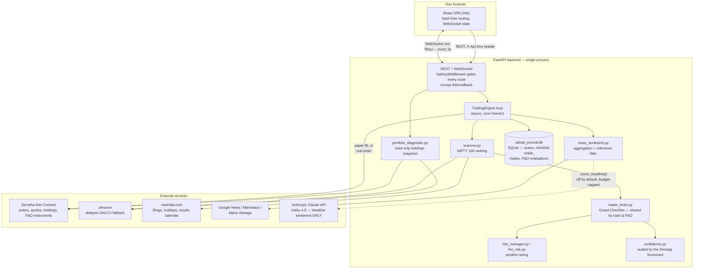
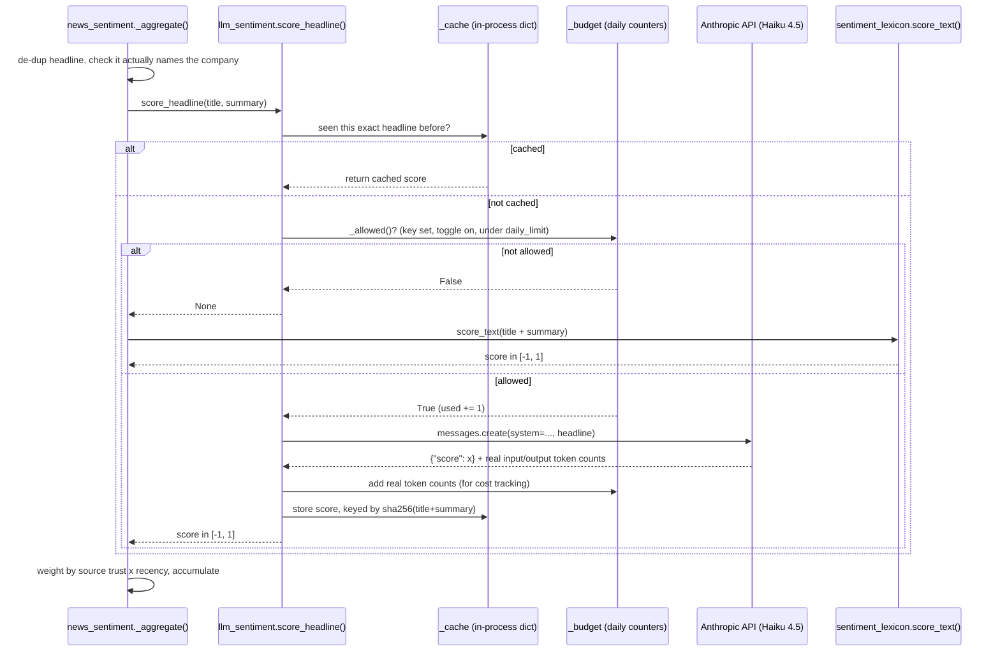
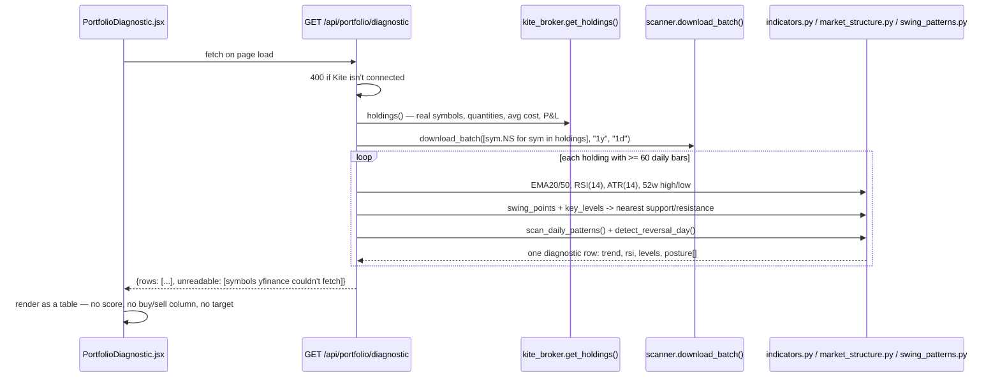
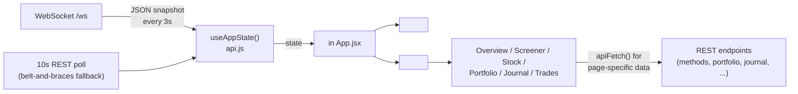

# Trader Sahab: an intraday trading agent for NSE (Zerodha)

Trader Sahab is an intraday trading agent for Indian equities and, now,
options-buying. It works like a disciplined technical trader. It **scans the
NIFTY 100** to decide *what* is worth trading today and on which side: strong
stocks to buy on strong days, weak stocks to **short** on weak days. It uses
market context, relative strength, volume, sector leadership, news and
results-day risk. The **Sahab's Dimaag** then decides *when* to enter and
exit, following **Zerodha Varsity's own Grand Checklist** — a candlestick
pattern, a stop at support or resistance, above-average volume, Dow Theory
trend agreement, and a minimum reward-to-risk — the same checklist Varsity's
Technical Analysis module teaches a retail trader to run before every trade.
It sizes every trade by risk and explains each decision in plain language,
with a link to the exact source behind it, on a live multi-page dashboard.

It runs in **paper mode** by default and can route real orders through
**Zerodha Kite Connect** — for cash equity, and (opt-in, separately) for
buying calls/puts once the checklist and a confidence gate both clear.

## ⚠️ Read this first

- **It is not profitable yet.** Every configuration in the
  [backtests](#backtest-results) loses money after costs. The best current
  default loses ~10% over 55 days. This is a well-instrumented, explainable
  decision engine that still needs an edge. Don't trade real money with it.
- **Most retail intraday traders lose.** SEBI's own study (Jul 2024) found
  71% of individual intraday cash traders net-lost in FY23, rising to 80%
  above 500 trades/year. A separate SEBI study (Sep 2024) found 93% of
  individual F&O traders lost money over FY22–FY24, averaging ~₹2 lakh loss
  each. The dashboard's Journal page shows these numbers directly instead of
  a made-up return target — see "What good actually looks like here."
- **F&O here means buying calls/puts only** — never writing/selling options,
  never futures. NISM Series VIII is explicit that a long option's maximum
  loss is the premium paid, full stop, while a short call's "has to be
  unlimited" — a fundamentally different risk shape from everything else
  this codebase sizes to a known, bounded loss. See
  [F&O (options-buying only)](#fo-options-buying-only) below.
- **F&O trades are gated by a confidence score**, not just the checklist —
  it's deliberately capped low whenever the Dimaag Scorecard (expectancy,
  Deflated Sharpe Ratio, Information Coefficient) hasn't proven a real
  system-wide edge yet. Right now, on real logged data, it hasn't — so F&O
  effectively won't trade until that changes. This is by design, not a bug.
- **The dashboard now requires an API key** on every route except the Kite
  OAuth redirect (`/kite/callback`) — see [Setup](#setup). Without this,
  anyone who could reach the backend (e.g. via a tunnel used for the Kite
  login step) could flip it to live trading or enable F&O.
- **News sentiment can optionally be read by an LLM** (Claude Haiku 4.5)
  instead of the keyword lexicon — off by default, costs real (small) money
  once you turn it on, and is not a price predictor: it scores a headline's
  tone toward the company, nothing more. See
  [LLM-read news sentiment](#llm-read-news-sentiment-llm_sentimentpy) below
  for exactly what it does and doesn't claim, and why raw "ask an LLM to
  predict the stock" isn't a feature here at all.
- **"Certified trader" describes the knowledge, not a licence.** The rules
  follow what CMT/NISM-trained technical traders study. If you ever offer
  this agent's signals to other people, SEBI's Research Analyst / Investment
  Adviser rules apply.
- **Starts in PAPER mode, F&O starts disabled.** No real orders until you
  click LIVE and set up Kite; no options orders until you also separately
  turn F&O on from the Portfolio page.
- **Data caveats:** yfinance is ~15 minutes delayed. The NSE feeds are the
  JSON endpoints behind nseindia.com's own pages, not a documented API, so
  they can change or rate-limit. Google News RSS is unofficial. Kite Connect
  gives F&O OHLC + open interest, not implied volatility — this app solves
  for IV itself from each contract's live premium (`options_pricing.py`).
- **Live trading needs a static IP** whitelisted on your Kite app (a SEBI
  rule). A home internet connection is often dynamic; a small cloud VM
  usually isn't. Run the backend there if you need this reliably.
- **NSE holidays are hardcoded for 2026** (`holidays.py`, pulled from NSE's
  own holiday-master API) — re-pull and update the list each year.

## How the agent decides

### 1. Market context (every scan)

| Signal | Effect |
|---|---|
| NIFTY daily trend (EMA20/50), day change, holding above its open | Market bias score |
| Breadth: advancers vs decliners across the NIFTY 100 | ≥ 60% up adds to the score, ≤ 40% subtracts |
| India VIX ≥ 20 | Counts as risk; new position sizes halved |
| **Bias** = risk-on / neutral / **risk-off** | Risk-off: **no new longs**, shorts get the slots (at most 2 long picks kept on watch). Risk-on: the mirror image, no new shorts. Neutral: both sides |

### 2. Scanner — *what* to trade (`scanner.py`, every 5 min open / 60 min closed)

The universe is the NIFTY 100 (large, liquid, F&O-eligible stocks), refreshed
weekly from NSE's list. The engine won't scan or trade on an NSE holiday or
weekend (`holidays.py`) — the dashboard shows "Markets are shut today for
X" and when trading resumes instead of treating it as an ordinary closed day.

| Stage | Rules (points) |
|---|---|
| **Tradability filters** | Price ≥ ₹100 · turnover ≥ ₹50 cr/day · daily ATR ≥ 1.2% (anything slower can't beat costs) · **results due today or next session → excluded** |
| **Daily setup** | Daily uptrend +20 / downtrend −15 · 10-day relative strength vs NIFTY up to +20 · within 3% of 52-week high +10 · NR7 +8 / inside day +6 · daily RSI 45–70 +5, > 75 −8 · confirmed Bulkowski daily pattern +15 · Murphy reversal day/selling climax +10 to +18 |
| **In play today** | Gap 0.3–3% +6, > 3% −10 · relative volume vs the same time of day ≥ 2× +15, ≥ 1.3× +8, < 0.7× −8 · beating NIFTY today up to +15 · above VWAP ±5 · above the 15-min opening range +8 · top-3 sector +8, bottom-3 −5 |
| **Catalysts** | Positive filing or news up to +12 · clearly negative −15 |
| **Both sides** | Every rule above is scored twice, once as a long and once as a mirrored short (daily downtrend, lagging NIFTY, near the 52-week low, gap down, below VWAP, broke the opening range, bottom-3 sector, negative catalyst). The stronger side is kept |
| **Deep read** | The top 15 get a full Sahab's Dimaag analysis with per-stock news; the timing edge for their side adjusts the score by up to ±15 |
| **Active watchlist** | Top 6 by final score whose daily trend doesn't fight their side, with at most 2 against the market bias, plus pinned stocks and open positions |

### 3. The Rule Book — how the sources connect

Every trade decision is one connected chain, not separate silos: a chart
pattern (Nison, Bulkowski, or Murphy) needs a stop at a real level (Varsity)
needs volume behind it (Varsity, plus Murphy's On Balance Volume divergence)
needs the trend to agree (Dow Theory *or* Brooks' "always-in" direction)
needs the day's news to not contradict it (NSE filings + Google News +
Marketaux + Alpha Vantage) needs a reward-to-risk worth taking (Varsity,
with Bulkowski's measured average move as the target when a daily pattern
applies) needs a position size that survives a string of losses (Tharp).
Every one of those checks is visible on the dashboard's Timing Read tab and
the dedicated **Technical Analysis** page, with its exact source cited, both
while a trade is being considered and afterwards in the journal — so the
reasoning is never hidden in a score.

| Source | What it contributes |
|---|---|
| Zerodha Varsity, Technical Analysis | The Grand Checklist itself: pattern, S/R stop, volume, Dow Theory, RRR |
| Nison, *Japanese Candlestick Charting Techniques* | Candlestick patterns, incl. Abandoned Baby and Rising/Falling Three Methods |
| Bulkowski, *Encyclopedia of Chart Patterns* | Daily-chart Double Top/Bottom and Head-and-Shoulders detection, gap classification, real failure-rate/average-move stats |
| Brooks, *Trading Price Action Trends* | The "always-in" trend direction, alongside Dow Theory |
| Murphy, *Technical Analysis of the Financial Markets* | Reversal days / selling climaxes (daily scanner) and On Balance Volume divergence (intraday checklist, ch 4 & 7). OCR'd this session — see below |
| News (NSE filings + Google News + Marketaux + Alpha Vantage) | The catalyst check — degrades or vetoes a trade the news contradicts |
| Tharp, *Trade Your Way to Financial Freedom* | Percent Risk / Percent Volatility position sizing, R-multiples, expectancy, Kelly fraction |
| NISM Series VIII | Options Greeks and long-option payoff definitions (now used by F&O below); F&O contract specs and the Market Wide Position Limit ban otherwise still unused |
| Bailey & López de Prado (2014); Grinold (cited in Jansen, *Machine Learning for Trading*) | Deflated Sharpe Ratio and Information Coefficient — the two statistics the Dimaag Scorecard is built on |

Murphy's book is a scanned PDF with no text layer. `tesseract` + `poppler`
were installed and used to OCR all 574 pages this session. Two concrete,
verifiable rules from it are wired into the engine (reversal days, OBV
divergence); Elliott Wave, Point & Figure, time cycles, intermarket analysis
and market-breadth indicators were read but deliberately not built in — each
for a specific reason (too subjective to encode reliably, redundant with
what's implemented, needs data this app doesn't fetch, or the wrong asset
class) documented on the dashboard's Technical Analysis page.

### 4. The Varsity Checklist — *when* to trade (`trader_brain.py`)

Trader Sahab's default entry logic (`entry_mode: "checklist"`) is Zerodha
Varsity's **Grand Checklist**, read directly from the Technical Analysis
module (chapters 4–18) and implemented rule for rule instead of paraphrased:

| Varsity rule | Chapter | What Trader Sahab checks |
|---|---|---|
| A recognisable candlestick pattern, after the right prior trend | ch 4–10 | One of 24 patterns (`candlestick_patterns.py`), sized sanely (0.3–3× ATR) — includes Nison's Abandoned Baby and Rising/Falling Three Methods |
| The stop-loss sits at support or resistance | ch 11 | The pattern's low/high must land within 0.5 ATR of a swing, previous-day, opening-range, Fibonacci or CPR level |
| Above-average volume on the signal candle | ch 12 | Volume vs its 10-candle average (Varsity's volume-trend table), **plus** On Balance Volume divergence over a longer window (Murphy ch 7) as an earlier warning than a single bar's volume ratio can show |
| The trend agrees | ch 17–18 | Dow Theory (15-minute trend, swing structure) **or** Brooks' "always-in" direction (`brooks.py`) — either confirms |
| Indicators confirm, but only to size the bet | ch 15.4 | MACD and RSI: if they agree, full size; if not, Varsity's own worked example ("300 shares instead of 500") — 60% size |
| *(new, not in Varsity)* News doesn't contradict the trade | — | NSE filings + Google News + Marketaux + Alpha Vantage sentiment; strongly opposed news vetoes the entry outright, mildly opposed news sizes it down like a missed indicator |
| Reward-to-risk of at least 1.5, net of costs | ch 18.5 | Target = next level beyond entry (or 2R if none); RRR is computed after estimated round-trip costs |

**A trade needs every required point** (pattern, S/R, volume, trend, RRR);
indicators and news only scale the size. This is stricter than the older
confluence-score system (`entry_mode: "confluence"`, kept for comparison) and
trades far less often — see the backtest table below.

Two more Varsity concepts feed the checklist as extra support/resistance
sources: **Fibonacci retracements** (ch 16 — 23.6/38.2/50/61.8% of the last
swing) and the **Central Pivot Range** (ch 22 — pivot, top and bottom from
the previous session's high/low/close), in `market_structure.py`.

Separately, at the **scanner** level (daily bars, not the intraday
checklist), `swing_patterns.py` detects confirmed Bulkowski Double
Top/Bottom and Head-and-Shoulders patterns (scored with his actual measured
failure rate and average move), Murphy reversal days / selling climaxes, and
`bulkowski.classify_gap()` labels today's gap as
area/breakaway/continuation/exhaustion using his gap-closure statistics —
all surfaced as cited reasons in the scanner's "Why it ranks" tab.

### 5. The confluence engine (legacy, `entry_mode: "confluence"`)

| What a trained trader checks | Source | Rule |
|---|---|---|
| Regime first | CMT / Wilder ADX | ADX ≥ 25 trending, < 20 ranging; RSI and Bollinger are read differently in each |
| Higher timeframe | Multi-timeframe analysis | 5m resampled to 15m; a long against the 15m downtrend −2 |
| Trend + VWAP | CMT, institutional practice | Price > EMA20 > EMA50 +2 · above session VWAP +1 |
| Structure | Dow Theory | Higher highs + higher lows +1; a broken structure below EMA50 forces an exit |
| Location | Price action | S/R zones from clustered swing points, previous-day H/L/C, opening range · breakout on volume +2 · resistance within 1 ATR −1.5 |
| Momentum | CMT | MACD crossover/histogram · RSI 50–70 in trends, ≤ 35 in ranges · stochastic turns · RSI ≥ 78 −1.5 (don't chase) |
| Trigger | Nison candlesticks | 20 patterns conditioned on the prior trend; full weight only at a value area; noise bars ignored |
| Participation | Wyckoff | Volume ≥ 1.5× average on the trigger bar +1 |
| Catalyst | News | Sentiment × 2; strongly negative news **vetoes** new longs |
| **Discipline** | Intraday practice | No entries before 09:30 or after 14:30 · ≥ 3 agreeing categories · bull ≥ 6 and beats bear by ≥ 2 · **one entry per stock per day** |

**Shorts** use the same checklist on the bearish evidence: bear score ≥ 6,
at least 3 agreeing categories, and an edge of 2 or more over the bull score.
They get the same discipline penalties as longs (fighting the 15-min uptrend
−2, support within 1 ATR −1.5, thin volume −0.5, RSI washed out −1.5), and
strongly positive news blocks a new short. The engine also refuses a short
the scanner ranked as a long, and vice versa. Shorts are MIS (intraday)
orders and are always covered by the 15:15 square-off. Never hold a cash
short overnight, because a short delivery goes to exchange auction.

Exits for both sides: the ATR stop-loss and take-profit (or the checklist's
own pattern-based stop and level-based target, when `entry_mode: "checklist"`),
the opposite case reaching 5 or the swing structure breaking, and the 15:15
square-off. `allow_shorts` in `STRATEGY_PARAMS["trader_brain"]` and
`SCANNER` turns shorting off.

### 6. Position sizing and stops (Varsity Risk Management module)

- **Percentage-risk sizing** (ch 11–13): risk 1% of capital divided by the
  stop distance — the pattern's structural stop when the checklist supplies
  one, ATR otherwise (`risk_manager.py`).
- **Step trailing stop** (Futures Trading ch 7): optional, off by default
  (`RISK["trail_after_r"]`) — after N·R profit, lock in (N−1)·R, one R at a
  time, the way Varsity describes a trailing SL on a Bracket Order.
- **R-multiples and expectancy** (ch 11, 14 — Kelly's Criterion): the
  backtester reports each trade's result as a multiple of its initial risk,
  the system's expectancy in R per trade, and the Kelly fraction (negative
  means the correct bet size is zero, however good the entries feel).

### 7. F&O (options-buying only)

Added this session, off by default (`config.FNO["enabled"] = False`). Buys a
**call** on a LONG checklist signal, a **put** on a SHORT signal — the same
signal engine as cash equity, just expressed through a different, capped-risk
instrument. Deliberately excludes writing/selling options and futures:

> "A long option position has limited risk (premium paid) and unlimited
> profit potential... if maximum loss for a long call position is equal to
> the premium paid, then... even maximum loss for the short call position
> has to be unlimited." — NISM Series VIII

| Piece | Module | What it does |
|---|---|---|
| Pricing + Greeks | `options_pricing.py` | Black-Scholes-Merton, with implied volatility solved from the contract's own live premium (Kite gives F&O OHLC + open interest, not IV). Delta, Gamma, Theta, Vega defined exactly as NISM Series VIII defines them |
| Contract selection | `fno_instruments.py` | Resolves the live NFO contract via Kite's own instrument dump — never a hardcoded lot size or expiry, since both are exchange-reset (SEBI changed NIFTY's lot size outright in Nov 2024). Skips expiries under 5 days out (theta decay) |
| Position sizing | `fno_risk.py` | The trade's entire max loss (premium × lots × lot size) is capped at a % of a *ring-fenced* F&O capital allocation (default ₹10,000 of ₹1,00,000), decided before the order is placed |
| Confidence gate | `confidence.py` | See below — the thing that actually decides whether a qualifying setup is allowed to fire |
| Knowledge base | `database.py` (`fno_evaluations`, `fno_trades`) | Every confidence read is logged, executed or not — same principle as `checklist_evals` logging every read, not just fills |

Exits are in **premium terms** (default: stop at −40%, target at +80% of
entry premium), because premium doesn't move linearly with the underlying.
Every F&O position shares the same `max_open_positions` and daily-loss-limit
counters as cash equity — one account, one risk budget, not two independent
ones. Live order placement uses Kite's `NFO` exchange and `MIS` product,
same same-day-square-off discipline as everything else here.

### 8. The confidence check — not a probability of profit

`confidence.py` scores every F&O candidate on two things: **local setup
strength** (how far past its own bar the checklist's edge margin cleared,
how many independent categories agreed, how clear the trend regime is) and
**system-wide evidence** (whether the Dimaag Scorecard's expectancy, DSR and
IC currently show a real, proven edge). The two multiply — a locally
"perfect" checklist pass on a system with zero proven edge is capped low,
by design, because a clean-looking setup means nothing statistically until
the system around it has demonstrated it beats chance. This is deliberately
*not* a calibrated probability: nothing here has enough closed trades yet to
calibrate one, and presenting a precise-looking number nobody's earned would
be exactly the fabricated-precision this project has tried to avoid
everywhere else. `config.FNO["min_confidence_to_trade"]` (default 60/100)
is the bar an order actually has to clear.

### 9. The Dimaag Scorecard — grading the system honestly

Added to the Journal page this session. Not a single "IQ" number — no such
validated measure exists for a trading system, and compressing independent,
differently-uncertain metrics into one score would hide the exact
uncertainty this project tries hard to keep visible. Three rows instead,
each graded against a bar already used elsewhere in this codebase, computed
from real logged data:

| Criterion | Source | Gate |
|---|---|---|
| Trading edge (expectancy) | Tharp, ch 6 | Needs ≥ 10 closed trades; pass if expectancy > 0R |
| Statistical significance (Deflated Sharpe Ratio) | Bailey & López de Prado (2014) | Needs ≥ 10 trades; pass if DSR ≥ 0.95 |
| Predictive skill (Information Coefficient) | Grinold, cited in Jansen ch 1 | Needs ≥ 20 (session, symbol) pairs; pass if IC > 0 |

Each row says "not enough data yet" rather than guessing below its sample
threshold. This same Scorecard is what gates F&O's confidence multiplier —
see above.

### 10. Position sizing and stops, News sources, Taxation panel

*(unchanged from before — see below)*

`risk_manager.py` implements Van Tharp's Percent Risk Model (ch 9, Model 3)
and Percent Volatility Model (ch 9, Model 4) for cash equity stop distance
and sizing; `costs.py` models Zerodha's published intraday tariff.

| News source | Cost | Used for | Weight |
|---|---|---|---|
| NSE corporate announcements | Free | Order wins, acquisitions, buybacks, resignations, pledges, credit ratings | 1.5 |
| NSE event calendar | Free | Results due today/next session → stock excluded | filter |
| Google News RSS (India) | Free, no key | Per-stock headlines plus market-wide "stocks in news" discovery | 1.0 |
| Marketaux (optional) | Free tier 100/day | Per-entity sentiment scores; set `MARKETAUX_API_KEY` | 1.2 |
| **Alpha Vantage (optional, added this session)** | Free tier 25/day (used at 20/day) | Real per-article sentiment, **market-wide discovery only** — its `tickers` filter can't reliably target NSE symbols and its budget is too tight for per-stock calls; set `ALPHAVANTAGE_API_KEY` | 1.2 |
| Yahoo Finance | Free | Fallback when Google returns nothing | 0.6 |

The weight column above is about *trust*, not *how a headline gets scored*.
Scoring is a separate step (`llm_sentiment.py` / `sentiment_lexicon.py`) —
see [LLM-read news sentiment](#llm-read-news-sentiment-llm_sentimentpy) below.

NSE bulk/block deals ("smart money" signal) were researched as a possible
addition but not built — it needs scraping an undocumented NSE endpoint, not
yet worth the added dependency.

Intraday equity is **speculative business income** under Indian tax law
(Varsity Markets & Taxation, ch 3–6) — the Trades tab shows running
trade-wise turnover, net P&L, estimated charges, and the relevant carry-
forward/advance-tax rules. Informational only, not tax advice.

### 11. Sahab's Journal — a persistent audit trail (`database.py`)

Everything above is written to a local SQLite database
(`backend/data/sahab_journal.db`, gitignored — runtime data, not source):

- **Every scan**, with the full ranked list, not just the picks.
- **Every checklist read** on an active-watchlist stock, roughly every 30
  seconds during market hours — whether or not it led to a trade.
- **Every fill**, with the checklist snapshot that justified an entry
  attached, and the realized R-multiple once the matching exit closes the
  position (linked by a shared `position_id`).
- **Every F&O confidence read**, executed or blocked, with the full
  breakdown and why (`fno_evaluations`) — and **every F&O position**, with
  the Greeks/IV/confidence frozen at entry and the outcome filled in at exit
  (`fno_trades`), never edited before that so no hindsight leaks in.

This is built around the [ML4Trading](https://github.com/stefan-jansen/machine-learning-for-trading)
book's own opening argument, "the process is your edge" — see
`research/ml4t_integration_plan.md` for the full reasoning. Two things from
it power the Scorecard above: the **Information Coefficient**
(`database.factor_ic()`, honestly "not enough data" below 20 session-pairs)
and the **Deflated Sharpe Ratio** (`evaluation.py`, every `backtester.py` run
logged as a trial in `backend/data/backtest_trials.json`).

### 12. LLM-read news sentiment (`llm_sentiment.py`)

The one LLM integration in this codebase, and deliberately narrow. Added
after explicitly declining a broader ask ("use an LLM to predict the
stock") — that request is answered in full in
[High-Level Design](#high-level-design) below, but the short version: an
LLM has no live market feed and no calibration for numeric forecasting: it
generates the most statistically fluent continuation of a prompt, not a
prediction, and that isn't a limitation prompting can fix.

What it *does* do: reads a headline's actual text — via Claude Haiku 4.5 —
and returns a sentiment score in the same `[-1, 1]` range
`sentiment_lexicon.score_text()` already returned, catching negation,
hedging language, and which company a multi-company article is really
about, which keyword matching can miss. It is a drop-in upgrade to one
existing scoring step, not a new prediction surface — and its value isn't
assumed: `database.factor_ic()` measures whether the resulting score
predicts anything, the same honesty check applied to every other signal in
this codebase.

- **Off by default.** Needs `ANTHROPIC_API_KEY`; even with a key set, a
  separate runtime toggle (`config.NEWS["use_llm_sentiment"]`, flippable
  from the Technical Analysis page with no restart) has to be on too.
- **Real usage tracking, not an estimate.** Every API response reports its
  own `input_tokens`/`output_tokens`; those are summed per day and priced
  at Haiku 4.5's published rate ($1/M input, $5/M output, verified against
  anthropic.com/claude/haiku on 2026-09-14 — re-check if it's been a
  while). The dashboard panel polls this live every 15s.
- **A daily call budget** (`config.NEWS["llm_daily_limit"]`, default 500)
  and a **permanent per-headline cache** (a headline's text doesn't change
  once published, so it's never re-scored or re-billed).
- **Falls back to the lexicon** on any error, disabled state, missing key,
  or exhausted budget — this can never block a scan or a checklist read.

### 13. Holdings diagnostic (`portfolio_diagnostic.py`)

Runs the *exact same* indicators the scanner uses on the NIFTY 100 (trend
via EMA 20/50, `indicators.rsi()`, distance from the 52-week high/low,
`market_structure.key_levels()` for support/resistance,
`swing_patterns.scan_daily_patterns()` / `detect_reversal_day()` for
confirmed daily patterns) against your actual Kite holdings — not a
separate, lighter-weight read.

This exists because a user asked for return predictions on their real
portfolio, and that's a line worth being explicit about: those holdings are
real money, most aren't NIFTY-100 intraday-style stocks this engine was
built to read, and producing a growth forecast for them would be
personalized investment advice — out of scope regardless of what the
technical read shows. What *is* in scope: naming today's actual technical
posture (`"Uptrend, RSI overbought"`, `"Within 3% of its 52-week low"`,
`"Possible top reversal today (Murphy ch 4)"`) so you have a second,
consistent pair of eyes on the chart. The decision stays yours.

### 14. Pre-Market Analysis (`scanner.run_premarket()`)

A dedicated page (`/premarket`) that ranks the NIFTY 100 *before the market
opens*, using only what's actually known then: last session's daily candle.
It calls the same `premarket_score()` component the live scanner blends with
intraday evidence during the day, run on its own with no 5-minute-candle
dependency — so it works at any time, not just 09:15–15:30 IST.

It deliberately does **not** invent a pre-open gap estimate, an SGX-Nifty-style
proxy, or a global-markets read — this codebase has no honest, licensed data
source for any of those, and previous sections of this README go to some
length about not fabricating numbers. What it does show, all real and
computed:

- **Last session's market read** — NIFTY's prior-day close/change/trend,
  India VIX, and advance/decline breadth, scored with the same bias logic
  `market_context()` uses intraday (`risk-on` / `risk-off` / `neutral`).
- **Today's event risk** — results due (`nse_feed.results_calendar()`) and
  ex-dates (`nse_feed.corporate_actions_on()`), the same exclusions the live
  scanner applies, surfaced before the open instead of discovered mid-session.
- **A ranked watchlist** — every eligible stock's daily trend, 10-day relative
  strength vs. NIFTY, distance from 52-week high/low, confirmed Bulkowski
  patterns, and the exact point-by-point reasons behind its score, with an
  Avoid tab for what's excluded today and why.
- **"The morning take"** — `scanner._premarket_narrative()` turns those same
  fields into a few sentences of trader-style prose instead of a bullet dump:
  a market-read line, the long/short shortlist with each pick's single
  strongest reason, an event-risk caveat, and a closing discipline line. It's
  presentation, not a second source of truth — every clause maps to a field
  already in the response, built with plain string formatting (no LLM call),
  so it can't say anything the data doesn't already say.

`trading_engine` owns the schedule and the cache (`state.premarket`), not
`app.py` — it runs the scan once a day on its own (`tick()`'s pre-market
section), so the shortlist is ready before you'd even open the page, not
only when someone visits it. `/api/premarket` just reads/triggers through
the engine; a manual Refresh button is on the page too.

**Linking it to an actual buy — deliberately narrow, on purpose.** The
pre-market shortlist *primes the day's watchlist*: once, at the start of each
trading day (`_maybe_seed_watchlist_from_premarket()`), before the live
intraday scanner has run for the first time, `state.watchlist` is seeded with
last night's top picks (plus anything pinned or already held) instead of
sitting empty until the first live scan completes a few minutes into the
session. That's the entire link. It does **not** place an order, and it
never will on its own — every entry, for a pre-market pick or any other
symbol, still has to clear the exact same live gate: `trader_brain_signal()`'s
checklist (candlestick pattern, above-average volume, VWAP side, opening
range, reward-to-risk — see "How the agent decides" above) evaluated against
*today's* intraday candles, which don't exist until the market is actually
open. This mirrors how a discretionary trader actually works: build tonight's
watchlist off the close, then let tomorrow's tape — not last night's
conviction — decide whether anything gets bought. Research into wiring it
any tighter than that (e.g. auto-buying pre-market's top pick at the open)
was deliberately rejected: it would mean sizing a real order off zero live
confirmation, exactly the kind of fabricated-certainty shortcut the rest of
this README argues against.

### 15. Real-capital sync (`trading_engine._sync_capital()`)

`config.RISK["total_capital"]` used to be a static number you set once. The
risk model (Van Tharp's 1% rule, `risk_manager.position_size()`) sizes every
trade off it — and if that number doesn't match what's actually sitting in
your Kite account, sizing can look perfectly fine on the dashboard and still
get rejected by Kite for insufficient margin the moment an order goes live.

`_sync_capital()` closes that gap: once Kite is connected, every tick (max
once per 5 minutes) it reads the real equity `live_balance` from
`kite.get_margins()` and writes it straight into `config.RISK["total_capital"]`
in place — `RiskManager` holds a reference to that same dict, so the very
next `position_size()` call uses the real figure, no restart needed. Applies
in paper mode too, on purpose: a paper day should test against what a live
day could actually size, not a fictional balance. Toggle it off with
`config.RISK["sync_capital_with_kite"] = False` to pin the number manually
instead. The Portfolio page's Kite margins card shows the synced amount and
when it last refreshed, alongside the fuller `utilised` breakdown Kite's
`margins()` endpoint returns (span, exposure, option premium, M2M, holding
sales) — not just cash and a used-margin total.

One consequence worth being explicit about: **this makes real account size a
real constraint on whether any cash-equity trade can fire at all.** At 1%
risk, ₹500 (or the ₹683 this account actually holds as of this write-up)
produces a stop-distance-based position size of 0 shares for essentially
every NIFTY-100 stock's real ATR — the risk-per-trade in rupees is smaller
than one share's stop distance. This isn't a bug to patch around; it's the
Van Tharp model doing exactly what it's supposed to do. The honest ways
around it are: fund the account with more real capital (sizing then reflects
it automatically, no config edit needed), rely on F&O's premium-based sizing
instead (cheaper per unit, but confidence-gated — see §9, currently failing
since the live Information Coefficient is negative), or accept that a small
account is a pipeline/connectivity test rather than a real trading day until
it's funded further.

### 16. Day Plan (`day_plan.py`) — capital planning without a fabricated return

A user directly asked for a tab showing "what we're going to invest and what
is expected at end of day, and did we achieve it" against a planned ₹5,000.
The middle part of that — an expected end-of-day number — is exactly what
this README has refused everywhere else, for the same reason each time:
there's no proven edge yet to base a return forecast on (the Dimaag
Scorecard's live Information Coefficient is negative, expectancy hasn't
cleared its bar — §9). Stating an expected P&L would be fabricating a number
this system has no right to state, not a feature.

What's real and buildable instead, and what `/day-plan` actually shows, split
into two halves that are never allowed to blend into each other:

- **Your plan** — enter a capital figure (defaults to 5,000) and see the risk
  model's own boundaries at that number: max ₹ risk per trade, max ₹ daily
  loss, and — for every symbol on today's real ranked shortlist (the live
  scanner's active picks once it's run, else the pre-market ranking) — the
  actual `risk_manager.RiskManager` computed stop, target, share quantity,
  ₹ risk, ₹ reward and RRR at that capital. This is arithmetic on real prices
  and real ATR, using the exact same `position_size()`/`stop_loss_price()`/
  `take_profit_price()` calls a live entry would use — not a simulation of
  outcomes, just what the sizing math produces. At ₹5,000 today, 2 of the 6
  current picks size to a real 1+ share position; the other 4 round to 0 —
  shown plainly, not hidden.
- **What actually happened today** — today's real fills from the journal
  (`database.trades_between()`), actual realized P&L, and whether the day
  stayed inside the daily-loss cap *computed off the real capital that
  actually sized those trades* (not the hypothetical figure above — the two
  are shown side by side specifically so they're never mistaken for each
  other, since a live day almost never uses exactly the amount someone is
  simulating in the planner).

"Did we achieve it" becomes "did the day stay inside its own rules," checked
against a real number, instead of a profit target checked against an
imagined one.

## Dashboard

Rebuilt across two sessions: first as a multi-page site (hash-routed, single
HTML file) replacing a fixed three-pane layout, then migrated to **React +
Vite** with real client-side routing (the old version still works standalone
at `frontend/legacy/index.html`). It follows your system's dark mode, and
colour only means something: green for long/profit, red for short/loss,
amber for waiting, violet for a book/rule citation.

Every piece of jargon (VWAP, RRR, ADX, the option Greeks, DSR, IC, Kelly,
confidence, ...) has a hover/focus-explained tooltip — a dotted underline
signals it, keyboard-focusable so it works without a mouse. The stock chart
(Lightweight Charts v5) supports mouse-wheel zoom, pinch-zoom, and
kinetic-scroll panning, and layers on top of the candles: EMA 20/50 trend
lines (recomputed client-side from the same candles, not a separate value),
a volume histogram panel, the checklist's actual entry/stop/target as
labeled price lines, and arrows marking the latest detected candlestick
pattern — explicitly **not** a projected price path, see
[Enhancing the chart](#enhancing-the-chart-componentschartjsx) below.

- **Overview** — one-sentence headline of what the agent is doing, a market
  countdown ("opens in 2h 14m" / a live session-progress bar, computed
  server-side in IST and holiday-aware), NIFTY/VIX/breadth/sectors, today's
  picks, open positions, and the activity log.
- **Screener** — every NIFTY 100 stock, ranked. Click a column header
  (Score / Change % / Symbol) to sort; click a row to expand its full rule
  book inline without leaving the page, with an "Open full page →" link.
- **Technical Analysis** — a dedicated reference page assembled from the
  live code constants (not hand-written text that could drift): the
  checklist categories, all 24 candlestick patterns, Bulkowski's daily
  patterns and gap stats, Murphy's reversal days and OBV divergence, trend/
  level/momentum rules, news source weights, position-sizing methods, the
  F&O section (Greeks, pricing model), a live LLM-sentiment usage panel
  (real token counts, actual cost so far, an on/off toggle), and an honest
  "read but not (yet) built in" list with the specific reason each item
  doesn't apply.
- **Portfolio** — real Kite holdings + margins once connected (free Kite
  Connect endpoints), today's paper/live positions regardless of Kite, open
  F&O positions with live Greeks/confidence, and the F&O on/off toggle (its
  own confirmation dialog, separate from the cash-equity Live switch). A
  link from here opens **Holdings diagnostic** (`/portfolio/diagnostic`) —
  today's technical read (trend, RSI, 52-week distance, support/resistance,
  confirmed daily patterns) on every real Kite holding, using the exact same
  indicators the scanner runs on the NIFTY 100. Deliberately **not** a buy/
  sell call or a return forecast — see
  [Holdings diagnostic](#holdings-diagnostic-portfolio_diagnosticpy) below
  for why that line is drawn where it is.
- **Journal** — the Dimaag Scorecard, the F&O knowledge base summary, the
  honest SEBI-sourced benchmark panel ("What good actually looks like
  here" — not a promised return number), trade record, which checklist
  rules actually mattered, and the Information Coefficient read.
- **Trades** — the fill-by-fill blotter.
- **Selected stock page** — a plan box (*Ready to short*, *Waiting to buy*
  with which checklist points fail, *Holding N shares*, or *No trade
  today*), key levels on the chart, the full Timing Read checklist, why the
  scanner ranked it where it did, and its news.

Every clickable item is a real button/div with a visible keyboard focus
ring. The layout stacks to one column on narrow screens.

## Backtest results

55 days of 5-minute bars (2026-06-29 → 2026-09-11), ₹1,00,000 capital,
realistic Zerodha costs + slippage. H1/H2 are the two halves of the sample.
These predate the Murphy/OBV-divergence and F&O additions — not yet re-run
with them.

| Setup | Trades | Win % | Gross | Costs | **Net** | H1 / H2 |
|---|---|---|---|---|---|---|
| SMA crossover, 4 fixed stocks | 108 | 19% | −₹4,178 | ₹3,699 | **−7.9%** | — |
| Sahab's Dimaag, 4 fixed stocks, unlimited re-entries | 452 | 19% | −₹13,602 | ₹15,485 | **−29.1%** | −12.6k / −16.4k |
| **Sahab's Dimaag, 4 fixed stocks, 1 entry/stock/day (current default)** | 162 | 21% | −₹4,938 | ₹5,548 | **−10.5%** | −4.3k / −6.2k |
| Sahab's Dimaag + scanner top-5/day, 1 entry/day | 218 | 20% | −₹6,767 | ₹6,979 | **−13.7%** | −5.9k / −7.8k |
| Same on **15-minute** bars, 4 fixed stocks | 103 | 23% | −₹2,736 | ₹3,525 | **−6.3%** | −3.3k / −3.0k |
| 15-minute bars, scanner top-5/day | 177 | 23% | −₹8,796 | ₹5,668 | **−14.5%** | −5.7k / −8.8k |

**Varsity checklist mode** (`entry_mode: "checklist"`, now the default —
same 55 days, long + short):

| Setup | Trades | Win % | Net | Expectancy | Kelly |
|---|---|---|---|---|---|
| 4 fixed stocks | 6 | 17% | **−0.5%** | −0.69R/trade | −36% (bet size should be 0) |
| Scanner top-10/day, NIFTY 100 | 19 | 26% | **−1.9%** | −0.60R/trade | −43% (bet size should be 0) |

The checklist requires a pattern, a stop at a real level, above-average
volume, Dow Theory agreement and a 1.5+ reward-to-risk all at once — so it
trades far less often (6–19 times in 55 days, versus 150–450 for the
confluence engine) and loses far less in rupee terms. But **it is not an
edge**: the expectancy per trade is still negative, and the Kelly fraction
says the mathematically correct position size is zero. Both figures come
from far too few trades (6 and 19) to trust — a sanity check on the logic,
not a verdict on the checklist.

**With short selling, confluence engine** (same period, symmetric long/short rules):

| Setup | Trades | Win % | Gross | Costs | **Net** | Longs / Shorts net |
|---|---|---|---|---|---|---|
| 4 fixed stocks, long-only (`--long-only`) | 162 | 20% | −₹5,613 | ₹5,548 | **−11.2%** | −11.2k / — |
| 4 fixed stocks, long + short | 202 | 25% | −₹3,999 | ₹6,920 | **−10.9%** | −6.3k / −4.6k |
| **Scanner top-5/day, long + short** | 146 | 25% | −₹3,788 | ₹4,741 | **−8.5%** | −5.8k / −2.7k |
| 15-minute bars, 4 fixed stocks, long + short | 189 | 29% | −₹5,020 | ₹6,470 | **−11.5%** | −5.6k / −5.9k |

What this shows:

- **Overtrading was the biggest leak.** Limiting each stock to one entry a
  day cut losses in every variant and in both halves.
- **Slower bars help.** 15-minute bars roughly halved the loss on fixed
  stocks — fewer, larger moves are less eaten by costs.
- **The scanner's daily-only picks didn't beat a fixed list** of four
  mega-caps in backtest — it can't replay the scanner's intraday relative
  volume, gap, news or results-day filters, which is most of what it does live.
- **Gross P&L is negative everywhere.** Not only a cost problem — the
  entries themselves don't have an edge yet.

```bash
cd backend
python backtester.py --strategy trader_brain --days 55
python backtester.py --strategy trader_brain --universe nifty100 --scan-top 5
python backtester.py --strategy trader_brain --interval 15m
python backtester.py --no-costs   # frictionless, for reference only
```

## Improving the brain

1. **Longer history + out-of-sample.** 55 days is tiny. Kite's historical
   API gives years of data. Tune on one period, validate on another.
2. **Separate thresholds per side.** Shorts behaved differently from longs
   here — test on more data than 55 days.
3. **Structure-based stops** below the swing low that defined the setup,
   instead of a fixed ATR multiple.
4. **Record live news + scanner snapshots** so catalysts and intraday scan
   rules can be backtested later.
5. **Let real F&O data answer its own open question.** `fno_journal_summary()`'s
   confidence-to-outcome rank correlation (needs ≥ 10 closed F&O trades)
   will show whether F&O confidence — currently borrowed from cash equity's
   Scorecard — actually predicts F&O outcomes, or whether F&O needs a
   separately-earned Scorecard of its own.
6. **Learn from better sources.** Already integrated: Varsity, NISM Series
   VIII, Murphy, Nison, Brooks, Bulkowski, Tharp. Still open: Chan's
   *Algorithmic Trading*, López de Prado's *Advances in Financial Machine
   Learning* (backtest overfitting), and the ML4Trading chapters on
   gradient boosting / deep learning / RL once there's enough real trade
   history to justify them (see `research/ml4t_integration_plan.md`).

## Architecture

```
webapp/
├── backend/
│   ├── app.py                   # FastAPI: REST + WebSocket, API-key middleware, runs the engine
│   ├── config.py                # SCANNER, MARKET_FILTER, NEWS, STRATEGY_PARAMS, RISK, COSTS, FNO, DASHBOARD_API_KEY
│   ├── trading_engine.py        # loop: scan → per-stock brain → market/risk gates → execute (cash + F&O) → activity log
│   ├── scanner.py               # ★ NIFTY 100 ranking: market context, tradability, setup, in-play, catalysts
│   ├── trader_brain.py          # ★ confluence timing strategy with explanations (shared by cash and F&O)
│   ├── confidence.py            # ★ F&O per-trade confidence check, scaled by the Dimaag Scorecard
│   ├── options_pricing.py       # ★ Black-Scholes-Merton pricing, Greeks, implied-volatility solve
│   ├── fno_instruments.py       # ★ resolves live NFO contracts via Kite's own instrument dump
│   ├── fno_risk.py              # ★ premium-based position sizing (options-buying only, capped max loss)
│   ├── evaluation.py            # ★ Deflated Sharpe Ratio + the Dimaag Scorecard
│   ├── methods.py               # ★ assembles the Technical Analysis page from real code constants
│   ├── holidays.py              # NSE trading holiday calendar
│   ├── news_sentiment.py        # ★ multi-source news aggregation (NSE, Google, Marketaux, Alpha Vantage) + market catalyst discovery
│   ├── llm_sentiment.py         # ★ Claude Haiku headline scoring — real usage/cost tracking, budget, cache, toggle
│   ├── portfolio_diagnostic.py  # ★ technical read on real Kite holdings (trend/RSI/levels/patterns), not a forecast
│   ├── nse_feed.py              # ★ NSE announcements + results calendar
│   ├── sentiment_lexicon.py     # India-tuned finance sentiment lexicon
│   ├── universe.py              # NIFTY 100 list (cached in data/nifty100.csv)
│   ├── indicators.py            # EMA, RSI, MACD, Bollinger, VWAP, ADX, Stochastic, ATR, OBV, resampling
│   ├── candlestick_patterns.py  # context-aware pattern recognition (24 patterns)
│   ├── swing_patterns.py        # Bulkowski daily patterns + Murphy reversal days (scanner only)
│   ├── market_structure.py      # swings, Dow trend, S/R zones, breakouts, Fibonacci, CPR
│   ├── risk_manager.py          # cash-equity risk sizing, 33% notional cap, ATR stops, daily loss limit
│   ├── day_plan.py              # ★ real risk-boundary sizing at a given capital + today's actual outcome — §16
│   ├── database.py              # ★ Sahab's Journal — scans, checklist reads, trades, F&O evaluations/trades
│   ├── backtester.py            # same strategy/risk code over history, with costs; --universe mode
│   ├── costs.py · data_provider.py · state.py · paper_broker.py · kite_broker.py · generate_access_token.py
│   └── data/nifty100.csv
└── frontend/                     # React + Vite dashboard (migrated from a single-file vanilla-JS app)
    ├── src/
    │   ├── App.jsx                # routing (react-router) + layout shell
    │   ├── api.js                 # apiFetch, dashboard-key handling, useAppState() WebSocket hook
    │   ├── helpers.js             # domain helpers shared across pages (scanRows, analysisFor, primaryRule, ...)
    │   ├── format.js              # number/money/date formatting + the hover-tooltip glossary (GLOSSARY)
    │   ├── components/
    │   │   ├── Header.jsx          # topbar: market status/countdown, realized/open P&L, Kite connect, Paper/Live
    │   │   ├── Chart.jsx            # ★ Lightweight Charts v5 wrapper — see Low-Level Design below
    │   │   ├── Tip.jsx              # the hover/focus glossary tooltip
    │   │   ├── RuleBook.jsx · Pill.jsx · SymLink.jsx · Feed.jsx
    │   │   └── LlmSentimentPanel.jsx # ★ live usage/cost + on-off toggle for llm_sentiment.py
    │   └── pages/
    │       ├── Overview.jsx · Screener.jsx · Stock.jsx · Trades.jsx
    │       ├── PreMarket.jsx      # ★ renders scanner.run_premarket()'s daily-only pre-open ranking
    │       ├── DayPlan.jsx        # ★ renders day_plan.py — real risk-boundary sizing, never a return forecast
    │       ├── TechnicalAnalysis.jsx
    │       ├── Portfolio.jsx      # incl. the synced-capital Kite margins card — see §15
    │       ├── PortfolioDiagnostic.jsx # ★ renders portfolio_diagnostic.py's read on your holdings
    │       └── Journal.jsx
    └── legacy/index.html          # the original single-file version, kept working for reference
```

## High-Level Design



**Why this shape:** one backend process owns all state (`state.py`'s
`AppState`, behind a lock) and pushes it to every connected browser over
the WebSocket — there's no separate state store the frontend and backend
could disagree about. The engine loop is the only writer; the REST API and
the diagnostic/LLM paths are read-mostly extensions bolted onto the side,
which is why they can be built, tested, and toggled independently without
touching the core scan → brain → risk → execute chain. External services
are all optional except Kite for live data/orders and yfinance for
backtesting — everything else (Marketaux, Alpha Vantage, Claude) degrades
to "skip this source" on its own, never blocking a decision.

## Low-Level Design

Three pieces added this session don't have detailed documentation
elsewhere in this README (the trading logic itself is documented narrative-
style in [How the agent decides](#how-the-agent-decides) above, which *is*
effectively its LLD) — their internals, below.

### LLM-read news sentiment (`llm_sentiment.py`)



Any exception anywhere in the API-call branch (network error, bad JSON,
rate limit) is caught, logged, and treated as "not allowed right now" —
`score_headline()` returns `None` and the caller falls back to the lexicon
in the exact same code path as a disabled/unconfigured LLM. There is no
branch where a failure surfaces as a wrong score instead of a graceful
fallback.

`stats()` (backing `GET /api/llm-sentiment/status`, polled every 15s by
`LlmSentimentPanel.jsx`) reads `_budget`'s real accumulated
`input_tokens`/`output_tokens` and multiplies by the published per-token
price — not `used_today × an assumed average call size`. `set_enabled()`
(backing `POST /api/llm-sentiment/enable`) mutates
`config.NEWS["use_llm_sentiment"]` directly, so the toggle takes effect on
the very next headline scored, no restart.

### Holdings diagnostic (`portfolio_diagnostic.py`)



`_posture()` is the only place this module makes a judgment call, and it's
a bounded one: it names which real, already-computed signals are present
(`"Uptrend, RSI overbought"`, `"Within 3% of its 52-week high"`) — it never
combines them into a single number, because that number would look like a
recommendation whether or not it was labeled as one.

### Enhancing the chart (`components/Chart.jsx`)

Four independent `useEffect` hooks, each keyed on exactly the props that
should trigger it — not one big effect that redoes everything on every
render:

1. **Mount-only** — creates the chart once (`createChart`), the candlestick
   series, two `LineSeries` (EMA 20/50), a `HistogramSeries` on its own
   price scale (the volume panel, squeezed into the bottom 18% via
   `scaleMargins`), and a `ResizeObserver`. Cleans up (`chart.remove()`) on
   unmount.
2. **Keyed on `symbol`** — fetches `/api/candles/:symbol`, sets the
   candlestick data, then recomputes EMA 20/50 *client-side* from those
   same closes (`emaSeriesJS()`, the identical formula
   `indicators.ema_series()` uses server-side — not a separately-fetched or
   guessed value) and sets the volume histogram, colored per bar direction.
3. **Keyed on `plan`** (support/resistance/VWAP + the checklist's
   entry/stop/target) — removes and redraws price lines. Worth repeating
   the framing from "Read this first" above: entry/stop/target are the
   checklist's actual computed trade plan, never a projected future price
   — there is no forecasting model backing a price curve, and the chart
   draws none.
4. **Keyed on `patterns`/`barTime`** — arrow markers
   (`createSeriesMarkers`, the v5 API; v4 used `series.setMarkers()`
   directly) on the most recently detected candlestick pattern's bar.

Lightweight Charts was upgraded 4 → 5 as part of the React migration, which
changed series creation from `chart.addCandlestickSeries(...)` to
`chart.addSeries(CandlestickSeries, ...)` (series types are now imported
values, not method names) — worth knowing if you're diffing this against
older Lightweight Charts examples online. `kineticScroll`, `handleScroll`,
and `handleScale` are all explicitly enabled in the chart options; they
aren't v5 defaults.

### Frontend state flow



There is exactly one WebSocket connection and one source of truth
(`state` in `App.jsx`'s `<Shell>`) — every page receives it as a prop rather
than opening its own connection or keeping local copies that could drift.
Page-specific data (news, methods, journal, the diagnostic) is fetched
independently per page via `apiFetch()`, since that data doesn't change
every 3 seconds and doesn't belong in the constant WebSocket stream.

## Setup

```bash
cd webapp/backend
python3 -m venv .venv && source .venv/bin/activate
pip install -r requirements.txt
export MARKETAUX_API_KEY=...        # optional
export ALPHAVANTAGE_API_KEY=...     # optional — market-wide news discovery only
export ANTHROPIC_API_KEY=...        # optional — LLM-read news sentiment, see below
uvicorn app:app --port 8000
```

On first run, the backend auto-generates a **dashboard API key**
(`backend/.dashboard_key.json`, gitignored) and logs it on startup. Every
route except `/kite/callback` requires it (`X-Api-Key` header, or `?key=`
for the WebSocket and the Kite-login popup, since neither can set a custom
header).

In another terminal:

```bash
cd webapp/frontend
npm install
npm run dev          # http://localhost:5500
```

It'll prompt for the dashboard API key once (or pass it via `?key=...` in
the URL), then remember it via `localStorage`. The key requirement exists
because the backend sometimes needs to be reachable from the public
internet (see "Connecting Kite locally" below) and has real control
surface — without it, anyone with the URL could flip the dashboard to live
trading or turn on F&O. `npm run build` produces a static `dist/` you can
serve any other way if you don't want the dev server running.

The first scan runs within a minute, even when the market is closed (it
shows the last session). To point the dashboard at a backend on another
local port, add `?api=http://localhost:8765` to the URL.

Main settings in `config.py`: `SCANNER` (universe filters, active count,
pinned symbols), `MARKET_FILTER` (risk-off / VIX behaviour), `NEWS`
(sources), `STRATEGY_PARAMS["trader_brain"]`, `RISK`, and `FNO` (capital
allocation, confidence bar, expiry window — disabled by default).

### Connecting Kite locally

Kite Connect's app registration requires an **HTTPS** Redirect URL, even for
local testing — `http://127.0.0.1:8000/kite/callback` will be rejected by
the form. Two ways around it:

1. **CLI script, no exposure needed** — `python generate_access_token.py`
   opens the login in your browser; after you log in, the `request_token` is
   in the browser's address bar even if the redirect page fails to load. You
   paste it into the terminal; nothing on the internet ever needs to receive
   the redirect. Register *any* real, resolving `https://` URL as the
   Redirect URL just to satisfy the form — it never needs to actually
   respond. This is the recommended daily routine (see below).
2. **In-app "Connect Kite" button, needs a real tunnel** — install `ngrok`
   (`brew install ngrok`), get a free authtoken from
   [dashboard.ngrok.com](https://dashboard.ngrok.com), `ngrok config
   add-authtoken <token>`, then `ngrok http 8000`. Register the printed
   `https://....ngrok-free.dev/kite/callback` as the Redirect URL. This
   exposes the *whole* backend while the tunnel runs — the dashboard API key
   (above) is what makes that safe, but still stop the tunnel once the login
   completes; you don't need it running again until you change it.
   ngrok's free tier now includes one permanent static domain per account
   (Gateway → Domains in its dashboard) — use `ngrok http 8000 --url
   https://<your-static-domain>` to avoid re-registering a new Redirect URL
   every time you restart the tunnel.

**Kite sessions expire daily.** Whichever method you used, you'll need to
redo it each morning before trading live —
`python generate_access_token.py` doesn't depend on any tunnel still being
up, which is why it's the more durable daily habit.

### Getting an Anthropic API key (for LLM-read news sentiment)

Optional — only needed if you want `llm_sentiment.py` reading headlines
instead of the keyword lexicon. `pip install -r requirements.txt` already
pulls in the `anthropic` SDK, so no separate install once you have a key.

1. Go to [console.anthropic.com](https://console.anthropic.com) and sign
   up or log in.
2. Anthropic's API is prepaid — under **Billing**, add a payment method
   and purchase credits before any call will succeed. This is a real (if
   small — see the cost tracking on the Technical Analysis page) ongoing
   cost, not a one-time setup fee.
3. Under **API Keys**, create a new key and copy it — it's shown once.
4. `export ANTHROPIC_API_KEY="sk-ant-..."` and restart the backend.
   Setting the key alone doesn't turn the feature on: flip the toggle on
   the Technical Analysis page (or `POST /api/llm-sentiment/enable`) once
   you're ready — it stays off by default even with a valid key, and you
   can turn it off again any time without restarting anything.

### Going live (only once backtests and paper results justify it)

1. Create an app at https://developers.kite.trade and subscribe to the
   **Connect** tier (needed for historical data + live market quotes —
   Personal tier explicitly excludes both, and F&O has no other data source).
2. Whitelist a **static IPv4** on the app. Use a VPS in India, and run the
   backend there, if your home connection doesn't have one.
3. `export KITE_API_KEY=... KITE_API_SECRET=...`, then log in each morning
   (`python generate_access_token.py` or **Connect Kite**). The token is
   saved to the gitignored `.kite_session.json`.
4. Click **LIVE** and confirm.
5. **Separately**, if you also want F&O: open the Portfolio page and turn
   F&O on (its own confirmation dialog). It stays off by default even once
   cash equity is live — an order only reaches Kite when both are on.

## Known limitations

- Net-negative in every backtest. There's no edge yet, in cash equity or F&O.
- F&O confidence currently borrows cash equity's Scorecard rather than
  having its own — untested assumption, not a proof (see "Improving the
  brain" above).
- Shorts (cash) are intraday cash (MIS) only. No check for stocks in the
  exchange's short-sell ban or circuit limits. No Market Wide Position Limit
  check for F&O either (documented, not yet built).
- News, gaps, relative volume and results-day filters can't be backtested
  (no historical data for them). F&O hasn't been backtested at all yet —
  only the pricing/Greeks/sizing math has been unit-tested with synthetic data.
- Live analysis uses the still-forming candle, unlike backtests.
- Live positions and the current watchlist still reset on restart (only
  history is persisted, in `sahab_journal.db`), and aren't reconciled with
  `kite.positions()`.
- Single-user. An API key now gates every route, but there's still no
  per-user auth, rate limiting, or HTTPS termination built in — treat this
  as "safe enough to expose briefly via a tunnel," not "safe to run
  permanently on the open internet" without more hardening.
- LLM sentiment's actual effect on the Information Coefficient hasn't been
  measured yet — it's too new. Whether reading headlines this way helps,
  hurts, or does nothing is an open, honestly-unanswered question until
  enough logged pairs accumulate with it turned on.
- Holdings diagnostic assumes NSE (`.NS`); a BSE-only listing among your
  holdings will show up under `unreadable` rather than a wrong read. It
  also runs the same indicators regardless of whether a holding is a stock
  or an ETF (`SILVERBEES`, `MID150BEES`, ...) — "trend" for an ETF means
  the trend of what it tracks, not a company's fundamentals, and the
  diagnostic doesn't distinguish the two.
- Real account size is a real constraint, not just a config setting. At 1%
  risk (Van Tharp), a small account (see §15) produces a 0-share position
  size for essentially any NIFTY-100 stock — the engine will mechanically
  place nothing until either the account is funded further or the risk
  settings are deliberately changed away from that guidance.
- Pre-market ranking (§14) uses only the last completed session's daily
  candle — no live pre-open price, no gap estimate. It can disagree with
  where a stock actually opens; that's expected, not a bug, since this
  codebase has no honest data source for a real pre-open number.
