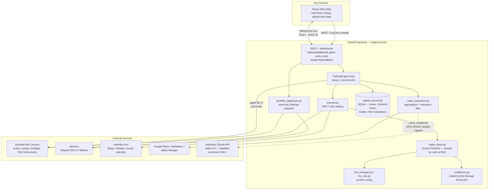
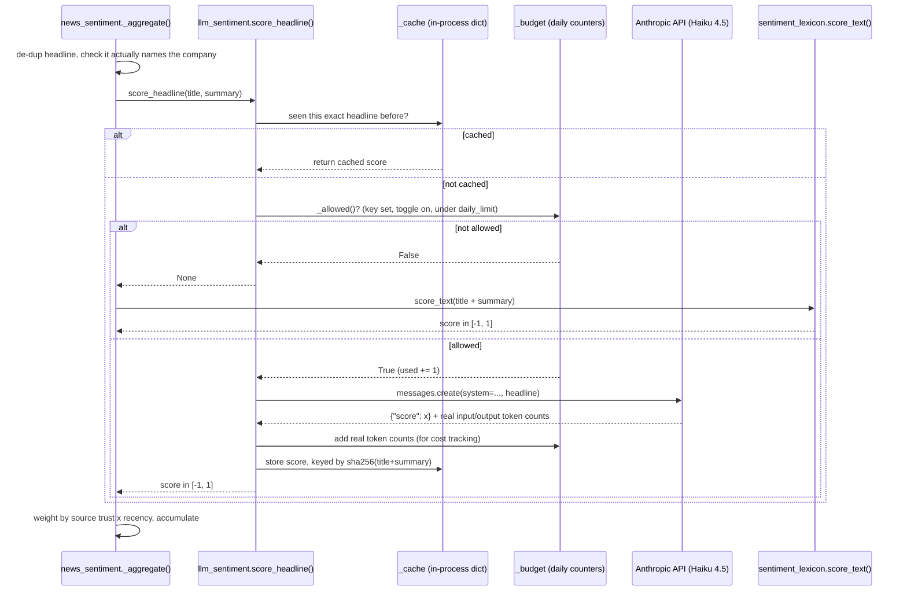
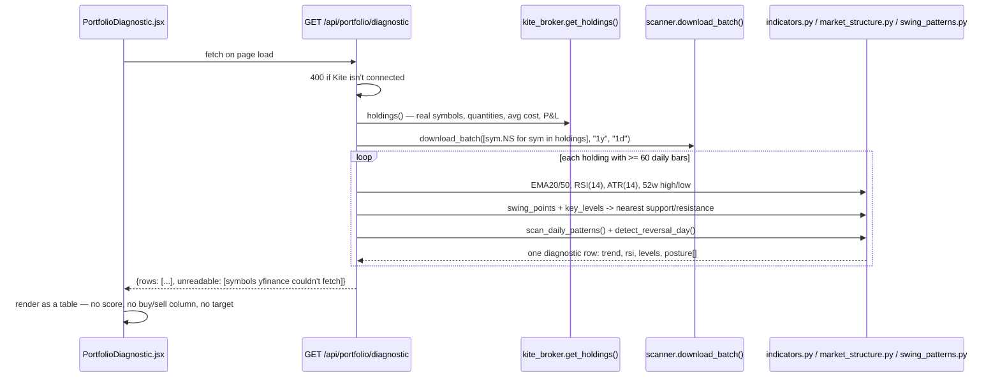
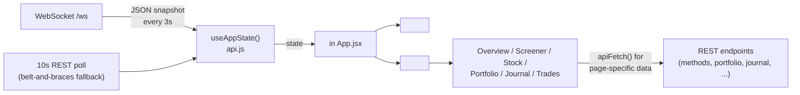

# Trader Sahab: an intraday trading agent for NSE (Zerodha)

Trader Sahab is an intraday trading agent for Indian equities and, now,
options-buying. It works like a disciplined technical trader. It **scans the
NIFTY 100** to decide *what* is worth trading today and on which side: strong
stocks to buy on strong days, weak stocks to **short** on weak days. It uses
market context, relative strength, volume, sector leadership, news and
results-day risk. The **Sahab's Dimaag** then decides *when* to enter and
exit, following **Zerodha Varsity's own Grand Checklist** — a candlestick
pattern, a stop at support or resistance, above-average volume, Dow Theory
trend agreement, and a minimum reward-to-risk — the same checklist Varsity's
Technical Analysis module teaches a retail trader to run before every trade.
It sizes every trade by risk and explains each decision in plain language,
with a link to the exact source behind it, on a live multi-page dashboard.

It runs in **paper mode** by default and can route real orders through
**Zerodha Kite Connect** — for cash equity, and (opt-in, separately) for
buying calls/puts once the checklist and a confidence gate both clear.

## ⚠️ Read this first

- **It is not profitable yet.** Every configuration in the
  [backtests](#backtest-results) loses money after costs. The best current
  default loses ~10% over 55 days. This is a well-instrumented, explainable
  decision engine that still needs an edge. Don't trade real money with it.
- **Most retail intraday traders lose.** SEBI's own study (Jul 2024) found
  71% of individual intraday cash traders net-lost in FY23, rising to 80%
  above 500 trades/year. A separate SEBI study (Sep 2024) found 93% of
  individual F&O traders lost money over FY22–FY24, averaging ~₹2 lakh loss
  each. The dashboard's Journal page shows these numbers directly instead of
  a made-up return target — see "What good actually looks like here."
- **F&O here means buying calls/puts only** — never writing/selling options,
  never futures. NISM Series VIII is explicit that a long option's maximum
  loss is the premium paid, full stop, while a short call's "has to be
  unlimited" — a fundamentally different risk shape from everything else
  this codebase sizes to a known, bounded loss. See
  [F&O (options-buying only)](#fo-options-buying-only) below.
- **F&O trades are gated by a confidence score**, not just the checklist —
  it's deliberately capped low whenever the Dimaag Scorecard (expectancy,
  Deflated Sharpe Ratio, Information Coefficient) hasn't proven a real
  system-wide edge yet. Right now, on real logged data, it hasn't — so F&O
  effectively won't trade until that changes. This is by design, not a bug.
- **The dashboard now requires an API key** on every route except the Kite
  OAuth redirect (`/kite/callback`) — see [Setup](#setup). Without this,
  anyone who could reach the backend (e.g. via a tunnel used for the Kite
  login step) could flip it to live trading or enable F&O.
- **News sentiment can optionally be read by an LLM** (Claude Haiku 4.5)
  instead of the keyword lexicon — off by default, costs real (small) money
  once you turn it on, and is not a price predictor: it scores a headline's
  tone toward the company, nothing more. See
  [LLM-read news sentiment](#llm-read-news-sentiment-llm_sentimentpy) below
  for exactly what it does and doesn't claim, and why raw "ask an LLM to
  predict the stock" isn't a feature here at all.
- **"Certified trader" describes the knowledge, not a licence.** The rules
  follow what CMT/NISM-trained technical traders study. If you ever offer
  this agent's signals to other people, SEBI's Research Analyst / Investment
  Adviser rules apply.
- **Starts in PAPER mode, F&O starts disabled.** No real orders until you
  click LIVE and set up Kite; no options orders until you also separately
  turn F&O on from the Portfolio page.
- **Data caveats:** yfinance is ~15 minutes delayed. The NSE feeds are the
  JSON endpoints behind nseindia.com's own pages, not a documented API, so
  they can change or rate-limit. Google News RSS is unofficial. Kite Connect
  gives F&O OHLC + open interest, not implied volatility — this app solves
  for IV itself from each contract's live premium (`options_pricing.py`).
- **Live trading needs a static IP** whitelisted on your Kite app (a SEBI
  rule). A home internet connection is often dynamic; a small cloud VM
  usually isn't. Run the backend there if you need this reliably.
- **NSE holidays are hardcoded for 2026** (`holidays.py`, pulled from NSE's
  own holiday-master API) — re-pull and update the list each year.

## How the agent decides

### 1. Market context (every scan)

| Signal | Effect |
|---|---|
| NIFTY daily trend (EMA20/50), day change, holding above its open | Market bias score |
| Breadth: advancers vs decliners across the NIFTY 100 | ≥ 60% up adds to the score, ≤ 40% subtracts |
| India VIX ≥ 20 | Counts as risk; new position sizes halved |
| **Bias** = risk-on / neutral / **risk-off** | Risk-off: **no new longs**, shorts get the slots (at most 2 long picks kept on watch). Risk-on: the mirror image, no new shorts. Neutral: both sides |

### 2. Scanner — *what* to trade (`scanner.py`, every 5 min open / 60 min closed)

The universe is the NIFTY 100 (large, liquid, F&O-eligible stocks), refreshed
weekly from NSE's list. The engine won't scan or trade on an NSE holiday or
weekend (`holidays.py`) — the dashboard shows "Markets are shut today for
X" and when trading resumes instead of treating it as an ordinary closed day.

| Stage | Rules (points) |
|---|---|
| **Tradability filters** | Price ≥ ₹100 · turnover ≥ ₹50 cr/day · daily ATR ≥ 1.2% (anything slower can't beat costs) · **results due today or next session → excluded** |
| **Daily setup** | Daily uptrend +20 / downtrend −15 · 10-day relative strength vs NIFTY up to +20 · within 3% of 52-week high +10 · NR7 +8 / inside day +6 · daily RSI 45–70 +5, > 75 −8 · confirmed Bulkowski daily pattern +15 · Murphy reversal day/selling climax +10 to +18 |
| **In play today** | Gap 0.3–3% +6, > 3% −10 · relative volume vs the same time of day ≥ 2× +15, ≥ 1.3× +8, < 0.7× −8 · beating NIFTY today up to +15 · above VWAP ±5 · above the 15-min opening range +8 · top-3 sector +8, bottom-3 −5 |
| **Catalysts** | Positive filing or news up to +12 · clearly negative −15 |
| **Both sides** | Every rule above is scored twice, once as a long and once as a mirrored short (daily downtrend, lagging NIFTY, near the 52-week low, gap down, below VWAP, broke the opening range, bottom-3 sector, negative catalyst). The stronger side is kept |
| **Deep read** | The top 15 get a full Sahab's Dimaag analysis with per-stock news; the timing edge for their side adjusts the score by up to ±15 |
| **Active watchlist** | Top 6 by final score whose daily trend doesn't fight their side, with at most 2 against the market bias, plus pinned stocks and open positions |

### 3. The Rule Book — how the sources connect

Every trade decision is one connected chain, not separate silos: a chart
pattern (Nison, Bulkowski, or Murphy) needs a stop at a real level (Varsity)
needs volume behind it (Varsity, plus Murphy's On Balance Volume divergence)
needs the trend to agree (Dow Theory *or* Brooks' "always-in" direction)
needs the day's news to not contradict it (NSE filings + Google News +
Marketaux + Alpha Vantage) needs a reward-to-risk worth taking (Varsity,
with Bulkowski's measured average move as the target when a daily pattern
applies) needs a position size that survives a string of losses (Tharp).
Every one of those checks is visible on the dashboard's Timing Read tab and
the dedicated **Technical Analysis** page, with its exact source cited, both
while a trade is being considered and afterwards in the journal — so the
reasoning is never hidden in a score.

| Source | What it contributes |
|---|---|
| Zerodha Varsity, Technical Analysis | The Grand Checklist itself: pattern, S/R stop, volume, Dow Theory, RRR |
| Nison, *Japanese Candlestick Charting Techniques* | Candlestick patterns, incl. Abandoned Baby and Rising/Falling Three Methods |
| Bulkowski, *Encyclopedia of Chart Patterns* | Daily-chart Double Top/Bottom and Head-and-Shoulders detection, gap classification, real failure-rate/average-move stats |
| Brooks, *Trading Price Action Trends* | The "always-in" trend direction, alongside Dow Theory |
| Murphy, *Technical Analysis of the Financial Markets* | Reversal days / selling climaxes (daily scanner) and On Balance Volume divergence (intraday checklist, ch 4 & 7). OCR'd this session — see below |
| News (NSE filings + Google News + Marketaux + Alpha Vantage) | The catalyst check — degrades or vetoes a trade the news contradicts |
| Tharp, *Trade Your Way to Financial Freedom* | Percent Risk / Percent Volatility position sizing, R-multiples, expectancy, Kelly fraction |
| NISM Series VIII | Options Greeks and long-option payoff definitions (now used by F&O below); F&O contract specs. The Market Wide Position Limit ban was researched (§33) but its NSE endpoint couldn't be verified live after several real attempts — same honest "not built" call as ASM/GSM (§20) rather than guessing at it |
| Bailey & López de Prado (2014); Grinold (cited in Jansen, *Machine Learning for Trading*) | Deflated Sharpe Ratio and Information Coefficient — the two statistics the Dimaag Scorecard is built on |

Murphy's book is a scanned PDF with no text layer. `tesseract` + `poppler`
were installed and used to OCR all 574 pages this session. Three concrete,
verifiable rules from it are wired into the engine (reversal days, OBV
divergence, and — added later, §33 — real whole-exchange market breadth:
the advance-decline line and TRIN). Elliott Wave, Point & Figure, time
cycles, and intermarket analysis were read but deliberately not built in —
each for a specific reason (too subjective to encode reliably, redundant
with what's implemented, or the wrong asset class) documented on the
dashboard's Technical Analysis page.

### 4. The Varsity Checklist — *when* to trade (`trader_brain.py`)

Trader Sahab's default entry logic (`entry_mode: "checklist"`) is Zerodha
Varsity's **Grand Checklist**, read directly from the Technical Analysis
module (chapters 4–18) and implemented rule for rule instead of paraphrased:

| Varsity rule | Chapter | What Trader Sahab checks |
|---|---|---|
| A recognisable candlestick pattern, after the right prior trend | ch 4–10 | One of 24 patterns (`candlestick_patterns.py`), sized sanely (0.3–3× ATR) — includes Nison's Abandoned Baby and Rising/Falling Three Methods |
| The stop-loss sits at support or resistance | ch 11 | The pattern's low/high must land within 0.5 ATR of a swing, previous-day, opening-range, Fibonacci or CPR level |
| Above-average volume on the signal candle | ch 12 | Volume vs its 10-candle average (Varsity's volume-trend table), **plus** On Balance Volume divergence over a longer window (Murphy ch 7) as an earlier warning than a single bar's volume ratio can show |
| The trend agrees | ch 17–18 | Dow Theory (15-minute trend, swing structure) **or** Brooks' "always-in" direction (`brooks.py`) — either confirms |
| Indicators confirm, but only to size the bet | ch 15.4 | MACD and RSI: if they agree, full size; if not, Varsity's own worked example ("300 shares instead of 500") — 60% size |
| *(new, not in Varsity)* News doesn't contradict the trade | — | NSE filings + Google News + Marketaux + Alpha Vantage sentiment; strongly opposed news vetoes the entry outright, mildly opposed news sizes it down like a missed indicator |
| Reward-to-risk of at least 1.5, net of costs | ch 18.5 | Target = next level beyond entry (or 2R if none); RRR is computed after estimated round-trip costs |

**A trade needs every required point** (pattern, S/R, volume, trend, RRR);
indicators and news only scale the size. This is stricter than the older
confluence-score system (`entry_mode: "confluence"`, kept for comparison) and
trades far less often — see the backtest table below.

Two more Varsity concepts feed the checklist as extra support/resistance
sources: **Fibonacci retracements** (ch 16 — 23.6/38.2/50/61.8% of the last
swing) and the **Central Pivot Range** (ch 22 — pivot, top and bottom from
the previous session's high/low/close), in `market_structure.py`.

Separately, at the **scanner** level (daily bars, not the intraday
checklist), `swing_patterns.py` detects confirmed Bulkowski Double
Top/Bottom and Head-and-Shoulders patterns (scored with his actual measured
failure rate and average move), Murphy reversal days / selling climaxes, and
`bulkowski.classify_gap()` labels today's gap as
area/breakaway/continuation/exhaustion using his gap-closure statistics —
all surfaced as cited reasons in the scanner's "Why it ranks" tab.

### 5. The confluence engine (legacy, `entry_mode: "confluence"`)

| What a trained trader checks | Source | Rule |
|---|---|---|
| Regime first | CMT / Wilder ADX | ADX ≥ 25 trending, < 20 ranging; RSI and Bollinger are read differently in each |
| Higher timeframe | Multi-timeframe analysis | 5m resampled to 15m; a long against the 15m downtrend −2 |
| Trend + VWAP | CMT, institutional practice | Price > EMA20 > EMA50 +2 · above session VWAP +1 |
| Structure | Dow Theory | Higher highs + higher lows +1; a broken structure below EMA50 forces an exit |
| Location | Price action | S/R zones from clustered swing points, previous-day H/L/C, opening range · breakout on volume +2 · resistance within 1 ATR −1.5 |
| Momentum | CMT | MACD crossover/histogram · RSI 50–70 in trends, ≤ 35 in ranges · stochastic turns · RSI ≥ 78 −1.5 (don't chase) |
| Trigger | Nison candlesticks | 20 patterns conditioned on the prior trend; full weight only at a value area; noise bars ignored |
| Participation | Wyckoff | Volume ≥ 1.5× average on the trigger bar +1 |
| Catalyst | News | Sentiment × 2; strongly negative news **vetoes** new longs |
| **Discipline** | Intraday practice | No entries before 09:30 or after 14:30 · ≥ 3 agreeing categories · bull ≥ 6 and beats bear by ≥ 2 · **one entry per stock per day** |

**Shorts** use the same checklist on the bearish evidence: bear score ≥ 6,
at least 3 agreeing categories, and an edge of 2 or more over the bull score.
They get the same discipline penalties as longs (fighting the 15-min uptrend
−2, support within 1 ATR −1.5, thin volume −0.5, RSI washed out −1.5), and
strongly positive news blocks a new short. The engine also refuses a short
the scanner ranked as a long, and vice versa. Shorts are MIS (intraday)
orders and are always covered by the 15:15 square-off. Never hold a cash
short overnight, because a short delivery goes to exchange auction.

Exits for both sides: the ATR stop-loss and take-profit (or the checklist's
own pattern-based stop and level-based target, when `entry_mode: "checklist"`),
the opposite case reaching 5 or the swing structure breaking, and the 15:15
square-off. `allow_shorts` in `STRATEGY_PARAMS["trader_brain"]` and
`SCANNER` turns shorting off.

### 6. Position sizing and stops (Varsity Risk Management module)

- **Percentage-risk sizing** (ch 11–13): risk 1% of capital divided by the
  stop distance — the pattern's structural stop when the checklist supplies
  one, ATR otherwise (`risk_manager.py`).
- **Step trailing stop** (Futures Trading ch 7): optional, off by default
  (`RISK["trail_after_r"]`) — after N·R profit, lock in (N−1)·R, one R at a
  time, the way Varsity describes a trailing SL on a Bracket Order.
- **R-multiples and expectancy** (ch 11, 14 — Kelly's Criterion): the
  backtester reports each trade's result as a multiple of its initial risk,
  the system's expectancy in R per trade, and the Kelly fraction (negative
  means the correct bet size is zero, however good the entries feel).

### 7. F&O (options-buying only)

Added this session, off by default (`config.FNO["enabled"] = False`). Buys a
**call** on a LONG checklist signal, a **put** on a SHORT signal — the same
signal engine as cash equity, just expressed through a different, capped-risk
instrument. Deliberately excludes writing/selling options and futures:

> "A long option position has limited risk (premium paid) and unlimited
> profit potential... if maximum loss for a long call position is equal to
> the premium paid, then... even maximum loss for the short call position
> has to be unlimited." — NISM Series VIII

| Piece | Module | What it does |
|---|---|---|
| Pricing + Greeks | `options_pricing.py` | Black-Scholes-Merton, with implied volatility solved from the contract's own live premium (Kite gives F&O OHLC + open interest, not IV). Delta, Gamma, Theta, Vega defined exactly as NISM Series VIII defines them |
| Contract selection | `fno_instruments.py` | Resolves the live NFO contract via Kite's own instrument dump — never a hardcoded lot size or expiry, since both are exchange-reset (SEBI changed NIFTY's lot size outright in Nov 2024). Skips expiries under 5 days out (theta decay) |
| Position sizing | `fno_risk.py` | The trade's entire max loss (premium × lots × lot size) is capped at a % of a *ring-fenced* F&O capital allocation (default ₹10,000 of ₹1,00,000), decided before the order is placed |
| Confidence gate | `confidence.py` | See below — the thing that actually decides whether a qualifying setup is allowed to fire |
| Knowledge base | `database.py` (`fno_evaluations`, `fno_trades`) | Every confidence read is logged, executed or not — same principle as `checklist_evals` logging every read, not just fills |

Exits are in **premium terms** (default: stop at −40%, target at +80% of
entry premium), because premium doesn't move linearly with the underlying.
Every F&O position shares the same `max_open_positions` and daily-loss-limit
counters as cash equity — one account, one risk budget, not two independent
ones. Live order placement uses Kite's `NFO` exchange and `MIS` product,
same same-day-square-off discipline as everything else here.

### 8. The confidence check — not a probability of profit

`confidence.py` scores every F&O candidate on two things: **local setup
strength** (how far past its own bar the checklist's edge margin cleared,
how many independent categories agreed, how clear the trend regime is) and
**system-wide evidence** (whether the Dimaag Scorecard's expectancy, DSR and
IC currently show a real, proven edge). The two multiply — a locally
"perfect" checklist pass on a system with zero proven edge is capped low,
by design, because a clean-looking setup means nothing statistically until
the system around it has demonstrated it beats chance. This is deliberately
*not* a calibrated probability: nothing here has enough closed trades yet to
calibrate one, and presenting a precise-looking number nobody's earned would
be exactly the fabricated-precision this project has tried to avoid
everywhere else. `config.FNO["min_confidence_to_trade"]` (default 60/100)
is the bar an order actually has to clear.

### 9. The Dimaag Scorecard — grading the system honestly

Added to the Journal page this session. Not a single "IQ" number — no such
validated measure exists for a trading system, and compressing independent,
differently-uncertain metrics into one score would hide the exact
uncertainty this project tries hard to keep visible. Three rows instead,
each graded against a bar already used elsewhere in this codebase, computed
from real logged data:

| Criterion | Source | Gate |
|---|---|---|
| Trading edge (expectancy) | Tharp, ch 6 | Needs ≥ 10 closed trades; pass if expectancy > 0R |
| Statistical significance (Deflated Sharpe Ratio) | Bailey & López de Prado (2014) | Needs ≥ 10 trades; pass if DSR ≥ 0.95 |
| Predictive skill (Information Coefficient) | Grinold, cited in Jansen ch 1 | Needs ≥ 20 (session, symbol) pairs; pass if IC > 0 |

Each row says "not enough data yet" rather than guessing below its sample
threshold. This same Scorecard is what gates F&O's confidence multiplier —
see above — **and, since a multi-expert review flagged the gap, cash
equity's too.** Until this fix, `confidence.py`'s system-evidence multiplier
(caps confidence to 0.25× whenever the Scorecard has any failing row) only
gated F&O entries — cash equity fired on the Varsity checklist passing
alone, with no equivalent check, despite the README's own backtests showing
every tested config net-negative. Same evidence, one instrument gated and
not the other. `trading_engine._try_enter()` now runs the identical
`confidence.score_trade()` check cash equity uses for F&O
(`config.RISK["min_confidence_to_trade"]`, default 60) before sizing a
position. Real consequence, checked against the live Scorecard while
writing this: IC currently fails, so even a locally perfect checklist pass
(100/100) scores 25/100 overall — below the bar — meaning cash-equity
entries are now blocked in both paper and live mode until the Scorecard
actually shows a real edge, not just a clean-looking setup.

### 10. Position sizing and stops, News sources, Taxation panel

*(unchanged from before — see below)*

`risk_manager.py` implements Van Tharp's Percent Risk Model (ch 9, Model 3)
and Percent Volatility Model (ch 9, Model 4) for cash equity stop distance
and sizing; `costs.py` models Zerodha's published intraday tariff.

| News source | Cost | Used for | Weight |
|---|---|---|---|
| NSE corporate announcements | Free | Order wins, acquisitions, buybacks, resignations, pledges, credit ratings | 1.5 |
| NSE event calendar | Free | Results due today/next session → stock excluded | filter |
| Google News RSS (India) | Free, no key | Per-stock headlines plus market-wide "stocks in news" discovery | 1.0 |
| Marketaux (optional) | Free tier 100/day | Per-entity sentiment scores; set `MARKETAUX_API_KEY` | 1.2 |
| **Alpha Vantage (optional, added this session)** | Free tier 25/day (used at 20/day) | Real per-article sentiment, **market-wide discovery only** — its `tickers` filter can't reliably target NSE symbols and its budget is too tight for per-stock calls; set `ALPHAVANTAGE_API_KEY` | 1.2 |
| Yahoo Finance | Free | Fallback when Google returns nothing | 0.6 |

The weight column above is about *trust*, not *how a headline gets scored*.
Scoring is a separate step (`llm_sentiment.py` / `sentiment_lexicon.py`) —
see [LLM-read news sentiment](#llm-read-news-sentiment-llm_sentimentpy) below.

NSE bulk/block deals ("smart money" signal) were researched as a possible
addition but not built — it needs scraping an undocumented NSE endpoint, not
yet worth the added dependency.

Intraday equity is **speculative business income** under Indian tax law
(Varsity Markets & Taxation, ch 3–6) — the Trades tab shows running
trade-wise turnover, net P&L, estimated charges, and the relevant carry-
forward/advance-tax rules. Informational only, not tax advice.

### 11. Sahab's Journal — a persistent audit trail (`database.py`)

Everything above is written to a local SQLite database
(`backend/data/sahab_journal.db`, gitignored — runtime data, not source):

- **Every scan**, with the full ranked list, not just the picks.
- **Every checklist read** on an active-watchlist stock, roughly every 30
  seconds during market hours — whether or not it led to a trade.
- **Every fill**, with the checklist snapshot that justified an entry
  attached, and the realized R-multiple once the matching exit closes the
  position (linked by a shared `position_id`).
- **Every F&O confidence read**, executed or blocked, with the full
  breakdown and why (`fno_evaluations`) — and **every F&O position**, with
  the Greeks/IV/confidence frozen at entry and the outcome filled in at exit
  (`fno_trades`), never edited before that so no hindsight leaks in.

This is built around the [ML4Trading](https://github.com/stefan-jansen/machine-learning-for-trading)
book's own opening argument, "the process is your edge" — see
`research/ml4t_integration_plan.md` for the full reasoning. Two things from
it power the Scorecard above: the **Information Coefficient**
(`database.factor_ic()`, honestly "not enough data" below 20 session-pairs)
and the **Deflated Sharpe Ratio** (`evaluation.py`, every `backtester.py` run
logged as a trial in `backend/data/backtest_trials.json`).

### 12. LLM-read news sentiment (`llm_sentiment.py`)

The one LLM integration in this codebase, and deliberately narrow. Added
after explicitly declining a broader ask ("use an LLM to predict the
stock") — that request is answered in full in
[High-Level Design](#high-level-design) below, but the short version: an
LLM has no live market feed and no calibration for numeric forecasting: it
generates the most statistically fluent continuation of a prompt, not a
prediction, and that isn't a limitation prompting can fix.

What it *does* do: reads a headline's actual text — via Claude Haiku 4.5 —
and returns a sentiment score in the same `[-1, 1]` range
`sentiment_lexicon.score_text()` already returned, catching negation,
hedging language, and which company a multi-company article is really
about, which keyword matching can miss. It is a drop-in upgrade to one
existing scoring step, not a new prediction surface — and its value isn't
assumed: `database.factor_ic()` measures whether the resulting score
predicts anything, the same honesty check applied to every other signal in
this codebase.

- **Off by default.** Needs `ANTHROPIC_API_KEY`; even with a key set, a
  separate runtime toggle (`config.NEWS["use_llm_sentiment"]`, flippable
  from the Technical Analysis page with no restart) has to be on too.
- **Real usage tracking, not an estimate.** Every API response reports its
  own `input_tokens`/`output_tokens`; those are summed per day and priced
  at Haiku 4.5's published rate ($1/M input, $5/M output, verified against
  anthropic.com/claude/haiku on 2026-09-14 — re-check if it's been a
  while). The dashboard panel polls this live every 15s.
- **A daily call budget** (`config.NEWS["llm_daily_limit"]`, default 500)
  and a **permanent per-headline cache** (a headline's text doesn't change
  once published, so it's never re-scored or re-billed).
- **Falls back to the lexicon** on any error, disabled state, missing key,
  or exhausted budget — this can never block a scan or a checklist read.

### 13. Holdings diagnostic (`portfolio_diagnostic.py`)

Runs the *exact same* indicators the scanner uses on the NIFTY 100 (trend
via EMA 20/50, `indicators.rsi()`, distance from the 52-week high/low,
`market_structure.key_levels()` for support/resistance,
`swing_patterns.scan_daily_patterns()` / `detect_reversal_day()` for
confirmed daily patterns) against your actual Kite holdings — not a
separate, lighter-weight read.

This exists because a user asked for return predictions on their real
portfolio, and that's a line worth being explicit about: those holdings are
real money, most aren't NIFTY-100 intraday-style stocks this engine was
built to read, and producing a growth forecast for them would be
personalized investment advice — out of scope regardless of what the
technical read shows. What *is* in scope: naming today's actual technical
posture (`"Uptrend, RSI overbought"`, `"Within 3% of its 52-week low"`,
`"Possible top reversal today (Murphy ch 4)"`) so you have a second,
consistent pair of eyes on the chart. The decision stays yours.

### 14. Pre-Market Analysis (`scanner.run_premarket()`)

A dedicated page (`/premarket`) that ranks the NIFTY 100 *before the market
opens*, using only what's actually known then: last session's daily candle.
It calls the same `premarket_score()` component the live scanner blends with
intraday evidence during the day, run on its own with no 5-minute-candle
dependency — so it works at any time, not just 09:15–15:30 IST.

It deliberately does **not** invent a pre-open gap estimate, an SGX-Nifty-style
proxy, or a global-markets read — this codebase has no honest, licensed data
source for any of those, and previous sections of this README go to some
length about not fabricating numbers. What it does show, all real and
computed:

- **Last session's market read** — NIFTY's prior-day close/change/trend,
  India VIX, and advance/decline breadth, scored with the same bias logic
  `market_context()` uses intraday (`risk-on` / `risk-off` / `neutral`).
- **Today's event risk** — results due (`nse_feed.results_calendar()`) and
  ex-dates (`nse_feed.corporate_actions_on()`), the same exclusions the live
  scanner applies, surfaced before the open instead of discovered mid-session.
- **A ranked watchlist** — every eligible stock's daily trend, 10-day relative
  strength vs. NIFTY, distance from 52-week high/low, confirmed Bulkowski
  patterns, and the exact point-by-point reasons behind its score, with an
  Avoid tab for what's excluded today and why.
- **"The morning take"** — `scanner._premarket_narrative()` turns those same
  fields into a few sentences of trader-style prose instead of a bullet dump:
  a market-read line, the long/short shortlist with each pick's single
  strongest reason, an event-risk caveat, and a closing discipline line. It's
  presentation, not a second source of truth — every clause maps to a field
  already in the response, built with plain string formatting (no LLM call),
  so it can't say anything the data doesn't already say.

`trading_engine` owns the schedule and the cache (`state.premarket`), not
`app.py` — it runs the scan once a day on its own (`tick()`'s pre-market
section), so the shortlist is ready before you'd even open the page, not
only when someone visits it. `/api/premarket` just reads/triggers through
the engine; a manual Refresh button is on the page too.

**Linking it to an actual buy — deliberately narrow, on purpose.** The
pre-market shortlist *primes the day's watchlist*: once, at the start of each
trading day (`_maybe_seed_watchlist_from_premarket()`), before the live
intraday scanner has run for the first time, `state.watchlist` is seeded with
last night's top picks (plus anything pinned or already held) instead of
sitting empty until the first live scan completes a few minutes into the
session. That's the entire link. It does **not** place an order, and it
never will on its own — every entry, for a pre-market pick or any other
symbol, still has to clear the exact same live gate: `trader_brain_signal()`'s
checklist (candlestick pattern, above-average volume, VWAP side, opening
range, reward-to-risk — see "How the agent decides" above) evaluated against
*today's* intraday candles, which don't exist until the market is actually
open. This mirrors how a discretionary trader actually works: build tonight's
watchlist off the close, then let tomorrow's tape — not last night's
conviction — decide whether anything gets bought. Research into wiring it
any tighter than that (e.g. auto-buying pre-market's top pick at the open)
was deliberately rejected: it would mean sizing a real order off zero live
confirmation, exactly the kind of fabricated-certainty shortcut the rest of
this README argues against.

### 15. Real-capital sync (`trading_engine._sync_capital()`)

`config.RISK["total_capital"]` used to be a static number you set once. The
risk model (Van Tharp's 1% rule, `risk_manager.position_size()`) sizes every
trade off it — and if that number doesn't match what's actually sitting in
your Kite account, sizing can look perfectly fine on the dashboard and still
get rejected by Kite for insufficient margin the moment an order goes live.

`_sync_capital()` closes that gap: once Kite is connected, every tick (max
once per 5 minutes, but immediately on a Paper↔Live switch — see below) it
reads the real equity `live_balance` from `kite.get_margins()` and writes an
effective figure straight into `config.RISK["total_capital"]` in place —
`RiskManager` holds a reference to that same dict, so the very next
`position_size()` call uses it, no restart needed. Toggle the whole thing off
with `config.RISK["sync_capital_with_kite"] = False` to pin the number
manually instead. The Portfolio page's Kite margins card shows the synced
amount and when it last refreshed, alongside the fuller `utilised` breakdown
Kite's `margins()` endpoint returns (span, exposure, option premium, M2M,
holding sales) — not just cash and a used-margin total.

**In LIVE mode**, that effective figure IS the real balance — no exceptions,
since a live order actually spends real money. **In PAPER mode**, it's
`config.RISK["paper_capital"]` (a fixed test figure, ₹1,00,000 by default)
instead — added after a real account's balance turned out too small for a
useful mock trading day to review (see the account-size consequence below).
The real balance is never hidden, just set aside: `state.real_capital` always
holds it regardless of mode, so the Overview page's Autonomous Trading card
can show both — "Paper capital (simulated): ₹1,00,000" next to "Real Kite
balance: ₹5,683" — and the Go Live confirmation dialog always quotes the real
figure, since that's what sizing snaps back to the instant Live is turned on
(the mode-switch bypasses the normal 5-minute throttle specifically so that
snap-back is immediate, not "eventually").

One consequence worth being explicit about: **real account size is a real
constraint on whether any cash-equity LIVE trade can fire at all.** At 1%
risk, an account in the low thousands of rupees produces a stop-distance-
based position size of 0 shares for most NIFTY-100 stocks' real ATR — the
risk-per-trade in rupees is smaller than one share's stop distance. This
isn't a bug to patch around; it's the Van Tharp model doing exactly what it's
supposed to do. The honest ways around it are: fund the account with more
real capital (live sizing then reflects it automatically, no config edit
needed), rely on F&O's premium-based sizing instead (cheaper per unit, but
confidence-gated — see §9, currently failing since the live Information
Coefficient is negative), or use paper mode's fixed test capital to review
how the system behaves at a realistic size while the real account is still
being funded.

### 16. Day Plan (`day_plan.py`) — capital planning without a fabricated return

A user directly asked for a tab showing "what we're going to invest and what
is expected at end of day, and did we achieve it" against a planned ₹5,000.
The middle part of that — an expected end-of-day number — is exactly what
this README has refused everywhere else, for the same reason each time:
there's no proven edge yet to base a return forecast on (the Dimaag
Scorecard's live Information Coefficient is negative, expectancy hasn't
cleared its bar — §9). Stating an expected P&L would be fabricating a number
this system has no right to state, not a feature.

What's real and buildable instead, and what `/day-plan` actually shows, split
into two halves that are never allowed to blend into each other:

- **Your plan** — enter a capital figure (defaults to 5,000) and see the risk
  model's own boundaries at that number: max ₹ risk per trade, max ₹ daily
  loss, and — for every symbol on today's real ranked shortlist (the live
  scanner's active picks once it's run, else the pre-market ranking) — the
  actual `risk_manager.RiskManager` computed stop, target, share quantity,
  ₹ risk, ₹ reward and RRR at that capital. This is arithmetic on real prices
  and real ATR, using the exact same `position_size()`/`stop_loss_price()`/
  `take_profit_price()` calls a live entry would use — not a simulation of
  outcomes, just what the sizing math produces. At ₹5,000 today, 2 of the 6
  current picks size to a real 1+ share position; the other 4 round to 0 —
  shown plainly, not hidden.
- **What actually happened today** — today's real fills from the journal
  (`database.trades_between()`), actual realized P&L, and whether the day
  stayed inside the daily-loss cap *computed off the real capital that
  actually sized those trades* (not the hypothetical figure above — the two
  are shown side by side specifically so they're never mistaken for each
  other, since a live day almost never uses exactly the amount someone is
  simulating in the planner).

"Did we achieve it" becomes "did the day stay inside its own rules," checked
against a real number, instead of a profit target checked against an
imagined one.

### 17. Autonomous trading control + browser alerts

A user asked for the system to "do the trade on its own" without them
watching, plus a button to start it and a notification on price movement.
Worth being precise about what changed and what didn't:

**What didn't change — and won't.** Claude (this assistant) has never placed
an order in this codebase and still doesn't; every fill, paper or live, comes
from `trading_engine.py`'s own background loop executing its own pre-built
rules, the same architecture this whole project has had since the F&O
section was added (§4-8). Flipping real money on is still a real, deliberate
click by the account owner, still behind the same native `confirm()` dialog
it always was (`Header.jsx`'s Paper/Live control) — that step is not
something a "start automatically" request should remove, since it's the one
moment a human explicitly authorizes real orders to start firing unattended.

**What's new is making that already-autonomous engine easier to actually use
hands-off:**

- **An Autonomous Trading card on the Overview page** — the first thing you
  see, showing real capital (synced per §15), F&O status, and alert status
  in one place, with a single **Go live** button carrying an expanded
  confirmation that states plainly what's about to happen (real orders,
  every ~30 seconds, no per-trade confirmation from here on, current real
  capital) before you commit. If real capital is under ₹2,000 it says so
  right there, with a link to Day Plan (§16) to see exactly which picks
  would actually size — never silently implying "flip this and it'll trade."
  Switching back to Paper needs no confirmation, matching the existing
  Header control.
- **Browser push notifications** (`notifications.js`, `useAlerts.js`) — an
  Enable alerts toggle in the header (native `Notification` permission, kept
  entirely client-side). Once on, it fires a real browser notification for:
  every new trade fill and every risk warning already written to the
  activity log (`state.activity`, unchanged data, just watched for new
  entries), and for a real price move on any watched or held symbol past a
  threshold derived from that symbol's own real ATR% (half a day's typical
  range, falling back to a flat 1.5% only when ATR% isn't known yet). No new
  backend endpoint — it all runs off the same WebSocket-streamed state every
  page already reads, diffed client-side so turning it on doesn't replay
  history as if it just happened.

### 18. Seasonality (`seasonality.py`) — and what got rejected

A user asked for an "emotional quotient" — a seasonality signal, citing
festivals moving gold as the motivating example. Before encoding anything,
every commonly-repeated Indian-market seasonal claim was checked against
real published research, the same bar every other signal in this codebase
has to clear. Most didn't survive contact with real data:

- **Muhurat trading "always green"** — happens once a year, so there are
  only ~10-20 data points *ever*; every source found was broker marketing
  content, not a study. The actual industry-reported record (broker blogs,
  not peer-reviewed): positive in roughly 8 of the last 10 years, average
  session gain ~0.4-0.5%. Real enough to note as a curiosity — nowhere near
  a statistically meaningful sample to score. Not encoded.
- **Festival gold-demand → jewellery-stock price** (the motivating example,
  e.g. Titan around Akshaya Tritiya/Dhanteras) — physical gold-demand
  seasonality is real and well-documented: World Gold Council and industry
  data consistently show 10-30% demand jumps around these dates. But every
  source connecting that to a tradable *stock price* move was pre-festival
  news hype ("Titan rises ahead of Akshaya Tritiya" style coverage), not a
  backtested study with real entry/exit stats or a control period. The
  demand seasonality is real; the tradable price-spillover claim isn't
  proven. Not encoded.
- **Halloween Indicator / "Sell in May and Go Away"** — genuinely strong
  evidence *globally* (Bouman & Jacobsen, *American Economic Review*, 2002,
  37 countries, 1970-1998) and unusually durable for a calendar anomaly:
  Jacobs & Müller (2020) and Zhang & Jacobsen (2021) both found the effect
  persists in most markets even after publication, when most anomalies
  decay (McLean & Pontiff, 2016, found calendar/return anomalies lose over
  a third of their effect on average once published — Jacobs & Müller's
  own finding is that this decay is itself mostly a US phenomenon, not
  global). Despite all that real durability, multiple sources confirm
  **India was one of the original sample's exceptions where the effect did
  not hold**. Doesn't apply here regardless of how well it travels
  elsewhere. Not encoded.
- **Day-of-week effects** — real in older studies (positive Monday/Wednesday
  effects on NSE-Nifty/Sensex, concentrated in small-caps), but a
  2010-2019 study found no significant day-of-week effect in that more
  recent window — decayed to nothing, matching the broader "anomaly decay"
  pattern above. Not encoded.
- **Results-season sector co-movement** (e.g. Nifty IT moving ±3-5% on a
  TCS/Infosys results day, pulling other IT names with it) — real and
  repeatedly documented in market reporting, but this is an *event* effect
  (direction depends entirely on beat/miss), not a *calendar* one, so it
  doesn't belong in this module. `nse_feed.results_calendar()` already
  excludes a stock from new trades on its own results day (§ Event risk);
  the sector-spillover angle is a real, addable refinement for later, not
  folklore — just out of scope for a seasonality-only pass.

Two effects did clear the bar — real, cited, statistically stated — and are
wired into `scanner.premarket_score()` (so both live scoring and the
backtester see the same rule, via a new `date_iso` parameter threaded
through every call site):

- **March effect**: a real, statistically significant *negative* NIFTY
  500/BSE 500 return in March (Elangovan, Irudayasamy & Parayitam, 2022,
  *Asia-Pacific Financial Markets*, 2011-2021, GARCH model, p<.01) — a
  small, honest ±4-point tilt (helps shorts, works against longs), sized
  well below a confirmed Bulkowski pattern (15-20 pts), since a single
  academic study is real evidence, not proof. Like every other signal here,
  it doesn't get to assume it helps — `database.factor_ic()` will measure
  whether it actually does once enough March sessions accumulate.
- **Union Budget day** (Feb 1, fixed since the 2017 reform): direction is
  close to a coin flip historically (Samco/Arihant studies), so this is
  **informational only** — a plain note in the market read
  (`market_context()`/`premarket_context()`), never a score or size
  adjustment, since the volatility pattern that *is* more consistent
  (pre-announcement uncertainty, then an IV crush) isn't measured here
  precisely enough to size a real multiplier.

**Fundamentals were researched too and deliberately left out.** The
motivating question also asked about using company fundamentals (revenue,
P/E) the way famous traders do. Real research on four widely-cited
methodologies, all swing/positional (weeks to months), none intraday:

- **Jesse Livermore** (*Reminiscences of a Stock Operator*, Lefèvre 1923) —
  pure tape-reading/price-action, no fundamentals at all. Closest of the
  four to genuine short-term logic, but his documented wins were
  multi-day/week swings, not same-day trades.
- **Nicolas Darvas** (*How I Made $2,000,000 in the Stock Market*) — "box
  theory," price consolidation + breakout. Called himself a
  "techno-fundamentalist" (a basic earnings-growth filter, then technical
  timing) — self-described swing/position trader, weeks to months.
- **William O'Neil / CANSLIM** (*How to Make Money in Stocks*) — explicitly
  combines fundamentals (the "E" = earnings growth) with technical breakout
  entries. Swing/positional by design.
- **Mark Minervini / SEPA** — same lineage: fundamental screening
  (earnings/sales acceleration) plus technical breakout timing.
  Swing/positional.

All four use fundamentals for stock **selection**, never for intraday
**timing** — and Zerodha Varsity states this split explicitly in its own
"Fundamental vs Technical Analysis" chapter: technicals for identifying
short-term trades and timing entry/exit, fundamentals framed for long-term
investing. That's the documented consensus, not an assumption made for this
project. Given that, and the user's own call when asked, fundamentals stay
out of this intraday system entirely rather than being bolted on against
what the evidence actually supports.

`yfinance`'s `.info` (already a dependency) was confirmed live to return
usable real fundamentals for NSE tickers if this is ever revisited —
checked directly against `TITAN.NS`: `trailingPE=76.9, forwardPE=56.3,
marketCap=4.44T, totalRevenue=924B, revenueGrowth=0.293,
earningsGrowth=0.628, sector=Consumer Cyclical, industry=Luxury Goods,
profitMargins=0.062, trailingEps=65.12` — real, verified, but field
coverage is inconsistent (`returnOnEquity` came back null for this
ticker), so any future use would need to handle missing fields gracefully,
same as this codebase already does for ATR/RSI. Nothing currently reads it.

**One more real number surfaced by this research, worth having in view**:
SEBI's own published study found 93% of individual F&O traders lost money
FY22-FY24 (aggregate losses over ₹1.8 lakh crore), with a later update
showing losses widening further in FY25 — now cited directly in the app's
F&O section (Technical Analysis page) as a counterweight to any "how the
greats got rich" narrative.

**On using an LLM for this**: also researched and worth stating plainly —
there's a clean, real boundary. Claude reading a real, freshly-fetched
document (an actual news article, a fetched filing) and extracting what's
*in that text* is the same legitimate, narrow pattern `llm_sentiment.py`
already uses. Asking Claude to recall a company's revenue or "which stocks
to buy" from its own training data is not — unverifiable, possibly stale or
fabricated, structurally identical to the return-prediction requests this
project has declined everywhere else. No such feature was built.

### 19. Multi-expert review fixes

Four independent reviews (trading/risk, design/UX, software architecture,
product) were run against the live app and current code. Beyond the
cash-equity confidence gate (§9), three more concrete fixes came out of it:

- **The background loop could die silently, forever.** `trading_engine.py`'s
  `tick()` body (the day-reset, capital sync, square-off block) and
  `run_forever()`'s executor call had no top-level exception handling, unlike
  the per-symbol loop right next to them. One uncaught exception anywhere in
  that path — a Kite timeout during square-off, a malformed margins()
  response — would propagate out of the `while` loop and permanently kill
  the engine's background thread: no more scans, no more square-offs, ever,
  for the rest of the process's life, with nothing but a stack trace in a
  log nobody's watching. That directly contradicted the Autonomous Trading
  card's "runs unattended" promise (§17). `tick()` is now a thin wrapper
  around `_tick_impl()`, catching and logging any exception so one bad cycle
  is skipped and retried 30 seconds later instead of ending the engine;
  `run_forever()`'s executor call has the same defense-in-depth wrapper.
- **The Go Live confirmation didn't state the one fact that matters most.**
  It listed capital and F&O status, but never the Dimaag Scorecard's actual
  pass/fail state — a user could click through without ever seeing "this
  system has never shown a proven edge in any backtest" in that flow, even
  though the data already existed. The Overview page's Autonomy card now
  fetches the real Scorecard, shows a pass/fail chip on the card itself, and
  injects a plain-language summary (e.g. "Dimaag Scorecard: FAILS on
  Predictive skill (Information Coefficient) — this system has NOT shown a
  proven edge yet") directly into the confirm() dialog text.
- **Portfolio page was telling a wrong capital story.** Its margins card
  still said "Risk-model capital is synced to this live balance — ₹1,00,000"
  after paper mode's fixed test capital (§15) shipped — ₹1,00,000 was the
  paper figure, not the real balance, and the Overview page already had the
  correct paper/live-aware wording that Portfolio.jsx never got. Fixed to
  match.

A second pass through the same four reviews closed out the rest of what
they flagged:

- **Sector-concentration cap.** `max_open_positions` alone didn't stop 3
  concurrent positions from being the same sector — the scanner's own
  sector-momentum ranking makes correlated picks the *likely* outcome on a
  trend day, undermining the daily-loss cap's implicit independence
  assumption. `config.RISK["max_positions_per_sector"]` (default 1) now
  blocks a new entry if the same industry is already represented among open
  positions.
- **Kite token-expiry alert.** Sessions expire daily, and this has already
  bitten the user mid-session once (documented in an earlier section). Kite
  auth failures during `_sync_capital()`'s regular heartbeat now raise a
  clear, throttled, high-visibility alert ("Kite session has expired —
  click Reconnect...") instead of getting silently absorbed into a generic
  warning log — and since it's logged at `level="error"`, it fires a
  browser push notification too (§17), not just a dashboard message.
- **Position reconciliation on restart.** A real gap: live positions reset
  on process restart and were never checked against what Kite actually
  shows. `_check_position_reconciliation()` now compares Kite's real "day"
  positions against `state.positions` on every capital-sync cycle in live
  mode, and raises a clear alert naming any symbol Kite shows open that
  this app isn't tracking. Deliberately does NOT try to auto-heal by
  guessing an entry price or stop this process never saw — that could be
  actively worse than doing nothing. It only makes the mismatch impossible
  to miss.
- **Trade-history CSV export** (`GET /api/journal/trades.csv`, a button on
  the Trades page) — every trade ever logged, paper and live both (the mode
  column says which), for the user's own tax-filing records. There was
  previously no way to get trade history out of the app short of reading
  the SQLite file directly.
- **A real, if minimal, test suite.** `backend/tests/` (pytest) now covers
  the exact risk-critical logic that had zero coverage: position sizing,
  stop/target pricing, the daily-loss circuit breaker, and — specifically —
  a regression test that would catch the cash-equity confidence-gate bypass
  bug from §9 if it were ever reintroduced (`test_perfect_setup_still_blocked_when_scorecard_fails`).
  15 tests, all passing; not exhaustive, but no longer zero.
- **Security hardening, honestly scoped.** CORS was `["*"]`; now defaults to
  the actual dev origins this app uses (`localhost:5500`/`127.0.0.1:5500`),
  overridable via `CORS_ALLOWED_ORIGINS`. The dashboard API key printed in
  full on *every* restart's startup log — now only on the run that first
  generates it; every later restart shows a masked reference
  (`4Xh0ey...NWgc`) instead, with the full value still retrievable from
  `.dashboard_key.json`. What's **not** fixed, honestly: the key still has
  to travel as a `?key=` URL param for the WebSocket and Kite-login popup,
  since browsers can't attach a custom header to either — a real limitation
  of this auth pattern, not something this pass papered over.
- **Onboarding banner.** A dismissible first-run checklist on Overview
  (connect Kite → confirm Paper mode → read the Scorecard before ever
  considering Live), shown only until Kite connects once, then gone for
  good — there was previously no in-app "what do I do first" path at all,
  just a 1000+ line README.
- **Pre-Market/Overview cross-reference.** A design review found the two
  pages' stock lists (last night's pre-market read vs. today's live scan)
  can visibly disagree with no explanation, reading as a bug. Pre-Market
  now shows a plain note and a link over to Overview once the live scanner
  has superseded it.
- **Loading spinners** on Pre-Market's refresh and Portfolio Diagnostic's
  data download, replacing static "this can take a moment" text that read
  as frozen on a slow connection.

**Findings noted, deliberately not acted on** — for completeness, since a
review is only honest if it also records what it didn't change:

- **`confidence.py`'s system-multiplier buckets (0.25/0.5/1.0) are a coarse
  three-step function with no data-driven basis for those exact
  thresholds** — defensible in spirit (never let a clean local setup
  outweigh proven-absent system edge), arbitrary in magnitude. Left as-is;
  would need its own real study to justify a different set of numbers, not
  a guess swapped for another guess.
- **Slippage (`config.COSTS["slippage_pct"]`, 0.03%) is a stated estimate,
  not measured** — flagged in its own code comment as exactly that. Left
  as-is; real intraday slippage depends on the specific symbol, order size,
  and volatility at the moment of the fill, and this codebase doesn't yet
  have real fill-vs-signal data to measure it from.
- **`database.factor_ic()`'s `min_pairs=20` threshold** is a reasonable
  floor for declaring some signal, but a small sample for declaring the
  Information Coefficient definitively "proven positive." Left as-is —
  raising it is a real option worth considering once enough sessions
  accumulate to see whether 20 was too permissive in practice.
- **`config.RISK` is a shared mutable dict acting as a global**, read and
  written from multiple call sites (`_sync_capital`, the F&O enable
  endpoint, the `sync_capital_with_kite` toggle) with no encapsulation.
  Currently correct because nothing reads it mid-mutation, but fragile —
  nothing stops a future feature from reading a half-updated value. Left
  as a known fragility, not refactored, since the fix (wrapping it in a
  real config object) touches every module that reads `config.RISK`
  directly and wasn't worth the blast radius for this pass.
- **`app.py` is becoming a god-file** (400+ lines, every endpoint +
  middleware + lifespan in one module). Not urgent at current size, but
  the F&O/day-plan/pre-market/PCR endpoints already show it's growing; a
  `routers/` split would age better. Left as-is.
- **Operational readiness is still nil** — this backend runs via a manual
  `nohup uvicorn ... &` (visible throughout this README's own session
  history), with no process supervisor, no crash-restart, and logs to a
  single growing file rather than a rotated one. The tick()-level
  exception handling above (this section) means the engine itself can't
  die from an ordinary exception anymore, but the *process* still can —
  from an OOM, a `kill`, a machine restart — with nothing to bring it back
  automatically. Left as a real gap, not solved.
- **Design: uneven visual density across pages** — Day Plan and Portfolio
  pack 6-8 equal-weight stat chips per card; the actually decision-relevant
  numbers (real ₹ risk, "tradable picks right now") don't outrank
  max-open-positions or F&O-off in size or position. Left as-is — a real
  visual-hierarchy pass, not a quick fix.
- **Design: the nav bar has no overflow affordance on mobile** — 8 items at
  ~400px width relies on bare `overflow-x: auto` with no fade or arrow
  hint that more tabs exist off-screen. Left as-is, minor.

### 20. Real Indian-market data — sectoral indices, flows, deals, positioning

A user asked how to make Trader Sahab more knowledgeable specifically for
Indian markets. Researched six candidate directions against real evidence
(same bar as §18's seasonality work), ranked, then built the five that
verified out — and explicitly did NOT build the one that didn't:

- **NSE surveillance (ASM/GSM) exclusion — researched, not built.** Real
  data exists under a real, named file — NSE's daily
  `REG_IND<DDMMYY>.csv` surveillance file, published at
  nseindia.com/all-reports, which standardizes scrip-specific cautionary
  messages across exchanges (ScripCode, Symbol, trading Status, Series). A
  third-party mirror (a "VIGIL Surveillance Tracker" built on this same
  file) was also found. But despite real effort — testing direct archive
  URL patterns against both `nsearchives.nseindia.com` and
  `archives.nseindia.com`, searching known open-source NSE API wrapper
  libraries (`stock-nse-india`, `NseIndiaApi`) for an ASM/GSM method, and
  attempting to fetch NSE's live surveillance page directly — no reliable,
  directly-callable public JSON endpoint could be confirmed working. This
  codebase won't ship a guessed URL that could silently break or point
  nowhere; skipped honestly rather than faked.

What did verify, all tested live against real data while building:

- **Real NSE sectoral indices** (`sectoral_indices.py`) — `NIFTY_FIN_SERVICE.NS`
  (Financial Services), `^CNXAUTO` (Auto), `^CNXPHARMA` (Healthcare,
  approximated), `^CNXFMCG`, `^CNXMETAL`, `^CNXENERGY` (both Power and Oil
  Gas & Consumable Fuels — Nifty Energy genuinely spans both in NSE's own
  index construction), `^CNXIT`, `^CNXREALTY` — each verified live via
  yfinance with ~80-120+ real daily bars. Two candidates that resolved as
  tickers but returned only 1 row of real history (`NIFTY_OIL_AND_GAS.NS`,
  `NIFTY_CONSR_DURBL.NS`) were left out rather than used with insufficient
  data — Consumer Durables and the separate Oil & Gas framing simply
  aren't covered by this module as a result. Feeds `intraday_score()` as a
  confluence check alongside the scanner's own same-universe sector rank —
  genuinely complementary (one same-day, one structural), not a duplicate.
  "Healthcare" maps to Nifty Pharma as a stated approximation, not an exact
  match — this universe's Healthcare category also includes
  hospital/diagnostics names Nifty Pharma doesn't track.
- **Daily FII/DII net flow** (`nse_feed.fii_dii_flows()`, real NSE
  `api/fiidiiTradeReact`) — a modest, honestly-thresholded (±₹1,000cr)
  market-context input in `market_context()`/`premarket_context()`, same
  small-weight treatment as the March effect: a real academic relationship
  exists (SJCC Management Research Review — DII flows act as a
  stabilizer, offsetting FII selling, with the FII relationship strongest
  when the market is falling), the exact threshold doesn't, so it's sized
  accordingly and logged through the same scoring `database.factor_ic()`
  can validate or invalidate later. Verified live while building: FII net
  sold ₹930.9 cr, DII net bought ₹1,968.17 cr on the most recent session —
  real, current figures, not sample data.
- **Bulk/block deal disclosures** (`nse_feed.large_deals_today()`, real NSE
  `api/snapshot-capital-market-largedeal`) — shown per-symbol as pure
  context, never scored. Real academic studies (an IIM Calcutta working
  paper on price discovery from bulk trades; a Managerial Finance/Emerald
  study on Indian bulk deals) found the apparent "predictive" pattern in
  these disclosures is substantially explained by information leakage and
  front-running, not a clean edge a system reading the after-the-fact
  disclosure can capture — stated honestly rather than sold as a signal.
  Verified live: 218 bulk deals, 39 block deals, 97 short-sell disclosures
  on the most recent session — real data, zero overlap with NIFTY 100 that
  day (bulk/block disclosures concentrate in smaller, less liquid names,
  not mega-caps — confirmed by checking the raw data directly rather than
  assuming an empty result meant a bug).
- **Options Put/Call OI ratio** (`fno_instruments.index_pcr()`, real Kite
  OI data, near-the-money strikes only) for NIFTY/BANKNIFTY, surfaced on
  the Portfolio page (`GET /api/fno/pcr`). A real, widely-used practitioner
  heuristic (Zerodha's own Z-Connect blog covers Open Interest/MaxPain/PCR
  directly, the same citation pattern as this codebase's existing
  NISM/Varsity sources) — PCR > 1 read bearish, < 1 bullish, with
  contrarian-extreme readings below 0.6 or above 1.2 sometimes flagged as
  reversal zones — but consistently described as a practitioner heuristic,
  not something with rigorous backtested evidence behind it, so this never
  feeds `confidence.py`'s score either. Verified live against real Kite
  quote data before the day's session token expired (e.g. a real
  near-expiry NIFTY contract: CE last price 4.05 / OI 3,030,365, PE last
  price 506.4 / OI 116,285).
- **Walk-forward validation** (`backtester.py --walk-forward N`) — splits
  the backtest window into N consecutive folds and runs the same fixed
  config on each independently, to check whether a result is stable across
  time or concentrated in one lucky/unlucky period. Precise about what it
  isn't: not full walk-forward optimization, since this system doesn't
  search parameters at all — there's nothing to fit in-sample. Run live
  during development (`sahab_dimaag`, RELIANCE/TCS/INFY/HDFCBANK, 3 folds):
  fold 1 (Jul 22-Aug 6) 2 trades, expectancy -1.590R, 0% win rate; fold 2
  (Aug 7-24) 0 trades; fold 3 (Aug 25-Sep 11) 4 trades, expectancy -0.263R,
  25% win rate — every fold with any trades net-negative, "consistent, but
  consistently unprofitable" — exactly the kind of result this check exists
  to catch (or, here, confirm honestly).

### 21. The universe question — verified, not assumed

Also asked: should the tradable universe be NIFTY 100, or something else?
Researched real NSE/SEBI eligibility criteria and impact-cost methodology,
then verified the specific claim rather than trusting the research's
inference — live against real Kite instrument data: **216 F&O-eligible
underlyings exist; 97 of NIFTY 100's 100 constituents have listed options,
3 don't** (ENRIN, TATACAP, TMCV — likely recent listings not yet added to
F&O). Already handled safely by existing code with no change needed: a
non-eligible underlying simply fails to find a contract in
`fno_instruments.find_contract()` and gets blocked via the normal
`_blocked()` path, not a crash.

The real numbers behind that 216 figure — SEBI's August 2024-revised
derivatives eligibility criteria, drawn from the top 500 stocks by market
cap/turnover: Median Quarter Sigma Order Size ≥ ₹75 lakh, Market-Wide
Position Limit ≤ ₹1,500 crore, Average Daily Delivery Value ≥ ₹35 crore.
NSE's own NIFTY 50 inclusion methodology separately requires "the stock
should generally be available for trading in the NSE F&O segment" as a
stated criterion — and NIFTY 100 = NIFTY 50 + NIFTY Next 50, drawn from
that same large-cap pool, which is why the overlap is as high as 97/100
rather than a coincidence.

On liquidity/impact-cost specifically: NIFTY 50's own real inclusion
methodology requires average impact cost ≤ 0.50% for 90% of observations
on a ₹10 crore basket — a real, NSE-stated liquidity bar, with Zerodha
Varsity carrying a dedicated chapter on impact cost as exactly this kind
of real, taught hazard. Separately-sourced guidance puts typical large-cap
daily moves at 0.2-1% — already *narrower* than this system's own
`min_atr_pct: 1.2` floor in `config.py`'s `SCANNER` dict, meaning the
scanner's existing tradability filters are already screening harder than
"large-cap" alone implies, largely independent of whether the starting
pool is 50 or 100 names.

On opportunity count: reasoning from this codebase's own pipeline shape
(100 candidates → tradability filter → top 15 deep-analysis → top 6
active, with the §19 sector-diversification cap now limiting concurrent
positions to 1 per industry) — a pool of just 50 names would meaningfully
shrink both raw opportunity count on a quiet day *and* sector diversity,
since fewer represented sectors means the diversification cap has less
room to actually diversify across. NIFTY 100's extra 50 names aren't
noise; they're what makes that constraint meaningful rather than starving
it.

Verdict: **stay with NIFTY 100.** Narrowing to NIFTY 50 would starve both
opportunity count and the sector-diversification cap of room to actually
diversify across; broadening to NIFTY 500/Midcap would trade execution
quality for more setups, which hurts a small account disproportionately —
NSE's own index methodology ties broader indices to looser
impact-cost/liquidity thresholds (exact per-tier numeric thresholds for
NIFTY 500/Midcap 150 weren't independently confirmed — a fetch of NSE's
methodology PDF timed out — so that direction is real but not as precisely
quantified as the NIFTY 50 numbers above). The scanner's existing
tradability floors (`min_price`, `min_turnover_cr`, `min_atr_pct`) already
do most of the real liquidity-filtering work regardless of the starting
universe size. The one concrete, cheap follow-up worth doing later: an
explicit periodic check of NIFTY 100 against NSE's actual F&O-eligible
list (this section's own verification, repeated automatically) rather than
a one-time snapshot that can silently go stale as either list changes.

### 22. Live log — a terminal, not just a card feed

Overview's "What Trader Sahab is doing" feed already showed the last 6
activity entries, but only there, and only the most recent few. A
terminal-style drawer (`components/LiveLog.jsx`) is now available from
every page via a header toggle: the full activity stream (scans, setups
forming, entries blocked and why, fills, risk alerts), monospace,
color-coded by kind (the same `.kind.trade`/`.kind.risk`/`.kind.error`
classes the card feed already used), auto-scrolling to the newest line
unless you've scrolled up to read history. No new backend endpoint and no
polling — it's the same WebSocket-pushed `state.activity` every page
already reads, just rendered as a console instead of a card list.

### 23. Live charts on the Home page

A user asked why nothing was open yet and wanted to see it, not just read
about it — the real setups the engine's actually evaluating, with entry/
stop/target marked, right on Overview instead of only on each stock's own
page. Overview now has a "Live charts" section: one real, live candlestick
chart per active pick (candles, EMA 20/50, support/resistance/VWAP, and the
checklist's actual entry/stop/target price lines when a plan exists — the
same `Chart.jsx` component the Stock detail page already used, made
properly reusable — it previously hardcoded a DOM `id`, which silently
breaks with more than one instance on a page; now takes a `className` prop
instead). Each tile also shows the real reason nothing's fired yet (e.g.
"Waiting on: Recognisable candlestick pattern: No bearish pattern after a
prior trend") — the actual checklist blocker, not a placeholder. Click any
chart to open that stock's full page. No projected price path here either,
same rule as the full Chart component: real plan levels only, never a
forecast.

### 24. Live-log audit — two real bugs, both fixed and regression-tested

A user asked for the live log to be watched for real bugs, specifically
prompting the scenario "what happens if I hold a position and the stock
drops out of the top 6." That one turned out fine — traced through the
code to confirm, not assumed: `held = [s for s, p in
self.state.positions.items() if p["quantity"] != 0]` is unioned into the
watchlist on every scan cycle (both `_run_scan()` and the pre-market
seeder), so a held position keeps getting stop/target/exit checks every
tick regardless of ranking. Looking for more scenarios like it surfaced
two real, more serious ones:

- **A blocked entry was silently burning the day's only real shot at that
  symbol.** `trader_brain_signal()` counts a signal against
  `max_entries_per_day` (default 1) the moment it fires, and that gets
  persisted to `state.strategy_state` *before* `_try_enter()` has run any
  of its own checks — the confidence gate, the sector cap, the daily-loss
  limit, 0-share position sizing. If any of those blocked the trade (which,
  with the Scorecard currently failing, was going to happen to nearly every
  real signal today), the symbol's one allowed entry was already spent on a
  trade that never happened — it wouldn't try again for the rest of the
  session even if conditions later turned ideal. `_try_enter()` now returns
  whether it actually placed an order; `_process_symbol()` rolls back
  `entries_today` when it didn't.
- **Position reconciliation (§19) only alerted — it didn't stop a second
  real entry.** If Kite showed a real open position in a symbol this app
  wasn't tracking (the restart-reset scenario §19 added detection for),
  nothing actually stopped `_try_enter()` from opening a *second* real
  position in that same symbol later the same day, doubling real exposure
  without the engine ever knowing. `self._untracked_kite_positions` is now
  a live set (not just a one-time alert flag) that `_try_enter()` checks
  before every entry, cleared automatically once the mismatch resolves.
- **Smaller: the sector-concentration cap (§19) silently no-opped** when
  the live scanner had no fresh row for a symbol (a data-fetch gap, or
  right at process start before the first scan completes) — exactly when
  diversification protection matters most. Now falls back to the static
  NIFTY 100 universe list's industry field, which is always available.

`backend/tests/test_entries_today_rollback.py` proves the first two
deterministically (forces the exact block sequence with real `_try_enter()`
code, no market timing required) rather than resting on code review alone.

### 25. Watching 6 stocks was too volatile — widened to 25, and made the candle fetch parallel

Watching the live log during real market hours showed real setups
routinely stalling on chop with nothing else to fall back on — the top-6
picks are exactly the ones getting the most attention (and volatility)
market-wide, so they're disproportionately likely to be mid-chop at any
given moment. `config.SCANNER["active_count"]` went from 6 to 25 (with
`"deep_analysis"` raised alongside it, 15 → 25, so every tracked pick still
gets the full Sahab's Dimaag + news read before selection, not just the
old top 15 — see the code comment in `backend/config.py` for the reasoning
and the real tradeoff: lower-conviction picks now enter the watchlist too).

That immediately exposed a real scaling problem the 6-stock watchlist had
been masking: `trading_engine.tick()`'s open-market loop fetched each
symbol's candles one blocking HTTP call at a time —
`data_provider.get_intraday_candles()` per symbol, in sequence. Fine at 6
symbols; a real bottleneck at 25, serializing ~25 network round-trips into
every 30-second tick.

`data_provider.get_candles_batch(symbols, ...)` now fetches the whole
watchlist concurrently instead: on Kite, a `ThreadPoolExecutor` (3
workers — Kite's historical-data endpoint is rate-limited to roughly
3 req/sec) fetches all symbols at once, submissions paced to stay under
that limit (a first version without pacing was verified live and did hit
"Too many requests" on 2-3 symbols per tick, each falling back to
per-symbol yfinance; adding a ~1/3s stagger between submissions eliminated
that — confirmed against the real live log, not assumed); any symbol whose
Kite fetch still fails falls back to yfinance same as before, batched into
one multi-ticker call for the whole failed group instead of one-by-one. On
yfinance-only setups, it's a single batched `yf.download()` call for all 25
tickers, the same batching trick `scanner.py`'s `download_batch()` already
used for scans. `_process_symbol()` now takes the pre-fetched candles as an
optional argument and falls back to its own single-symbol fetch when one's
missing (a batch failure, or a symbol the batch skipped) — the per-symbol
try/except isolation in `tick()`'s loop is unchanged, so one bad fetch still
can't take down the others.

### 26. Test suite was writing into the live production database

Still watching the live log for genuine issues turned up one more, this
time in the test suite rather than the trading logic: `database.DB_PATH`
is a single fixed path (`backend/data/sahab_journal.db`) with no test-mode
override, and `AppState.log()` calls `database.record_activity()`
unconditionally. `backend/tests/test_entries_today_rollback.py` exercises
real `_try_enter()`/`_blocked()` code with fake symbols (`TESTCO`,
`TESTCO3`) — every one of those calls logs through the real, unmocked
`state.log()`, so every `pytest` run was inserting fake rows straight into
the same activity table the live Live Log UI (§22) reads from. Caught by
diffing the production DB's row count and contents around a live pytest
run, not by inspection alone: 14 polluted rows turned up across one
session's worth of test runs.

`backend/tests/conftest.py` now has an autouse `isolated_db` fixture that
points `database.DB_PATH` at a throwaway per-test file and resets the
thread-local connection cache (`database._local.conn`) so `_conn()`
actually reconnects to it — otherwise the first test to open a connection
in a process would keep every later test pinned to that same (real) file
regardless of a later `DB_PATH` change. Verified by re-running the suite
against a live backend and confirming, directly against the production
`sahab_journal.db`, that it gained zero `TESTCO*` rows afterward — the
rows it did gain in that window were checked individually and were genuine
live-engine activity for real symbols.

### 27. The reward:risk target was picking the nearest level, not a real one

Zero trades executed across the first ~90 minutes of a real session (1,618
checklist evaluations, 46 symbols) — not itself surprising given the
pattern requirement is genuinely strict (§24), but the numbers said
something more specific was going on. Across every required checklist
item, `rrr` (reward:risk ≥ 1.5) failed **99%** of the time, more often
than `pattern` (92%) or `volume` (92%) — and of the 17 evaluations today
where only one required item failed (the closest calls to a real trade),
**13 of 17** were blocked by `rrr` alone. Of the 273 evaluations that got
far enough to compute a real R:R number, the median was **0.06** and 44%
were negative — even with a real pattern, a real stop, and trend agreement
all already lined up.

The cause was in `_checklist()`'s target selection, not the market:
`target = min(beyond)` (long) / `max(beyond)` (short) always took the
single *nearest* opposing level out of a dense candidate pool —
`key_levels()`'s swing-point clusters, 7 Fibonacci sub-ratios, CPR
top/pivot/bottom, prev-day levels — with no check for whether that
nearest level was actually far enough away to give real room to run,
unlike the stop-placement check a few lines above it (which does filter
for significance, `touches >= 2`). Confirmed live on two real symbols:
TATACONSUM's nearest support was the CPR top, 0.16 ATR away, used as the
short target, while a real swing level and CPR bottom sat 1.0-1.1 ATR away
— both ignored purely because they weren't the closest. Same story on
SHREECEM (nearest resistance 0.60 ATR away; a qualifying level 2.2 ATR out
existed and was never considered).

Fixed by walking outward through the candidate levels (sorted by
distance) for the first one that actually clears `min_rrr` — a new
`max_target_atr` (3.0) config default caps how far out it's willing to
look, so the target stays realistic for an intraday move — falling back
to the old nearest-level behavior only when nothing within that range
qualifies, same as it always has when there's no level at all. The bar
itself didn't move: 1.5R is still 1.5R. Verified with a direct unit test
(a synthetic level layout matching TATACONSUM's real one, confirming the
walk correctly skips four non-qualifying nearby levels for a real
qualifying one 2.84 ATR out), then live: in the first 90 seconds after
deploying it, real R:R values were already visibly higher (several
clearing 1.5, versus a same-session pre-fix median of 0.06), and by the
end of the day the blended full-day R:R pass rate had moved from roughly
7-8% to 11.4%.

### 28. Fault-injection tests for the real external dependencies

This is a live-money system; a network blip, an expired Kite session, or
a malformed NSE response has to degrade gracefully — skip that one thing,
log it, keep ticking — not crash the engine's background thread or
corrupt state. `backend/tests/test_fault_injection.py` deliberately
breaks each real dependency and asserts the specific graceful behavior
the surrounding code claims to have, distinct from
`test_entries_today_rollback.py`'s risk/entry *logic* bugs — these are
*infrastructure* failure modes: Kite session expiry mid-`_sync_capital()`,
a generic Kite network failure, `_check_position_reconciliation()`
surviving Kite's positions() call failing, NSE feed timeouts on
`fii_dii_flows()`/`large_deals_today()`, `tick()` surviving one bad
symbol without stopping the other 24, and `get_candles_batch()` under
partial (Kite down, yfinance up) and total (both down) outages.

Writing the total-outage test first caught a real gap: the per-symbol
Kite fetch was defended (each future's exception caught individually,
§25) but the batched yfinance *fallback* call wasn't — it raised straight
out of `get_candles_batch()` when yfinance was also unreachable, silently
relying on `_tick_impl()`'s own try/except to mask it rather than the
function honoring its own documented contract ("a symbol that fails on
every path is simply absent from the result"). Fixed in
`data_provider.py` (`_safe_yfinance_batch`) so the function is safe on
its own, not just safe because of how its one current caller happens to
use it.

### 29. Chaywanaprash — the platform's own research analyst

Named after chyawanprash, the Ayurvedic general-strengthening tonic —
same naming spirit as Trader Sahab / Sahab's Dimaag / the Varsity Grand
Checklist. Where Sahab's Dimaag scores one trade, Chaywanaprash
(`backend/chaywanaprash.py`) looks at the platform itself: it pulls real,
structured stats straight out of the journal database — a new
`database.checklist_blocker_stats()` (per-required-item pass/fail counts,
near-misses grouped by their lone blocker, the real R:R and volume-ratio
distributions — the same aggregate analysis that found §27's bug, now
reusable instead of hand-rolled each time) and `recent_activity_issues()`
(recent warn/error log lines) — and, when `ANTHROPIC_API_KEY` is
configured, asks Claude (Sonnet 5, a heavier on-demand call than
`llm_sentiment.py`'s per-headline Haiku scoring) to turn those real
numbers into prioritized, evidence-cited platform improvements. The
system prompt explicitly forbids citing any number it wasn't given and
forbids recommending a loosened risk/entry bar just to force more trades.

Same discipline as everywhere else in Sahab's Dimaag: never fabricate. No
API key configured, the daily call budget spent (a separate, small cap
from `NEWS['llm_daily_limit']` — this is one heavy call, not hundreds of
small ones), or the LLM call itself fails — it still returns the real
computed stats, clearly labeled as ungenerated, rather than inventing a
narrative. And it's deliberately read-only: it never edits `config.py`,
`trader_brain.py`, or anything else itself — it produces a report a human
reads and decides on, the same loop this project has followed for every
other change (§27 included: found live, reported, only implemented once
asked). Wired up as `POST /api/chaywanaprash/analyze`, `GET
/api/chaywanaprash/reports` (every report persisted to a new
`chaywanaprash_reports` table, so history isn't lost), and `GET
/api/chaywanaprash/status`.

### 30. The Scorecard's Information Coefficient was pseudo-replicated — real IC is positive, not negative

Running Chaywanaprash over the live journal for the first time surfaced
something bigger than a UI or targeting bug: `database.factor_ic()`
(§8/§19's "never trust an unproven edge" check, and the exact statistic
that gates `confidence.py`'s system-evidence multiplier) reported **IC
-0.124 across 8,091 session pairs** — a large enough sample to look
solidly, significantly negative, and the reason a MAZDOCK setup that
scored a perfect 100/100 locally (a real Three Black Crows pattern, every
required checklist item passing) still got scaled down to 25/100 and
blocked: the Scorecard was reporting *proven-absent* edge, not just
*unproven*.

The 8,091 "pairs" weren't real. `scan_rows` gets one row per scan, and a
symbol is scanned repeatedly through a session — every 5-60 minutes,
including while the market's closed (`interval_minutes_closed`). Verified
directly against the data: RELIANCE had 59 rows for a single Friday
session, every one of them identical (`final_score=58.1, chg_pct=-1.3`) —
59 repeated market-closed preview scans, not 59 independent observations.
`factor_ic()` paired every consecutive raw row rather than one reading per
(symbol, session_date), so it fed a rank correlation 58 near-duplicate
Friday-Friday pairs and ~22 duplicate Tuesday-Tuesday pairs per symbol
alongside the one real Friday→Tuesday transition — for ~100 symbols, that
arithmetic (58+22+1) × 100 ≈ 8,091 matches exactly. The real, independent
sample size was never more than ~100 (one genuine session-to-session
transition per symbol, since Monday the 14th was a real NSE holiday —
Ganesh Chaturthi — checked directly rather than assumed, so Friday→Tuesday
really is the correct "next session" pairing, not a monitoring gap).

Fixed in `database.py`: `factor_ic()` now collapses repeated intraday
re-scans down to one reading per (symbol, session_date) — the latest —
before pairing (`_last_reading_per_symbol_session`). Recomputed on the
same real data: **IC +0.319 across 100 independent pairs** — positive, the
opposite sign of what the bug reported. (Correction, §37: those 100 pairs
were one session transition on a day the whole market fell, so this was
never evidence of a real edge; measured across 434 sessions, the ranking's
daily IC is 0.000.) The Scorecard's "Predictive skill" criterion flipped live from
`fail` to `pass`, and `_system_multiplier()`'s output for any new signal
moved from 0.25x ("Scorecard currently FAILS") to 0.5x ("no failures yet,
but not enough data to confirm a real edge either") — a real, verified
change to how much any future setup's local score gets trusted, not just
a cosmetic number. Worth being precise about what this does and doesn't
unlock: local setup scores are capped at 100, so 100 × 0.5 = 50 is still
under the `min_confidence_to_trade` bar of 60 — this fix alone doesn't
make today's MAZDOCK-shaped setup tradeable, it corrects a statistic that
was wrongly telling the system its own scanner has no edge when the honest
number says otherwise. The multiplier keeps improving exactly as more real
evidence accumulates (10+ closed trades resolve expectancy, 10+ backtest
trials resolve DSR, more real session transitions sharpen the IC) — same
"never fabricate, wait for real evidence" discipline as everywhere else,
just no longer measuring the wrong thing while it waits.

Also fixed as part of the same change: `_spearman()` correctly returns
`None` (rather than a fabricated number) when every value on one side is
tied — the original code did `round(_spearman(...), 3)` unconditionally,
which would have crashed on `round(None, 3)` the first time a real
segment hit that case. `database.py`'s IC helper now surfaces that
honestly ("no variance in the data yet") instead.

### 31. "Dimag ki batti" — which real pattern currently shows the best result

A request to "invent a new recognition pattern that finds the best
result" ran straight into this project's one hard rule: never fabricate.
Inventing an arbitrary new candlestick or swing shape with no real backing
would be exactly the kind of thing every other section of this README has
refused to do. Built instead, honestly: `database.dimag_ki_batti()` (`GET
/api/dimag-ki-batti`) — of the platform's real, already-tagged setup
patterns (`scan_rows.swing_pattern`, Bulkowski daily patterns and Murphy
reversal days from `swing_patterns.py`), which one currently shows the
strongest genuine result, using the exact same corrected, deduplicated IC
methodology as §30's fix. A scan row can carry more than one real pattern
at once (e.g. a Double Top and a Head and Shoulders Top on the same read
— `swing_pattern` is a JSON array, not a bare string), so each detected
pattern gets credited individually rather than the raw multi-pattern
string being treated as one compound, never-repeated category.

True to the name: it's a real lightbulb, not a manufactured one. Checked
against live data right now, every real pattern detected so far (Double
Top, Double Bottom, Head and Shoulders Top/Bottom) has only 1-3
independent observations — nowhere near the same `min_pairs=20` bar §30's
fix cleared for the overall score. `dimag_ki_batti()` reports exactly
that plainly (`"winner": null`, "too early to say which one actually
works, not evidence that none do") rather than picking a winner anyway.
It'll have something real to say once more real trading days accumulate
— which is the honest, correct state of the answer today.

### 32. The confidence gate could mathematically never pass — a real cold-start deadlock

Asked to keep watching the live log for a functional bug behind zero
trades, running Chaywanaprash again surfaced something bigger than
another checklist-blocker statistic: a genuine deadlock in
`confidence.py`, verified with arithmetic against the live Scorecard, not
just theorized. `score_trade()` computes `local_score (capped at 100) ×
system_multiplier`. With the Scorecard showing two criteria stuck on
"not enough data" (expectancy needs 10+ closed trades; DSR needs 10+
backtest trials) and none failing, `_system_multiplier()` landed in its
"no failures yet, not proven either" tier — **0.5x**. `100 × 0.5 = 50`,
and `min_confidence_to_trade` is **60** for both cash equity and F&O.
50 can never clear 60 — not on a bad setup, not on a mathematically
perfect one. Confirmed live against a real 100/100 local setup (MAZDOCK,
§29's Three Black Crows signal) capped at 25-50/100 all session by exactly
this. And because no trade could ever execute, `closed_trades` could never
reach the 10 needed to resolve expectancy — the system could never
accumulate the evidence that would let it stop being capped, a permanent
cold start with no way out. Almost certainly an unintended side effect of
extending this gate from F&O-only to cash equity earlier this session
(§19) — before that, cash equity fired on checklist-pass alone, which is
what would have let real trade history build up in the first place.

This one wasn't a pure bug fix — raising a multiplier tier is a real
risk-policy choice, not just a miscalculation, so it went back for a
decision rather than being changed unilaterally: raise the 0.5x tier, or
lower the 60-point bar itself, or add a separate bootstrap-only threshold.
Went with the smallest-blast-radius option — raising the "no failures,
not proven" tier from 0.5x to **0.6x** in `confidence._system_multiplier()`.
New ceiling: `100 × 0.6 = 60`, exactly matching the existing bar — only a
near-perfect local setup can fire during this bootstrap phase, everything
weaker is still correctly blocked, and the all-pass (1.0x) and any-fail
(0.25x) tiers, plus the permanent 60-point bar a mature, proven system is
held to, are untouched. Verified live: the achievable ceiling is now
exactly 60, confirmed directly against the running Scorecard. No trade
fired in the first few minutes after deploying it — expected and correct,
since this only removes an impossible mathematical ceiling; a trade still
needs every checklist item to genuinely pass (§27's still-binding pattern/
volume/R:R gates) at the same time as a perfect local score, which is
appropriately rare, not guaranteed.

### 33. First real trade, and three more real bugs it exposed

The confidence deadlock fix (§32) produced the platform's first-ever
closed trade: **BEL short**, entered on a real Hanging Man pattern at
confidence exactly 60/100 (the new ceiling), stopped out for -₹30. Small,
but real — signal, checklist, confidence gate, entry, stop, journal, all
running end to end for the first time. Watching it closely (per the
recurring live-log watch, §34) surfaced three more real gaps, plus one
legitimate new feature built from research done in response to a direct
ask.

**Slippage was applied in every backtest, never live or paper.**
`costs.apply_slippage()` (BUY fills a little higher, SELL a little lower)
existed and was correctly used by `backtester.py` for every fill, but
`trading_engine._execute()` — the one function every live and paper trade
actually goes through — never called it, only `costs.leg_cost()`
(brokerage/STT/exchange charges, which *were* real). That broke the
backtester's own "same code, same costs" property: live/paper P&L,
including BEL's first real trade, was held to a laxer cost standard than
backtested performance is — one of the most common, well-documented
reasons a strategy looks better on paper than it performs with real
capital. Fixed by wiring `apply_slippage()` into `_execute()` for both
paper and live fills, same direction convention the backtester already
used.

**A restart during market hours silently erased today's trade history
from the dashboard — and the daily-loss safety counter's memory of it.**
`AppState.trades` and `realized_pnl_today` are in-memory fields, reset to
empty on every process start; `database.record_trade()` already logs
everything permanently, but nothing read it back. Restarting to deploy
the slippage fix made BEL's already-closed trade vanish from the Trade
Journal page — looking like it had never happened. Worse, found while
tracing the same bug fully: `RiskManager.daily_realized_pnl` (the counter
`max_daily_loss_pct` checks against) has the identical problem, and
`TradingEngine._last_day` starting as `None` meant the very first tick
after *any* restart saw "a new day started" and zeroed it right back out
even after a fix. A restart didn't just cosmetically hide a trade — it
erased the real-money daily-loss safety check's memory of what had
already been lost that day. Fixed with `AppState._rehydrate_today()`
(reloads today's real fills from `database.trades_between()` on
construction) and seeding `TradingEngine.__init__`'s `_last_day` /
`risk.daily_realized_pnl` from that rehydrated state instead of `None`/0.
Verified live: both trade legs and the correct -₹30 `realized_pnl_today`
reappeared immediately after a restart, no tick needed to wait for.

**Real, whole-exchange market breadth (Murphy ch 10) — advance-decline
line and TRIN.** Asked directly whether the "read but not built" Murphy
techniques (§3) could now be built, market-breadth indicators had been
deferred specifically because they need every NSE constituent, not just
this scanner's NIFTY 100 universe — a genuine data gap, not a judgment
call like Elliott Wave's subjectivity. Found real, live, whole-exchange
data anyway: `nse_feed.market_breadth()` calls NSE's own
`api/live-analysis-advance` / `api/live-analysis-decline` (verified live:
3,687 real NSE stocks, not an approximation from the 100-stock scan
universe), giving real advances/declines plus each stock's traded volume
— enough for both the advance-decline line and **TRIN** (Arms Index:
(advances/declines) ÷ (up-volume/down-volume)) from one live reading, no
history needed. The **McClellan Oscillator** (EMA19 − EMA39 of daily net
advances) genuinely can't be computed from a single snapshot — it needs
real day-over-day history, so `database.mcclellan_oscillator()` persists
one row per real trading day (`market_breadth_daily`) and honestly reports
"not enough data" below 39 real days, same discipline as
`factor_ic()`/`deflated_sharpe_ratio()` elsewhere in this journal, rather
than computing a number from 5 days of history nobody should trust.
Wired into `scanner.py`'s `market_context()` as TRIN crossing Murphy's own
classical reference bands (≥1.2 / ≤0.8) — informational only, never
scored, same "don't assume it helps on arrival" discipline as FII/DII
(§20), pending a real `factor_ic()` check once enough days exist. Exposed
at `GET /api/market-breadth`.

The NISM Series VIII Market Wide Position Limit ban (§3's table) was
researched properly for this, in case it turned out to share an endpoint
family with the breadth data — it doesn't. Tried NSE's own F&O-ban-period
page's obvious API pattern and several real variations; every one
consistently 500'd rather than 404'd (a route that exists but errors,
not one that doesn't), most likely needing session state this simple
`requests`-based client doesn't replicate. Same honest call as ASM/GSM
(§20): documented as researched-but-unverified rather than shipped on a
guess.

### 34. A recurring automated live-log watch

Asked to keep watching rather than checking back manually each time —
a `CronCreate` job (session-only, not written to disk, auto-expires after
7 days) fires every ~15 minutes during real NSE market hours (9:15-15:30
IST, weekdays), running the same checklist a manual check would: confirm
the backend's up, pull `/api/state` and `/api/activity`, report whether a
position opened, any new error, whether the checklist blockers still look
like the same genuine chop, and how close any real setup got to the
confidence ceiling. It only sends a message when there's something worth
reporting — a new position, a new error, a genuinely new blocker shape, or
a real near-miss — and stays silent through quiet cycles rather than
repeating "still nothing." This is exactly how BEL's entry and exit, and
the entry-window and market-close transitions, were caught live rather
than after the fact.

### 35. Responsibly tuning entry parameters — a grid search ranked by DSR, not return

With confidence capped at 0.6x (§32) and only one live trade ever, hand-
tweaking `RISK["min_confidence_to_trade"]` and watching a week of paper
trades would mean judging each guess on a handful of trades — exactly the
small-sample overfitting risk this codebase's whole evaluation framework
(Deflated Sharpe Ratio, Information Coefficient) exists to catch. Built
`tune_entry_params.py` instead: a grid search over
`RISK["min_confidence_to_trade"]` (40/50/60/70) ×
`STRATEGY_PARAMS["sahab_dimaag"]["min_rrr"]` (1.2/1.5/1.8), calling
`backtester.run_backtest()` directly — not the CLI — over 55 days of real
NIFTY 100 data, ranked by **Deflated Sharpe Ratio**, not raw return, since
DSR (Bailey & López de Prado 2014, already implemented in `evaluation.py`)
is specifically built to correct for exactly what grid-searching many
configs and picking the best one does.

Building it surfaced a real gap first: `backtester.run_backtest()` never
called `confidence.score_trade()` at all (tracked as its own issue before
this), so varying `min_confidence_to_trade` would have had zero effect on
results. Fixed by wiring in the same gate `trading_engine._try_enter()`
applies live, using the **real current journal Scorecard**
(`database.journal_summary()`), fixed for the whole grid — the same
system-evidence state live paper trading operates under right now, not a
hypothetical fully-proven one.

12 configs, 55 days, 100-stock universe, top 5/day, real costs:

| min_conf | min_rrr | trades | win% | expectancy(R) | DSR |
|---|---|---|---|---|---|
| 60 | 1.5 | 10 | 30% | -0.472 | **6.2%** |
| 60 | 1.2 | 21 | 33% | -0.407 | 2.0% |
| 40 | 1.8 | 11 | 9% | -1.621 | 0.3% |
| 40/50 | 1.2/1.5 | 23-53 | 15-26% | -0.78 to -1.23 | 0.0% |
| 60 | 1.8 | 2 | 50% | +0.555 | n/a (too few trades) |
| 70 | any | 0 | — | — | n/a (never traded) |

**None of the 12 configs clear DSR ≥ 95%** — the same bar `evaluation.scorecard()`
already holds a live backtest's DSR to. The least-bad,
`min_confidence_to_trade=60, min_rrr=1.5`, only reaches 6.2%: reported
plainly as the least-bad of a batch that didn't clear the bar, not framed
as a win. That combination happens to already be today's config default —
so nothing was changed numerically; `config.py`'s comments at both keys
now document that the grid search *validated* rather than *improved*
them, for a clear audit trail instead of an unexplained coincidence. The
agreed next step is a week of live paper trading on this one fixed config
as an out-of-sample check — not another round of tuning.

A real, permanent side effect worth recording here too: every config
tried logs a real trial via `evaluation.log_trial()`
(`backend/data/backtest_trials.json`) — this grid alone added 12 (13 with
one smoke-test run), permanently raising the bar for every DSR this
codebase computes from now on, including the live journal's own Scorecard
once real trades accumulate. That's DSR's whole point (know the true
number of things tried), not a bug — but it means re-running the same
grid later costs real, permanent trial budget rather than being free to
repeat.

### 36. Why the checklist loses — friction, timing, and a horizon mismatch

§35 showed no threshold setting fixes the strategy. This section asks why,
using trade-level data rather than aggregate returns. Backtests now record
each trade's `entry_time`, `stop`, `target` and `risk_per_share`, so the
analysis uses real entry bars instead of guessing them.

**Problem 1: costs eat most of a trade before it starts.** On 5-minute bars
the stop sits at the candlestick pattern's own high or low — a median of
just **0.19%** from entry — while a round trip (brokerage, STT, slippage)
costs **0.106%** of the trade's value. That's **0.56R of friction per
trade**; a stopped-out trade loses ~1.9R, not 1R. Typical bar range tells
the same story: round-trip cost is ~74% of one 5-minute ATR, ~26% of a
30-minute ATR, ~17% of a 60-minute ATR. Nison's candlestick patterns were
built on daily charts; on 5-minute bars their ranges are noise-sized.

**Problem 2: there's no edge even before costs.** Gross (pre-cost)
expectancy on 5-minute bars is -0.42R. Removing friction would shrink the
loss, not remove it.

**Test: four configs, same 55 days, confidence gate off** (it throttles
volume; entry logic is what's being judged). `diagnose_entry_edge.py`
splits every result into a selection period and the last 20 sessions held
out — a result only counts if it holds on days it wasn't chosen on. Top-5
scanner picks per day, real costs.

| Config | Trades | Win | Gross R | Net R | Cost R | Stop % | Held-out net R | DSR |
|---|---|---|---|---|---|---|---|---|
| Checklist @ 5m (live logic) | 37 | 19% | -0.42 | **-1.09** | 0.56 | 0.19% | -1.32 | 0.0% |
| Checklist @ 30m | 25 | 28% | -0.15 | -0.50 | 0.16 | 0.68% | -0.30 | 0.5% |
| No-timing baseline @ 5m | 162 | 33% | -0.12 | -0.37 | 0.24 | 0.44% | -0.41 | 0.0% |
| No-timing baseline @ 30m | 169 | 33% | -0.10 | **-0.24** | 0.14 | 0.75% | -0.40 | 0.0% |

The no-timing baseline enters the scanner's pick at 09:45 on its picked
side with a 1.5 ATR stop and 3 ATR target — no pattern, no confluence.

What this shows:

- **The candlestick timing subtracts value.** On the same picks, simply
  entering at a fixed time lost 0.37R per trade; the checklist lost 1.09R.
  Most of that gap is friction from pattern-sized stops.
- **30-minute bars cut friction by ~70%** (0.56R → 0.16R) and halve the
  checklist's loss. The checklist's held-out gross turned slightly
  positive (+0.09R) but on 11 trades, with the selection period worse —
  inconsistent, not an edge (DSR 17%).
- **Nothing is profitable, before or after costs, in both periods.** Best
  net result is the 30-minute baseline at -0.24R, and its held-out period
  is worse than its selection period. Every DSR is far below 95%.
- **Hypothesis at the time — since rejected (§37):** the scanner's positive
  Information Coefficient (+0.29 to +0.32, §30) is measured against
  *next-session* returns, so a multi-day effect might be going uncollected
  by same-day exits. §37 tested this on 2 years of daily bars: longer holds
  don't help, and that IC turned out to be a single day's cross-section.

**What that means for tuning:** threshold tuning can't fix a strategy with
no gross edge, and 5-minute candlestick stops add a large friction loss on
top. The structural options, in order of risk: move entry logic off
5-minute bars (halves losses, still negative); or align the holding period
with the horizon the ranking was thought to predict — holding into the
next session, i.e. delivery/swing trades rather than same-day MIS. (That
second option was tested in §37 and doesn't help.) `config.py` is unchanged; this run
logged 4 DSR trials (plus 2 earlier diagnostic runs). Samples are small
for the checklist rows (11–37 trades); the baseline rows (160+) are more
reliable.

### 37. Holding longer doesn't help — the ranking itself has no measurable edge

§36 guessed that the scanner's ranking predicts next-session moves the
agent's same-day exits never collect. `swing_backtester.py` tests that on
**2 years of daily bars** (434 sessions, Dec 2024 – Sep 2026): enter the
scanner's long picks (top 5 a day, pre-open data only) at the open, hold 1,
2, 3 or 5 sessions, exit at the close. Same-day exits pay intraday costs;
overnight holds pay delivery costs (`costs.DELIVERY_COSTS`: STT 0.1% on
both legs, 0.015% stamp duty, a flat ₹15.93 depository charge per sell —
verify against Zerodha's current tariff). The exact same rules also run on
**every** universe stock as a benchmark, because a long-only strategy can
look fine just because stocks rose. R here is a risk unit (2× daily ATR at
entry), not a stop.

| Hold | Pick trades | Picks net R | Benchmark net R | Picks minus benchmark (all / selection / held-out) |
|---|---|---|---|---|
| 1 session | 2,085 | -0.057 | -0.049 | -0.008 / -0.007 / -0.010 |
| 2 sessions | 1,309 | -0.132 | -0.110 | -0.022 / -0.014 / -0.034 |
| 3 sessions | 995 | -0.156 | -0.133 | -0.023 / -0.026 / -0.018 |
| 5 sessions | 656 | -0.201 | -0.178 | -0.023 / -0.004 / -0.051 |

**The picks do worse than buying every stock, at every hold length, in both
periods** — before costs as well as after. DSR is 0% throughout. Longer
holds only add delivery costs.

Then the ranking itself was measured directly, separate from any entry or
exit rule: each session, the rank correlation (IC) between the pre-market
long score and that session's return, across ~96 eligible stocks, for all
434 sessions. **Mean daily IC 0.000 (t-stat 0.00)** against open→close
returns; −0.002 (t −0.25) against close→close; positive on exactly 50% of
days; ~0 in both the first 60% and last 40% of days. No measurable
predictive power. This measurement isn't a strategy and logs no DSR trial.

**Correcting §30.** Its IC of +0.29–0.32 came from a *single* session
transition (Sep 11 → Sep 15, 100 stocks) on a day the whole universe fell
~2% — one cross-section, not evidence of skill. The pseudo-replication fix
in §30 was right; calling the result "a real positive edge" wasn't. The
Scorecard graded it "pass" because `min_pairs` counted stocks, not
independent days — and one day's stocks all move with the same market.
Fixed in §38.

What this doesn't cover: the live scanner's `final_score` also uses news,
results-day flags, intraday relative volume and the Dimaag read, none of
which can be replayed on historical daily bars — untested, not disproven.
Caveats: long-only (cash shorts can't be held overnight); the universe is
today's NIFTY 100 applied to history, which flatters long results
(picks-minus-benchmark partly cancels that); at ₹1 lakh capital the
depository charge alone is ~0.16% of a ₹10,000 slot. 4 DSR trials logged.
Reproduce with `python swing_backtester.py`.

**Where that leaves tuning:** neither the intraday entry timing (§36) nor the
daily ranking shows an edge that tuning or longer holds could extract. The
honest paths are new signal research held to the same bar — daily IC across
many sessions first, then a benchmark-relative backtest with a held-out
period — or keeping the agent paper-only.

### 38. The Scorecard's IC check now needs separate days, not just stocks

§37 found the Scorecard's "Predictive skill" row passing on one day's data:
100 stocks from a single session transition, on a day the whole market
fell. `database.factor_ic()` pooled every (stock, next session) pair into
one correlation and only asked for 20 pairs, so one day's cross-section —
every stock moving with the same market — counted as 100 independent
observations.

It now computes IC the standard way for a ranking signal: one rank
correlation per session transition (each needing at least 20 stocks),
averaged across sessions, with a t-stat. The row reports nothing until
there are **20 separate session transitions**, and passes only if the mean
daily IC is positive **and** its t-stat is at least 2 — the same "positive
isn't enough, it has to clear a significance bar" rule the DSR row already
applies (≥ 0.95). Once 20 sessions exist, a mean IC that's zero, negative,
or positive but inconsistent grades "fail", matching the DSR row's
convention too.

**Live effect today: none.** The journal has one usable session
transition, so the row moves from "pass" to "not enough data". With
expectancy and DSR also "not enough data", the confidence multiplier stays
at 0.6x (§32).

**The consequence worth knowing:** scans write this data every trading day
whether or not anything trades, so the row resolves by itself in about 20
trading days — no deadlock like §32's. If the live ranking behaves like the
434-session replay in §37 (daily IC 0.000), the row will flip to "fail",
the multiplier will drop to 0.25x, and the confidence gate will effectively
stop paper entries. That's the gate doing what it was built for, not a new
bug. `dimag_ki_batti()` still pools pairs per pattern; it reports "not
enough data" today for other reasons but shares the old weakness. The
Journal page now shows mean daily IC, session count and t-stat.

### 39. Is "max trades and max profit" the right strategy? No — and here's why

Asked directly. The honest answer, grounded in what §35-38 already measured,
not a new opinion:

**Max trades and max profit pull against each other, not together.** §36
measured this directly: at full frequency (179 trades, 55 days) the
strategy lost 8.4% of capital. Round-trip costs on 5-minute bars run
~0.56R per trade — a stopped-out trade loses ~1.9R, not 1R. SEBI's own
study (already on the Journal page): 71% of individual intraday cash
traders net-lost in FY23, rising to 80% above 500 trades/year, and
loss-makers spent 57% of their losses on costs alone. More trades is the
thing that has historically destroyed retail intraday accounts, not the
thing that grows an account.

**"Rank + forecast the value + trade on it" is what this system already
is,** just not framed that way. `final_score` is a ranking-based forecast
of which stocks will move; the checklist is a timing forecast of when.
§37 measured the ranking's actual skill across 434 sessions: mean daily IC
**0.000** — no better than chance. A point forecast of a stock's future
*value* is a strictly harder problem than the rank forecast that already
failed. Professional systematic funds run desks and PhDs to reach a daily
IC of 0.02-0.05 (Grinold's own benchmark, cited throughout this journal);
"5 or 6 recommendations a day, forecast their value" from public NSE data
on one retail account is not a smaller version of that problem, it's the
same problem without the resources that make 0.02 achievable.

**Realistic arithmetic, so "max profit" has a number attached to it.** A
genuinely good systematic edge — 0.1R net per trade, better than anything
measured in this journal so far — at 1% risk per trade and ~5 trades/week
is roughly 0.5% of capital per week before a bad week. On the ₹1,00,000
paper capital, that's approximately ₹500/week. Intraday on this account
size is structurally a small-numbers game; the achievable goal is positive
expectancy after costs, not a return target.

**What actually is real here, and worth keeping:** the evaluation
discipline — DSR, per-session IC with a t-stat bar, held-out splits,
benchmark-relative comparison (§35-38) — is what caught every version of
"looks good in a backtest" tried so far before it went live. That
machinery is the asset. A new ranking/forecast idea is legitimate to
pursue, but only if it's held to the same bar the existing ones were:
positive daily IC with t ≥ 2 across many sessions *first*, as a pure
measurement with no trading rule attached, before any backtest with
entries and exits is even built. See tracking issue for the honest next
steps if this direction is pursued (short-horizon momentum, post-results
drift, FII-flow-based tilts — each testable in about a day with
`swing_backtester.py`'s `daily_ranking_ic()`).

### 40. Look-ahead bias audit — checked against the real code, not assumed

A specific audit checklist (five categories: time-alignment/shift errors,
execution-price timing, repainting/centered indicators, fundamental-data
publication lag, global normalization leaks) was checked directly against
`backtester.py` and `swing_backtester.py` rather than taken on faith.

**Clean — verified by direct search, no matches found:**
- **Repainting indicators.** No `center=True` rolling windows, no
  `.shift(-N)` (backward shifts), no forward-looking interpolation or
  peak/trough detectors anywhere in `indicators.py`, `candlestick_patterns.py`
  or `market_structure.py`.
- **Global normalization leak.** No `MinMaxScaler`, no dataset-wide
  `.min()`/`.max()`/z-score applied before a backtest loop runs. Every
  indicator (`atr`, `ema`, `rsi`, `adx`, ...) computes over a trailing
  window ending at the current bar, recomputed fresh each bar.
- **Time-alignment.** `backtester.py`'s signal is always computed from
  `window = candles[:i+1]` — up to and including the current bar, never
  beyond. `swing_backtester.py`'s entry-day ATR is computed from
  `daily[sym][max(0, i-30):i]` — bars *before* the entry day only
  (regression-tested: `test_risk_unit_never_uses_the_entry_days_own_bar`,
  §37). `scanner.premarket_picks()` scores every day using only data from
  before that session's open.

**Not applicable — deliberately excluded, not mis-timed:** fundamental
data (results dates, corporate actions) is read live for the *scanner*
but is explicitly **not** replayed in backtests at all — `backtester.py`'s
own universe-mode output says so: "gap, relative volume, news and
results-day filters need live/intraday context and aren't replayed."
There's no publication-lag bug because that data never enters a backtest
to be mistimed.

**One real, verified nuance — not a bug, but worth being explicit about.**
`backtester.py` fills both entries and signal-based exits at
`bar["close"]` — the same bar the signal was just computed from, not the
next bar's open. This isn't the classical "used tomorrow's close today"
error: this system's live engine polls and acts within the same tick
cycle a 5-minute bar closes in, so same-bar-close is a reasonable model
of live latency, cushioned by `costs.apply_slippage()` rather than by
shifting to next-bar-open (a daily-bar convention that doesn't match how
this specific live engine runs). `swing_backtester.py` doesn't have this
question at all — entries there are already at the next session's open,
after only pre-open data. Worth a regression test making this convention
explicit rather than implicit; tracked as an issue rather than changed
silently here, since shifting it would change every R-multiple in
§35-37's results and deserves its own verification pass.

### 41. Real fundamentals scoring — a genuine gap found by comparing against an open-source multi-agent framework

Prompted by a look at Tauric Research's `TradingAgents` (a real,
`#1`-trending GitHub repo — its README was fetched directly, not guessed
from a screenshot): an LLM-multi-agent framework with a dedicated
Fundamentals Analyst, a Bull/Bear researcher debate, a Risk team, and a
Portfolio Manager, explicitly built for *research*, not live trading — its
own README says so ("designed for research purposes... not intended as
financial, investment, or trading advice") and it only ever sends orders to
a simulated exchange.

Most of its pipeline already has a deterministic, backtested equivalent
here — the Varsity checklist *is* the researcher debate, the confidence
gate *is* the Portfolio Manager's approve/reject, the Dimaag Scorecard *is*
the decision-log/reflection memory, arguably stronger because every one of
those is auditable and DSR/IC-tested (§35-38) rather than an LLM's
non-deterministic read. Deliberately **not** copied: the LLM debate itself —
adding non-deterministic, per-trade-unverifiable reasoning to the live
execution path would undo exactly the discipline §35-38 built.

One gap was real, though: `trader_brain.py`'s "catalyst" checklist item was
always labeled "the fundamental side of the checklist"
(`CHECKLIST_SOURCES["catalyst"]`) but only ever carried news sentiment —
there was no actual company-quality data (ROE, margins, valuation,
leverage) anywhere in the app.

**`fundamentals.py`** (new) closes that gap with real data: `returnOnEquity`,
`operatingMargins`, `debtToEquity`, `trailingPegRatio` fetched live via
`yfinance.Ticker("<SYMBOL>.NS")` — the same dependency and `.NS` convention
`news_sentiment.py` already uses. Field scales were verified against live
TCS.NS data before writing any scoring logic (`returnOnEquity`/
`operatingMargins` are plain 0-1 ratios; `debtToEquity` is Yahoo's own
percent-scaled convention, confirmed sane — 10.211 → 10.2% — against TCS's
real near-zero-debt balance sheet). Scored against the conventional Peter
Lynch / Graham-style screening thresholds (also covered qualitatively in
Zerodha Varsity's own Fundamental Analysis module); a stock missing a given
field on Yahoo just skips that one criterion rather than guessing, and
all-missing returns `score=None` ("not enough data"), the same convention
used everywhere else in this app. Cached 24h — these ratios move on
quarterly results, not intraday.

Wired into `trader_brain.py` as a new, ninth checklist item ("Company
fundamentals don't contradict the trade") — a **tilt only, never a veto**:
a weak balance sheet trims size the same way a MACD/RSI miss or contrary
news does, but doesn't block an otherwise-good intraday technical trade the
way a strongly-negative news veto does. Weighted deliberately smaller than
`news_weight` (`fundamentals_weight: 1.5` vs `news_weight: 2.0`) because,
like every new signal, it hasn't itself been IC/DSR-validated yet — tracked
under the same rule issue #12 already requires for any new ranking signal.
Reaches both the scanner's ranking (`eligible[:deep_analysis]`, same
restriction news already has, to avoid hammering Yahoo across the full
NIFTY 100 every scan) and the live per-tick engine
(`trader_brain_signal.uses_fundamentals`, mirroring `uses_news`) —
verified live: WIPRO's real score came back `+4.0` ("Strong"), correctly
sizing down an otherwise-qualifying short since strong fundamentals
disagree with a bearish call. `backtester.py` never passes `fundamentals=`,
so historical runs are unaffected — no look-ahead risk, same reasoning
already applied to news in §40's audit.

### 42. The live checklist now reads only finished candles

Both data feeds return the candle that's still forming as their newest
row, and the live engine passed it straight to the checklist every 30
seconds. The checklist's volume and pattern rules were written for finished
candles, and the backtester only ever sees finished ones, so live trading
wasn't running what §35-37 tested (issue #18).

**What the journal showed (15-16 Sep, 26,112 checklist reads).** The volume
check mostly measured how far into the candle the engine happened to look:

| Minute into the 5-minute candle | Median volume ratio | Share passing (≥ 1.0×) |
|---|---|---|
| 0 | 0.1× | 5.7% |
| 1 | 0.2× | 4.2% |
| 2 | 0.4× | 12.4% |
| 3 | 0.5× | 19.9% |
| 4 | 0.7× | 32.0% |

Patterns were affected too. All five paper entries fired 2-4 minutes into a
candle. Re-fetching the finished candles and running the same
`detect_patterns()` showed that three of the five patterns were gone once the
candle closed:

- BEL's Hanging Man became a Doji.
- ENRIN's Bearish Marubozu became no pattern.
- TMPV's Hanging Man became no pattern.

All three hit their stop.

**The fix:**

- **Engine.** `data_provider.closed_bars()` drops the newest candle until it
  has finished. The engine feeds only finished candles to
  `trader_brain_signal()` and to position sizing. Stops, targets and fills
  still use the live price from the newest candle, so exits react as fast as
  before.
- **Delayed feed.** yfinance runs about 15 minutes behind, so its candles are
  now tagged `delayed`. Their newest row isn't trusted at all while the
  session is open.
- **Clock.** The tick passes its own start time, taken before the fetch, so a
  candle that ends mid-fetch isn't counted as finished.
- **Entry re-check.** The order now fills a little after the candle closed,
  so `_try_enter()` re-checks the plan at the live price with
  `trader_brain.recheck_plan()`. The price must still be on the right side
  of the stop, short of the target, and leave a reward-to-risk of at least
  1.5 after costs. That uses the same formula as the checklist, now shared
  as `_net_rrr()`. The refactor was checked to produce byte-identical
  checklist output on 518 real evaluations.
- **Entry note.** The note now records which candle the decision came from,
  and the reward-to-risk at the actual entry price.
- **Scanner.** Its deep read uses finished candles too. So does its
  same-time-of-day relative volume, which used to compare a half-filled
  candle with full ones and could turn a normal morning into a −8 "little
  interest" penalty.
- **Stock page.** The checklist now says which candle it's based on.

**Replay on real data.** This used the fixed engine's view, with Kite
candles fetched after the session, for the five real entries:

| Stock | Real result | Fixed engine at the entry moment | Once that candle finished |
|---|---|---|---|
| BEL | −1.09R | No entry (volume fails on 12:15) | No entry (no pattern on 12:20) |
| ENRIN | −1.21R | No entry | No entry (no pattern on 09:35) |
| BPCL | −1.27R | No entry | No entry (Bearish Engulfing, but reward-to-risk fails on 10:00) |
| TMPV | −2.21R | No entry | No entry (no pattern on 11:20) |
| TCS | +3.71R | No entry | **Enters** at about 11:30 with the same plan (stop 2223.20, target 2208.57, R:R 1.63). The re-check passes at 2220.30, and the target is reached on the 13:00 candle. |

That's four losing trades skipped and the one winner kept, but it's five
trades, which says nothing about edge. The replay also can't include news,
the scanner-side gate or the confidence gate. What it does show is that the
live engine now trades on the same candles the backtester tests.

**Behavior changes worth knowing:**

- **The checklist changes at most once per candle**, not every 30 seconds.
- **Entries go in a few seconds after a candle closes.** The 09:30-14:30
  entry window now applies to candle start times, as it already did in
  backtests. The first entry can happen at about 09:35, when the 09:30
  candle finishes, and the last at about 14:30.
- **Expect fewer volume passes early in each candle.** That's the point:
  those passes were the artifact.
- **Backtests are unchanged.** The backtester still fills at the signal
  candle's close (issue #13), while live fills a few seconds later at the
  live price.

### 43. The engine no longer stalls, or mixes up stocks, when Kite is down

On 17 Sep, Kite's session expired overnight and the engine stalled twice
(issue #23).

- **First stall:** no cycle finished from 04:33 to 09:53, so the first 38
  minutes of the session went unwatched.
- **Second stall:** from 11:18 to 13:37, cycles finished only every 15–55
  minutes, while an open position's stop was waiting to be checked.

**Two real causes were found:**

- **yfinance's `download()` isn't safe to run from two threads at once.**
  - *How it works:* it keeps its results in a module-global dict, resets
    that dict at the start of every call, and then waits, with no time
    limit, until the dict holds as many tickers as the call asked for.
  - *Why that broke here:* with Kite down, the engine's candle fallback
    ran every cycle, overlapping the scanner's much larger downloads. A
    call could then wait on a dict another call keeps emptying, or return
    another call's tickers.
  - *Test result:* an engine-sized download (25 tickers) overlapping a
    scan-sized one (60) came back with **none of its own tickers and 25
    of the scan's**. The scan-sized one got 8 foreign tickers. That means
    the checklist could have been reading the wrong stock's candles.
- **The engine kept retrying a dead Kite session.** Every cycle sent all 25
  watched stocks to Kite, paced for its rate limit, and got the same
  "Incorrect `api_key` or `access_token`" for each.

**The fix:**

- **One download at a time.** Every yfinance download now goes through
  `data_provider.yf_download()`, which allows only one download in the
  whole process. That covers the engine's fallback, the per-stock
  fallback and `get_ltp()`, and the scanner's `download_batch()`. The
  lock times out after 120 s, so one stuck download can't block
  everything.
- **No more retries of a rejected token.** Once Kite rejects the token, on
  a candle fetch, a price fetch, or the engine's capital check,
  `kite_data_active()` returns false until the token changes, and data
  goes straight to yfinance. Reconnecting Kite brings it back at once.
  `/api/kite/status` now reports `using_live_data: false` in that state,
  so the header drops "Kite live prices". It still says "Kite connected"
  rather than "expired"; that part is issue #24.
- **A watchdog.** A background thread checks every 15 s. If a cycle has
  run for more than 2 minutes, it logs every thread's Python stack to the
  backend log and raises a dashboard alert, once per stuck cycle.

**Verified with the real expired token and live yfinance:**

- The same overlapping downloads through the new path each got exactly
  their own tickers. The engine-sized one simply waited for the other to
  finish (8.4 s).
- The engine's candle fetch for 25 stocks took 12.8 s on the cycle where
  Kite rejected the token, and 2.9 s on the next, with candles for all 25
  both times.

**Not proven:** which call held the overnight cycle, when the engine
doesn't download candles at all. The watchdog exists so the next stall
names its own cause. It detects and reports a stuck cycle; it doesn't
restart one.

### 44. The Research Desk — a firm's research process, with no hand on the order button

The screenshots in TauricResearch/TradingAgents show a trading firm's
staff: analysts, two researchers who argue, a manager who rules, a
trader, a risk team, and a portfolio manager who signs off. §41 took the
one piece that could be done deterministically (fundamentals scoring).
This is the rest of it, on the **Research desk** tab of any stock page
(issue #19).

**Who writes what, in order** — 12 model calls per brief:

| Team | Agents | Model |
| --- | --- | --- |
| Analysts (in parallel) | market, sentiment, news, fundamentals | Haiku 4.5, low effort |
| Researchers | bull and bear, one round each | Sonnet 5, medium effort |
| Research manager | rules on the debate, writes the investment plan | Sonnet 5 |
| Trader | proposes long, short or stand aside | Sonnet 5 |
| Risk team | aggressive, conservative, neutral | Sonnet 5 |
| Portfolio manager | final rating and verdict on the trader | Sonnet 5 |

It runs on the Anthropic API when `ANTHROPIC_API_KEY` is set, and
otherwise on the Claude Code CLI against your Claude plan. It is **off by
default**, capped at 25 briefs and $10 of list-price model spend a day.

**Three rules keep this honest, and they are the reason it exists:**

1. **It cannot place an order.** The desk is never imported by the
   engine, the broker, the scanner or the checklist. It only reads state
   and writes a `research_briefs` row. A test asserts that
   (`test_desk_has_no_path_to_orders_or_gates`).
2. **Every sentence must cite the snapshot.** Each agent gets one JSON
   snapshot of real state — the checklist read, scanner rank,
   fundamentals, news scores, market breadth, open positions, the Dimaag
   Scorecard — and every point must name the snapshot paths it came from.
   A point citing a path that isn't there, or a number that appears
   nowhere in the snapshot, is **dropped before you see it** and listed
   under "statement(s) dropped" so the drop itself is visible. The trader
   cannot invent an entry, stop or target: it gets the checklist's own
   levels or none.
3. **The rating carries no weight anywhere.** Like every other signal, it
   has to clear the same predictive-skill bar first: a per-session
   Spearman IC with t ≥ 2 over at least 20 sessions of 20+ rated stocks
   (`database.research_rating_ic()`). It reads "0 of 20 sessions" today,
   and until it passes, the rating changes no trade, no size and no gate.

**One real brief, measured** (RELIANCE, 18 Sep 00:07 IST, Claude CLI):

- 12 calls, no errors, **110 s** end to end (snapshot build included),
  **$0.32** at list prices.
- The market analyst returned "insufficient data" and the trader
  **stood aside** — correctly: the market was closed, so there was no
  checklist read or scanner rank to trade against, and it said so instead
  of inventing a setup.
- The portfolio manager rated it **Underweight** on the news tilt alone
  and approved standing aside.
- **2 of the sentiment analyst's statements were dropped**: one wrote
  "8 headlines" where the snapshot doesn't carry that count, the other
  cited `news.headlines[6].text`, a field that doesn't exist.

An earlier run before the effort settings and parallel analysts took
317 s and $0.57. That was a different stock at a different time of day,
so treat the comparison as an indication, not a controlled measurement.

**What this does not do:** it does not forecast prices, it is not a
second opinion the engine listens to, and a brief written after the close
has no technical evidence to work with — which is exactly when it should
stand aside, and did.

## Dashboard

Rebuilt across two sessions: first as a multi-page site (hash-routed, single
HTML file) replacing a fixed three-pane layout, then migrated to **React +
Vite** with real client-side routing (the old version still works standalone
at `frontend/legacy/index.html`). It follows your system's dark mode, and
colour only means something: green for long/profit, red for short/loss,
amber for waiting, violet for a book/rule citation.

Every piece of jargon (VWAP, RRR, ADX, the option Greeks, DSR, IC, Kelly,
confidence, ...) has a hover/focus-explained tooltip — a dotted underline
signals it, keyboard-focusable so it works without a mouse. The stock chart
(Lightweight Charts v5) supports mouse-wheel zoom, pinch-zoom, and
kinetic-scroll panning, and layers on top of the candles: EMA 20/50 trend
lines (recomputed client-side from the same candles, not a separate value),
a volume histogram panel, the checklist's actual entry/stop/target as
labeled price lines, and arrows marking the latest detected candlestick
pattern — explicitly **not** a projected price path, see
[Enhancing the chart](#enhancing-the-chart-componentschartjsx) below.

- **Overview** — one-sentence headline of what the agent is doing, a market
  countdown ("opens in 2h 14m" / a live session-progress bar, computed
  server-side in IST and holiday-aware), NIFTY/VIX/breadth/sectors, today's
  picks, open positions, and the activity log.
- **Screener** — every NIFTY 100 stock, ranked. Click a column header
  (Score / Change % / Symbol) to sort; click a row to expand its full rule
  book inline without leaving the page, with an "Open full page →" link.
- **Technical Analysis** — a dedicated reference page assembled from the
  live code constants (not hand-written text that could drift): the
  checklist categories, all 24 candlestick patterns, Bulkowski's daily
  patterns and gap stats, Murphy's reversal days and OBV divergence, trend/
  level/momentum rules, news source weights, position-sizing methods, the
  F&O section (Greeks, pricing model), a live LLM-sentiment usage panel
  (real token counts, actual cost so far, an on/off toggle), and an honest
  "read but not (yet) built in" list with the specific reason each item
  doesn't apply.
- **Portfolio** — real Kite holdings + margins once connected (free Kite
  Connect endpoints), today's paper/live positions regardless of Kite, open
  F&O positions with live Greeks/confidence, and the F&O on/off toggle (its
  own confirmation dialog, separate from the cash-equity Live switch). A
  link from here opens **Holdings diagnostic** (`/portfolio/diagnostic`) —
  today's technical read (trend, RSI, 52-week distance, support/resistance,
  confirmed daily patterns) on every real Kite holding, using the exact same
  indicators the scanner runs on the NIFTY 100. Deliberately **not** a buy/
  sell call or a return forecast — see
  [Holdings diagnostic](#holdings-diagnostic-portfolio_diagnosticpy) below
  for why that line is drawn where it is.
- **Journal** — the Dimaag Scorecard, the F&O knowledge base summary, the
  honest SEBI-sourced benchmark panel ("What good actually looks like
  here" — not a promised return number), trade record, which checklist
  rules actually mattered, and the Information Coefficient read.
- **Trades** — the fill-by-fill blotter.
- **Selected stock page** — a plan box (*Ready to short*, *Waiting to buy*
  with which checklist points fail, *Holding N shares*, or *No trade
  today*), key levels on the chart, the full Timing Read checklist, why the
  scanner ranked it where it did, and its news.

Every clickable item is a real button/div with a visible keyboard focus
ring. The layout stacks to one column on narrow screens.

## Backtest results

55 days of 5-minute bars (2026-06-29 → 2026-09-11), ₹1,00,000 capital,
realistic Zerodha costs + slippage. H1/H2 are the two halves of the sample.
These predate the Murphy/OBV-divergence and F&O additions — not yet re-run
with them.

| Setup | Trades | Win % | Gross | Costs | **Net** | H1 / H2 |
|---|---|---|---|---|---|---|
| SMA crossover, 4 fixed stocks | 108 | 19% | −₹4,178 | ₹3,699 | **−7.9%** | — |
| Sahab's Dimaag, 4 fixed stocks, unlimited re-entries | 452 | 19% | −₹13,602 | ₹15,485 | **−29.1%** | −12.6k / −16.4k |
| **Sahab's Dimaag, 4 fixed stocks, 1 entry/stock/day (current default)** | 162 | 21% | −₹4,938 | ₹5,548 | **−10.5%** | −4.3k / −6.2k |
| Sahab's Dimaag + scanner top-5/day, 1 entry/day | 218 | 20% | −₹6,767 | ₹6,979 | **−13.7%** | −5.9k / −7.8k |
| Same on **15-minute** bars, 4 fixed stocks | 103 | 23% | −₹2,736 | ₹3,525 | **−6.3%** | −3.3k / −3.0k |
| 15-minute bars, scanner top-5/day | 177 | 23% | −₹8,796 | ₹5,668 | **−14.5%** | −5.7k / −8.8k |

**Varsity checklist mode** (`entry_mode: "checklist"`, now the default —
same 55 days, long + short):

| Setup | Trades | Win % | Net | Expectancy | Kelly |
|---|---|---|---|---|---|
| 4 fixed stocks | 6 | 17% | **−0.5%** | −0.69R/trade | −36% (bet size should be 0) |
| Scanner top-10/day, NIFTY 100 | 19 | 26% | **−1.9%** | −0.60R/trade | −43% (bet size should be 0) |

The checklist requires a pattern, a stop at a real level, above-average
volume, Dow Theory agreement and a 1.5+ reward-to-risk all at once — so it
trades far less often (6–19 times in 55 days, versus 150–450 for the
confluence engine) and loses far less in rupee terms. But **it is not an
edge**: the expectancy per trade is still negative, and the Kelly fraction
says the mathematically correct position size is zero. Both figures come
from far too few trades (6 and 19) to trust — a sanity check on the logic,
not a verdict on the checklist.

**With short selling, confluence engine** (same period, symmetric long/short rules):

| Setup | Trades | Win % | Gross | Costs | **Net** | Longs / Shorts net |
|---|---|---|---|---|---|---|
| 4 fixed stocks, long-only (`--long-only`) | 162 | 20% | −₹5,613 | ₹5,548 | **−11.2%** | −11.2k / — |
| 4 fixed stocks, long + short | 202 | 25% | −₹3,999 | ₹6,920 | **−10.9%** | −6.3k / −4.6k |
| **Scanner top-5/day, long + short** | 146 | 25% | −₹3,788 | ₹4,741 | **−8.5%** | −5.8k / −2.7k |
| 15-minute bars, 4 fixed stocks, long + short | 189 | 29% | −₹5,020 | ₹6,470 | **−11.5%** | −5.6k / −5.9k |

What this shows:

- **Overtrading was the biggest leak.** Limiting each stock to one entry a
  day cut losses in every variant and in both halves.
- **Slower bars help.** 15-minute bars roughly halved the loss on fixed
  stocks — fewer, larger moves are less eaten by costs.
- **The scanner's daily-only picks didn't beat a fixed list** of four
  mega-caps in backtest — it can't replay the scanner's intraday relative
  volume, gap, news or results-day filters, which is most of what it does live.
- **Gross P&L is negative everywhere.** Not only a cost problem — the
  entries themselves don't have an edge yet.

```bash
cd backend
python backtester.py --strategy trader_brain --days 55
python backtester.py --strategy trader_brain --universe nifty100 --scan-top 5
python backtester.py --strategy trader_brain --interval 15m
python backtester.py --no-costs   # frictionless, for reference only
```

## Improving the brain

1. **Longer history + out-of-sample.** 55 days is tiny. Kite's historical
   API gives years of data. Tune on one period, validate on another.
2. **Separate thresholds per side.** Shorts behaved differently from longs
   here — test on more data than 55 days.
3. **Structure-based stops** below the swing low that defined the setup,
   instead of a fixed ATR multiple.
4. **Record live news + scanner snapshots** so catalysts and intraday scan
   rules can be backtested later.
5. **Let real F&O data answer its own open question.** `fno_journal_summary()`'s
   confidence-to-outcome rank correlation (needs ≥ 10 closed F&O trades)
   will show whether F&O confidence — currently borrowed from cash equity's
   Scorecard — actually predicts F&O outcomes, or whether F&O needs a
   separately-earned Scorecard of its own.
6. **Learn from better sources.** Already integrated: Varsity, NISM Series
   VIII, Murphy, Nison, Brooks, Bulkowski, Tharp. Still open: Chan's
   *Algorithmic Trading*, López de Prado's *Advances in Financial Machine
   Learning* (backtest overfitting), and the ML4Trading chapters on
   gradient boosting / deep learning / RL once there's enough real trade
   history to justify them (see `research/ml4t_integration_plan.md`).

## Architecture

```
webapp/
├── backend/
│   ├── app.py                   # FastAPI: REST + WebSocket, API-key middleware, runs the engine
│   ├── config.py                # SCANNER, MARKET_FILTER, NEWS, STRATEGY_PARAMS, RISK, COSTS, FNO, DASHBOARD_API_KEY
│   ├── trading_engine.py        # loop: scan → per-stock brain → market/risk gates → execute (cash + F&O) → activity log
│   ├── scanner.py               # ★ NIFTY 100 ranking: market context, tradability, setup, in-play, catalysts
│   ├── trader_brain.py          # ★ confluence timing strategy with explanations (shared by cash and F&O)
│   ├── confidence.py            # ★ F&O per-trade confidence check, scaled by the Dimaag Scorecard
│   ├── options_pricing.py       # ★ Black-Scholes-Merton pricing, Greeks, implied-volatility solve
│   ├── fno_instruments.py       # ★ resolves live NFO contracts via Kite's own instrument dump
│   ├── fno_risk.py              # ★ premium-based position sizing (options-buying only, capped max loss)
│   ├── evaluation.py            # ★ Deflated Sharpe Ratio + the Dimaag Scorecard
│   ├── methods.py               # ★ assembles the Technical Analysis page from real code constants
│   ├── holidays.py              # NSE trading holiday calendar
│   ├── news_sentiment.py        # ★ multi-source news aggregation (NSE, Google, Marketaux, Alpha Vantage) + market catalyst discovery
│   ├── fundamentals.py          # ★ real ROE/margin/PEG/debt-equity via Yahoo Finance — §41
│   ├── llm_sentiment.py         # ★ Claude Haiku headline scoring — real usage/cost tracking, budget, cache, toggle
│   ├── chaywanaprash.py         # ★ platform research analyst — real journal stats + Claude Sonnet, read-only — §29, §30
│   ├── portfolio_diagnostic.py  # ★ technical read on real Kite holdings (trend/RSI/levels/patterns), not a forecast
│   ├── nse_feed.py              # ★ NSE announcements + results calendar + FII/DII flows + bulk/block deals + market breadth/TRIN — §20, §33
│   ├── sentiment_lexicon.py     # India-tuned finance sentiment lexicon
│   ├── universe.py              # NIFTY 100 list (cached in data/nifty100.csv)
│   ├── indicators.py            # EMA, RSI, MACD, Bollinger, VWAP, ADX, Stochastic, ATR, OBV, resampling
│   ├── candlestick_patterns.py  # context-aware pattern recognition (24 patterns)
│   ├── swing_patterns.py        # Bulkowski daily patterns + Murphy reversal days (scanner only)
│   ├── market_structure.py      # swings, Dow trend, S/R zones, breakouts, Fibonacci, CPR
│   ├── seasonality.py           # ★ real, cited calendar effects only — March effect, Budget day — §18
│   ├── sectoral_indices.py      # ★ real NSE sectoral index trend confluence check — §20
│   ├── risk_manager.py          # cash-equity risk sizing, 33% notional cap, ATR stops, daily loss limit
│   ├── day_plan.py              # ★ real risk-boundary sizing at a given capital + today's actual outcome — §16
│   ├── database.py              # ★ Sahab's Journal — scans, checklist reads, trades, F&O evaluations/trades, factor IC, McClellan — §30, §31, §33, §38
│   ├── backtester.py            # same strategy/risk/confidence-gate code over history, with costs; --universe/--walk-forward modes — §20, §35
│   ├── tune_entry_params.py     # ★ grid-search min_confidence_to_trade/min_rrr, ranked by Deflated Sharpe Ratio — §35
│   ├── diagnose_entry_edge.py   # ★ why the checklist loses: friction, timeframe, no-timing baseline, held-out split — §36
│   ├── swing_backtester.py      # ★ multi-day long-only holds on daily bars vs an every-stock benchmark, plus daily ranking IC — §37
│   ├── tests/                   # ★ pytest — position sizing, stop/target math, confidence gate, fault injection — §19, §24, §28
│   ├── costs.py · data_provider.py · state.py · paper_broker.py · kite_broker.py · generate_access_token.py
│   └── data/nifty100.csv
└── frontend/                     # React + Vite dashboard (migrated from a single-file vanilla-JS app)
    ├── src/
    │   ├── App.jsx                # routing (react-router) + layout shell
    │   ├── api.js                 # apiFetch, dashboard-key handling, useAppState() WebSocket hook
    │   ├── helpers.js             # domain helpers shared across pages (scanRows, analysisFor, primaryRule, ...)
    │   ├── format.js              # number/money/date formatting + the hover-tooltip glossary (GLOSSARY)
    │   ├── notifications.js       # ★ browser Notification wrapper — permission + on/off, all client-side
    │   ├── useAlerts.js           # ★ watches state for new trades/risk warnings/price moves, fires notifications
    │   ├── components/
    │   │   ├── Header.jsx          # topbar: market status/countdown, realized/open P&L, Kite connect, Paper/Live
    │   │   ├── Chart.jsx            # ★ Lightweight Charts v5 wrapper — see Low-Level Design below
    │   │   ├── Tip.jsx              # the hover/focus glossary tooltip
    │   │   ├── RuleBook.jsx · Pill.jsx · SymLink.jsx · Feed.jsx
    │   │   ├── LlmSentimentPanel.jsx # ★ live usage/cost + on-off toggle for llm_sentiment.py
    │   │   └── LiveLog.jsx          # ★ terminal-style live activity drawer, available from any page — §22
    │   └── pages/
    │       ├── Overview.jsx · Screener.jsx · Stock.jsx · Trades.jsx
    │       ├── PreMarket.jsx      # ★ renders scanner.run_premarket()'s daily-only pre-open ranking
    │       ├── DayPlan.jsx        # ★ renders day_plan.py — real risk-boundary sizing, never a return forecast
    │       ├── TechnicalAnalysis.jsx
    │       ├── Portfolio.jsx      # incl. the synced-capital Kite margins card — see §15
    │       ├── PortfolioDiagnostic.jsx # ★ renders portfolio_diagnostic.py's read on your holdings
    │       └── Journal.jsx
    └── legacy/index.html          # the original single-file version, kept working for reference
```

## High-Level Design



**Why this shape:** one backend process owns all state (`state.py`'s
`AppState`, behind a lock) and pushes it to every connected browser over
the WebSocket — there's no separate state store the frontend and backend
could disagree about. The engine loop is the only writer; the REST API and
the diagnostic/LLM paths are read-mostly extensions bolted onto the side,
which is why they can be built, tested, and toggled independently without
touching the core scan → brain → risk → execute chain. External services
are all optional except Kite for live data/orders and yfinance for
backtesting — everything else (Marketaux, Alpha Vantage, Claude) degrades
to "skip this source" on its own, never blocking a decision.

## Low-Level Design

Three pieces added this session don't have detailed documentation
elsewhere in this README (the trading logic itself is documented narrative-
style in [How the agent decides](#how-the-agent-decides) above, which *is*
effectively its LLD) — their internals, below.

### LLM-read news sentiment (`llm_sentiment.py`)



Any exception anywhere in the API-call branch (network error, bad JSON,
rate limit) is caught, logged, and treated as "not allowed right now" —
`score_headline()` returns `None` and the caller falls back to the lexicon
in the exact same code path as a disabled/unconfigured LLM. There is no
branch where a failure surfaces as a wrong score instead of a graceful
fallback.

`stats()` (backing `GET /api/llm-sentiment/status`, polled every 15s by
`LlmSentimentPanel.jsx`) reads `_budget`'s real accumulated
`input_tokens`/`output_tokens` and multiplies by the published per-token
price — not `used_today × an assumed average call size`. `set_enabled()`
(backing `POST /api/llm-sentiment/enable`) mutates
`config.NEWS["use_llm_sentiment"]` directly, so the toggle takes effect on
the very next headline scored, no restart.

### Holdings diagnostic (`portfolio_diagnostic.py`)



`_posture()` is the only place this module makes a judgment call, and it's
a bounded one: it names which real, already-computed signals are present
(`"Uptrend, RSI overbought"`, `"Within 3% of its 52-week high"`) — it never
combines them into a single number, because that number would look like a
recommendation whether or not it was labeled as one.

### Enhancing the chart (`components/Chart.jsx`)

Four independent `useEffect` hooks, each keyed on exactly the props that
should trigger it — not one big effect that redoes everything on every
render:

1. **Mount-only** — creates the chart once (`createChart`), the candlestick
   series, two `LineSeries` (EMA 20/50), a `HistogramSeries` on its own
   price scale (the volume panel, squeezed into the bottom 18% via
   `scaleMargins`), and a `ResizeObserver`. Cleans up (`chart.remove()`) on
   unmount.
2. **Keyed on `symbol`** — fetches `/api/candles/:symbol`, sets the
   candlestick data, then recomputes EMA 20/50 *client-side* from those
   same closes (`emaSeriesJS()`, the identical formula
   `indicators.ema_series()` uses server-side — not a separately-fetched or
   guessed value) and sets the volume histogram, colored per bar direction.
3. **Keyed on `plan`** (support/resistance/VWAP + the checklist's
   entry/stop/target) — removes and redraws price lines. Worth repeating
   the framing from "Read this first" above: entry/stop/target are the
   checklist's actual computed trade plan, never a projected future price
   — there is no forecasting model backing a price curve, and the chart
   draws none.
4. **Keyed on `patterns`/`barTime`** — arrow markers
   (`createSeriesMarkers`, the v5 API; v4 used `series.setMarkers()`
   directly) on the most recently detected candlestick pattern's bar.

Lightweight Charts was upgraded 4 → 5 as part of the React migration, which
changed series creation from `chart.addCandlestickSeries(...)` to
`chart.addSeries(CandlestickSeries, ...)` (series types are now imported
values, not method names) — worth knowing if you're diffing this against
older Lightweight Charts examples online. `kineticScroll`, `handleScroll`,
and `handleScale` are all explicitly enabled in the chart options; they
aren't v5 defaults.

### Frontend state flow



There is exactly one WebSocket connection and one source of truth
(`state` in `App.jsx`'s `<Shell>`) — every page receives it as a prop rather
than opening its own connection or keeping local copies that could drift.
Page-specific data (news, methods, journal, the diagnostic) is fetched
independently per page via `apiFetch()`, since that data doesn't change
every 3 seconds and doesn't belong in the constant WebSocket stream.

## Development workflow

Every change — a fix, a feature, a README update — goes through a branch
and a PR, not a direct commit to `main`. See **[WORKFLOW.md](WORKFLOW.md)**
for the full picture: branch naming, commit conventions, how solo code
review actually works without a second person, CI (`.github/workflows/tests.yml`
runs the full pytest suite on every PR), and an honest note on why branch
protection isn't platform-enforced here (private repo, free tier — a real,
checked-not-assumed limitation, not an oversight). Open work is tracked on
[Project #1](https://github.com/users/harshece16/projects/1). Every confirmed
bug gets a GitHub issue labeled `bug` and a row in
**[BUG_LOG.md](BUG_LOG.md)**, which lists open bugs and everything fixed so
far with its PR.

## Setup

```bash
cd webapp/backend
python3 -m venv .venv && source .venv/bin/activate
pip install -r requirements.txt
export MARKETAUX_API_KEY=...        # optional
export ALPHAVANTAGE_API_KEY=...     # optional — market-wide news discovery only
export ANTHROPIC_API_KEY=...        # optional — LLM-read news sentiment, see below
uvicorn app:app --port 8000
```

On first run, the backend auto-generates a **dashboard API key**
(`backend/.dashboard_key.json`, gitignored) and logs it on startup. Every
route except `/kite/callback` requires it (`X-Api-Key` header, or `?key=`
for the WebSocket and the Kite-login popup, since neither can set a custom
header).

In another terminal:

```bash
cd webapp/frontend
npm install
npm run dev          # http://localhost:5500
```

It'll prompt for the dashboard API key once (or pass it via `?key=...` in
the URL), then remember it via `localStorage`. The key requirement exists
because the backend sometimes needs to be reachable from the public
internet (see "Connecting Kite locally" below) and has real control
surface — without it, anyone with the URL could flip the dashboard to live
trading or turn on F&O. `npm run build` produces a static `dist/` you can
serve any other way if you don't want the dev server running.

The first scan runs within a minute, even when the market is closed (it
shows the last session). To point the dashboard at a backend on another
local port, add `?api=http://localhost:8765` to the URL.

Main settings in `config.py`: `SCANNER` (universe filters, active count,
pinned symbols), `MARKET_FILTER` (risk-off / VIX behaviour), `NEWS`
(sources), `STRATEGY_PARAMS["trader_brain"]`, `RISK`, and `FNO` (capital
allocation, confidence bar, expiry window — disabled by default).

### Connecting Kite locally

Kite Connect's app registration requires an **HTTPS** Redirect URL, even for
local testing — `http://127.0.0.1:8000/kite/callback` will be rejected by
the form. Two ways around it:

1. **CLI script, no exposure needed** — `python generate_access_token.py`
   opens the login in your browser; after you log in, the `request_token` is
   in the browser's address bar even if the redirect page fails to load. You
   paste it into the terminal; nothing on the internet ever needs to receive
   the redirect. Register *any* real, resolving `https://` URL as the
   Redirect URL just to satisfy the form — it never needs to actually
   respond. This is the recommended daily routine (see below).
2. **In-app "Connect Kite" button, needs a real tunnel** — install `ngrok`
   (`brew install ngrok`), get a free authtoken from
   [dashboard.ngrok.com](https://dashboard.ngrok.com), `ngrok config
   add-authtoken <token>`, then `ngrok http 8000`. Register the printed
   `https://....ngrok-free.dev/kite/callback` as the Redirect URL. This
   exposes the *whole* backend while the tunnel runs — the dashboard API key
   (above) is what makes that safe, but still stop the tunnel once the login
   completes; you don't need it running again until you change it.
   ngrok's free tier now includes one permanent static domain per account
   (Gateway → Domains in its dashboard) — use `ngrok http 8000 --url
   https://<your-static-domain>` to avoid re-registering a new Redirect URL
   every time you restart the tunnel.

**Kite sessions expire daily.** Whichever method you used, you'll need to
redo it each morning before trading live —
`python generate_access_token.py` doesn't depend on any tunnel still being
up, which is why it's the more durable daily habit.

### Getting an Anthropic API key (for LLM-read news sentiment)

Optional — only needed if you want `llm_sentiment.py` reading headlines
instead of the keyword lexicon. `pip install -r requirements.txt` already
pulls in the `anthropic` SDK, so no separate install once you have a key.

1. Go to [console.anthropic.com](https://console.anthropic.com) and sign
   up or log in.
2. Anthropic's API is prepaid — under **Billing**, add a payment method
   and purchase credits before any call will succeed. This is a real (if
   small — see the cost tracking on the Technical Analysis page) ongoing
   cost, not a one-time setup fee.
3. Under **API Keys**, create a new key and copy it — it's shown once.
4. `export ANTHROPIC_API_KEY="sk-ant-..."` and restart the backend.
   Setting the key alone doesn't turn the feature on: flip the toggle on
   the Technical Analysis page (or `POST /api/llm-sentiment/enable`) once
   you're ready — it stays off by default even with a valid key, and you
   can turn it off again any time without restarting anything.

### Going live (only once backtests and paper results justify it)

1. Create an app at https://developers.kite.trade and subscribe to the
   **Connect** tier (needed for historical data + live market quotes —
   Personal tier explicitly excludes both, and F&O has no other data source).
2. Whitelist a **static IPv4** on the app. Use a VPS in India, and run the
   backend there, if your home connection doesn't have one.
3. `export KITE_API_KEY=... KITE_API_SECRET=...`, then log in each morning
   (`python generate_access_token.py` or **Connect Kite**). The token is
   saved to the gitignored `.kite_session.json`.
4. Click **LIVE** and confirm.
5. **Separately**, if you also want F&O: open the Portfolio page and turn
   F&O on (its own confirmation dialog). It stays off by default even once
   cash equity is live — an order only reaches Kite when both are on.

## Known limitations

- Net-negative in every backtest. There's no edge yet, in cash equity or F&O.
- F&O confidence currently borrows cash equity's Scorecard rather than
  having its own — untested assumption, not a proof (see "Improving the
  brain" above).
- Shorts (cash) are intraday cash (MIS) only. No check for stocks in the
  exchange's short-sell ban or circuit limits. No Market Wide Position Limit
  check for F&O either (documented, not yet built).
- News, gaps, relative volume and results-day filters can't be backtested
  (no historical data for them). F&O hasn't been backtested at all yet —
  only the pricing/Greeks/sizing math has been unit-tested with synthetic data.
- Live entries fill at the live price a few seconds after the signal candle
  closes; the backtester fills at that candle's close (§42, issue #13).
- A stuck engine cycle is detected and reported (thread stacks in the log,
  an alert on the dashboard), but not restarted automatically (§43).
- Live positions and the current watchlist still reset on restart (only
  history is persisted, in `sahab_journal.db`). §19 added detection — a
  clear alert if Kite shows a real open position this app isn't tracking —
  but not auto-healing; the app still won't know that position's real entry
  price, stop, or target, and won't act on it until you do.
- Single-user. An API key now gates every route, but there's still no
  per-user auth, rate limiting, or HTTPS termination built in — treat this
  as "safe enough to expose briefly via a tunnel," not "safe to run
  permanently on the open internet" without more hardening.
- LLM sentiment's actual effect on the Information Coefficient hasn't been
  measured yet — it's too new. Whether reading headlines this way helps,
  hurts, or does nothing is an open, honestly-unanswered question until
  enough logged pairs accumulate with it turned on.
- The Research Desk's rating (§44) has **no measured skill at all** yet —
  0 of the 20 sessions it needs. Its briefs are written prose about real
  data, nothing more; they change no trade. The grounding check can only
  catch a claim that cites a missing path or an unseen number — an agent
  can still reason badly about numbers that are genuinely in the snapshot,
  and no code catches that.
- Holdings diagnostic assumes NSE (`.NS`); a BSE-only listing among your
  holdings will show up under `unreadable` rather than a wrong read. It
  also runs the same indicators regardless of whether a holding is a stock
  or an ETF (`SILVERBEES`, `MID150BEES`, ...) — "trend" for an ETF means
  the trend of what it tracks, not a company's fundamentals, and the
  diagnostic doesn't distinguish the two.
- Real account size is a real constraint, not just a config setting. At 1%
  risk (Van Tharp), a small account (see §15) produces a 0-share position
  size for essentially any NIFTY-100 stock — the engine will mechanically
  place nothing until either the account is funded further or the risk
  settings are deliberately changed away from that guidance.
- Pre-market ranking (§14) uses only the last completed session's daily
  candle — no live pre-open price, no gap estimate. It can disagree with
  where a stock actually opens; that's expected, not a bug, since this
  codebase has no honest data source for a real pre-open number.
