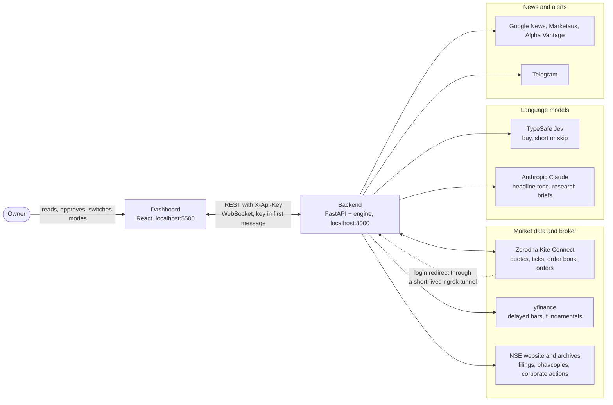
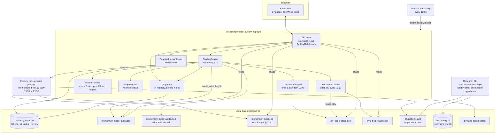
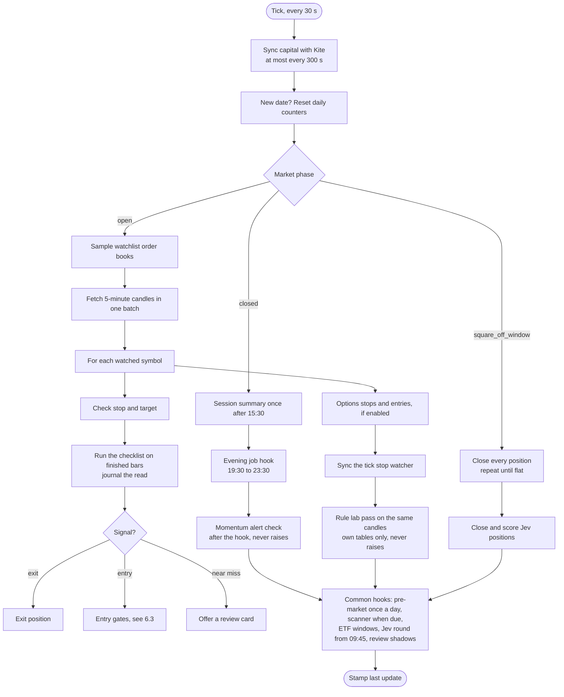
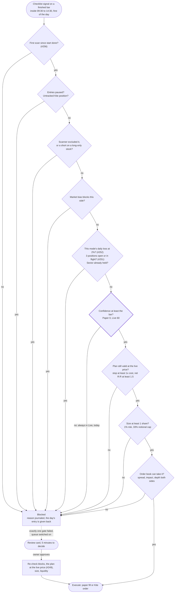
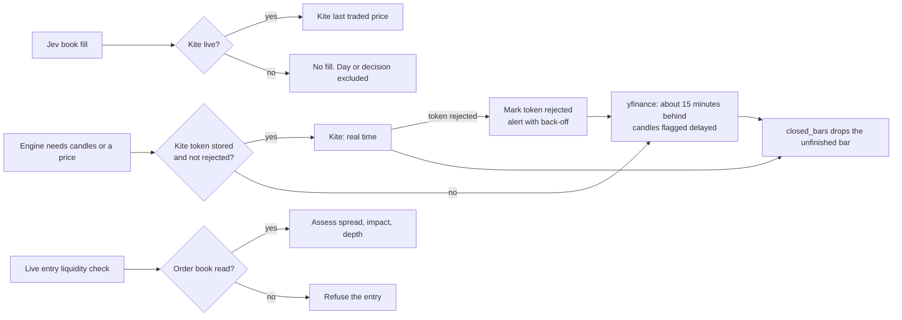
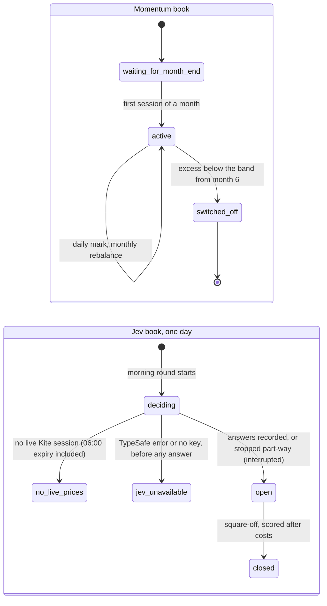
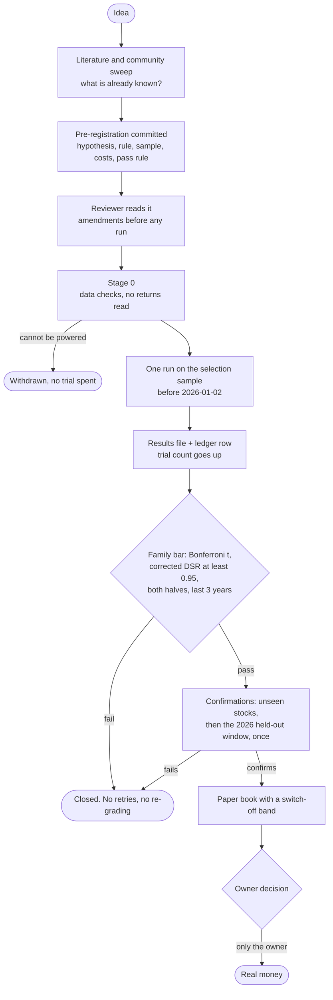

# Trader Sahab — High-Level Design

| | |
| --- | --- |
| **Status** | Describes `main` as of 2026-10-05 |
| **Audience** | The owner, a reviewer, or a new session that needs the whole system in one read |
| **Companions** | [Low-Level Design](LLD.md) · [Rules checklist](RULES.md) · [Knowledge graph](KNOWLEDGE_GRAPH.md) |
| **Source of truth** | The code. Every statement here was checked against it; where the code and this page disagree, the code wins and this page has a bug |

## 1. What the system is

Trader Sahab is a single-user trading system for NSE that runs on one Mac. It
has two jobs that share one codebase:

1. **Run paper books and, only if the owner chooses, live orders** through
   Zerodha Kite Connect.
2. **Decide what is allowed to run** by testing every idea against a rule
   written down before its data is read.

The second job governs the first. After 202 recorded trials, one rule has
passed a pre-registered test (monthly momentum held in delivery), narrowly,
so it has a book of its own. From 2026-09-30 it was the core of the system
(`docs/research/decisions/decision-2026-09-30-momentum-core.md`). On
2026-10-05 the owner reframed the front page
(`docs/research/decisions/decision-2026-10-05-paper-desk.md`, README §125):
the dashboard opens on the **paper desk**, where the five paper books (the
intraday engine, the Jev book, the Jev 2 book, the rule lab and the momentum
book) are equal experiments, each trading in paper and logging every process
step and trade into one merged process log. Each card shows the book's net
paper rupees today and since it started, on the notional it trades, with
"paper" beside every figure (README §129). None is "the strategy" until it
passes its own gate; the gates themselves are unchanged. The intraday engine still scans,
labels setups and enforces risk, in paper, as a record: no intraday edge was
found, and no new intraday look is started. Since 2026-10-01 it takes its
entries automatically in paper: the confidence gate's bar is 0 in Paper and
60 in Live, where it still blocks every automatic entry (README §118).

No real-money order has ever been placed.

## 2. Design principles

These are the decisions everything else follows from. Each one maps to rules
in the [checklist](RULES.md).

| Principle | What it means in practice |
| --- | --- |
| **Evidence before belief** | A strategy trades only after a pre-registered test passes. The live confidence gate reads the committed backtest evidence and blocks entries while it fails |
| **Paper by default** | The engine always starts in Paper. Live needs an explicit switch, a readiness check and a confirmation |
| **One writer** | One engine process owns the state and the journal. A lock file refuses a second engine on the same journal |
| **Degrade, never trade blind** | Every external source has a fallback or is skipped. A missing order book blocks a live entry. Delayed prices never fill a paper test that promises live prices |
| **One cost model** | Backtests, paper fills and live bookkeeping use the same slippage and charges code |
| **Live code never imports research** | Research scripts can read anything; the engine can't import them. Logic the engine needs is copied and held equal by parity tests |
| **Secrets stay on the machine** | Keys live in gitignored files or the environment, travel in headers, and are never logged in full after first run |
| **Everything is explained** | Every block, fill and rule has a plain-language reason and a source, in the journal and on the dashboard |

## 3. System context

Only Kite can receive an order. Every other arrow is a read.

## 4. Containers

| Container | Technology | Responsibility | Lifetime |
| --- | --- | --- | --- |
| Dashboard | React 19, Vite, Lightweight Charts | Shows state, takes the owner's decisions | While the tab is open |
| Backend process | Python 3.9, FastAPI, uvicorn | API, engine loop, threads | Always on; restarted by the watchdog |
| Evening job | Python, child process | Rebuilds the price panel and advances the momentum book | About 70 s, once per trading evening |
| Journal | SQLite | Durable record of scans, checklist reads, fills, blocks, order-book samples | Permanent |
| Research CLI | Python scripts | Pre-registered tests and measurements | Run by hand |
| Watchdog | launchd + shell | Keeps the backend up through sleep and crashes | Every 120 s |

## 5. Subsystems

| Subsystem | Responsibility | Key modules | State today |
| --- | --- | --- | --- |
| **Engine core** | Tick loop, phases, the only order path, square-off, kill switch | `trading_engine`, `state`, `engine_lock`, `stop_watcher` | Running |
| **Scanner** | Score the NIFTY 100, set the market bias, fix the day's 25 most-traded eligible stocks as the watchlist, and journal every stock of every scan for the shadow log. It sets no side: the checklist picks it (README §115) | `scanner`, `universe`, `sectoral_indices`, `seasonality` | Running |
| **Setup describer** | Build a plan (entry, stop, target, reward-to-risk) from the Varsity checklist | `trader_brain`, `indicators`, `candlestick_patterns`, `market_structure` | Describes only; no longer decides |
| **Gates** | Confidence, risk, sector, market bias, liquidity | `confidence`, `evaluation`, `risk_manager`, `liquidity`, `costs` | Confidence gate: bar 0 in Paper (taken automatically, score journaled), 60 in Live (blocks every automatic entry; README §118) |
| **Review queue** | Offer near-miss setups to the owner; replay what approval would have done | `review_queue` | Off until switched on; in Live the only entry route that can fill. In Paper a confidence-only near-miss is entered, not carded |
| **Brokers** | Paper fills and Kite orders | `paper_broker`, `kite_broker` | Paper |
| **F&O** | Buy calls and puts, never write | `fno_instruments`, `options_pricing`, `fno_risk` | Off |
| **Market data** | One interface over Kite and yfinance; Kite session lifecycle | `data_provider`, `kite_tunnel`, `kite_history` | Kite when connected, else delayed |
| **News and context** | Filings, headlines, flows, breadth, fundamentals | `nse_feed`, `news_sentiment`, `llm_sentiment`, `fundamentals` | Running |
| **Momentum book** | The paper run of the one rule that passed, with a monthly report against its benchmark and an alert at each rebalance or failed evening job. One of the five books on the paper desk. The evening job follows renamed holdings, re-fetches a half-written bhavcopy, keeps a failed day until it arrives and runs one job at a time (README §123) | `momentum_book`, `momentum_alerts` | Holding 15 since the 1 Oct close; next rebalance 2 Nov |
| **Paper desk** | The front page: one card per paper book, equal weight, with the book's net paper rupees today and since its start on the notional it trades (README §129), and one process log that merges every step and trade of the five books. Read-only: assembled from what the books already write (README §125) | `paper_desk` | Running |
| **Jev book** | Paper test of an LLM judge on the shortlist. From 15 closed sessions its page shows an interim read (clustered t, projection, minimum detectable mean), information only; the test is unchanged (README §127) | `jev_book`, `typesafe_key` | Running since 28 Sep; 4 rounds closed, 1 skipped for no live prices |
| **Jev 2 book** | A second test of the judge beside Jev 1: blind state, seven narrow questions combined in code, a skip band, all 25 names, fills shared with Jev 1 on the common 15, so the Jev 2 − Jev 1 pair is exact; session-clustered t (README §128) | `jev2_book` | Running since 5 Oct (that day's round was missed: the backend restarted after 10:00); first full round the next session |
| **Rule lab** | 157 single rules in three cohorts (1: 20 of its own, 2: 87 from the YouTube and practitioner catalogs, 2b: 50 basic pattern and indicator rules), each a shadow paper book on the day's list, judged only at pre-registered looks. Its historical search L55 ran once and is closed: no survivor among 104,655 combinations, every powered single rule losing after costs (README §124) | `rule_lab`, `rule_lab_catalog`, `rule_lab_patterns`, `research/rule_lab_screen` | Running since the 5 Oct session (4,334 trades closed that day, −₹3.56 lakh paper); screen after lab session 40. Never places an order |
| **Order-book sampler** | Record five-level books for the one open intraday test | `depth_sampler` | Collecting; test runs after 15 full sessions |
| **Research desk** | Multi-agent brief per stock, grounded in a snapshot | `research_desk` | Off by default; never touches orders |
| **Evidence pipeline** | Backtests, Deflated Sharpe, IC, the trial ledger | `backtester`, `evaluation`, `research/*`, `docs/research/*` | 202 trials of record; no new intraday look since 2026-09-30 |
| **Journal** | Persistence and every read model the dashboard uses | `database` | Running |
| **Security and ops** | Dashboard key, log redaction, alerts, watchdog | `auth`, `telegram_alerts`, `scripts/` | Running |

## 6. Runtime views

### 6.1 A trading day

All times are IST. The engine's phases are `closed`, `open` (09:15 to 15:08)
and `square_off_window` (15:08 to 15:30).

| Time | What happens | Needs Kite |
| --- | --- | --- |
| 06:00 | Zerodha expires every Kite session | |
| First tick of the day | Pre-market read: daily bars only, ranks a watchlist | No |
| 08:45 | Pre-open check. One error-level alert if Kite isn't connected | Probes it |
| 09:15 | Phase `open`. Scanner every 5 minutes. Stops are watched on ticks and on every poll | For live prices |
| 09:15 to 09:30 | ETF window sampling | Yes |
| 09:15 to 15:08 | Order-book sample of the watchlist on every tick | Yes |
| 09:15 to 15:05 | Rule lab: every finished 5-minute bar of the day's list through 157 rules, last in the tick, own tables only | No; delayed bars are flagged |
| 09:30 to 14:30 | Entry window for the checklist and the review queue | |
| 09:45 | Jev round: one request per shortlisted stock, paper entries at the live price | Yes |
| After Jev 1's round, by 10:00 | Jev 2 round: fourteen Nouls per stock on the scan captured at 09:45, all 25 names; shared names reuse Jev 1's entry | Yes |
| 15:00 to 15:30 | ETF window sampling | Yes |
| 15:08 | Phase `square_off_window`. Every cash and F&O position is closed, each under its own guard, repeated until flat (#250). Jev positions are closed and scored, then Jev 2's (shared names reuse Jev 1's exit). Once a session, every universe stock's last price goes to `session_closes` | Yes for Jev, Jev 2 and the closes |
| 15:30 | Phase `closed`. Session summary is logged | |
| 19:30 to 23:30 | Evening job: download the bhavcopy, rebuild prices, mark the momentum book. On a month's first session, rebalance. After it, one alert per rebalance, failed run or early stop | No |
| 23:30 | If a run that day left the day unprocessed, one alert | No |

### 6.2 One engine tick

A tick that throws is caught and logged; the loop continues. A tick that
runs past 120 seconds gets every thread's stack dumped once.

### 6.3 The entry pipeline and where it stops today

The confidence score is the setup's local score (out of 100) times a system
multiplier. The multiplier is 0.25 while any Scorecard row fails. The
committed backtest evidence row fails (−0.356R a trade, t −3.59), so the
score tops out at 25 and no automatic entry can pass 60. That is the
designed behaviour, not a fault. The bar of 60 is the Live bar. In Paper the
bar is 0 (`RISK["paper_min_confidence_to_trade"]`, README §118, by the
owner's instruction of 2026-10-01), so every setup that reaches the gate
passes it, and its trade row records the score and whether 60 would have
blocked it. The bar is read at each entry: a switch to Live restores 60 for
the next one, and a paper position stays paper.

The money path was reviewed on 2026-10-05 and eleven bugs fixed (#249 to
#259, README §121 and §122): an approval re-runs the plan check at the live
price; the square-off closes every position under its own guard and repeats
until flat; a slot and a sector are reserved under the lock before the order;
paper and live keep separate daily-loss counters, seeded by mode on restart;
a journal write that fails mid-order is queued and retried, never raised into
the order path; a partly exited live position is restored at what is left; a
paper close with no readable price waits for one; nothing is entered before
the first scan; the Scorecard counts one R per position; the tax box's
charges are the closed trades'; off-day scans run once. No entry rule,
threshold, size or cost changed.

### 6.4 Market data and its fallbacks

The scanner uses Kite's quotes for today's prices when Kite is connected, and the delayed feed when it is not (README §101). Daily bars and the bars of earlier sessions come from yfinance, completed from NSE's own daily files.

## 7. The books

Each book is independent of the engine's mode, pause and kill switch. None
places an order. Each has a card on the paper desk with its net paper rupees
today and since it started, on the notional it trades (README §129): the
engine's realized P&L on its ₹1,00,000 paper capital, Jev 1's and Jev 2's net
bp × ₹1,00,000 a position, the rule lab's net ₹ summed over its closed
₹50,000 trades, the momentum book's marked value minus ₹10,00,000 and against
its benchmark. The figures are read from what the books write; they are not
a verdict and never a gate.

While a Jev round is open, its page shows a live mark of the positions at
Kite's prices. The mark is never stored and never scored.

| Book | Rule it runs | Switches itself off when | Verdict |
| --- | --- | --- | --- |
| Momentum | Hold the 15 of the 200 most-traded stocks with the best volatility-adjusted 6- and 12-month return; keep while in the top 30; rebalance monthly | Cumulative excess falls below n × 0.71% − 2 × 3.89% × √n, from month 6 | Forward record against the pre-registered band |
| Jev | Buy, short or skip each shortlisted stock at 09:45; close at 15:08 | After 100 trades, t below −2 | After 300 trades or 60 sessions: t ≥ 2.24, both halves positive, beats the scanner |
| Jev 2 | Seven Nouls on a blind state for all 25 names, combined by a frozen rule with a skip band; close at 15:08 | After 100 trades, t below −2 | After 300 trades or 60 sessions: session-clustered t ≥ 2.39 (N_family = 3), both halves positive, beats the scanner; Jev 2 − Jev 1 reported |
| Order-book test | None. It records data | Never | After 15 full sessions: one pre-registered analysis |
| Rule lab | 157 single rules, one book each: next bar's open, 30 minutes (R19/R20 and the two flag rules: stop, 3R or 15:05), ₹50,000 | Never; a failed screen ends a rule | After 40 lab sessions: Romano–Wolf screen; candidates confirm on the next 40; a confirmed rule may only be proposed to the owner |

## 8. The evidence pipeline

Trials of record: **202**. Passed: **1** (trial 120; re-run on repaired prices as trial 126, it survives narrowly, with a smaller edge). Held-out window: spent
once, for the momentum family.

## 9. Security model

| Control | How |
| --- | --- |
| Every route needs the dashboard key | Header only. A key in the URL is refused with 401, because URLs get logged |
| WebSocket | The key is the first message, within 5 seconds, or the socket closes with code 4401 |
| Logs | A filter redacts `key=` and `request_token=` from request lines. The key is logged in full only on the run that generates it |
| Going live | Blocked while Kite is disconnected, the daily loss limit is hit, or Kite holds a position the engine doesn't track |
| Exposure | Local-only by design. The tunnel opens for a login and closes 5 seconds after the callback, or after 10 minutes |

## 10. Deployment

One machine, no cloud. `uvicorn app:app --port 8000` runs detached; the
dashboard dev server runs on 5500. launchd runs the watchdog
(`scripts/sahab_watchdog.sh`) every 120 seconds and on wake; inside session
hours (09:15 to 15:30, 20 minutes either side, trading days only) it starts a
backend that is not listening or not answering `/api/state`, and never stops
one. The project lives in `~/Projects`, because macOS blocks background jobs
from reading Documents, Desktop and Downloads.

**Deploy and restart.** The main checkout (`~/Projects/webapp`) is what the
backend and the dashboard serve, so other sessions build in worktrees under
`.claude/worktrees/` and never switch its branch.

| Step | Command or check | Goes live |
| --- | --- | --- |
| 1 | `git status -sb` in the main checkout: on `main`, clean | |
| 2 | `git pull` after the squash merge | Frontend changes at once: Vite serves the working tree, the open tab reloads on its own |
| 3 | Outside market hours (before 09:15 or after 15:30, when no round or square-off is due): stop the backend (`kill` the uvicorn pid on :8000; the lock file is released) | |
| 4 | In session hours the watchdog restarts it within 120 s; otherwise `cd backend && .venv/bin/uvicorn app:app --port 8000` detached, or `launchctl kickstart` the watchdog | Backend changes: new routes, fields, engine fixes, book code |
| 5 | Read `~/Library/Logs/TraderSahab/backend.log` and `GET /api/state`; note the restart in the README section that shipped the change | |

A restart comes back in Paper with the review queue, the options switch and
the research desk off; today's trades, counters and open paper positions are
rebuilt from the journal, and the day's list is read back from `day_lists`
so the scanner does not choose again (#198). A dashboard tab older than the
running backend shows "—" for a field the backend does not send yet; one
newer than it says so beside the field.

A second backend for testing must use another port **and** a copy of the
journal (`SAHAB_DB_PATH`), or the engine lock refuses to start it; its
origin also needs adding to `CORS_ALLOWED_ORIGINS`, or a GET-only proxy on an
allowed port, before a browser on another port can read it.

## 11. How it fails

| Failure | What the system does |
| --- | --- |
| Kite session expired | Falls back to delayed prices, alerts with back-off, blocks live entries that need the order book, skips the Jev round |
| Kite tick stream dies | The 30-second poll still checks every stop |
| yfinance hangs | One download at a time with a 120-second lock timeout; the symbol is skipped |
| NSE endpoint fails | Last cached payload, or the scan runs without that input |
| News source fails | That source is skipped; sentiment falls back from the LLM to the keyword lexicon |
| TypeSafe fails | Retries with back-off, then records "Jev unavailable" and trades nothing |
| A tick throws | Caught, logged once per distinct message, next tick runs |
| Backend crashes or the Mac sleeps | Watchdog restarts it; today's trades, counts and open paper positions are rebuilt from the journal |
| Two engines on one journal | The second refuses to start |
| Kite rejects one close in the square-off | The other positions are still closed; the failed one is logged once and retried next tick (#250). A live position is checked against Kite's day book before any closing order |
| A journal write fails mid-order | The fill stays in memory and the row is queued and retried each tick; nothing is raised into the order path (#253) |
| No readable price for a paper close | The position waits for a price; it is never booked at its entry (#255). A live one is still sent to Kite at market |
| A restart before the first scan | No entry and no card until a scan has set the market read (#256) |
| Bhavcopy not published yet | Evening job exits and retries every 30 minutes until 23:30 |
| Evening job fails or stops early | One alert with the reason, in the activity log and on Telegram when it is set up; one more at 23:30 if a run that day left the day unprocessed. A rebalance is alerted once, restart or not |

## 12. Known gaps

The open issues as of 2026-10-05 (`gh issue list --state open`), confirmed
in code. None stops today's paper operation, which takes automatic entries
since README §118; paper fills use the assumed slippage (#66). #220 (the
silent symbol-change refresh) closed with README §123.

| Issue | Gap | Matters when |
| --- | --- | --- |
| [#66](https://github.com/harshece16/intraday-trading-agent/issues/66) | One slippage figure for every stock, never measured | Every intraday test's hurdle, and the rule lab's 16.6 bp round trip |
| [#162](https://github.com/harshece16/intraday-trading-agent/issues/162) | Holiday list covers 2026 only. A year without a list is loud (an error at start-up and on each pre-market read, `holiday_calendar_missing` in the state); NSE's 2027 list is not published yet | Before 2027 |
| [#163](https://github.com/harshece16/intraday-trading-agent/issues/163) | Stale comments and UI text | Readers |
| [#222](https://github.com/harshece16/intraday-trading-agent/issues/222) | A redacted request line is dropped from the log, with a traceback | Reading the log after a Kite login |
| [#223](https://github.com/harshece16/intraday-trading-agent/issues/223) | An F&O index underlying needs pinning, and is then also traded as cash | Before enabling index options |
| [#260](https://github.com/harshece16/intraday-trading-agent/issues/260) | The backtester books a stop exit at the stop level; the engine books the first price past it, so backtests are optimistic by the overshoot on every stop-out. Owner decision pending | Reading any intraday backtest against the paper record |
| [#263](https://github.com/harshece16/intraday-trading-agent/issues/263) | Momentum book: a holding with no month-end row is sold at a stale close when the job runs that evening (pre-registered rule H5). Owner decision pending | A held stock that does not trade on a month turn |
| [#274](https://github.com/harshece16/intraday-trading-agent/issues/274) | `rule_lab_screen.judge()` computes `dsr_best` on the raw-t best over every key, not the powered best | Reading L55's DSR figure; the search is closed |
| [#279](https://github.com/harshece16/intraday-trading-agent/issues/279) | An undated headline is given an age of 24 h and passes the 72 h filter, so it can be newer than a Jev fill | Jev 1's and Jev 2's news fields |
| [#130](https://github.com/harshece16/intraday-trading-agent/issues/130) | NSE's bhavcopy carries no corporate-action tell; the research panel relies on the corporate-actions files | Research on delivery prices |
