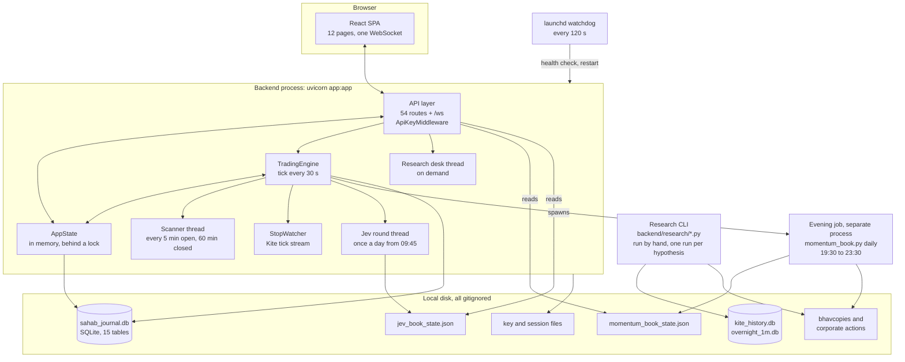
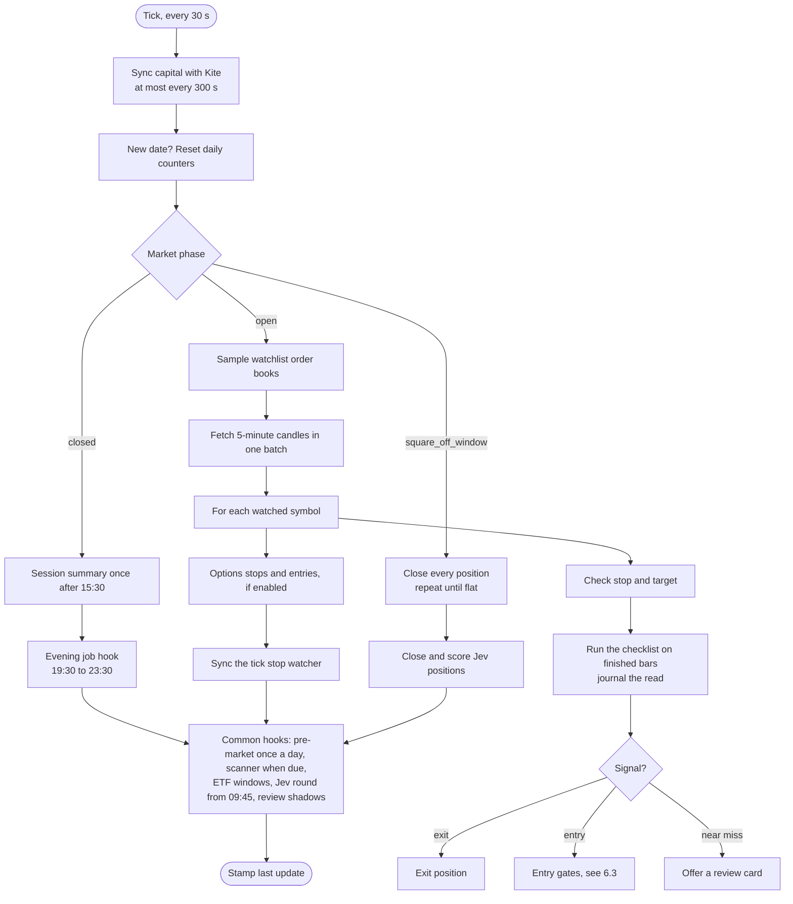
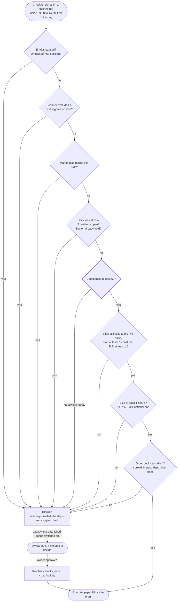
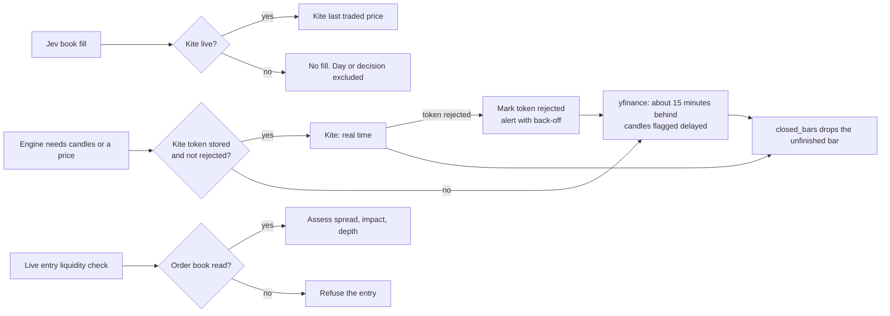
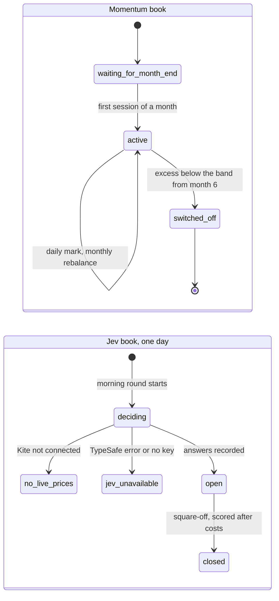
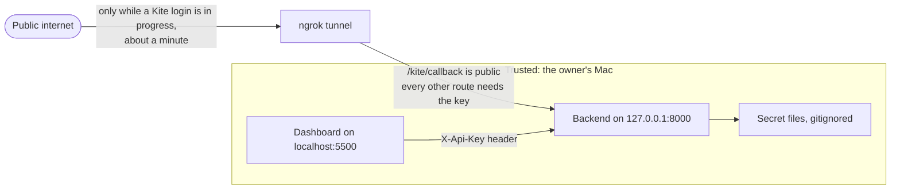

# Trader Sahab — High-Level Design

| | |
| --- | --- |
| **Status** | Describes `main` as of 2026-09-28 |
| **Audience** | The owner, a reviewer, or a new session that needs the whole system in one read |
| **Companions** | [Low-Level Design](LLD.md) · [Rules checklist](RULES.md) · [Knowledge graph](KNOWLEDGE_GRAPH.md) |
| **Source of truth** | The code. Every statement here was checked against it; where the code and this page disagree, the code wins and this page has a bug |

## 1. What the system is

Trader Sahab is a single-user trading system for NSE that runs on one Mac. It
has two jobs that share one codebase:

1. **Run paper books and, only if the owner chooses, live orders** through
   Zerodha Kite Connect.
2. **Decide what is allowed to run** by testing every idea against a rule
   written down before its data is read.

The second job governs the first. After 125 recorded trials, one strategy has
passed (monthly momentum held in delivery), so that is the only strategy with
a book of its own. The intraday engine still scans, labels setups and
enforces risk, but its automatic entries are switched off by the evidence
gate.

No real-money order has ever been placed.

## 2. Design principles

These are the decisions everything else follows from. Each one maps to rules
in the [checklist](RULES.md).

| Principle | What it means in practice |
| --- | --- |
| **Evidence before belief** | A strategy trades only after a pre-registered test passes. The live confidence gate reads the committed backtest evidence and blocks entries while it fails |
| **Paper by default** | The engine always starts in Paper. Live needs an explicit switch, a readiness check and a confirmation |
| **One writer** | One engine process owns the state and the journal. A lock file refuses a second engine on the same journal |
| **Degrade, never trade blind** | Every external source has a fallback or is skipped. A missing order book blocks a live entry. Delayed prices never fill a paper test that promises live prices |
| **One cost model** | Backtests, paper fills and live bookkeeping use the same slippage and charges code |
| **Live code never imports research** | Research scripts can read anything; the engine can't import them. Logic the engine needs is copied and held equal by parity tests |
| **Secrets stay on the machine** | Keys live in gitignored files or the environment, travel in headers, and are never logged in full after first run |
| **Everything is explained** | Every block, fill and rule has a plain-language reason and a source, in the journal and on the dashboard |

## 3. System context

Only Kite can receive an order. Every other arrow is a read.

## 4. Containers

| Container | Technology | Responsibility | Lifetime |
| --- | --- | --- | --- |
| Dashboard | React 19, Vite, Lightweight Charts | Shows state, takes the owner's decisions | While the tab is open |
| Backend process | Python 3.9, FastAPI, uvicorn | API, engine loop, threads | Always on; restarted by the watchdog |
| Evening job | Python, child process | Rebuilds the price panel and advances the momentum book | About 70 s, once per trading evening |
| Journal | SQLite | Durable record of scans, checklist reads, fills, blocks, order-book samples | Permanent |
| Research CLI | Python scripts | Pre-registered tests and measurements | Run by hand |
| Watchdog | launchd + shell | Keeps the backend up through sleep and crashes | Every 120 s |

## 5. Subsystems

| Subsystem | Responsibility | Key modules | State today |
| --- | --- | --- | --- |
| **Engine core** | Tick loop, phases, the only order path, square-off, kill switch | `trading_engine`, `state`, `engine_lock`, `stop_watcher` | Running |
| **Scanner** | Rank the NIFTY 100, pick up to 25 to watch, set the market bias | `scanner`, `universe`, `sectoral_indices`, `seasonality` | Running |
| **Setup describer** | Build a plan (entry, stop, target, reward-to-risk) from the Varsity checklist | `trader_brain`, `indicators`, `candlestick_patterns`, `market_structure` | Describes only; no longer decides |
| **Gates** | Confidence, risk, sector, market bias, liquidity | `confidence`, `evaluation`, `risk_manager`, `liquidity`, `costs` | Confidence gate blocks every automatic entry |
| **Review queue** | Offer near-miss setups to the owner; replay what approval would have done | `review_queue` | Off until switched on; the only entry route that can fill |
| **Brokers** | Paper fills and Kite orders | `paper_broker`, `kite_broker` | Paper |
| **F&O** | Buy calls and puts, never write | `fno_instruments`, `options_pricing`, `fno_risk` | Off |
| **Market data** | One interface over Kite and yfinance; Kite session lifecycle | `data_provider`, `kite_tunnel`, `kite_history` | Kite when connected, else delayed |
| **News and context** | Filings, headlines, flows, breadth, fundamentals | `nse_feed`, `news_sentiment`, `llm_sentiment`, `fundamentals` | Running |
| **Momentum book** | Paper run of the strategy that passed | `momentum_book` | Waiting for the month turn; first trades at the 1 Oct close |
| **Jev book** | Paper test of an LLM judge on the shortlist | `jev_book`, `typesafe_key` | Running since 28 Sep |
| **Order-book sampler** | Record five-level books for the one open intraday test | `depth_sampler` | Collecting; test runs after 15 full sessions |
| **Research desk** | Multi-agent brief per stock, grounded in a snapshot | `research_desk` | Off by default; never touches orders |
| **Evidence pipeline** | Backtests, Deflated Sharpe, IC, the trial ledger | `backtester`, `evaluation`, `research/*`, `docs/research/*` | 125 trials of record |
| **Journal** | Persistence and every read model the dashboard uses | `database` | Running |
| **Security and ops** | Dashboard key, log redaction, alerts, watchdog | `auth`, `telegram_alerts`, `scripts/` | Running |

## 6. Runtime views

### 6.1 A trading day

All times are IST. The engine's phases are `closed`, `open` (09:15 to 15:08)
and `square_off_window` (15:08 to 15:30).

| Time | What happens | Needs Kite |
| --- | --- | --- |
| 06:00 | Zerodha expires every Kite session | |
| First tick of the day | Pre-market read: daily bars only, ranks a watchlist | No |
| 08:45 | Pre-open check. One error-level alert if Kite isn't connected | Probes it |
| 09:15 | Phase `open`. Scanner every 5 minutes. Stops are watched on ticks and on every poll | For live prices |
| 09:15 to 09:30 | ETF window sampling | Yes |
| 09:15 to 15:08 | Order-book sample of the watchlist on every tick | Yes |
| 09:30 to 14:30 | Entry window for the checklist and the review queue | |
| 09:45 | Jev round: one request per shortlisted stock, paper entries at the live price | Yes |
| 15:00 to 15:30 | ETF window sampling | Yes |
| 15:08 | Phase `square_off_window`. Every cash and F&O position is closed. Jev positions are closed and scored | Yes for Jev |
| 15:30 | Phase `closed`. Session summary is logged | |
| 19:30 to 23:30 | Evening job: download the bhavcopy, rebuild prices, mark the momentum book. On a month's first session, rebalance | No |

### 6.2 One engine tick

A tick that throws is caught and logged; the loop continues. A tick that
runs past 120 seconds gets every thread's stack dumped once.

### 6.3 The entry pipeline and where it stops today

The confidence score is the setup's local score (out of 100) times a system
multiplier. The multiplier is 0.25 while any Scorecard row fails. The
committed backtest evidence row fails (−0.356R a trade, t −3.59), so the
score tops out at 25 and no automatic entry can pass 60. That is the
designed behaviour, not a fault.

### 6.4 Market data and its fallbacks

The scanner always uses yfinance, even when Kite is connected.

## 7. The books

Each book is independent of the engine's mode, pause and kill switch. None
places an order.

While a Jev round is open, its page shows a live mark of the positions at
Kite's prices. The mark is never stored and never scored.

| Book | Rule it runs | Switches itself off when | Verdict |
| --- | --- | --- | --- |
| Momentum | Hold the 15 of the 200 most-traded stocks with the best volatility-adjusted 6- and 12-month return; keep while in the top 30; rebalance monthly | Cumulative excess falls below n × 0.82% − 2 × 3.87% × √n, from month 6 | Forward record against the pre-registered band |
| Jev | Buy, short or skip each shortlisted stock at 09:45; close at 15:08 | After 100 trades, t below −2 | After 300 trades or 60 sessions: t ≥ 2.24, both halves positive, beats the scanner |
| Order-book test | None. It records data | Never | After 15 full sessions: one pre-registered analysis |

## 8. The evidence pipeline

Trials of record: **125**. Passed: **1** (trial 120). Held-out window: spent
once, for the momentum family.

## 9. Security model

| Control | How |
| --- | --- |
| Every route needs the dashboard key | Header only. A key in the URL is refused with 401, because URLs get logged |
| WebSocket | The key is the first message, within 5 seconds, or the socket closes with code 4401 |
| Logs | A filter redacts `key=` and `request_token=` from request lines. The key is logged in full only on the run that generates it |
| Going live | Blocked while Kite is disconnected, the daily loss limit is hit, or Kite holds a position the engine doesn't track |
| Exposure | Local-only by design. The tunnel opens for a login and closes 5 seconds after the callback, or after 10 minutes |

## 10. Deployment

One machine, no cloud. `uvicorn app:app --port 8000` runs detached; the
dashboard dev server runs on 5500. launchd runs the watchdog every 120
seconds and on wake. The project lives in `~/Projects`, because macOS
blocks background jobs from reading Documents, Desktop and Downloads.

A second backend for testing must use another port **and** a copy of the
journal (`SAHAB_DB_PATH`), or the engine lock refuses to start it.

## 11. How it fails

| Failure | What the system does |
| --- | --- |
| Kite session expired | Falls back to delayed prices, alerts with back-off, blocks live entries that need the order book, skips the Jev round |
| Kite tick stream dies | The 30-second poll still checks every stop |
| yfinance hangs | One download at a time with a 120-second lock timeout; the symbol is skipped |
| NSE endpoint fails | Last cached payload, or the scan runs without that input |
| News source fails | That source is skipped; sentiment falls back from the LLM to the keyword lexicon |
| TypeSafe fails | Retries with back-off, then records "Jev unavailable" and trades nothing |
| A tick throws | Caught, logged once per distinct message, next tick runs |
| Backend crashes or the Mac sleeps | Watchdog restarts it; today's trades, counts and open paper positions are rebuilt from the journal |
| Two engines on one journal | The second refuses to start |
| Bhavcopy not published yet | Evening job exits and retries every 30 minutes until 23:30 |

## 12. Known gaps

Found while this design was mapped, confirmed in code, and filed. None
affects today's paper operation with automatic entries off.

| Issue | Gap | Matters when |
| --- | --- | --- |
| [#155](https://github.com/harshece16/intraday-trading-agent/issues/155) | Live fills are booked at the modelled price, not Kite's executed price | Before going live |
| [#156](https://github.com/harshece16/intraday-trading-agent/issues/156) | A live position is unwatched after a restart | Before going live |
| [#154](https://github.com/harshece16/intraday-trading-agent/issues/154) | Paper F&O stops and targets can never fire | Before enabling F&O |
| [#157](https://github.com/harshece16/intraday-trading-agent/issues/157) | F&O entries skip several cash entry rules | Before enabling F&O |
| [#158](https://github.com/harshece16/intraday-trading-agent/issues/158) | Jev book: interrupted rounds and the live-price gate | Now, for the test's record |
| [#159](https://github.com/harshece16/intraday-trading-agent/issues/159) | Momentum book: silent data gaps and a skippable rebalance | Before 1 Oct |
| [#160](https://github.com/harshece16/intraday-trading-agent/issues/160) | LLM features switch on with the key alone | Now, small cost |
| [#161](https://github.com/harshece16/intraday-trading-agent/issues/161) | Dashboard key file isn't mode 0600 | Now, low risk |
| [#162](https://github.com/harshece16/intraday-trading-agent/issues/162) | Holiday list covers 2026 only | Before 2027 |
| [#66](https://github.com/harshece16/intraday-trading-agent/issues/66) | One slippage figure for every stock, never measured | Every intraday test's hurdle |
| [#163](https://github.com/harshece16/intraday-trading-agent/issues/163) | Stale comments and UI text | Readers |
