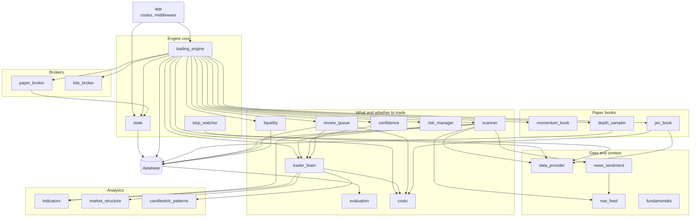

# Trader Sahab — Knowledge graph

| | |
| --- | --- |
| **Built with** | [graphify](https://github.com/safishamsi/graphify), updated 2026-09-28 |
| **Covers** | 316 files: all backend and frontend code, the README, the bug log and every research document |
| **Companions** | [High-Level Design](HLD.md) · [Low-Level Design](LLD.md) · [Rules checklist](RULES.md) |

The graph links every function, class, document and research result to the
things it calls, cites or explains. The design documents were checked
against it. This page records what it shows and how to use it.

## What is in it

| Measure | Value |
| --- | --- |
| Nodes | 3,619 |
| Edges | 8,545 |
| Clusters | 200 |
| Edges read directly from the source | 8,282 (97%) |
| Edges inferred by a model, average confidence 0.84 | 258 (3%) |
| Edges marked ambiguous | 5 |
| Import cycles | None |

| Node kind | Count |
| --- | --- |
| Code: modules, classes, functions | 2,141 |
| Rationale: the reason recorded for a decision | 708 |
| Concepts: trials, rules, findings, bugs | 640 |
| Documents | 83 |
| Cited papers and books | 44 |
| Images | 3 |

Code was parsed, not read by a model, so its edges are exact. Documents
were read by a model. Reading the 18 documents that changed since the last
build took about 266,000 tokens across the two agents that reported usage;
a third agent was interrupted before it reported.

## What it shows

### The most connected things

These are the parts a change is most likely to ripple through.

| Node | Links | What it is |
| --- | --- | --- |
| `TradingEngine` | 71 | The tick loop and the only order path |
| `AppState` | 70 | The shared in-memory state |
| `database._conn()` | 54 | Every journal read and write |
| The trial ledger | 48 | `docs/research/trials.md` |
| `num()` | 45 | The dashboard's number formatter |
| The bug log | 42 | `BUG_LOG.md` |
| `run_backtest()` | 40 | The backtest harness |
| `deflated_sharpe_ratio()` | 33 | The multiple-testing gate |

`AppState` and `TradingEngine` are the two bridges between clusters: each
connects more than 20 of them. That matches the design's "one writer" rule.
It also means a change to either needs the widest test run.

### How the modules depend on each other

Drawn from the graph's import and call edges between live backend modules.
Research scripts and tests are left out.



`config` is imported by 27 modules and is left off the diagram. `jev_book`
imports `data_provider` and `costs` inside functions, so those two edges
come from reading the code, not from the parser.

### The largest clusters

| Cluster | Nodes | Holds |
| --- | --- | --- |
| Review queue | 70 | `review_queue.py` and its 25 tests |
| Jev book | 68 | `jev_book.py`, its tests and its pre-registration |
| Research splits and held-out window | 67 | `splits.py` and the guards that keep selection data apart |
| Journal database | 63 | `database.py` |
| NIFTY 100 membership | 59 | The point-in-time index membership builder |
| Liquidity and depth sampling | 53 | `liquidity.py`, `depth_sampler.py` and their tests |
| Scanner pipeline | 45 | `scanner.py` |
| News and NSE feeds | 45 | `news_sentiment.py`, `nse_feed.py` |
| Kite login tunnel | 43 | `kite_tunnel.py` and its tests |
| Strategy search | 42 | The 76-configuration search |

Code and its tests cluster together in almost every case. A few code
clusters hold no test at all: the scanner pipeline, options pricing and
instruments, the holiday calendar and the day plan. The
[rules checklist](RULES.md) shows the same gaps as rules with no test.

### Chains the graph found

Each of these is a group of nodes that belong to one story. They are the
graph's own groupings, read from the documents.

- **The live entry gate:** scan, checklist, confidence, sizing, sector cap, liquidity, execute.
- **The evidence pipeline that refused to certify an edge:** Scorecard, Deflated Sharpe, IC, the backtest-evidence row, the trial count, pre-registration, the held-out window, the family bar.
- **Every price-only intraday rule:** about zero before costs, and minus the cost after. It ties together trials 35, 40, 41 to 116 and 117.
- **The move to delivery momentum:** literature sweep, 3h fails, data guards, 3i passes, the paper book.
- **The cost-model bug lineage:** issues #21, #25, #41, #43, #53, #66, #74 and #79 all trace to `costs.py`.
- **Trial-count integrity:** issues #132 and #136, `deflated_sharpe_ratio()` and `trial_count()`.

## How to use it

The graph lives in `graphify-out/` on the owner's machine. It is not in the
repository: `graph.json` and `graph.html` are about 4 MB each.

```bash
open graphify-out/graph.html                       # interactive graph, in a browser
graphify query "what stops an automatic entry?"    # broad answer from the graph
graphify path "TradingEngine" "deflated_sharpe_ratio()" --undirected   # how two things connect
graphify explain "live_ltp()"                      # one node and its neighbours
```

To bring it up to date after a code change, run `graphify update .` from the
repo root. It re-reads code only and needs no model. After documents change,
run `/graphify ~/Projects/webapp --update` in Claude Code, which re-reads the
changed documents with a model.

## Limits

- Inferred edges are a model's reading. They are 3% of the graph and each carries a confidence score.
- Labels on README nodes keep their first wording when a section is re-read, so a few are older than the text they point at.
- The graph describes structure. It does not know whether a rule is followed at run time. The [rules checklist](RULES.md) is for that.
