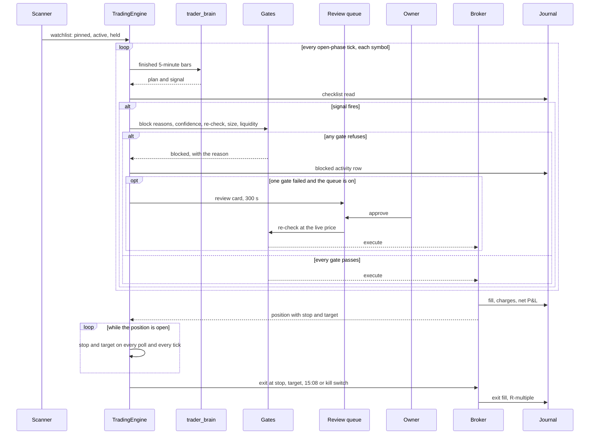
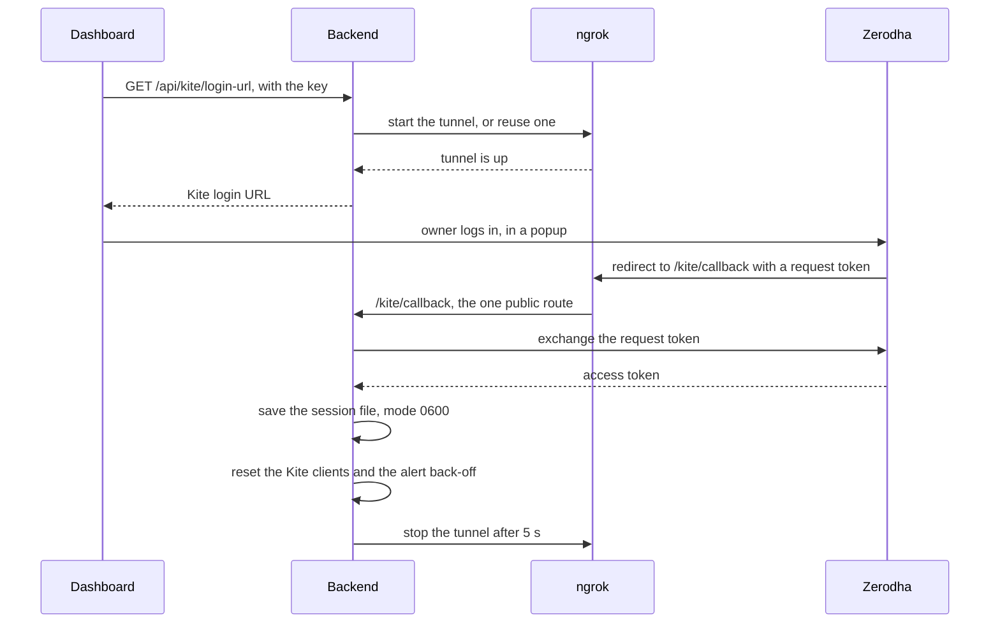
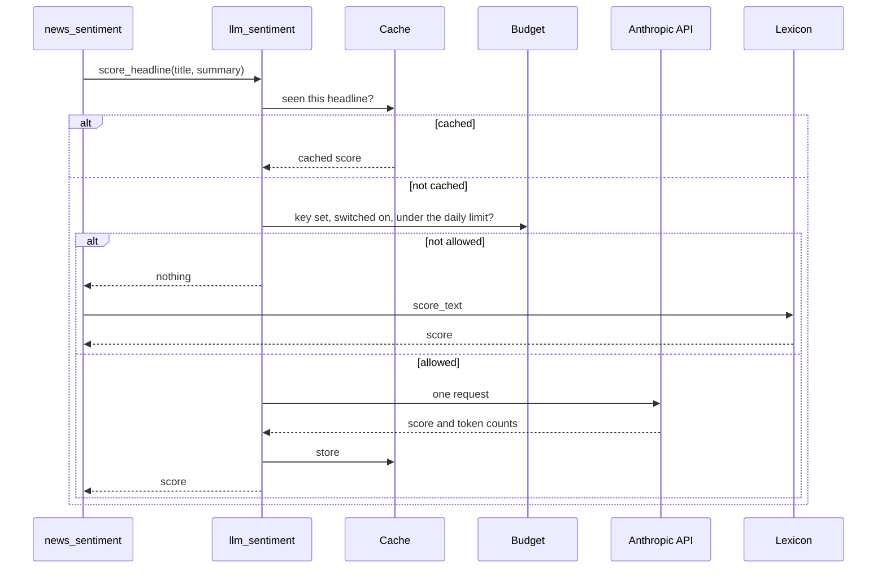
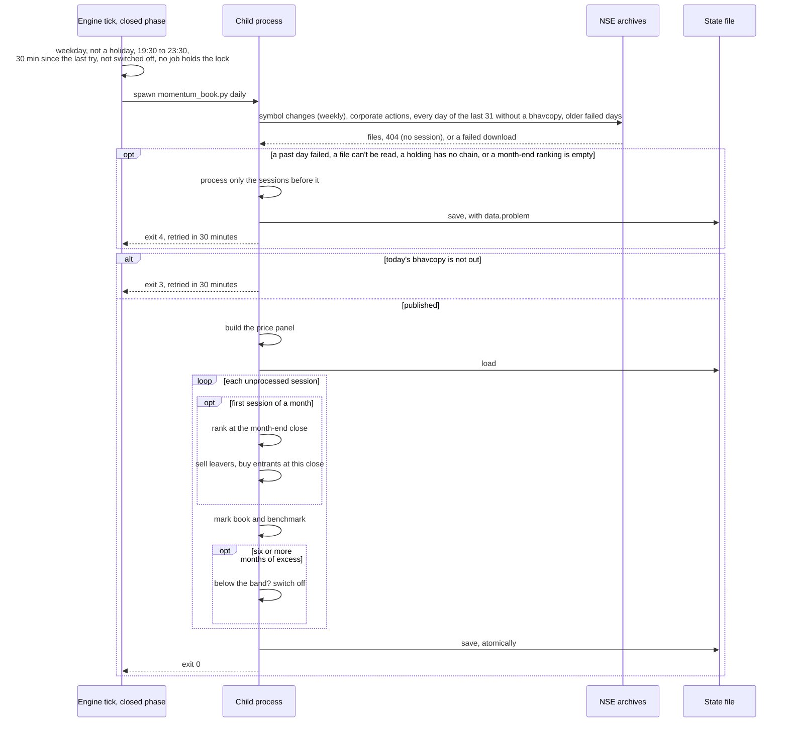
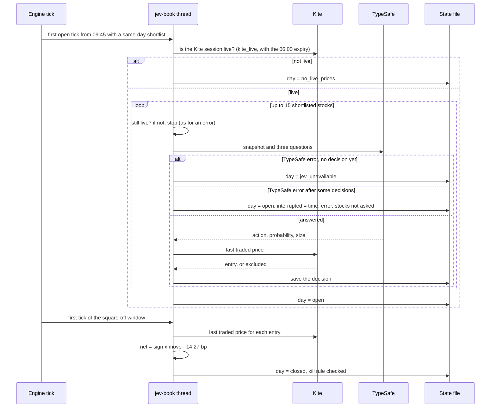
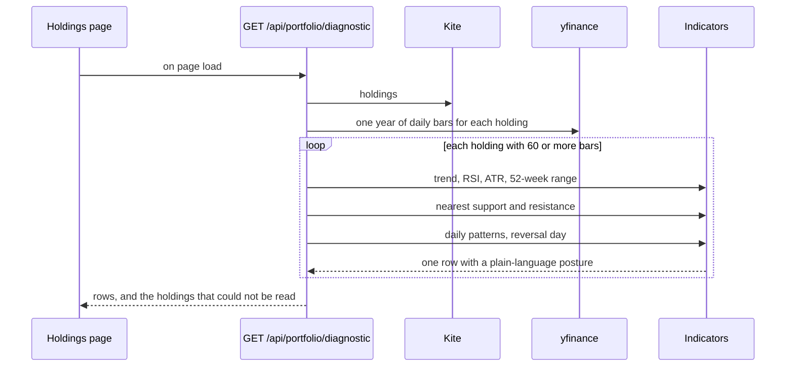
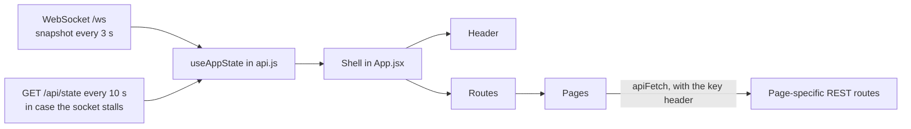

# Trader Sahab — Low-Level Design

| | |
| --- | --- |
| **Status** | Describes `main` as of 2026-09-28 |
| **Read first** | [High-Level Design](HLD.md) for the shape of the system |
| **Companions** | [Rules checklist](RULES.md) · [Knowledge graph](KNOWLEDGE_GRAPH.md) |
| **Conventions** | Paths are relative to the repo root. Times are IST. Rule ids such as `ENT-01` point into the rules checklist. Line numbers are left out on purpose; function names are stable, lines are not |

## Contents

1. [Process and threads](#1-process-and-threads)
2. [Engine core](#2-engine-core)
3. [The entry path](#3-the-entry-path)
4. [Exits](#4-exits)
5. [Costs](#5-costs)
6. [Options path](#6-options-path)
7. [Scanner](#7-scanner)
8. [Market data and the Kite session](#8-market-data-and-the-kite-session)
9. [News, sentiment and fundamentals](#9-news-sentiment-and-fundamentals)
10. [Paper books](#10-paper-books)
11. [Research desk and holdings diagnostic](#11-research-desk-and-holdings-diagnostic)
12. [Evidence pipeline](#12-evidence-pipeline)
13. [API surface](#13-api-surface)
14. [Database schema](#14-database-schema)
15. [Files on disk](#15-files-on-disk)
16. [Configuration reference](#16-configuration-reference)
17. [Dashboard](#17-dashboard)
18. [Tests and CI](#18-tests-and-ci)

## 1. Process and threads

One Python process runs everything except the evening job.

| Thread or process | Started by | Does | Stops when |
| --- | --- | --- | --- |
| Event loop | uvicorn | Serves REST and the WebSocket | Process exits |
| Engine tick | `TradingEngine.run_forever` via `run_in_executor` | One `tick()`, then sleeps 30 s | `state.running` is false |
| `tick-watchdog` | `run_forever` | Every 15 s, checks whether the current tick has run past 120 s | Process exits |
| `scanner` | `request_scan()` | One scan; single-flight | Scan ends |
| Kite ticker | `StopWatcher.start()` | Receives ticks for held symbols | Socket closes |
| `jev-book` | `jev_book.maybe_decide` | One decision round | Round ends |
| `research-desk` | `research_desk.request_run` | One run of briefs | Run ends |
| Telegram worker | `telegram_alerts` | Sends queued alerts, at most 20 a minute | Process exits |
| **Evening job** (child process) | `momentum_book.maybe_start_evening_job` | `momentum_book.py daily` | Job ends |

Startup order in `app.py`: build `AppState`, build `TradingEngine`, add CORS
and `ApiKeyMiddleware`, install log redaction, log the key (masked unless it
was just generated). In `lifespan`: take the engine lock, then start
`run_forever`. On shutdown: stop the engine, stop any tunnel the backend
started, release the lock.

## 2. Engine core

### 2.1 Phases

`trading_engine.market_phase(now)` returns one of three values.

| Phase | When | What runs |
| --- | --- | --- |
| `closed` | Weekends, NSE holidays, before 09:15, from 15:30 | Common hooks only. No symbol processing, no stop checks |
| `open` | 09:15 to 15:08 | Everything |
| `square_off_window` | 15:08 to 15:30 | Closes every position on every tick until flat |

There is no separate pre-open phase. The part of `closed` before 09:15 does
the pre-open work through the common hooks.

### 2.2 One tick

`TradingEngine._tick_impl()`. The loop runs a tick, then sleeps
`POLL_INTERVAL_SECONDS` (30), so ticks are 30 seconds plus the tick's own
duration apart.

**Every tick, in this order:**

1. `_sync_capital()`: at most every 300 s, or at once after a mode change. In live mode it also runs position reconciliation.
2. Day rollover on the first tick of a new date: daily P&L and the open-position count reset.
3. Set the phase, `market_status`, `next_open`, `holiday` and `holiday_calendar_missing` (set when the year has no NSE holiday list, [#162](https://github.com/harshece16/intraday-trading-agent/issues/162)).
4. `_check_preopen_kite()`: once per trading day between 08:45 and the close.
5. Holiday notice, once per date.
6. Session summary, once, on a trading day at or after 15:30.
7. If closed: `momentum_book.maybe_start_evening_job`, then `momentum_alerts.check` (§10.1), which never raises, so it cannot keep the job from starting.
8. Pre-market scan on the first tick of each date. On a trading day from 08:45 until the open, one more read fixes the day's list (`should_fix_list`), tried again after five minutes if it fails. Each read first logs an error if the year has no NSE holiday list; start-up logs the same.
9. `scanner.due()` then `request_scan()`: every 5 minutes while open, every 60 minutes while closed on a trading day, once on a weekend or holiday (#259). An off-day scan updates `state.market`/`state.scanner` but leaves the watchlist alone, and the pre-market read doesn't seed it then.
10. If open or in the square-off window: `depth_sampler.sample_windows`.
11. If open: `jev_book.maybe_decide`. If in the square-off window: `jev_book.maybe_close`.
12. The phase branch, below.
13. `_update_review_shadows()`, at most once every 60 s.
14. Stamp `state.last_update_ts`.

**Phase `open`:**

1. `depth_sampler.sample(watchlist)`.
2. `data_provider.get_candles_batch(watchlist, "5m", "5d")`. On failure each symbol fetches its own candles.
3. For each symbol, `_process_symbol`:
   1. Keep the last 200 candles. The live price is the last candle's close.
   2. `closed_bars()` keeps finished candles only.
   3. `_check_stop_take()`. If it exits, stop here.
   4. Attach news and fundamentals and run the strategy function on the finished bars.
   5. Store the state and indicators. Journal the read to `checklist_evals`.
   6. Record the signal. An entry signal is also left in `_fno_signals` for `_process_fno()`.
   7. Exits the brain asks for.
   8. Entries: `_try_enter()`. If blocked, give the day's entry back. Until the first scan since start has set `state.market`, `_entry_block_reason()` blocks every entry and card (#256).
   9. If flat and the review queue is on: `_offer_near_misses()`.
4. `_process_fno()`: stops of open options positions, whether or not F&O is switched on, then options entries on this tick's entry signals.
5. If a kill switch left anything open: `_square_off_all(reason="kill_switch")`. It stays pending until a pass leaves nothing open, and is dropped at the day change (#250).
6. `stop_watcher.sync()`.

**Phase `square_off_window`:** `_square_off_all()` exits each cash position
at the live price through `_close_at_market()`, each under its own guard: a
close that fails is logged once (`_close_error`) and tried again next tick,
and the loop goes on to the next position (#250). A paper position with no
readable price is not closed that tick; it is never booked at its entry price
(#255). A live one is still sent to Kite at market, with no signal price.
Then every options position is closed. This repeats every tick until the book
is flat.
Then `_record_session_closes()`: once a session, Kite's last traded price of
every universe stock and the NIFTY goes to `session_closes`, the 15:08
outcome of the shadow log (README §115). Without Kite nothing is written; it
is tried again each tick of the window and said once.

**Phase `closed`:** `_reconcile_live_while_closed()` checks every live cash
position still held against Kite's day book, every five minutes, and drops
one Kite no longer holds (#250). It sends no order.

**Failure handling.** `tick()` wraps `_tick_impl()` and catches everything.
`_process_symbol` catches its own errors and logs each distinct message
once. `_check_tick_stall()` dumps every thread's stack once for a tick that
runs past 120 seconds.

### 2.3 `AppState` (`state.py`)

The one process-wide object, guarded by an `RLock`. The engine writes it;
the API and the WebSocket read it through `snapshot()`.

| Field | Holds |
| --- | --- |
| `paper_mode`, `entries_paused`, `running` | Mode and control |
| `market_status`, `holiday`, `next_open`, `holiday_calendar_missing` | Market clock; the last is `{year, message}` when the year has no NSE holiday list |
| `watchlist`, `candles` | Watched symbols; last 200 candles each |
| `strategy_state`, `indicators` | Per-symbol checklist state, including `entries_today` |
| `positions` | `{quantity, avg_price, entry_atr, stop_price, target_price, initial_risk, position_id, charges}` per symbol |
| `fno_positions` | Open option positions, keyed by underlying; each carries `live`, `entry_lots` and `realized_so_far` |
| `review_queue`, `scanner`, `market`, `premarket` | Read models for the dashboard |
| `activity` | Newest first, capped at 300 |
| `trades`, `signals_log` | Today's trades; last 100 signals |
| `realized_by_mode` | Today's realized P&L, `{paper, live}`; `realized_pnl_today` reads the current mode's (#252) |
| `unjournaled` | Trade rows whose journal write failed, retried by `retry_journal()` each tick (#253) |
| `real_capital`, `capital_sync` | Money |

| Method | Behaviour |
| --- | --- |
| `apply_fill(symbol, side, qty, price, charges, mode)` | Averages the price when opening or adding. When closing, realizes P&L pro rata: net = gross − entry-charge share − exit charges, added to `mode`'s figure. Returns `{gross, charges_deducted, net}` |
| `record_trade(...)` | Writes the in-memory list and the `trades` table. A failed table write is queued in `unjournaled`, logged, and never raised (#253) |
| `log(kind, message, symbol, level)` | Writes `activity` in memory and in the database, then hands the line to Telegram. A failed database write or Telegram send never breaks the log, and never raises into the order path (#253) |
| `snapshot()` | The dashboard's view of everything. Its `tax` box: `charges` are the closed trades' (so gross − charges = net), `open_charges` the entry charges of positions still open (#258) |
| `_rehydrate_today()` | On startup, rebuilds today's trades, realized P&L, entry counts, open positions and open option positions from the journal |

### 2.4 Restart recovery

`_rehydrate_open_positions()` restores a position opened today that still
has shares open once its later legs are netted off: a paper leg when the
engine is in Paper, a live leg always. A live exit Kite filled in part is
restored at the quantity left open, with that share of the entry charges
(#254). The stop
and target come from the last "Stop X, target Y" text in the entry note.
Entry charges are carried over.

A restart always comes back in Paper. A restored live position keeps
`live: True`, so its exit is a real order. `_verify_live_position()` checks
every live position against Kite's day book before any closing order is sent,
restored or not (#250): Kite flat drops it with no order, Kite smaller on the
same side cuts the order, Kite on the other side sends nothing.

Open option positions come back through `_rehydrate_fno_positions()` (#187):
every `fno_trades` row opened today with no exit, rebuilt with its entry leg
in `trades` (mode, entry charges, "stop X, target Y") and the quantity its
exit legs left open. Their legs are kept out of `_rehydrate_open_positions()`,
which used to restore one as a cash position in the option's tradingsymbol,
and `_rehydrate_entry_counts()` counts them on the underlying. A restored live
option is checked against Kite's day book by `_verify_live_fno()` before any
order is sent.

The day's list is read back too (#198). `Scanner.__init__` loads the latest
row of `day_lists`, so the scanner holds what it held before the restart, with
the time and the way the list was fixed. If that row is for today,
`_restore_day_list()` makes the watchlist pinned + list + held at once, so the
order-book sampler follows the list from the first tick, and
`_maybe_seed_watchlist_from_premarket()` does not replace it with the ordinary
pre-market read, which chooses again from newer data.

### 2.5 Engine lock (`engine_lock.py`)

`acquire(db_path)` writes `<db>.enginelock` holding `{pid, db_path,
started_at}`. If another **live** pid holds it, `EngineAlreadyRunning` is
raised and the backend does not start. A dead pid is a stale lock and is
taken over. `release()` removes only our own lock.

### 2.6 Stop watcher (`stop_watcher.py`)

| Step | Behaviour |
| --- | --- |
| `available()` | Needs a key, a token and `kite_data_active()` |
| `start()` | Idempotent and lazy. Does nothing, quietly, when Kite is down |
| `sync()` | Once per open-phase tick. Subscribes held symbols in LTP mode and drops the rest |
| `_on_ticks()` | Calls `engine.check_stop_from_tick(symbol, price)`. On an exit it unsubscribes. It never raises |
| `stats()` | Reports `stale` after 120 s without a tick while something is watched. Served at `/api/stops/status` |

The tick path can only close positions. If the socket dies, the 30-second
poll still enforces every stop.

## 3. The entry path

### 3.1 Signal

`trader_brain.trader_brain_signal(candles, prev_state, news, fundamentals,
**params)` runs on finished 5-minute bars. It needs at least 80 bars.

A side passes only when **all six required items** pass.

| Item | Passes when |
| --- | --- |
| Pattern | A candlestick pattern for that side, with a range between 0.3 and 3.0 ATR |
| Stop at support or resistance | A level on the right side within 0.5 ATR of the pattern's extreme |
| Cost | The stop distance is at least 1.0 × the round-trip cost |
| Volume | The bar's volume exceeds 1.0 × its 10-bar average |
| Trend | The 15-minute trend agrees, or is flat with no opposing structure, or Brooks' always-in direction agrees |
| Reward to risk | Net R:R to the nearest level within 3 ATR is at least 1.5 |

Three more items only change size. If indicators, news or fundamentals
disagree, the trade is sized at 0.6 ×.

Net reward-to-risk is `(|target − price| − cost) / (|price − stop| + cost)`.

Signals are **edge-triggered**: a BUY or SHORT fires only on the read where
the side flips to passing. They are capped at one entry per stock per day
and limited to bars that start between 09:30 and 14:30. If both sides pass,
neither is taken. A news score at or beyond ∓0.5 vetoes the side.

Since README §75 this function only describes setups. Its signals still
reach `_try_enter`, where in Live the confidence gate stops every one. In
Paper its bar is 0 (README §118), so they are entered if every other check
passes.

### 3.2 Blocks, in order

`TradingEngine._try_enter()`:

| # | Check | Function |
| --- | --- | --- |
| 1 | Already positioned, or another thread is entering this symbol | `_try_enter` |
| 2 | Entries paused | `_entry_block_reason` |
| 3 | Kite holds a position in this symbol that the engine doesn't track | `_entry_block_reason` |
| 4 | The scan excluded the stock; or a short on a long-only stock (fixed price band), or with `SCANNER["allow_shorts"]` off. The scan sets no side, so disagreeing with the old score blocks nothing (README §115) | `_entry_block_reason` |
| 5 | Risk-off and long, or risk-on and short | `_entry_block_reason` |
| 6 | Daily loss limit reached | `_entry_block_reason` |
| 7 | Three positions already open | `_entry_block_reason` |
| 8 | A position already open in the same industry | `_entry_block_reason` |
| 9 | Confidence below the bar in force: `config.cash_confidence_bar(paper_mode)`, 0 in Paper, 60 in Live (README §118). Re-checked against the Live bar just before the order if the mode switched to Live during the entry | `confidence.score_trade` |
| 10 | The plan no longer holds at the live price | `trader_brain.recheck_plan` |
| 11 | Size rounds to zero shares | `RiskManager.position_size` |
| 12 | The order book can't take the trade | `liquidity.check` |

Every block writes a `blocked` activity row with its reason and gives the
day's entry back. An entry that passes writes its confidence record on the
trade row (`trades.confidence_json`): score, label, local score, multiplier,
mode, `bar_applied`, `live_bar`, `paper_bar_let_through` and
`live_bar_would_block`.

### 3.3 Confidence (`confidence.py`)

`score = round(local × multiplier)`.

| Part | Formula | Cap |
| --- | --- | --- |
| Edge | `max(0, edge − 2.0) × 8`, where edge is the winning score minus the losing score on the evidence ledger | 40 |
| Breadth | `categories / 3 × 30` | 30 |
| Regime | `min(1, ADX / 25) × 30` | 30 |

| Scorecard state | Multiplier |
| --- | --- |
| Every row passes | 1.0 |
| No row fails, some lack data | 0.6 |
| Any row fails, or the Scorecard is empty | 0.25 |

The Scorecard has four rows (`evaluation.scorecard`): expectancy (at least
10 closed trades, above zero), Deflated Sharpe (at least 0.95), IC (above
zero with t ≥ 2) and backtest evidence. The backtest evidence row reads
`backend/backtest_evidence.json` and applies only if the evidence was
measured on the live `{strategy, entry_mode, interval}`.

### 3.4 Sizing (`risk_manager.py`)

`RiskManager.position_size(entry, atr, stop_price, size_factor)`:

1. Risk = capital × 1%.
2. Stop distance = distance to the structural stop, else 1.5 × ATR, else 0.8% of the entry price.
3. Quantity = risk ÷ stop distance.
4. Cap the quantity at 33% of capital ÷ entry price.
5. Multiply by the size factor and the VIX multiplier, then round down once.

`daily_loss_limit_hit(mode=None)` is true when today's realized P&L in that
mode is at or below −2% of capital. Paper and live keep separate counters
(`daily_realized`), each fill adds to its own mode's, and a restart seeds both
from the journal by `mode` (#252). Without `mode`, the engine's current mode
is read through `mode_fn`; `live_readiness()` reads `"live"`.

`max_open_positions` and the sector cap count open positions plus entries in
flight (`_cap_block_reason`): a slot is reserved under `state.lock` by
`_reserve_slot()` right before the order and becomes a counted position in
`_execute()`'s fill bookkeeping, so two threads can't share the last one
(#251). An unconfirmed live entry keeps its slot.

### 3.5 Liquidity (`liquidity.py`)

`check(symbol, side, qty, ltp, paper_mode)` reads five levels of the Kite
order book and journals every reading to `liquidity_checks`.

| Refuse when | Threshold |
| --- | --- |
| Spread | Above 6 bp (2 × the modelled slippage) |
| Depth | Five levels can't fill the quantity |
| Impact | Volume-weighted price is more than 3 bp from the mid |
| Two-sided depth | The thinner side holds less than 3 × the quantity |

With no order book to read, a paper entry proceeds and is recorded as
`unchecked`. A live entry is refused.

### 3.6 Review queue (`review_queue.py`)

| Piece | Behaviour |
| --- | --- |
| Offer | A card is offered when exactly one required item failed, or when only the confidence gate blocked (in Live; in Paper its bar is 0, so such a setup is entered, not carded, README §118). When the failed item is R:R, its net R:R at the offer must be at least `REVIEW_QUEUE.min_net_rrr` (1.0, #166) |
| Held back | An R:R near-miss under the floor is not offered. `hold()` journals the first one per stock, side and session as status `withheld`; it is replayed, never approvable, and doesn't take the stock's card |
| One at a time | One card per stock, side and session while it is pending or decided. `add()` lets a later near-miss replace an EXPIRED card only if it is read on a later bar and its `progress()` (share of the failed item's bar reached, from the item's `value`/`need`) is higher |
| Card | `build_card()` is arithmetic only: entry, stop, target, net R:R, breakeven win rate `1/(1+R)`, expected R at the 32% reference win rate, rupee risk, reward and cost, and `money`: a hit target and a stop after costs (`target_net_rs`, `stop_net_rs`), and the break-even rate or "cannot break even at any win rate" |
| Expiry | 300 seconds after the offer |
| Approval | `approve_review()` needs a pending, unexpired card. In live mode it also needs `confirm_live` |
| Re-check | `_approve_claimed()` re-checks market open, the entry window, the daily entry cap, every block reason, a fresh price, the stop and target, size and liquidity. A card blocked on R:R is held to `REVIEW_QUEUE.min_net_rrr` again: `floor_reason()` on the net R:R at the live price, with the card's stop, target and `cost_pct`; under it the approval is refused, journaled as `refused` with the reason and `net_rrr_live` (#211). Then `_card_recheck()`: `trader_brain.recheck_plan()` at the live price, exempting only the card's own blocker (an R:R card skips the 1.5 minimum, a cost-floor card the cost floor). The same check runs at the offer (#249) |
| Shadow | `shadow_outcome()` replays every unapproved card and every held-back near-miss as if approved at the offer, with the same slippage and charges. If one bar touches both stop and target, the stop is assumed first |

The queue's switch is in memory only. A restart turns it off.

### 3.7 Order lifecycle



`_execute()` applies slippage and charges, then either calls
`execute_paper_order` or sends a Kite MARKET order (NSE, MIS, 1% market
protection) and books the fill locally.

## 4. Exits

| Exit | Trigger | Function |
| --- | --- | --- |
| Stop | `(ltp − stop) × sign ≤ 0`, on every poll and every tick | `_check_stop_take` |
| Target | `(ltp − target) × sign ≥ 0` | `_check_stop_take` |
| News veto | Sentiment crosses ∓0.5 against the position | `_process_symbol` |
| Square-off | From 15:08 | `_square_off_all` |
| Kill switch | `POST /api/control/stop` | `stop_and_flatten` |

Every exit goes through `_exit_position()`. `_claim_exit()` makes one thread
the owner of the close, so a tick and a poll can't both send an order. The
claim is released in a `finally` block.

The **kill switch** pauses entries, closes every cash and options position,
and switches to Paper only if every close succeeded. Anything left open is
retried on the next tick.

The step trailing stop exists and is switched off (`trail_after_r = None`).

## 5. Costs

`costs.py` is the one cost model for backtests, paper fills and live
bookkeeping.

| Function | Behaviour |
| --- | --- |
| `apply_slippage(side, price, cfg)` | Moves the price 3 bp against the trade |
| `leg_cost(side, price, qty, cfg)` | Brokerage min(₹20, 0.03%), sell-side STT 0.025%, exchange 0.00307%, SEBI 0.0001%, buy-side stamp 0.003%, 18% GST on brokerage and exchange charges |
| `round_trip_pct(notional, cfg)` | Both legs' charges plus two legs of slippage, as a percentage |

| Position | Intraday round trip |
| --- | --- |
| ₹33,000 | 16.6 bp |
| ₹1,00,000 | 14.3 bp |
| ₹2,00,000 | 11.9 bp |
| ₹3,00,000 | 11.1 bp |

Delivery (`momentum_book.buy_cost`, `sell_cost`): STT 0.10% on each side,
stamp 0.015% on buys, exchange and SEBI charges with GST, 5 bp slippage per
leg, and ₹15.34 DP per stock sold.

The slippage figure is an assumption that has never been measured
([#66](https://github.com/harshece16/intraday-trading-agent/issues/66)).

## 6. Options path

Switched off (`FNO.enabled = False`). When on, entries run only in the open
phase and only with Kite credentials. The switch is in memory, so a restart
turns it off; open option positions are watched and squared off either way.

| Step | Behaviour | Module |
| --- | --- | --- |
| Side | A call on a long read, a put on a short read. Buying only | `_try_enter_fno` |
| Signal | The same edge-triggered entry signal as cash, left by `_process_symbol` | `_process_fno` |
| Entry rules | One entry per stock per day, shared with cash; then every `_entry_block_reason` rule on the underlying (pause, untracked position, scanner exclusion and short limits, market bias, loss limit, position cap, sector cap counting cash and options); and no untracked Kite position in a contract on it | `_fno_entry_block_reason`, `fno_risk.contract_on` |
| Gate | Confidence at least 60; one contract per underlying, an unconfirmed order counting as one | `_try_enter_fno` |
| Ban | No stock-option buy in a stock on NSE's F&O ban list for the day. An unreadable list, or one for another date, is unknown and refuses stock options, and the reason says when the last fetch failed (`nse_feed.failure_text`); index options are exempt | `fno_risk.mwpl_block_reason`, `nse_feed.fno_ban_list`, `nse_feed.last_failure` |
| Expiry | Nearest monthly expiry 5 to 35 days out | `fno_instruments.nearest_expiry` |
| Strike | The strike whose delta is nearest 0.45, priced at a fixed 20% volatility | `fno_instruments.find_contract` |
| Size | `floor(20% × ₹10,000 ÷ (premium × lot size))` lots | `fno_risk.lots_to_buy` |
| Liquidity | The contract's own book: spread at most 2% of the mid premium, the order fills within five levels at most 1% from the mid, both sides hold 3× the order. No book: paper goes ahead, live is refused | `liquidity.check_option`, `assess_option` |
| Order | Live: `place_fno_order`, then `wait_for_fill`; booked at Kite's executed premium and quantity, with stop, target and max loss from the premium paid. Rejected: nothing booked. Part filled: what filled. Unconfirmed: held in `_unconfirmed_orders` and booked when Kite answers | `_live_fno_fill`, `_book_fno_entry`, `_book_fno_exit` |
| Exits | Premium −40% or +80%; every position closed at 15:08. A live position's close is a real order whatever the mode; one close at a time per position | `_check_fno_stop_take`, `_close_fno`, `_claim_fno_exit` |
| Pricing | Black-Scholes-Merton price, Greeks and an implied-volatility solve by bisection | `options_pricing` |

In paper the premium is a model price, repriced each tick by
`_paper_fno_premium` from the underlying's live price. An index is read
under its quote name: `NSE:NIFTY 50` / `NSE:NIFTY BANK` from Kite
(`data_provider.kite_quote_key`, the table `kite_broker.INDEX_QUOTE_SYMBOLS`),
`^NSEI` / `^NSEBANK` from yfinance (#189).

The entry rules, the liquidity check, the live order booking and the restart
recovery were added in README §110 (#157, #186, #187). Two cash rules are not
applied to options: `trader_brain.recheck_plan` (an option's exits are on the
premium) and cash sizing (FNO-05 sizes it).

## 7. Scanner

`Scanner.run()` runs in its own thread, one scan at a time.

1. **Universe.** The NIFTY 100 from `backend/data/nifty100.csv`, refreshed from NSE archives when older than 7 days.
2. **Prices.** Two batched yfinance downloads: a year of daily bars and five days of 5-minute bars. When Kite is connected, one `kite_quotes()` request then gives today's prices for the whole universe: last price, NSE's opening price, volume and average traded price. `live_day()` decides which session the quotes describe, and `live_metrics()` replaces the delayed bars' figures for every stock that has traded. The day's list also gets live 5-minute bars for its checklist read. With no Kite, or no readable quotes, the delayed bars are used and the result says why. `complete_daily()` adds the last completed session from NSE's equity bhavcopy and index closing file when the daily bars do not have it yet (#192).
3. **Side feeds.** Results calendar, corporate actions, market catalysts, FII and DII flows, large deals, market breadth, and two guard files: the F&O ban list and the price-band list.
4. **Profile.** `daily_profile()` uses only bars strictly before the session and needs at least 60.
5. **Market bias.** See the table below.
6. **Sectors.** Each industry is ranked by its members' average change and checked against its real sectoral index's daily trend (`sectoral_indices.sector_trend()`, which needs 51 daily bars). An index the delayed feed serves short of that is completed by `complete_sector_history()` from NSE's index closing files for the last 60 sessions (`nse_feed.index_history()`: each file downloaded once into `backend/data/nse_indices/`, one pass a day, at most 60 downloads 0.5 s apart, NSE's bar kept where both have one; #197). Industries whose trend still cannot be worked out are listed in the result's `sector_trends_unavailable` and on the Screener.
7. **Exclusions.** See the table below.
8. **Scoring.** Each stock is scored as a long and as a short (a long only when it is long-only). The stronger is kept as `score_side`, with `long_score` and `short_score`, for information. The row's `side` is empty: the scanner sets no side, and the checklist's own reading picks it at entry (README §115, scanner audit rule 3.8). Nothing that gates or sizes an entry reads `score_side`; the Jev book reads it as its registered baseline, and `score` mode ranks by it.
    - **Shadow inputs** (audit passes 1 to 3, README §115). Each row also carries the time of its price (`price_at`), the average change of the other stocks in its industry (`sector_chg_pct`, empty when it is alone), its sector index's daily trend, and `shadow_side()`: LONG when the stock is above its VWAP, ahead of its industry and the NIFTY is above its open, SHORT when all three are down, empty otherwise. The NIFTY leg reads the open because an index has no traded volume, so no VWAP. `market_context()` returns the NIFTY's open as `nifty_open`, outside `nifty` (which Jev's snapshot copies).
9. **Deep read.** The stocks on the day's list get news, fundamentals and a checklist read. `final_score = score + clamp(2 × (bull − bear), ±15)`, the edge signed by `score_side`. It is shown, and in `liquidity` mode it does not choose the list.
10. **Selection** (`SCANNER["selection"]`, README §91).
    - `liquidity`, the default: `select_liquid()` takes the 25 eligible stocks with the highest 20-day average turnover. The list is fixed before the open by `Scanner.fix_day_list()`, from the pre-market read, and kept all day. If no read ran before the open, `day_list_for()` fixes it at the first scan that covers at least 90% of the universe. A stock that stops being eligible is dropped, not replaced. Either way `_keep()` writes the list to the journal (`day_lists`, one row per session, first write stands) and a restarted scanner reads it back, so a restart does not choose again (#198). A list for an earlier session is replaced when a scan reads a later one.
    - `score`, the old list: `select_active()` sorts by final score, skips scores under 20 and rows whose daily trend fights their `score_side`, allows at most 2 picks against the bias, stops at 25, and re-chooses every scan.
11. **Output.** Every row is ACTIVE, WATCH or AVOID. The scan is journaled to `scans` and `scan_rows`, every stock with the shadow inputs above; with `session_closes` they form the view `scan_candidates` (section 14). The result no longer carries `active_sides`. The watchlist becomes pinned + active + held.

| Market bias input | Score |
| --- | --- |
| NIFTY daily trend | ±1 |
| NIFTY day change beyond ±0.3% | ±1 |
| Holding above or below the open | ±0.5 |
| Breadth at or above 60%, or at or below 40% | ±1 |
| India VIX at or above 20 | −1, and new positions are sized at 0.5 × |
| FII net beyond ±₹1,000 crore | ±1 |

Risk-on at +2 or more. Risk-off at −2 or less.

| Excluded when | Threshold |
| --- | --- |
| In the F&O ban | On NSE's list for the day |
| Fixed price band | Long only; left alone within 2% of either band |
| Trade-for-trade or surveillance | Series BE or BZ, or a GSM remark |
| Price | Below ₹100 |
| Turnover | 20-day average below ₹50 crore a day |
| Volatility | Daily ATR below 1.2% of price |
| Results | Due today or the next weekday |
| Corporate action | Ex-date today |

The pre-market read (`run_premarket`) uses daily bars only, and chooses its watchlist by the same rule as the live scan. Its rows also carry `score_side` and no `side`, and its narrative names the list without a side. It runs once a
day on the first tick and seeds the watchlist only until the day's first
live scan.

## 8. Market data and the Kite session

### 8.1 `data_provider.py`

| Function | Behaviour |
| --- | --- |
| `kite_data_active()` | A token is stored and that exact token has not been rejected. It does not look at the clock |
| `kite_session_live()` | The above, and the time is before the next 06:00 after the token was generated |
| `kite_session_status(probe)` | `not_configured`, `disconnected`, `expired` or `connected`. With `probe`, calls `kite.profile()` with a 4-second deadline |
| `get_intraday_candles()` | Kite first, then yfinance |
| `get_candles_batch()` | Kite with 3 workers, staggered. Failures fall back to one yfinance batch. Never raises |
| `get_ltp()` | Kite, then yfinance 1-minute, then 5-minute. Raises if nothing is available |
| `closed_bars()` | Drops an unfinished newest bar. A delayed bar is trusted only 30 minutes after the close |
| `yf_download()` | One yfinance download at a time, with a 120-second lock timeout |

### 8.2 Logging in



If the tunnel can't start, the login isn't started and the route returns 503. The tunnel also stops after 600 seconds, and at shutdown.

`generate_access_token.py` is the same exchange from a terminal, with no tunnel.

### 8.3 When the session dies

| Event | Response |
| --- | --- |
| 06:00 | The dashboard shows the session as expired (`kite_session_live`) |
| 08:45 on a trading day | One error-level alert if Kite isn't live |
| First failed Kite call | The token is marked rejected. Data falls back to yfinance |
| Capital sync fails with a token error | Alert at once, then after 15 minutes, doubling to a 4-hour cap |
| Reconnect | Back-off resets, so the next expiry is loud again |

## 9. News, sentiment and fundamentals

| Module | Behaviour |
| --- | --- |
| `nse_feed` | NSE website endpoints with browser headers and primed cookies. Each response is cached: announcements 10 minutes, breadth 5 minutes, flows and deals 1 hour, calendar and corporate actions 6 hours. On failure it returns the last good payload or nothing. The two guard files from NSE's archives (`_archive`: F&O ban list 30 minutes, price bands 6 hours) return None when unknown, never a stale copy. A failed fetch is remembered per file for `ARCHIVE_RETRY_S` (180 s), so callers get None at once until then; `last_failure(url)` gives when and why (#212) |
| `news_sentiment.get_sentiment` | NSE filings, Google News, Marketaux if keyed, Yahoo only if Google returned nothing. Cached 15 minutes. Headlines older than 72 hours are dropped |
| `news_sentiment._aggregate` | Weight = source weight × 0.5^(age ÷ 12 h). Source weights: NSE filing 1.5, Marketaux 1.2, Alpha Vantage 1.2, Google 1.0, Yahoo 0.6 |
| `sentiment_lexicon.score_text` | A weighted phrase lexicon with negation handling |
| `llm_sentiment.score_headline` | Claude Haiku 4.5. Permanent per-headline cache. 500 calls a day. Returns nothing on any failure, and the caller uses the lexicon |
| `fundamentals.get_fundamentals` | ROE, operating margin, debt to equity and PEG from yfinance, scored ±1 each. A missing metric is skipped. Cached 24 hours |

### 9.1 Headline scoring



Any failure in the API branch is treated as "not allowed". A failure never
surfaces as a wrong score.

## 10. Paper books

### 10.1 Momentum book (`momentum_book.py`)

The forward paper run of trial 120. The loader and ranking are copies of the
research code, because live code may not import `research/`. Parity tests
hold the copies to the same answers. Since 2026-09-28 the loader is a copy
of the research loader's repaired panel (#175, #177, #178): it reads
trade-for-trade rows, consolidations and corrected dividend amounts. Since
2026-09-29 the fills are trial 126's (#180): an order waits when the stock is
locked at its band or did not trade. Run over 2010 to 2025, the book equals
trial 126 month by month.

| Function | Behaviour |
| --- | --- |
| `build_panel()` | Merges the bhavcopy folders, reads the EQ, BE and BZ series, follows renames, drops fund units, and applies splits, bonuses, consolidations, rights, demergers and dividends backward to build total-return closes. Each chain also carries `eq`, its EQ rows alone. With `report=`, it says which chain every symbol went into (`aliases`) and which files it could not read (`unreadable`) |
| `follow_symbol_changes()` | Re-keys a holding or open order whose symbol is no longer a chain to the chain its rows went into, and keeps the change in `state.symbol_changes` (#261) |
| `ranked_universe()` | Chosen from EQ rows only: stocks with at least 250 sessions, an EQ print that day and a raw close of ₹20 or more, sorted by median traded value over 126 sessions |
| `scores()` | `mean((c1/c7 − 1)/σ, (c1/c13 − 1)/σ)`, with closes at month-ends 1, 7 and 13 months back and σ from up to 252 daily changes |
| `ranking()` | The universe, the names by score, and each name's rank |
| `target_book()` | What the rebalance would be if every order filled. Keep a holding while it ranks in the top 30. Fill to 15 from the top |
| `lock()`, `why_not()` | Whether a row closed locked at a price band, and why an order cannot fill today |
| `rebalance()` | The month-turn decision: drop open orders, sell what can be sold, count vacancies, fix each buy's amount, buy |
| `work_orders()` | Try the open orders of one book. A buy is cancelled after five sessions |
| `process_session()` | One session: rebalance on a month turn, otherwise try the waiting orders; then mark to market and check the band. With `strict` (the evening job), a holding or order with no chain, or a month turn with nothing to rank, raises `IncompleteData` before the state changes; without it the month is skipped, as the research simulator skips months before its panel can rank |
| `band_threshold(n, mean, sd)` | `n × mean − 2 × sd × √n` |
| `update_bhavcopies()`, `download_bhavcopy()` | Ask NSE for every day of the last 31 without a file (#159). Each answer is fetched, no file (404: no session, or not out yet) or failed. A download goes to `.part` and is moved into place only as a valid zip; only a valid zip counts as cached (#262) |
| `daily()` | The evening job, under a lock beside the state file (`.lock`, with its pid). Exit code 0 when today is processed, 3 when the bhavcopy isn't out, 4 when the data is incomplete: it stops before a past day whose download failed (kept in `data.failed_days_pending` until it comes in, #220), before a session where a holding has no chain, or before a month turn with an empty ranking, and keeps what it processed before it; an unreadable bhavcopy is deleted and fetched again, and nothing is processed until it is in. 5 when another job holds the lock. Logs a failed corporate-actions or symbol-change refresh. Writes `data` to the state |
| `clear_failed_day(day)` | The owner's way past a day NSE keeps failing that was not a session (`momentum_book.py clear-failed-day --date`) |
| `maybe_start_evening_job()` | The engine hook. Starts nothing for a switched-off book (#227) or while a job holds the lock (`job_running()`, a job from before an engine restart). Never raises |
| `monthly_report(state)` | Read side. One row per completed month, from one rebalance close to the next: book and benchmark returns, excess, cumulative excess (the band's own sum), one-sided turnover and costs of the trades inside it; the opening rebalance apart. No row before the first month completes |
| `band_status(state)` | Read side. Months counted, expected cumulative excess, the floor from month 6, and `not_active`, `inside`, `below` or `switched_off` |
| `next_rebalance(day)` | Read side. The first session of the month after `day`'s, holidays skipped; flagged when the year has no holiday list |
| `summary()` | Read side, for `/api/momentum-book`. Adds `months`, `opening_rebalance`, `band`, `month_to_date`, `next_rebalance`, `since_start` to the state's figures |



State file `backend/data/momentum_book_state.json`:

```text
version, created, status, status_reason, capital,
last_processed, latest_session, updated_at, rebalances,
book   {cash, positions {SYM: {symbol, fill_date, amount, fill_price, bought_as?}},
        orders [{side, symbol, placed, amount, waiting}]}
bench  {cash, positions {SYM: {symbol, fill_date, amount}}, orders [...]}
nav          [{date, book, bench}]
month_points [{date, book, bench}]
trades       [{date, side, symbol, value, cost, ordered?, series?, reason?}]
fills        {waited_buy_locked, waited_sell_locked, buys_cancelled, ...}
excess_months, cumulative_excess, band_floor     (after the first month turn)
symbol_changes [{date, side, from, to, what}]   (holdings re-keyed, #261)
data         {corporate_actions_refreshed, corporate_actions_as_of,
              symbol_changes_refreshed, symbol_changes_as_of,
              failed_downloads, failed_days_pending, unreadable_files,
              problem}      (the evening job's data checks)
```

`status` is `waiting_for_month_end`, `active` or `switched_off`. Once
switched off, nothing turns the book back on.

**Alerts (`momentum_alerts.py`, README §116).** On each closed-phase tick,
after `maybe_start_evening_job`, `check(now, holiday, log)` reads what the job
did. It holds its own reference to each job it saw start, so a job replaced by
a retry is still read, and it re-reads the state file only when its mtime
changes.

| Seen | Line (kind `momentum`) | Once per |
| --- | --- | --- |
| A new date in `month_points` | The rebalance: month, bought, sold, waiting, the month just ended against the benchmark, since the start, the band, the next rebalance. Level `info`, `warn` if the book switched off | Rebalance. With no record, only the latest |
| A job ended with a code other than 0, 3, 4 or 5, or a signal | The code, the last line of `momentum_book.log`, where the book stands. Level `error` | Reason a day |
| `data.problem` in a state saved today | The job's reason. Level `warn` | Reason a day |
| 23:30 or later on a weekday, not a holiday, a run today, `last_processed` not today, no problem, not switched off | The day was not processed; tomorrow's run catches up. Level `warn` | Day |

Lines go through `AppState.log`, so to the journal and, since `momentum` is
in `telegram_alerts.ALWAYS`, to Telegram when it is configured and switched
on. The record `backend/data/momentum_book_alerts.json` (`rebalance`,
`problems`, `window_closed`) is written only here, atomically, before the line
is logged: an alert can be lost, never repeated. `check` catches every
exception.

### 10.2 Jev book (`jev_book.py`)

| Function | Behaviour |
| --- | --- |
| `build_state(row, market, now)` | The JSON Jev sees: scanner row fields, scanner reasons, chart fields with headlines, the market summary, the time, the exit rule and the cost. No keys, account data or positions. Its `side` is `scanner_side(row)` |
| `scanner_side(row)` | The side the test was registered with: the old score's stronger side, `score_side` on a row since README §115 (`side` before). The snapshot and the baseline both read it, so neither changed when the scanner stopped setting a side (clarification 9) |
| `questions()` | Three typed questions: `action` (buy, short, skip), `p_up` (a probability), `size` (none, half, normal, double) |
| `system_one()` | One POST to TypeSafe. Up to 4 attempts. Retries 429, 529, 5xx and connection errors. Fails at once on 401, 403 and 422 |
| `kite_live()` | `kite_data_active()` and `kite_session_live()`: a stored token Kite has not rejected, before its 06:00 expiry (#158) |
| `live_ltp(symbol)` | Kite's last traded price, or an exception. Never the delayed feed. Refuses without a call when `kite_live()` is false |
| `decide_round()`, `close_round()` | The morning round and the 15:08 close. A round stopped part-way stays open with its decisions and records `interrupted` |
| `_apply_kill_rule()` | After 100 traded decisions, t below −2 switches the book off |
| `summary()` | The scored read model. Counts a trade only after its 15:08 close |
| `live_marks()` | While today's round is open: each position at Kite's last traded price, and the mean after costs. One batched Kite call, cached 30 s. Display only: it writes nothing and feeds no score |
| `page()` | `summary()` plus the live mark under `live`. What `/api/jev-book` returns |



The verdict is not computed in code. `summary().verdict_due` turns true at
300 traded decisions or 60 counted sessions, and a person applies the
pre-registered rule.

### 10.3 Order-book sampler (`depth_sampler.py`)

| Function | Writes | When |
| --- | --- | --- |
| `sample(symbols, ts)` | One `depth_samples` row per watched stock | Every open-phase tick |
| `sample_windows(now, ts)` | NIFTYBEES and SETFNIF50 books, and the NIFTY 50 level | 09:15 to 09:30 and 15:00 to 15:30 |

Each row holds the best bid and ask, the spread in basis points, level-1 and
five-level quantities, `imbalance5 = (bidQ − askQ) / (bidQ + askQ)`, volume
and the exchange's total buy and sell quantities. Both functions write only
when Kite data is active and never raise. No live code reads the table.

Since #188 (README §112) a row also holds the book itself, in
`bid_levels_json` and `ask_levels_json`: each non-empty level, best first, as
`[price, quantity, orders]`. The summary columns are computed from the same
levels as before, so level 1 is `(bid, bid_qty1)` and the quantities add up to
`bid_qty5`. Rows from before the deploy, and index rows, have NULL there.
`research/measure_real_slippage.py` walks the recorded levels when a row has
them and the modelled one-tick ladder when it does not, and counts each.

## 11. Research desk and holdings diagnostic

### 11.1 Research desk (`research_desk.py`)

Off by default. One brief makes 12 model calls.

| Stage | Calls | Model |
| --- | --- | --- |
| Analysts: market, sentiment, news, fundamentals | 4, in parallel | Haiku 4.5 |
| Bull and bear researchers | 2 | Sonnet 5 |
| Research manager | 1 | Sonnet 5 |
| Trader | 1 | Sonnet 5 |
| Risk analysts: aggressive, conservative, neutral | 3 | Sonnet 5 |
| Portfolio manager | 1 | Sonnet 5 |

| Safeguard | Behaviour |
| --- | --- |
| Snapshot | `build_snapshot()` assembles a point-in-time JSON and writes nothing |
| Grounding | Every point must cite snapshot paths that exist, and may only write numbers the snapshot contains |
| Levels | The trader's entry, stop and target must equal the checklist's own, or be empty |
| Rating | Withheld when no grounded evidence remains |
| Budget | 25 briefs and $10 a day. A brief stops mid-way at the cost cap |
| Isolation | Only `app.py` imports the module. Nothing it writes feeds a gate |

### 11.2 Holdings diagnostic (`portfolio_diagnostic.py`)



It returns 400 without a Kite token. It names the signals that are present
and never combines them into a score.

## 12. Evidence pipeline

### 12.1 Lifecycle

| # | Step | Files touched |
| --- | --- | --- |
| 1 | Idea, quoted from the owner or a finding | none |
| 2 | Sweep of what is already known. Spends no trial | `docs/research/*-sweep-*.md` |
| 3 | Owner decision, only if scope or the bar changes | `docs/research/decision-*.md` |
| 4 | **Pre-registration, committed before any code** | `docs/research/prereg-<id>.md` |
| 5 | Code, citing the pre-registration | `backend/research/<script>.py`, its test |
| 6 | Stage 0: data gates only. Reads no return | `docs/research/data/*_stage0.json` |
| 7 | One run, on sessions before `HELD_OUT_START` | `docs/research/data/<name>.json` |
| 8 | Results file, opening with the verdict | `docs/research/results-<id>.md` |
| 9 | Ledger row | `docs/research/trials.md` |
| 10 | Held-out look, only after a pass and a confirmation | exposure log in `trials.md` |
| 11 | Forward paper book with a switch-off band | a live module |
| 12 | Owner decision for money. Never implied by a pass | none |

Amendments are appended to the pre-registration, dated, and state what had
been seen when they were written. A void run still counts as a trial.

### 12.2 The family bar

From `docs/research/decision-2026-09-26-overnight-and-significance.md`.

| Element | Definition |
| --- | --- |
| Family | One economic mechanism, named before data is read |
| N | Every configuration and earlier trial of that mechanism. At least 2 |
| t gate | Net-of-cost t above the two-sided Bonferroni bound at 5%: `Φ⁻¹(1 − 0.025 ÷ N)` |
| DSR gate | Corrected Deflated Sharpe at least 0.95 at N |

| N | t gate |
| --- | --- |
| 2 | 2.24 |
| 3 | 2.39 |
| 5 | 2.58 |

Five safeguards are mandatory: positive in both halves, positive in the
most recent three years, a held-out confirmation, a forward paper run with
its own band, and a pass on economics alone counts as a fail.

### 12.3 Deflated Sharpe (`evaluation.deflated_sharpe_ratio`)

```text
SR    = mean(r) / stdev(r)                    per observation
σ_SR  = 1 / √(n − 1)                          default
SR0   = σ_SR × [(1 − γ)·Φ⁻¹(1 − 1/N) + γ·Φ⁻¹(1 − 1/(N·e))]      γ = 0.5772
z     = (SR − SR0)·√(n − 1) / √(1 − skew·SR + (kurt − 1)/4 · SR²)
DSR   = Φ(z)                                  pass at 0.95 or more
```

It returns "not enough data" below 10 observations. `trial_count()` is the
larger of the CLI run log and the highest trial number in `trials.md`.

### 12.4 Research scripts

All under `backend/research/`. No live module may import them; a test
enforces it.

| Script | Question | Served |
| --- | --- | --- |
| `splits.py` | Chronological splits, `HELD_OUT_START = "2026-01-02"` | Everything |
| `null_test.py`, `null_diagnostic.py` | Is the checklist better than random entries? | L5, L22 |
| `step2_feature_ic.py`, `step2_followups.py` | Does any scanner feature rank stocks? | L6 to L21 |
| `step3a_opening_range.py` | Opening-range breakout on relative volume | Trial 35 |
| `step3b_stage1.py` | Intraday momentum | L31, L32 |
| `step3c_overnight_intraday.py` | Overnight against intraday | L23 to L25 |
| `universe_b_*.py` | Do results hold on 113 other F&O names? | L26 to L28, L34 |
| `fix74_cost_pct.py`, `fix40_no_level_target.py` | Before and after for two bug fixes | Trials 36 to 39 |
| `confluence_deep.py` | The confluence engine | Trial 40 |
| `strategy_search.py`, `search_diagnostics.py` | 76 configurations | Trials 41 to 116 |
| `smc_mtf.py` | Smart Money multi-timeframe setup | Trial 117 |
| `event_study.py`, `results_direction.py` | Do filings and results move stocks past cost? | L35, L36 |
| `slow_momentum.py` | Slow momentum in delivery | Trials 118, 119 |
| `nse_prices.py` | Prices adjusted with NSE's corporate actions. `load(wide=True)` is the repaired panel: it also reads trade-for-trade rows, consolidations and corrected dividend amounts (#175, #177, #178) | 3i, ranker, PEAD; the repaired panel for trials 126, 127 |
| `momentum_3i.py` | Slow momentum on corrected data | Trial 120, L38, the held-out look |
| `pead_events.py`, `pead_stage_a.py` | Post-earnings drift | L39 |
| `ranker.py` | A 14-input ranking model | Trials 121, 122 |
| `overnight_data.py`, `overnight_etf.py` | The overnight premium in an ETF | Trials 124, 125 |
| `momentum_width.py` | Does the momentum rule survive honest fills, and is a wider book better? | L41, trial 126, L42, trial 127; L43 to L45 not taken |
| `panel_differences.py`, `width_report.py` | Every corporate action that differs between the two price panels, and which of them a book held | Reports; no return read |
| `kronos_feature_ic.py` | Does a zero-shot Kronos forecast rank the next 15 to 60 minutes? Needs its own environment (`requirements-kronos.txt`) | L40, run 2026-09-29/30 on the PC: FAIL at all three horizons (`results-kronos-feature-ic.md`) |

Backtest harnesses outside `research/`: `backtester.py`,
`swing_backtester.py`, `diagnose_entry_edge.py`, `tune_entry_params.py`.
Only their command-line entry points log a trial. Scripted runs are entered
in the ledger by hand.

### 12.5 The ledger

| Count | Today |
| --- | --- |
| Strategy trials | 125. Trial 118 is void, 120 is the only pass, 123 is pending |
| Research looks | L1 to L39 |
| Held-out window | Spent once, on 2026-09-26, for the momentum family |

## 13. API surface

Every route needs the `X-Api-Key` header except `/kite/callback`.

| Method | Path | Purpose |
| --- | --- | --- |
| GET | `/api/state` | The full snapshot |
| GET | `/api/candles/{symbol}` | Candles from state, else the scanner's cache |
| GET | `/api/scanner` | The last scan |
| POST | `/api/scan` | Start a scan |
| GET | `/api/premarket` | The pre-market read; starts one if stale |
| POST | `/api/premarket/refresh` | Force a pre-market read |
| GET | `/api/news/{symbol}` | Sentiment and headlines |
| GET | `/api/activity` | The activity feed |
| GET | `/api/methods` | The Technical Analysis page's content |
| GET | `/api/market-breadth` | Live breadth and the McClellan Oscillator |
| GET | `/api/dimag-ki-batti` | The best swing pattern by IC |
| GET | `/api/day-plan` | Risk plan at a capital figure, and today's outcome |
| GET | `/api/portfolio` | Paper positions and Kite holdings |
| GET | `/api/portfolio/diagnostic` | The holdings diagnostic |
| GET | `/api/journal/summary` | The Scorecard and journal statistics |
| GET | `/api/journal/trades`, `/api/journal/trades.csv` | The trade ledger |
| GET | `/api/journal/blocked-signals`, `/api/journal/blocker-stats` | Why entries were blocked |
| GET | `/api/journal/session-summary` | Why a session traded what it did |
| GET | `/api/journal/liquidity-checks`, `/api/journal/depth-samples` | Order-book records |
| GET | `/api/momentum-book`, `/api/jev-book` | The paper books. The momentum book's includes its monthly report, band status and next rebalance |
| GET | `/api/kronos`, `/api/kronos/day/{date}` | The Kronos space: L40's records and the shadow's forecasts, from `kronos.db`. Display only |
| GET, POST | `/api/review-queue`, `/enable`, `/{id}/approve`, `/{id}/reject` | The review queue |
| POST | `/api/mode` | Paper or Live. Live needs a readiness check, else 409 |
| GET | `/api/control/live-readiness` | What blocks going live |
| POST | `/api/control/pause`, `/api/control/stop` | Pause entries; the kill switch |
| POST | `/api/watchlist` | Pin symbols |
| GET, POST | `/api/fno/status`, `/journal`, `/pcr`, `/enable` | Options |
| GET, POST | `/api/llm-sentiment/status`, `/enable` | Headline scoring |
| GET, POST | `/api/chaywanaprash/status`, `/reports`, `/analyze` | Self-review |
| GET, POST | `/api/research/status`, `/briefs/{symbol}`, `/enable`, `/run` | Research desk |
| GET, POST | `/api/alerts/telegram`, `/enable`, `/test` | Telegram |
| GET | `/api/kite/status`, `/api/stops/status` | Kite session; tick stops |
| GET | `/kite/login`, `/api/kite/login-url` | Start a Kite login |
| GET | `/kite/callback` | **Public.** Exchanges the request token |
| WS | `/ws` | State every 3 seconds |

**WebSocket.** The server accepts the connection with no key in the URL. The
client must send `{"type": "auth", "key": "..."}` within 5 seconds. A wrong
key, a wrong shape or a timeout closes the socket with code 4401. After
that the server pushes a snapshot every 3 seconds and reads nothing more.

## 14. Database schema

`backend/data/sahab_journal.db`, or the path in `SAHAB_DB_PATH`. Schema
changes are additive: `CREATE IF NOT EXISTS` runs on every connection, and a
column added to a table already in use is added by `database._migrate` with
`ALTER TABLE ... ADD COLUMN`, once. That changes the table's definition only:
existing rows are not rewritten and read NULL in the new column. The one
migration that also rewrote rows, on purpose, is `trades.realized_gross`
(#21), which restated `realized` net of charges.

| Table | Holds | Written by | Read by |
| --- | --- | --- | --- |
| `scans` | One row per scan: bias, NIFTY price, open, change and trend, VIX, FII net, breadth, feed and quote time | `record_scan` | `journal_summary`, `scan_candidates` |
| `scan_rows` | One row per stock per scan: status, exclusion, long-only, scores (`score_side`, `long_score`, `short_score`; `side` is empty from README §115 and held the old score's side before), feed and price time, price, change, gap, relative volume, VWAP, opening range, industry change, sector trend, turnover, ATR %, `shadow_side`. Columns added in `_migrate`; older rows have them empty | `record_scan` | `factor_ic`, `dimag_ki_batti`, `scan_candidates` |
| `session_closes` | One row per session and stock (and `NIFTY 50`): Kite's last traded price at the 15:08 square-off, read once a session. First write stands | `record_session_closes` (from `_record_session_closes`) | `scan_candidates` |
| `scan_candidates` (view) | The shadow log: `scan_rows` joined to `scans` and `session_closes`. Every stock of every scan with its inputs, `vwap_dist_bp`, `score_side` (from `side` on older rows) and `ret_to_close_bp`, the return from the scan's price to the 15:08 price (empty for a scan after 15:08 or without a close). Recreated when its definition changes | `_migrate` | `database.scan_candidates()`, research |
| `checklist_evals` | Every checklist read, every tick | `record_checklist_eval` | `checklist_blocker_stats`, `session_summary` |
| `trades` | Every fill: price, charges, net and gross P&L, R-multiple | `record_trade` | Trades page, rehydration, `trade_stats` (one R per position via `closed_trade_rs`, #257) |
| `signals` | Every signal | `record_signal` | Research only |
| `activity` | Every log line | `record_activity` | Blocked-signal views, once-a-day guards |
| `manual_reviews` | Review cards, held-back near-misses (status `withheld`), decisions and shadow outcomes | `review_queue` | `review_queue` |
| `liquidity_checks` | Every order-book check before an entry | `liquidity.check` | Journal |
| `depth_samples` | Order-book samples: touch, spread, level-1 and five-level quantities, imbalance; since #188 also each level's price, quantity and orders (`bid_levels_json`, `ask_levels_json`, NULL on older rows). The level columns were added by `_migrate` (ALTER TABLE ADD COLUMN; no row rewritten) | `depth_sampler` | The order-book test (summary columns only); `research/measure_real_slippage.py` |
| `fno_evaluations`, `fno_trades` | Options evaluations and trades | Engine | `fno_journal_summary` |
| `market_breadth_daily` | One row per session | `scanner.run` | `mcclellan_oscillator` |
| `research_briefs` | Research desk briefs | `research_desk` | Stock page |
| `chaywanaprash_reports` | Self-review reports | `chaywanaprash` | Reports route |
| `control` | `entries_paused`, `telegram_enabled`, `llm_sentiment_enabled` | Control routes | Engine at startup |
| `day_lists` | One row per session: the day's list, when and how it was fixed. Written once; a second write for the session is ignored | `Scanner._keep` (`record_day_list`) | `Scanner.__init__` (`latest_day_list`) |

Tests never touch this file. `conftest.py` points every test at a temporary
database.

**`backend/data/kronos.db`** is a second, separate database (`kronos_store.py`,
README §102). It holds `shadow_forecasts` (one row per date, time and stock:
forecast, last hour's move, the scanner's side and score, live or delayed bars,
realised targets), `shadow_days` (counts, running statistics and the summary per
day) and `runs` (the L40 records, whole). It is filled by ingesting the research
processes' JSON files on a page request, opened per call with a busy timeout,
read by the two `/api/kronos` routes, and read by nothing in the engine (rule
RES-32).

## 15. Files on disk

All gitignored unless marked. The backend writes a credential file through
`config.write_secret_file` (a 0600 temporary file that replaces it), and
start-up sets any credential file other accounts can read to 0600
(`config.tighten_secret_files`, [#161](https://github.com/harshece16/intraday-trading-agent/issues/161)).

| Path | Holds | Mode |
| --- | --- | --- |
| `backend/.dashboard_key.json` | The dashboard key | 0600 |
| `backend/.kite_session.json` | Kite key, secret and the day's access token | 0600 |
| `backend/.typesafe_key.json` | The TypeSafe key | 0600 |
| `backend/.telegram.json` | The Telegram bot token and chat id, written by hand | 0600 from start-up |
| `backend/data/sahab_journal.db` | The journal | |
| `backend/data/momentum_book_state.json`, `jev_book_state.json` | Book state, written atomically | |
| `backend/data/momentum_book_alerts.json` | What the momentum alerts have said (README §116), written atomically by the engine only | |
| `backend/data/kronos.db` | The Kronos store: the shadow's forecasts and L40's records, ingested from the files below | |
| `backend/data/kronos_shadow_<date>.json`, `..._summary.json` | The shadow's day and summary, written atomically by `research/kronos_shadow.py` | |
| `backend/data/bhav_daily/`, `bhav_daily_2026_heldout/`, `bhav_live/` | Bhavcopies: selection, held-out, and the book's evening downloads | |
| `backend/data/corp_actions/` | NSE corporate actions, 2000 to 2026 | |
| `backend/data/kite_history.db` | 5-minute bars, NIFTY 100, from 2024-09-20 | |
| `backend/data/overnight_1m.db` | 1-minute bars for two ETFs, NIFTY 50 and India VIX, 2015 to 2025 | |
| `backend/backtest_evidence.json` | The evidence the confidence gate reads | **Tracked** |
| `backend/data/nifty100.csv` | The universe | **Tracked** |
| `docs/research/data/` | Raw run outputs | **Tracked** |

## 16. Configuration reference

`backend/config.py`. Values are current.

| Key | Purpose | Notable values |
| --- | --- | --- |
| `PAPER_MODE_DEFAULT` | Start mode | `True` |
| `STRATEGY`, `STRATEGY_PARAMS` | The setup describer | `sahab_dimaag`; window 09:30 to 14:30; 1 entry a day; min R:R 1.5 |
| `SCANNER` | What to watch | 25 active; every 5 and 60 minutes; min price ₹100; min turnover ₹50 crore; min ATR 1.2% |
| `MARKET_FILTER` | Bias blocks and VIX sizing | VIX 20; size × 0.5 |
| `RISK` | Sizing and limits | 1% a trade; 3 positions; 1 per sector; 33% notional; 2% daily loss; confidence 60 in Live, 0 in Paper (§118); paper capital ₹1,00,000 |
| `LIQUIDITY` | Pre-entry order-book check | On; depth multiple 3.0 |
| `REVIEW_QUEUE` | Manual review | Off; 300 s expiry |
| `FNO` | Options | Off; ₹10,000 |
| `COSTS` | Tariff and slippage | Brokerage ₹20 or 0.03%; slippage 0.03% a leg |
| `MOMENTUM_BOOK` | The momentum book | On; ₹10 lakh; 200 and 15; job 19:30 to 23:30 |
| `JEV_BOOK` | The Jev book | On; 09:45; 15 names; `jev-latest` |
| `DEPTH_SAMPLER` | Order-book sampling | On; two ETF windows |
| `RESEARCH_DESK` | Research desk | Off; 25 briefs and $10 a day |
| `NEWS`, `CHAYWANAPRASH` | News sources and self-review | Budgets: Marketaux 90, Alpha Vantage 20, LLM 500, self-review 12. Self-review is on, runs when asked and once a week after the close (the fortnightly review), through the API or else the Claude Code CLI |
| `SQUARE_OFF_TIME` | Intraday flatten | `15:08` |
| `POLL_INTERVAL_SECONDS` | Tick | 30 |
| `PREOPEN_KITE_CHECK_TIME` | Daily Kite reminder | `08:45` |
| `KITE_TUNNEL` | Login tunnel | On; 600 s backstop |
| `CORS_ALLOWED_ORIGINS` | CORS | `localhost:5500`, `127.0.0.1:5500` |

## 17. Dashboard

### 17.1 State flow



There is one WebSocket and one source of state. Pages receive it as a prop.
Data that doesn't change every 3 seconds is fetched per page.

**The key.** `getApiKey()` reads `localStorage`, or asks once. A `?key=` on
the dashboard's own URL seeds it and is stripped from the address bar. The
key is sent only in the header and in the WebSocket's first message. A 401
clears the stored key and asks again.

### 17.2 Pages

| Page | Route | Shows | Actions that change state |
| --- | --- | --- | --- |
| Overview | `/intraday` (`/overview` redirects) | Kite alert, review cards, market headline, top picks, activity, positions | Pause, kill switch, go live, Telegram, scan, reconnect Kite, review decisions |
| Pre-Market | `/premarket` | The morning read and watchlist | Refresh |
| Day Plan | `/day-plan` | Risk plan at a capital figure; today's outcome | None |
| Screener | `/screener` | Trading, watching and skipped rows | None |
| Stock | `/stock/:symbol` | Plan, rule book, chart, checklist, news, research desk | Research desk on, off and run |
| Technical Analysis | `/technical-analysis` | Every method, from live constants | Headline scoring on and off |
| Portfolio | `/portfolio` | Margins, holdings, positions | Options on and off |
| Holdings diagnostic | `/portfolio/diagnostic` | A technical read of real holdings | None |
| Momentum Book, the front page | `/` (`/momentum-book` redirects) | Status, value, cumulative excess and next rebalance; the monthly report against the benchmark; the band; NAV against the benchmark; holdings, waiting orders, trades | None |
| Jev Book | `/jev-book` | Status, Jev against the scanner, the latest session | None |
| Kronos | `/kronos` | L40's stage 0 records and result, the latest shadow day one time at a time, one row per day | None |
| Journal | `/journal` | Scorecard, blocks, trade record, IC | None |
| Trades | `/trades` | Today's orders with charges | Export CSV |

### 17.3 Chart (`components/Chart.jsx`)

Four effects, each keyed on the props that should trigger it.

| Effect | Keyed on | Does |
| --- | --- | --- |
| Mount | nothing | Creates the chart, the candlestick series, two EMA lines, a volume histogram and a resize observer |
| Data | `symbol` | Fetches candles, then computes EMA 20 and 50 in the browser with the same formula the server uses |
| Plan | `plan` | Redraws the price lines for support, resistance, VWAP, entry, stop and target |
| Markers | `patterns`, `barTime` | Marks the latest detected pattern's bar |

Entry, stop and target are the checklist's computed plan. The chart draws no
forecast.

## 18. Tests and CI

`backend/tests/` holds 84 test files. `conftest.py` has one autouse fixture
that points the database at a temporary file, blanks the Telegram
credentials and resets the rejected-token cache.

| Group | Files | Covers |
| --- | --- | --- |
| Research and evaluation | 17 | Deflated Sharpe, held-out guards, splits, look-ahead proof, IC, backtester, research harnesses, the Kite history cache |
| Entry logic, risk and costs | 13 | Confidence, sizing, stop width, cost floor, finished bars, net P&L, liquidity, fundamentals |
| Engine, state and operations | 11 | Engine lock, entry rollback, position restore, stop watcher, kill switch, fault injection, review queue, session summary, depth sampler |
| Kite connectivity | 5 | Session status, tunnel, alert back-off, fallback, pre-open check |
| Security, alerts and LLM services | 4 | Auth, Telegram, self-review, research desk |
| Paper books | 4 | Momentum book, its evening job's data, its alerts and monthly report, Jev book |
| Design documents | 1 | `test_rules_catalogue.py`: every rule points at code that exists, and the generated pages are current |

**CI** (`.github/workflows/tests.yml`): one job, on every pull request to
`main` and every push to `main`. Ubuntu, Python 3.11, `pip install -r
requirements.txt`, then `python -m pytest tests/ -v` in `backend/`.

CI does not run the frontend lint or build, and has no Python 3.9 job. Local
Python is 3.9, so 3.9 compatibility is held by running the suite locally.
