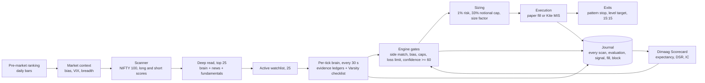
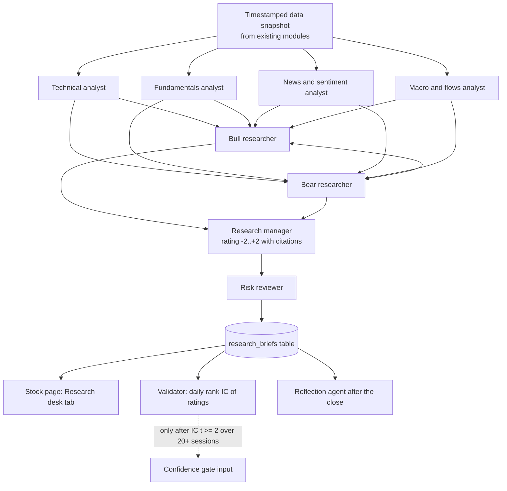

# Trader Sahab: full project brief for an external LLM review

Copy everything below the line into the reviewing model (a deep-research
mode works best for section 12). Snapshot taken 17 Sep 2026, about 03:00
IST, from the running backend and its SQLite journal. The numbers go stale
quickly, so regenerate them before reusing this brief.

---

## 0. Your role and the rules

You're reviewing a rules-based intraday trading agent as a quantitative
researcher and trading-systems engineer. I want concrete, testable
improvements to the trading flow, plus a design review of a proposed
multi-agent research layer (section 10).

1. **Never invent statistics.** Every number must come from this brief or
   from a source you name. "No evidence found" is useful. A made-up number
   is harmful.
2. **Label every claim** as either *measured* (give the source, market and
   timeframe) or *hypothesis*.
3. **Keep Indian evidence separate from foreign evidence.** Many pattern
   statistics come from US daily charts.
4. **Give codeable definitions** that use only the data listed in section 1.
5. **Say how each proposal would be validated** under this project's
   evidence bar (section 4). If a proposal can't be validated that way, say
   so.
6. **Don't recommend** any of these: trading more often as a goal,
   loosening the confidence gate to get trades, writing or selling options,
   futures, or asking an LLM to forecast prices.
7. **Date-stamp anything regulatory**, such as charges, SEBI algo rules or
   expiry days, and include circular numbers.

## 1. What the system is

- **Name and shape:** Trader Sahab, a single-user FastAPI backend with a
  React/Vite dashboard. One process holds all state and pushes it to the
  browser over a WebSocket.
- **Market:** NSE cash equities, NIFTY 100 universe. Intraday only (MIS),
  long and short. Everything is squared off at 15:15 IST. Options-buying
  (calls and puts only) is built but disabled.
- **Broker:** Zerodha Kite Connect for live quotes and orders. Paper mode is
  the default and the only mode used so far.
- **Capital:** ₹1,00,000 of paper capital. The linked real Kite balance is
  ₹5,500, too small to size any NIFTY 100 trade at 1% risk.
- **Data:** 5-minute bars from Kite, with yfinance (about 15 minutes
  delayed) as the fallback and for backtests. Also daily bars, NIFTY 50,
  India VIX, NSE filings, the results calendar, FII/DII flows, bulk/block
  deals, market breadth and TRIN, Google News RSS, optional
  Marketaux/Alpha Vantage, and Yahoo Finance fundamentals.
- **Costs:** the model uses Zerodha's intraday tariff: ₹20 or 0.03%
  brokerage per order, STT 0.025% on the sell side, exchange charges
  0.00297%, SEBI fees 0.0001%, stamp duty 0.003% on the buy side and GST
  18%. It adds 0.03% slippage per side. On the real trades, this came to
  **0.106% of notional per round trip**.
- **Cadence:** the engine loop runs every 30 s. The scanner runs every
  5 minutes while the market is open and every 60 minutes while it's
  closed.
- **Size:** about 9,200 lines of backend Python and about 3,000 lines of
  frontend JS/JSX. There are 89 pytest tests, and CI runs on every pull
  request.

## 2. End-to-end trading flow



| # | Stage | Module | What happens |
|---|---|---|---|
| 1 | Pre-market ranking | `scanner.run_premarket()` | Daily bars only, before 09:15. Seeds the watchlist. |
| 2 | Market context | `scanner.py` | Uses the NIFTY EMA20/50 trend, the day's change and breadth (≥ 60% of stocks up adds to the score, ≤ 40% subtracts). India VIX ≥ 20 halves new position sizes. The result is a bias of risk-on, neutral or risk-off. Risk-off blocks new longs and risk-on blocks new shorts. |
| 3 | Universe ranking | `scanner.py` | **Filters:** price ≥ ₹100, turnover ≥ ₹50 cr, daily ATR ≥ 1.2% and gap ≤ 3%. Stocks with results due today or next session are excluded. **Scoring:** each stock is scored as a long *and* as a short, and the stronger side is kept (minimum score 20). Inputs are daily trend, 10-day relative strength vs NIFTY, distance from the 52-week high or low, NR7/inside day, RSI, Bulkowski daily patterns, Murphy reversal days, the gap, time-of-day relative volume, VWAP, the opening range, sector rank and news/filing catalysts. |
| 4 | Deep read | `scanner.py` → `trader_brain.py` | The top 25 by score get a full brain read with per-stock news and fundamentals. Their bull-minus-bear edge moves the score by up to ±15, giving `final_score`. |
| 5 | Active watchlist | `scanner.select_active()` | The top 25 by `final_score` whose daily trend agrees with their side, with at most 2 against the market bias. Pinned stocks and open positions are always included. (README §2's table still says 15 and 6. The config says 25 and 25, per README §25.) |
| 6 | Per-tick evaluation | `trading_engine._process_symbol()` → `trader_brain.trader_brain_signal()` | Runs every 30 s per watched stock on the latest 5-minute candles (250-bar lookback, at least 80 bars). **Bull and bear evidence ledgers** cover trend/EMA, VWAP, swing structure, CPR, the 15-minute trend, MACD/RSI/stochastic read by regime (ADX), Bollinger bands in ranges, volume and OBV divergence, breakouts, S/R location, candlestick patterns (weighted by location), news and fundamentals. It then runs the Varsity checklist for each side. |
| 7 | Varsity checklist | `trader_brain._checklist()` | **Required:** (1) a candlestick pattern of the right bias whose range is 0.3–3× ATR (24 patterns). (2) The pattern's stop sits within 0.5 ATR of a real level: a swing level with ≥ 2 touches, the prior day's H/L/C, the opening range, a Fibonacci level or the CPR. (3) Signal-bar volume above 1.0× its 10-bar average. (4) The trend agrees: the 15-minute trend or swing structure (Dow), *or* Brooks' always-in direction. (5) Reward:risk ≥ 1.5 after 0.12% costs. The target is the first level beyond entry that clears 1.5R within 3 ATR, else the nearest level, else 2R. **Size-only:** MACD and RSI agree, news isn't contrary (score × side ≥ −0.15) and fundamentals aren't contrary (score × side ≥ −1.0). Any size-only miss means 60% size. **Vetoes:** news ≤ −0.5 blocks longs and news ≥ +0.5 blocks shorts. **Discipline:** entries only 09:30–14:30, one entry per stock per day, and nothing fires if both sides pass. |
| 8 | Engine gates | `trading_engine._try_enter()` | The signal side must match the scanner's side for that stock, and the market bias must allow it. No untracked Kite position may exist for the stock. At most 3 open positions and 1 per sector. The daily loss limit is 2% of capital. The confidence gate (section 3) needs a score of at least 60. |
| 9 | Sizing | `risk_manager.position_size()` | qty = min(1% of capital ÷ stop distance, 33% of capital ÷ price), then × 0.5 if VIX ≥ 20, then × the size factor (1.0 or 0.6). |
| 10 | Execution | `paper_broker.py` / `kite_broker.py` | **Paper:** fills at LTP ± 0.03% slippage, with charges computed separately. **Live:** a Kite MIS market order. **F&O (off):** a call or put near delta 0.45 with 5–35 days to expiry. Premium stop −40%, target +80%, and at most 20% of a ring-fenced ₹10,000 at risk. |
| 11 | Exits | `trading_engine.py` | The pattern stop, the level target, veto exits and the 15:15 square-off. A step-trailing stop exists but is off. |
| 12 | Journal | `database.py` (SQLite) | Records every scan and scan row, every checklist evaluation (both sides), every signal, fill and blocked entry with its reason, and every F&O evaluation. It feeds the Scorecard, blocker statistics, factor IC and the CSV export. |

## 3. The confidence gate: exact math

`confidence.score_trade()` works like this:

- **Local score (0–100)** is the sum of three parts:
  - edge = min(40, 8 × max(0, (winning ledger − losing ledger) − 2.0))
  - breadth = min(30, confirming categories ÷ 3 × 30)
  - regime = min(1, ADX ÷ 25) × 30
- **System multiplier** comes from the Scorecard. It's 1.0 if all three
  rows pass and 0.25 if any row fails or there's no data. It's 0.6 when the
  rows are "not enough data" and none fails.
- **Final score** = round(local × multiplier). It must be at least 60 to
  trade, for both cash and F&O.

Today all three Scorecard rows are "not enough data", so the multiplier is
0.6. **The ceiling is therefore exactly 60, so only a perfect local score
of 100 can trade.** That means an edge at least 7 points above the minimum,
at least 3 confirming categories and ADX ≥ 25, all at once. A real
example: HDFCLIFE "Hanging Man (short)" scored 84 locally, × 0.6 = 50, so
it was blocked.

README §38 already flags what comes next. Once 20 sessions of scan data
exist, the live ranking's IC may behave like the 434-session replay (mean
0.000). If it does, the IC row fails and the multiplier drops to 0.25.
The maximum score becomes 25, and paper entries effectively stop. That's
the intended behavior.

## 4. The evidence bar: how this project decides something works

- **Dimaag Scorecard:**
  - *Expectancy:* needs ≥ 10 closed trades. Passes if it's above 0R (Tharp).
  - *Deflated Sharpe Ratio:* needs ≥ 10 trades. Passes if DSR ≥ 0.95
    (Bailey & López de Prado 2014). Every backtest trial ever run is logged
    to `backtest_trials.json`, so the trial count is honest.
  - *Information Coefficient:* one Spearman rank IC per session transition
    with at least 20 stocks, averaged over at least 20 sessions. Passes only
    if the mean is above 0 **and** the t-stat is ≥ 2 (Grinold).
- **New signal research follows a fixed order (GitHub issue #12):** first a
  daily rank IC with no trading rule attached (t ≥ 2 over ≥ 20 sessions).
  Only then a benchmark-relative backtest (the picks vs every stock under
  the same rules) with a held-out period. Every attempt is logged.
- **Backtests** run the same strategy, risk and confidence code with real
  costs. They're judged on both halves of the sample, or on a selection
  period vs the last 20 sessions held out.
- **Look-ahead audit (README §40):** there are no centered windows,
  negative shifts or global normalization. News and results-day data aren't
  replayed in backtests. The backtester fills at the signal bar's close,
  which is tracked as issue #13.

## 5. Backtest statistics

### 5.1 55 days of 5-minute bars (29 Jun – 11 Sep 2026), ₹1 lakh, real costs

| Setup | Trades | Win % | Net |
|---|---|---|---|
| SMA crossover, 4 fixed stocks | 108 | 19% | −7.9% |
| Confluence brain, 4 stocks, unlimited re-entries | 452 | 19% | −29.1% |
| Confluence brain, 4 stocks, 1 entry per stock per day | 162 | 21% | −10.5% |
| Confluence brain + scanner top 5 per day | 218 | 20% | −13.7% |
| Same on 15-minute bars, 4 stocks | 103 | 23% | −6.3% |
| 15-minute bars, scanner top 5 per day | 177 | 23% | −14.5% |
| Confluence, scanner top 5, long + short | 146 | 25% | −8.5% |
| **Varsity checklist (current default), 4 stocks** | 6 | 17% | −0.5% (−0.69R per trade, Kelly −36%) |
| **Varsity checklist, scanner top 10, NIFTY 100** | 19 | 26% | −1.9% (−0.60R per trade, Kelly −43%) |

Gross P&L was negative in every row, so the losses aren't only a cost
problem.

### 5.2 Entry-parameter grid search (README §35)

This searched `min_confidence_to_trade` (40/50/60/70) against `min_rrr`
(1.2/1.5/1.8): 12 configurations over the same 55 days on the NIFTY 100,
top 5 per day, ranked by DSR. **None cleared DSR ≥ 0.95.** The best was
60/1.5 (10 trades, 30% wins, −0.472R, DSR 6.2%), which is already the
default. Configurations with confidence 70 never traded.

### 5.3 Why the checklist loses (README §36): trade-level analysis, confidence gate off

| Configuration | Trades | Win | Gross R | Net R | Cost R | Median stop | Held-out net R |
|---|---|---|---|---|---|---|---|
| Checklist @ 5m (live logic) | 37 | 19% | −0.42 | −1.09 | 0.56 | 0.19% | −1.32 |
| Checklist @ 30m | 25 | 28% | −0.15 | −0.50 | 0.16 | 0.68% | −0.30 |
| No-timing baseline @ 5m (09:45 entry, 1.5 ATR stop, 3 ATR target) | 162 | 33% | −0.12 | −0.37 | 0.24 | 0.44% | −0.41 |
| No-timing baseline @ 30m | 169 | 33% | −0.10 | −0.24 | 0.14 | 0.75% | −0.40 |

What this shows:

- On 5-minute bars, the pattern stops sit close enough that costs take
  0.56R per trade.
- On the same picks, candlestick timing does *worse* than simply entering
  at a fixed time.
- 30-minute bars cut friction by about 70%.
- Nothing is profitable in both the selection and held-out periods. Every
  DSR is far below 95%.

### 5.4 Multi-day holds and ranking skill (README §37): 2 years of daily bars, 434 sessions

| Hold | Pick trades | Picks net R | Every-stock benchmark net R | Picks minus benchmark (all / selection / held-out) |
|---|---|---|---|---|
| 1 session | 2,085 | −0.057 | −0.049 | −0.008 / −0.007 / −0.010 |
| 2 sessions | 1,309 | −0.132 | −0.110 | −0.022 / −0.014 / −0.034 |
| 3 sessions | 995 | −0.156 | −0.133 | −0.023 / −0.026 / −0.018 |
| 5 sessions | 656 | −0.201 | −0.178 | −0.023 / −0.004 / −0.051 |

- **The scanner's daily ranking has no measurable skill.** Mean daily IC
  is **0.000 (t = 0.00)** against open-to-close returns, and −0.002
  (t = −0.25) against close-to-close. It's positive on 50% of days.
- **An earlier "+0.29 IC" result was a mistake.** It came from a single
  day's cross-section, on a day the whole market fell, and has been
  corrected.
- **Untested caveat:** the live `final_score` also uses news, results-day
  flags, intraday relative volume and the brain read, none of which can be
  replayed on daily bars.

## 6. Live paper-trading statistics (real journal)

The journal has logged since 13 Sep 2026. Live checklist evaluations cover
the 15 and 16 Sep 2026 sessions.

| Metric | Value |
|---|---|
| Scans logged | 233 (23,290 scan rows) |
| Checklist evaluations | 26,112 rows (each has a long and a short side) |
| Signals | 33 |
| Fills | 10, which is 5 closed round trips; 0 open |
| F&O | disabled; 0 evaluations |
| LLM headline sentiment / Chaywanaprash analyst | not configured in this deployment (no API key) |

| Stock | Setup (all shorts) | Entry (IST) | Stop distance | Held | Notional | Gross P&L | Charges | Net P&L | Gross R | Net R | Exit |
|---|---|---|---|---|---|---|---|---|---|---|---|
| BEL | Hanging Man | 15 Sep 12:23 | 0.141% | 7 min | ₹19,482 | −₹30.00 | ₹20.67 | −₹50.67 | −1.09 | −1.84 | stop |
| ENRIN | Bearish Marubozu | 16 Sep 09:37 | 0.705% | 18 min | ₹17,865 | −₹146.36 | ₹19.00 | −₹165.36 | −1.21 | −1.37 | stop |
| BPCL | Bearish Engulfing | 16 Sep 10:03 | 0.314% | 50 min | ₹19,728 | −₹71.26 | ₹20.94 | −₹92.20 | −1.27 | −1.64 | stop |
| TMPV | Hanging Man | 16 Sep 11:22 | 0.080% | 38 s | ₹19,572 | −₹21.50 | ₹20.76 | −₹42.26 | −2.21 | −4.33 | stop |
| TCS | Bearish Engulfing | 16 Sep 11:28 | 0.161% | 93 min | ₹17,757 | +₹86.17 | ₹18.79 | +₹67.38 | +3.71 | +2.90 | target |

- **Totals:** gross −₹182.95, charges ₹100.15, net **−₹283.10**. One of
  five trades won (20%).
- **Expectancy:** −0.41R gross, which is what the Scorecard shows, but
  **−1.26R after charges**. Charges averaged 0.84R per trade.
- **Average loss:** −1.44R gross against a planned 1R, because stop fills
  came beyond the stop price.
- **Scorecard today:** all three rows read "not enough data": expectancy
  has 5 of the 10 trades it needs, DSR the same, and IC has 2 of 20
  sessions (200 pairs). That's why the multiplier is 0.6.
- **"Dimag ki batti"** (which daily pattern works best): no pattern has
  20 independent observations yet.
- **Five trades can't say anything about edge.** Their value is in the
  mechanisms they expose (section 8).

## 7. What blocks entries (live checklist statistics)

These cover the 24 hours before the snapshot, which is the 16 Sep session:
28,240 checklist sides were evaluated.

| Required item | Pass rate |
|---|---|
| Trend agrees (Dow or Brooks) | 71.6% |
| Volume > 1.0× its 10-bar average | 12.2% |
| Candlestick pattern | 10.6% |
| Stop at support/resistance | 7.7% |
| Reward:risk ≥ 1.5 | 4.0% |

- **Near misses** (every required item passed except one): volume 438,
  reward:risk 212, S/R 21, trend 12. The pattern item is never the lone
  blocker, because without a pattern there's no stop, so S/R and
  reward:risk fail too.
- **Reward:risk,** where computable (n = 2,953): median 0.09, mean 0.69,
  with 38.2% at or above 1.5.
- **Volume ratio** (n = 28,240): median 0.3×, mean 0.55×, with 6.5% at or
  above 1.5×. Finding F1 shows this is mostly a measurement artifact.
- **Blocked signals:** these are the 18 most recent that passed the
  checklist but were still refused.
  - 16 were refused because the signal side disagreed with the scanner's
    side for that stock. In 13 of those, a bullish reversal candle
    appeared on a stock ranked short. In the other 3, a bearish candle
    appeared on a stock ranked long.
  - 1 was refused by the confidence gate (HDFCLIFE, 50 < 60).
  - 1 was refused by the one-position-per-sector cap (ABB).

## 8. New verified findings from this review

Status as of 17 Sep 2026, 14:50 IST:

- **F1** is fixed and live (issue #18, PR #20). The fix was deployed at 14:44 and verified on the engine's first tick afterwards: all 25 checklist reads were on finished candles.
- **F2** is issue #21 and **F3** is issue #25; both are open.
- **Also filed on 17 Sep:**
  - #22: a restart forgets the per-stock entry count.
  - #23: the engine stalls while Kite is disconnected.
  - #24: the Kite status shows "connected" after the session expires.
  - #28: the size factor rounds high-priced stocks down to much less, or to zero.

The full list is in `BUG_LOG.md`.

### F1. The live engine judges the still-forming 5-minute candle (fixed: #18, PR #20)

**Volume evidence.** From 26,112 logged evaluations on 15–16 Sep, the
volume ratio depends on how far into the bar the engine happened to look:

| Minute into the 5-minute bar | Evaluations | Median volume ratio | Share passing (≥ 1.0×) |
|---|---|---|---|
| 0 | 5,215 | 0.1× | 5.7% |
| 1 | 5,081 | 0.2× | 4.2% |
| 2 | 5,306 | 0.4× | 12.4% |
| 3 | 5,076 | 0.5× | 19.9% |
| 4 | 5,180 | 0.7× | 32.0% |

`indicators.volume_ratio()` compares the last bar's volume with the average
of the previous full bars. While that last bar is still forming, its volume
is partial.

**Pattern evidence.** In 3 of the 5 live entries, the pattern that
triggered the trade no longer existed once the bar closed:

- BEL's Hanging Man became a Doji.
- ENRIN's Bearish Marubozu became no pattern.
- TMPV's Hanging Man became no pattern.

All three were stopped out. BPCL's and TCS's patterns survived. Every entry
fired 133–219 s into its bar. This was checked by re-fetching the completed
bars through the same `data_provider.get_intraday_candles()` the engine
uses and running the same `detect_patterns()`. The sample is small, and the
re-fetched bars could differ slightly from what the engine saw mid-bar.

**Why it matters.** The volume and pattern rules were written for completed
candles, and the backtests use completed candles. So the live engine isn't
running what was backtested. README lists "live analysis uses the
still-forming candle" as a limitation, but its size hadn't been measured
before.

**Candidate fix and test.** Evaluate only closed bars: ignore the last
candle until its 5-minute window has ended, then act within seconds of each
close. To validate, add a parity test: the live decision on a recorded tick
stream should equal the backtester's decision on the same completed bars.

### F2. Recorded P&L leaves out brokerage and taxes (open: #21)

**Cause.** `state.apply_fill()` sets realized = (fill − average price) ×
quantity. Slippage is inside the fill prices. Brokerage, STT, exchange
fees, GST and stamp duty are stored separately as `charges` and never
subtracted.

**Affected:**

- The header's "Realized today".
- The Trades page's "net P&L" sentence and its P&L and Net columns. Those
  columns were added on 16 Sep with a code comment that wrongly says they
  are net of charges.
- The 2% daily loss limit (`risk_manager.daily_loss_limit_hit`).
- The live Scorecard's R-multiples, expectancy and Kelly.

The backtester *does* subtract costs, so live R and backtest R aren't
comparable today.

**Size of the gap.** Across the 5 trades: gross −₹182.95 vs net −₹283.10,
and expectancy −0.41R vs −1.26R.

### F3. The notional cap sets position size, not the 1% risk rule, so fixed costs dominate R (open: #25)

**What happened.** Pattern stops sat 0.08%–0.71% from entry. Risking 1%
over that distance would need ₹1.4–12.5 lakh of notional, so the 33% cap
(₹33,000) bound on every trade. The 60% size factor then brought each trade
to about ₹19,800 (whole shares, so ₹17,757–19,728).

**The result.** Actual risk was ₹9.75–₹120.60 per trade, or 0.01%–0.12% of
capital. Charges were an almost fixed ₹19–21 per round trip. TMPV is the
extreme case: its stop was 0.080% away and costs were 0.106%, so charges
alone came to 2.13R, and it lost 4.33R net in 38 seconds.

**The link to backtests.** This is the live version of README §36's
friction finding: costs took 0.56R per trade in backtests and 0.84R per
trade live.

**Fixes to test:**

- A floor on stop distance as a multiple of round-trip cost (for example,
  stop ≥ 3× cost).
- A minimum net-R-after-costs filter.
- Structural stops on 15- or 30-minute bars.

### F4. The confidence gate's ceiling equals its bar

With the multiplier at 0.6 and the bar at 60, only a local score of exactly
100 can trade. See section 3.

### F5. Most checklist passes are refused for side disagreement

**What happens.** The pattern points one way and the scanner ranked the
stock the other way. It's usually a bullish reversal candle on a stock
ranked short.

**Open question.** Are these refusals correct, because they avoid
counter-trend trades, or is the scanner's side too sticky within the day?
Nothing records what a refused signal would have done, so this can't be
measured yet.

### F6. Every live trade so far was a short

All 5 came on two sessions where the market bias favored shorts, and no
live long has been taken. The sample is too small to say anything about
long/short asymmetry.

## 9. Known limitations and open issues

- **No edge yet.** Every backtest is net-negative, for cash equity and
  F&O alike. F&O itself has never been backtested; only its
  pricing/Greeks/sizing math is unit-tested.
- **F&O borrows cash equity's Scorecard.** Whether that's right is an
  untested assumption.
- **Short-side gaps.** Cash shorts are MIS only. There's no check for
  short-sell bans or circuit limits, and no Market Wide Position Limit
  check for F&O (issue #2: NSE's endpoint couldn't be verified).
- **Live-only inputs can't be backtested.** News, gaps, intraday relative
  volume and results-day filters have no historical record here.
- **Live analysis uses the forming candle.** See F1.
- **Restarts lose live state.** Positions and the watchlist reset; only
  history is persisted. An untracked real Kite position is detected but not
  healed.
- **Single user, basic security.** An API key gates every route, but
  there's no per-user auth, rate limiting or HTTPS termination.
- **LLM sentiment's effect on IC is unmeasured.**
- **Account size is a real constraint.** At 1% risk, the real ₹5,500
  account sizes almost every NIFTY 100 trade to 0 shares.
- **Pre-market ranking uses only the last completed daily candle**, with no
  live pre-open price.
- **Open GitHub issues:**
  - #2 Verify NSE's MWPL ban-list endpoint.
  - #3 Accumulate real trade history to unlock the Scorecard.
  - #4 ML feature-research direction.
  - #12 New signal research must clear the daily-IC bar first.
  - #13 Document and test the backtester's same-bar-close fill convention.

## 10. A multi-agent research layer (like TradingAgents): mapping and proposed design

### 10.1 What TradingAgents is

This comes from its README, fetched from `TauricResearch/TradingAgents` on
16 Sep 2026.

- **Structure:** Apache-2.0, built on LangGraph.
- **Pipeline:**
  1. An analyst team (fundamentals, sentiment, news/macro and technical)
     writes reports.
  2. Bull and bear researchers debate them, and a research manager rules.
  3. A trader drafts the trade.
  4. A risk team (aggressive, neutral and conservative) reviews it.
  5. A portfolio manager approves or rejects it and sends it to a
     *simulated* exchange.
- **Memory:** it keeps a decision log. On later runs it adds realized
  returns and a written reflection to the portfolio manager's prompt.
- **Its own caveats:** its README says it's designed for research and is
  not trading advice. It says two runs on the same ticker and date can
  differ. Version 0.4.0 added "Trader price grounding" and point-in-time
  fixes, meant to stop fabricated price levels and look-ahead.
- **Markets:** it works on Yahoo Finance tickers, including `.NS`.

### 10.2 How its roles map onto Trader Sahab today

| TradingAgents role | Trader Sahab today | Deterministic? |
|---|---|---|
| Technical/market analyst | `scanner.py` plus the `trader_brain.py` ledgers and checklist | Yes |
| Fundamentals analyst | `fundamentals.py` (ROE, operating margin, PEG, debt/equity), used as a size tilt only | Yes |
| News/sentiment analyst | `news_sentiment.py`, plus optional `llm_sentiment.py` headline tone (Claude Haiku) | Lexicon yes; LLM optional |
| Macro/flows analyst | `nse_feed.py` (FII/DII, bulk/block deals, breadth/TRIN), `sectoral_indices.py`, VIX, `seasonality.py` | Yes |
| Bull vs bear researchers | The bull and bear evidence ledgers in `trader_brain.py` | Yes |
| Trader | The checklist's entry/stop/target plan | Yes |
| Risk team | `risk_manager.py`, the market filter, sector cap and daily loss limit | Yes |
| Portfolio manager | The confidence gate (local × Scorecard multiplier ≥ 60) | Yes |
| Decision log and reflection | Sahab's Journal, the Dimaag Scorecard, and `chaywanaprash.py` (a read-only Claude Sonnet analyst over journal stats) | Stats yes; analyst is an LLM |

- **What's missing compared with TradingAgents:** a written research brief
  per stock that argues both sides from all the evidence, and a written
  reflection loop.
- **What's excluded on purpose:** any LLM output that drives orders.

### 10.3 Proposed design: "Sahab's Research Desk"

**Principles**

- **Agents write research, never orders.** The live gate stays
  deterministic. An agent's rating can only become an input after it clears
  section 4's bar, like any other signal.
- **Every number an agent cites comes from a tool call** into an existing
  module, collected into a timestamped snapshot. Output is JSON checked
  against a schema, and any figure that isn't in the snapshot is rejected.
- **Point-in-time.** Nothing after the snapshot timestamp is visible to the
  agents, so briefs can be replayed later without look-ahead.
- **Budget-capped and cached,** following the same pattern as
  `llm_sentiment.py`: a daily call limit, token and cost tracking, and an
  on/off switch. Off by default.
- **Off the hot path.** Briefs run pre-market for the active watchlist and
  on demand from the stock page. They never block the 30-second engine
  loop.

**Agent roster**

| Agent | Model tier | Tools (existing functions) | Output |
|---|---|---|---|
| Technical analyst | Fast | `trader_brain_signal()` analysis, scanner reasons, `swing_patterns`, levels | A stance and the three strongest pieces of evidence, with levels from the snapshot |
| Fundamentals analyst | Fast | `fundamentals.get_fundamentals()`, NSE results calendar | A quality read, red flags, days until results |
| News and sentiment analyst | Fast | `news_sentiment.get_sentiment()` headlines, NSE filings | A catalyst summary and a flag if the news contradicts the scanner's side |
| Macro and flows analyst | Fast | Market bias, VIX, breadth/TRIN, FII/DII, sector trend | A regime read |
| Bull researcher / bear researcher | Deep | The four reports | The best case for each side (one round by default) |
| Research manager | Deep | Reports plus the debate | A rating on a fixed 5-point scale (−2 to +2), key risks and what would change the view, each point citing snapshot fields |
| Risk reviewer | Fast | Sizing preview, stop distance vs cost ratio, sector exposure, Scorecard state | Risk flags, for example "stop is narrower than 3× round-trip costs" |
| Reflection agent (after the close) | Deep | The day's trades, blocked signals, blocker stats, and ratings vs realized returns | A lessons note in the journal (no parameter changes) |
| Validator (not an LLM) | — | `daily_ranking_ic()` over the logged ratings | IC, t-stat and session count, which decide whether a rating may ever feed the gate |



**Storage and API**

- A new table, `research_briefs`, with these columns: `ts`, `symbol`,
  `snapshot_json`, `reports_json`, `rating`, `model_ids`, `tokens` and
  `cost_usd`.
- Endpoints: `GET /api/research/{symbol}` and `POST /api/research/run`.
- A "Research desk" tab on the stock page showing each report, the debate,
  the rating and its citations.

**Evaluation plan**

- Each session, compute the Spearman IC between the ratings and the
  next-session return across all rated stocks (at least 20 per session).
- After at least 20 sessions, a t-stat ≥ 2 is required before the rating is
  even considered as a confidence input. Even then, it goes in only after a
  benchmark-relative backtest on the logged briefs.
- Also track the brief's agreement rate with the deterministic checklist
  and the cost per brief.

**Risks to review**

- **Run-to-run variation.** TradingAgents documents this for its own runs.
- **Invented numbers,** mitigated by grounding plus schema checks.
- **Look-ahead in any replay.** News fetched "now" for a past date leaks
  the future, which TradingAgents' README also warns about.
- **Anchoring.** Agents may rationalize whatever side the scanner picked.
- **Cost and latency.**

**Prerequisite.** `ANTHROPIC_API_KEY` isn't configured in this deployment:
`llm_sentiment` and `chaywanaprash` both report `configured: false`.

## 11. Improvement directions already on the table

Ranked by expected value relative to risk:

1. **Closed-bar evaluation (F1):** restores parity between live trading and
   backtests.
2. **Net-of-charges accounting (F2):** fixes the display, the daily loss
   limit and the Scorecard's R.
3. **Cost-aware stop floor or a minimum net-R filter (F3):** test it on
   15- and 30-minute bars, where §36 measured friction about 70% lower.
4. **Log what refused signals would have done** (side disagreement and the
   confidence gate), to measure whether each gate helps.
5. **New signal research, IC first:** short-horizon momentum, post-results
   drift, FII-flow tilts, the new fundamentals score, and an agent rating
   (section 10). Tracked as issue #12.
6. **Record live news and scanner snapshots** so live-only inputs can be
   replayed.
7. **Separate thresholds per side, structure-based stops, and an F&O
   backtest** before F&O is ever enabled.

## 12. Questions for you

1. Is there published evidence, Indian preferred, that intraday candlestick
   patterns on 5-, 15- or 30-minute bars have any edge after costs in large
   caps? Give sources, markets and timeframes.
2. Given F3, what's a principled minimum stop distance relative to
   round-trip cost? How should it interact with a reward:risk floor?
3. Is closed-bar-only evaluation the right fix for F1, or is there a better
   standard practice? What parity test would you write?
4. The daily cross-sectional IC here is about 0.00. Which documented
   Indian-market effects are most worth testing first under section 4's
   bar? Candidates include post-earnings drift, short-term reversal, FII
   flows and delivery percentage. Give a codeable definition, source and
   sample period for each.
5. Review section 10's agent design. What would you change so an LLM
   research layer can be measured honestly? How should ratings become a
   rank signal? How many sessions and stocks are needed for a meaningful IC
   at realistic IC levels (0.02–0.05)?
6. Is the confidence gate's structure (local score × Scorecard multiplier)
   sound? Would a different formulation be more informative once 10–20
   trades exist?
7. Which SEBI retail-algo rules from 2025–2026 apply to one person running
   this through Kite Connect (static IP, order-rate limits, algo IDs)? Give
   dates and circular numbers.
8. Is anything missing from the cost model in section 1 as of 2026? Cite
   the tariff page and its date.

## 13. What to send back

- **A ranked list of improvements.** For each one, give:
  - the problem
  - the evidence (source, market, timeframe)
  - an exact codeable definition
  - which module or function changes
  - the validation plan under section 4 (IC, then a benchmark backtest,
    then held-out results, with a DSR trial logged)
  - expected failure modes
  - rough effort
- **A separate review of the agent design** in section 10.
- **A list of claims you couldn't source.**

## Appendix A: live config values (17 Sep 2026)

```json
{
  "STRATEGY": "sahab_dimaag",
  "CANDLE_INTERVAL": "5m",
  "POLL_INTERVAL_SECONDS": 30,
  "RISK": {
    "max_risk_per_trade_pct": 1.0, "max_open_positions": 3, "max_positions_per_sector": 1,
    "max_position_notional_pct": 33.0, "max_daily_loss_pct": 2.0, "min_confidence_to_trade": 60,
    "paper_capital": 100000, "sync_capital_with_kite": true, "use_atr_risk": true,
    "atr_period": 14, "atr_sl_multiplier": 1.5, "atr_tp_multiplier": 3.0, "trail_after_r": null
  },
  "STRATEGY_PARAMS.sahab_dimaag": {
    "entry_mode": "checklist", "entry_threshold": 6.0, "min_confirmations": 3, "min_edge": 2.0,
    "exit_threshold": 5.0, "no_entry_before": "09:30", "last_entry_time": "14:30",
    "max_entries_per_day": 1, "allow_shorts": true, "min_rrr": 1.5, "sr_tolerance_atr": 0.5,
    "volume_lookback": 10, "indicator_miss_size": 0.6, "min_pattern_atr": 0.3, "max_pattern_atr": 3.0,
    "cost_pct": 0.12, "rrr_without_level": 2.0, "use_news": true, "news_weight": 2.0,
    "news_veto": -0.5, "use_fundamentals": true, "fundamentals_weight": 1.5
  },
  "SCANNER": {
    "interval_minutes_open": 5, "interval_minutes_closed": 60, "active_count": 25,
    "deep_analysis": 25, "counter_trend_active_count": 2, "allow_shorts": true, "min_score": 20,
    "min_price": 100, "min_turnover_cr": 50, "min_atr_pct": 1.2, "max_gap_pct": 3.0,
    "use_news": true, "use_fundamentals": true
  },
  "MARKET_FILTER": {
    "block_new_longs_when_risk_off": true, "block_new_shorts_when_risk_on": true,
    "vix_high": 20.0, "vix_high_size_multiplier": 0.5
  },
  "FNO": {
    "enabled": false, "capital": 10000, "max_premium_risk_pct": 20.0, "min_confidence_to_trade": 60,
    "index_underlyings": ["NIFTY", "BANKNIFTY"], "min_days_to_expiry": 5, "max_days_to_expiry": 35,
    "target_delta": 0.45, "stop_loss_pct_of_premium": 40.0, "target_pct_of_premium": 80.0,
    "risk_free_rate_pct": 7.0
  },
  "COSTS": {
    "brokerage_per_order": 20.0, "brokerage_pct": 0.03, "stt_pct_sell": 0.025,
    "exchange_txn_pct": 0.00297, "sebi_charges_pct": 0.0001, "stamp_duty_pct_buy": 0.003,
    "gst_pct": 18.0, "slippage_pct": 0.03
  }
}
```

## Appendix B: key modules

| Module | Role |
|---|---|
| `trading_engine.py` | The 30-second loop: scan → per-stock brain → gates → sizing → execution → journal |
| `scanner.py` | NIFTY 100 ranking, market context, pre-market ranking |
| `trader_brain.py` | Evidence ledgers and the Varsity checklist, shared by cash and F&O |
| `confidence.py` | The confidence gate |
| `evaluation.py` | Deflated Sharpe Ratio and the Dimaag Scorecard |
| `risk_manager.py`, `costs.py` | Sizing, caps, daily loss limit and the cost model |
| `candlestick_patterns.py`, `market_structure.py`, `indicators.py`, `brooks.py`, `swing_patterns.py`, `bulkowski.py` | Technical building blocks |
| `news_sentiment.py`, `llm_sentiment.py`, `sentiment_lexicon.py`, `nse_feed.py`, `fundamentals.py`, `sectoral_indices.py`, `seasonality.py` | Context inputs |
| `options_pricing.py`, `fno_instruments.py`, `fno_risk.py` | Options-buying |
| `database.py` | Sahab's Journal (SQLite): scans, evaluations, signals, trades, blocks, factor IC |
| `backtester.py`, `swing_backtester.py`, `tune_entry_params.py`, `diagnose_entry_edge.py` | Backtests and diagnostics |
| `chaywanaprash.py` | A read-only LLM analyst over journal statistics |
| `paper_broker.py`, `kite_broker.py`, `data_provider.py`, `state.py`, `app.py` | Plumbing |

## Appendix C: sources the rules come from

- Zerodha Varsity: Technical Analysis (the Grand Checklist), Risk
  Management, Futures Trading, and Markets and Taxation.
- Nison, *Japanese Candlestick Charting Techniques*.
- Bulkowski, *Encyclopedia of Chart Patterns*.
- Brooks, *Trading Price Action Trends*.
- Murphy, *Technical Analysis of the Financial Markets*.
- Tharp, *Trade Your Way to Financial Freedom*.
- NISM Series VIII (Equity Derivatives).
- Bailey & López de Prado (2014), the Deflated Sharpe Ratio.
- Grinold on the Information Coefficient, as cited in Jansen, *Machine
  Learning for Algorithmic Trading*.
- Two SEBI studies, as cited in the project README:
  - Jul 2024: 71% of individual intraday cash traders lost money in FY23,
    rising to 80% above 500 trades a year.
  - Sep 2024: 93% of individual F&O traders lost money over FY22–FY24.
